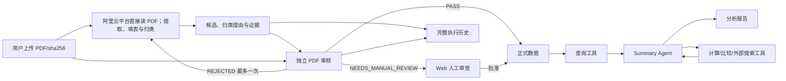

# 00 项目总体架构

## 目标与边界

面向港股公司，保存可追溯的水资源披露数据，支持跨公司、跨年份、跨报告版本查询。LLM 负责文档理解、候选提取、语义分类、独立复核与解释；Python 负责校验、持久化、状态迁移、计算和工具执行。当前实现范围为提取、分类、审核、人工复核、入库与基础分析；公式和评分仅预留接口。

## 三个 Agent 与数据入库阶段

1. `ExtractionAgent`：读取原 PDF，提取数据、填写结构化字段并完成指标归类，产出带证据的 `ExtractionCandidate`；允许 UNKNOWN。
2. `AuditAgent`：独立重新读取 PDF，核对候选、分类和证据，产出 `AuditDecision`。`REJECTED` 最多重试一次；`NEEDS_MANUAL_REVIEW` 进入 Web 审查队列。人工批准后才入正式表。
3. `SummaryAgent`：只查询已批准正式数据，通过动态工具调用生成证据化分析。缺公式时返回 `UNAVAILABLE_FORMULA`。

## 核心约束

- PDF 原件以不可变对象存储；提取阶段不运行本地 PDF 解析/OCR，SHA-256 标识内容；每条事实关联报告版本、页码、原文和必要上下文。截图与坐标可空；首版以 PDF 物理页码、逐字证据和上下文定位，无法确认时转人工。
- `candidate_id`、`audit_id` 均不可复用；修正创建新版本，通过 `supersedes_id` 关联。
- 业务数据、执行历史、临时上下文、任务 checkpoint 分开存储。
- PostgreSQL 为生产数据库；对象存储保存原 PDF；本地开发可用 MinIO。任务队列可先使用数据库任务表，规模增长后替换为 Redis/Celery。
- 多租户场景所有查询加 `tenant_id` 权限过滤；外部搜索资料不得写入企业披露事实表。
