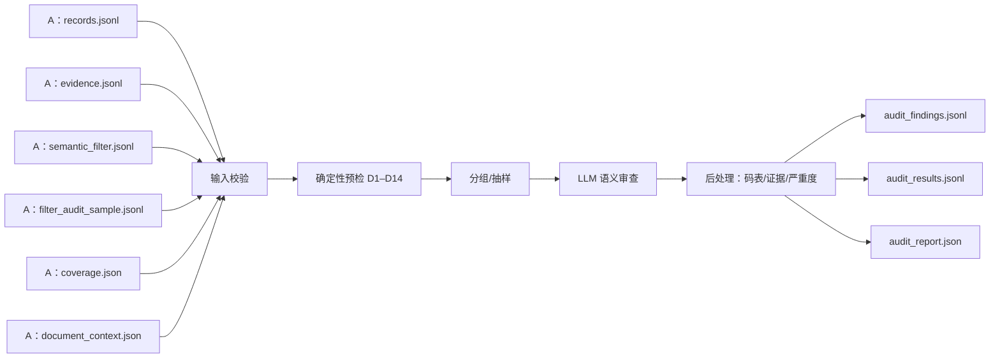

# 开发者 B 开发规范：审查 Agent

> 文档编号：ESG-B-AUD-001  
> 版本：3.0（第一阶段聚焦版）  
> 范围：只实现审查 Agent；数据契约引用 `A_开发文档.md` §3  
> 读者：开发者 B  
> 依赖：A 的过滤/归类产物（`records.jsonl`、`evidence.jsonl`、`semantic_filter.jsonl`、`filter_audit_sample.jsonl`、`coverage.json`、`document_context.json`）

---

## 0. 使用说明与范围

### 0.1 本文地位

1. 本文是开发者 B 的唯一开发依据，第一阶段**只覆盖审查 Agent**：输入校验、确定性预检、LLM 语义审查、finding 输出、逐记录结论、网站队列、测试与交接。
2. 公共数据模型、枚举、接口以 **A 文档 §3** 为唯一权威；本文只写“读哪些字段 / 写哪些字段 / 不满足怎么办”，不另定义模型。
3. 本文不实现存储、Planner、复核 CLI、Web、S6/S7/S8。
4. 审查 Agent **不修改** A 的任何产物；只写 `audit_findings.jsonl`、`audit_results.jsonl`、`audit_report.json`、`review_items.jsonl`。

### 0.2 与 A 文档的关系

| 场景 | 正确做法 | 返工做法 |
| --- | --- | --- |
| 需要 `ClassificationRecord` 字段 | 引用 A §3.4.6，只列读写字段 | 另画一张字段不同的表 |
| 需要 `AuditFinding` | 引用 A §3.4.8，逐字使用字段 | 改名、少字段 |
| 需要状态枚举 | 引用 A §3.3 | A/B 各一套 |
| 需要新增字段 | 提变更说明，A 同意后同改 A/B + `schemas/` | 先改代码后补文档 |
| 需要读原始证据 | 通过 `evidence_version_id` 关联 | 复制整份 PDF 文本 |
| 需要判断过滤遗漏 | 读 `filter_audit_sample.jsonl` | 声称“能看到全部被删数据” |

**边界一句话**：A 决定“记录是什么”，B 判断“这条记录与证据是否自洽”；B 不改 A 的数据，只产 finding 与 review_status。

### 0.3 本阶段范围

| 模块 | 本阶段 | 负责人 | 说明 |
| --- | --- | --- | --- |
| 审查 Agent（`auditor.py`） | **交付（唯一核心）** | **B** | 19 类 finding、逐记录 review_status、报告统计 |
| 审查 Skill（`skills/audit/`） | 交付 | B | prompt、码表、severity、examples、schema |
| 审查测试 | 交付 | B | 单元、契约、联合集成 |
| 过滤 Agent | 不实现 | A | 只读决策/样本 |
| 归类 Agent | 不实现 | A | 只读 records/evidence/coverage |
| 存储/数据库/导出 | 本阶段不做 | 后续 | 不建表、不写库 |
| Planner/任务调度/复核 CLI | 本阶段不做 | 后续 | 不实现 |
| Web/API、S6/S7/S8 | 本阶段不做 | 后续 | 不建接口 |

## 1. 当前输入事实（唯一基线）

### 1.1 当前仓库有什么

| 输入 | 来源 | 回溯能力 |
| --- | --- | --- |
| v1 `evidence.jsonl` | OSS `numeric_blocks.json` → `scripts/esg_adapt_source.py --source v1` | 页级：`pid + page_no + content`；无 bbox/table_id/pdf |
| v2 `evidence.jsonl` | 本地三通道提取 | 区域级：`page_no + bbox + source_ref + pdf_path` |
| `document_context.json` | v1/v2 适配器 | v2 有 `pdf_path`；v1 为 null |
| `extract_report.json` | v2 提取 | 统计/指纹，不参与审查逻辑 |

### 1.2 当前仓库没有什么

- 没有过滤 Agent、归类 Agent、`records.jsonl`、`semantic_filter.jsonl`、`filter_audit_sample.jsonl`、`coverage.json`；
- 没有审查 Agent、`audit_findings.jsonl`、`review_items.jsonl`；
- 没有旧 `src/esg_semantic/`、旧 LLM 归类、旧人工校对入口。

### 1.3 B 的开发前提

B 按 A 文档新建的 `FilterDecision` / `ClassificationRecord` 开发；A 未就绪时只用 fixture，不用旧 `records.jsonl` 验收。v1 缺失的 bbox/table_id/region_id 一律为 null，不报 `A-TRACE-MISSING`。

## 2. 架构位置与输入输出

### 2.1 数据流



### 2.2 输入/输出总表

| 文件 | 方向 | 必需 | 说明 |
| --- | --- | --- | --- |
| `records.jsonl` | 入 | 是 | A 归类记录（A §3.4.6） |
| `evidence.jsonl` | 入 | 是 | 统一证据（A §3.4.2；`source_format` 标记 v1/v2） |
| `semantic_filter.jsonl` | 入 | 是 | 过滤决策（A §3.4.4） |
| `filter_audit_sample.jsonl` | 入 | 否 | 过滤排除/待复核样本（A §3.4.5）；缺失则禁止报 `A-FILTER-OVERDROP` |
| `coverage.json` | 入 | 否 | 关键指标覆盖（A §3.4.11）；缺失则禁止报 `A-MISSING-KEY` |
| `document_context.json` | 入 | 是 | 报告年/报告期（A §3.4.1） |
| `audit_findings.jsonl` | 出 | 是 | 一行一个 finding |
| `audit_results.jsonl` | 出 | 是 | 一行一条记录（含 NOT_REVIEWED） |
| `audit_report.json` | 出 | 是 | 统计/版本/覆盖/问题 |
| `review_items.jsonl` | 出 | 是 | **网站队列视图**：finding + 记录 + 证据定位，一行一个待复核项 |

文件不存在：必需 → `ERR_AUDIT_INPUT_MISSING`，阶段 FAILED；可选 → 对应 finding 禁用 + `Problem(warn)`。

**v1 输入**：`evidence.jsonl` 的 `source_format=v1_numeric_blocks`、`bbox=null`、`kind=table_cell/text`；审查仍按 `evidence_version_id` 关联，`D6` 只校验页码/内容，不要求 bbox。v1 页面内容是整页 HTML，`A-EVIDENCE-WEAK` 需确认值确实在整页内容中。B **不直接读** OSS `numeric_blocks.json`；由 A 的 `scripts/esg_adapt_source.py --source v1` 先统一。v1 是 OSS 上已跑完的预计算产物，**不重跑 v2 提取**，因此审查只能做到页级。

### 2.3 目录

```text
src/esg_semantic/
├── auditor.py                 # B：审查 Agent
└── ...                        # A 的 filter/classifier/prompts/client 不改

skills/audit/
├── prompt.md                  # 角色/检查项/禁止项/输出 JSON
├── codebook.yaml              # 19 个 finding 码定义与反例
├── severity.yaml              # BLOCK/WARN/INFO 判定
├── examples.jsonl             # 正/反例
└── schema.json                # 模型输出 Schema

tests/
├── unit/test_auditor_checks.py
├── unit/test_auditor_postprocess.py
├── contract/test_audit_schema.py
└── integration/test_filter_classify_audit.py   # 与 A 共用
```

### 2.4 入口

```bash
python scripts/esg_audit_run.py --pid 2025073101502 --llm fake
python scripts/esg_audit_run.py --pid ... --llm dashscope --policy skills/audit/policy.json
pytest tests/unit/test_auditor_checks.py -q
```

`--dry-run` 只读、只打印将写文件；失败退出码非 0，已写产物保留。

---

## 3. 审查 Agent 详细设计

### 3.1 职责与边界

做：

1. 按 `(pid, indicator_id)` 分组审查 `ClassificationRecord`。
2. **提取正确性复核**：记录的值/单位/年份/行头列头/表格/段落，是否与 `evidence.jsonl` 的原文、`bbox`、`source_ref`、PDF 页一致；这是把旧版 v2 人工核对搬到审查 Agent 的核心职责。**v1 也审查，但只到页级/整页内容；v1 缺失的 bbox/table_id/region_id 为空，不因此判失败。**
3. **归类正确性复核**：指标/变量/统计口径/跨记录矛盾/闭集缺口。
4. 用确定性代码核对：字段/ID/值/单位/归一/年份/页码/bbox/重复/过滤样本/覆盖/回溯完整性。
5. 用 LLM 判断：指标语义、口径、跨记录矛盾、上下文冲突、闭集缺口；必要时对 PDF 区域做视觉核对。
6. 输出 finding（问题域/码/严重度/页码/bbox/证据/建议/置信度/理由）与逐记录 `review_status`。
7. 统计覆盖：每条记录都有结果；未抽样写 `NOT_REVIEWED`。
8. 只写审查产物，不改 A 文件；输出供网站消费（见 §3.8.1）。

不做：

- 不改 `records.jsonl`/`evidence.jsonl`/`semantic_filter.jsonl`。
- 不做算术、不换算、不重新归类、不重选指标。
- 不修改 A 的记录/证据；finding 的 `proposed_*` 只是建议。
- 不判断“能不能入库”（S5 后续）、不调用数据库。
- 不实现网站；只产网站可直接消费的 JSONL 字段。
- 不引用闭集外变量作为“应该是”；闭集缺口只能 `A-CLOSED-SET-GAP`（INFO）。
- 不在无证据时编造正确值；`proposed_value` 只是候选。
- 不把模型调用失败当通过。

#### 3.1.1 类与函数签名

```python
# src/esg_semantic/auditor.py
class SemanticAuditor:
    def __init__(
        self,
        llm: LLMClient,
        policy: ReviewPolicy,
        *,
        catalogue: VariableCatalogue | None = None,
    ) -> None: ...

    def audit_report(
        self,
        records: Sequence[ClassificationRecord],
        evidence: Sequence[EvidenceRecord],
        decisions: Sequence[FilterDecision],
        filter_sample: Sequence[FilterAuditSample],
        coverage: CoverageSignal | None,
        document: DocumentContext,
        *,
        run: AgentRunContext,
    ) -> AuditOutcome: ...

    def audit_group(
        self,
        group_key: tuple[str, str],                 # (pid, indicator_id)
        records: Sequence[ClassificationRecord],
        evidence_by_id: Mapping[str, EvidenceRecord],
        decisions_by_evidence: Mapping[str, FilterDecision],
        document: DocumentContext,
        *,
        run: AgentRunContext,
    ) -> AuditOutcome: ...                          # 组级结果，供 audit_report 汇总

def audit_classification(
    records: Sequence[ClassificationRecord],
    evidence: Sequence[EvidenceRecord],
    decisions: Sequence[FilterDecision],
    filter_sample: Sequence[FilterAuditSample],
    coverage: CoverageSignal | None,
    document: DocumentContext,
    *,
    policy: ReviewPolicy,
    run: AgentRunContext,
    llm: LLMClient,
) -> AuditOutcome: ...
```

```python
def run_audit_file(
    pid_dir: Path,
    *,
    policy_path: Path,
    llm: LLMClient,
    run_id: str | None = None,
    dry_run: bool = False,
) -> AuditOutcome: ...
```

`audit_classification` 是 A §3.6 定义的唯一跨模块入口；`SemanticAuditor.audit_report` 是其实现；`audit_group` 只做单组，便于单测。文件级适配器命名为 `run_audit_file`：读 §2.2 的输入文件、调用 `audit_classification`、写三个输出文件。

内部辅助函数（必须实现，便于测试）：

```python
def build_indexes(records, evidence, decisions) -> tuple[dict, dict, list[Problem]]: ...
def precheck(record, evidence, decision, document, coverage, filter_sample) -> list[PrecheckHint]: ...
def build_group_prompt(group, records, evidence, decisions, document, coverage, hints) -> str: ...
def parse_audit_response(raw: str, group, evidence_by_id) -> tuple[list[AuditFinding], list[str]]: ...
def postprocess(findings, records, policy) -> tuple[list[AuditFinding], list[AuditRecordResult], dict]: ...
def derive_review_status(findings, record) -> str: ...
```

### 3.2 输入与前置校验

必需字段（缺一 → 该记录 `INSUFFICIENT` + `Problem`，不阻断整批）：

| 对象 | 必需字段 |
| --- | --- |
| `ClassificationRecord` | `record_id/pid/evidence_version_id/evidence_id/source_page/source_kind/classification_status/value_nature/raw_value/raw_unit/value/unit/normalized_value/normalized_unit/normalization` |
| `EvidenceRecord` | `evidence_version_id/page_no/kind/content/numbers/bbox/tier/source_format/unit_hint/source_ref`（v1 `bbox` 可为 null） |
| `FilterDecision` | `evidence_version_id/status/reason_code/policy_version` |
| `DocumentContext` | `pid/report_year/page_count/pdf_path`（v2 回溯必须；v1 可为 null） |

前置断言：

1. `record_id` 全局唯一；重复 → `ERR_CONTRACT_INVALID`，阶段 FAILED。
2. 每条记录 `evidence_version_id` 能在证据集中找到；找不到 → `review_status=INSUFFICIENT` + `A-EVIDENCE-WEAK`（不得当作通过）。
3. `logical_group_key` 与 `(pid,indicator_id,variable,year,breakdown)` 重拼一致；不一致 → `INSUFFICIENT` + Problem。
4. `filter_sample` 中的 `evidence_version_id` 必须存在；不存在 → 丢弃该样本 + 计数。
5. v2 记录必须有 `bbox`/`source_ref` 才能做区域级复核；缺失 → `A-TRACE-MISSING`，不得声称已核对 PDF 区域。
6. v1 记录（`source_format=v1_numeric_blocks`）只有页码/整页内容，没有 bbox/table_id；**仍做页级/整页内容核对**（值/单位/年份/归类），缺失的回溯字段保持 null，不报 `A-TRACE-MISSING`，也不要求区域视觉核对。

#### 3.2.1 关联与索引规则

```text
evidence_by_version = {evidence_version_id: EvidenceRecord}
decisions_by_evidence = {evidence_version_id: FilterDecision}
records_by_id = {record_id: ClassificationRecord}
sample_by_evidence = {evidence_version_id: FilterAuditSample}
```

- 记录 → 证据：只用 `evidence_version_id`；找不到再用 `evidence_id` 反查（必须唯一）；仍找不到 → `INSUFFICIENT` + `A-EVIDENCE-WEAK`。
- 记录 → 决策：用 `evidence_version_id`；缺失 → 该记录过滤状态未知，`INSUFFICIENT` + Problem。
- finding → 证据：模型返回的每个 `evidence_version_id` 必须在 `evidence_by_version`；否则丢弃该 finding 并计数。
- 同一 `evidence_version_id` 对应多条记录（一表多记录）时，每条单独审查，不合并。
- 记录重复 `record_id` → `ERR_CONTRACT_INVALID`，阶段 FAILED；evidence 重复版本 ID 同理。

### 3.3 确定性预检（D1–D14，不调 LLM）

| 编号 | 检查 | 方法 | 产出 hint | 可支撑的 finding |
| --- | --- | --- | --- | --- |
| `D1` | 记录完整性 | 必填/类型/枚举/Schema | `schema_ok` | 失败 → `INSUFFICIENT` + Problem |
| `D2` | 值在证据中 | `raw_value`/`value` 去千分位后查 `numbers`，再查 `content` | `value_match=exact/approx/missing` | `A-EVIDENCE-WEAK` |
| `D3` | 归一一致性 | `raw_value * factor` 与 `normalized_value` 比较（相对误差 ≤1e-6）；`from/to/factor` 与 `normalization` 一致 | `normalization_ok` | `A-NORMALIZATION-INVALID` |
| `D4` | 单位一致性 | `raw_unit` 与证据 `unit_hint`/原文单位；`normalized_unit` 与 `unit` 的规范名 | `unit_match=true/false/unknown` | `A-UNIT-MISMATCH` |
| `D5` | 年份 | `year` vs `col_header/year_hint/report_period`；`year_status` 依据是否存在 | `year_match` | `A-YEAR-MISMATCH` |
| `D6` | 页码/溯源 | `source_page == evidence.page_no`；`provenance_source` | `page_ok/provenance_ok` | `A-EVIDENCE-WEAK` |
| `D7` | 重复 | 同 `duplicate_group_id`/同值同单位多条 | `duplicate_pair` | `A-DUPLICATE-UNMERGED` |
| `D8` | 过滤样本（报告级） | 样本 `status=EXCLUDE` 但 `numbers`/`keyword_hits` 非空且噪声类不是版式类 | `filter_overdrop` | `A-FILTER-OVERDROP`（record_id=null） |
| `D9` | 覆盖信号（报告级） | `coverage.by_indicator[ind].n_records == 0` 且有 `unclassified_hints` | `missing_key_signal` | `A-MISSING-KEY`（record_id=null） |
| `D10` | 同组矛盾 | 同 `indicator_id+variable+year+breakdown` 多值，差异 >10% | `cross_record_conflict` | `A-CROSS-RECORD` |
| `D11` | 回溯完整性 | v2：`bbox` + `source_ref`（`table_id/unit_id/region_id/page_ocr` 至少一项）+ `pdf_path`；v1：`PAGE_ONLY`（缺失字段允许 null） | `trace_mode=FULL/PAGE_ONLY/MISSING` | `A-TRACE-MISSING`（v2 缺失才报；v1 不报） |
| `D12` | 提取上下文 | `source_kind == evidence.kind`；v2 表证据有 `table_id`、文本有 `unit_id`、图有 `region_id`、OCR 有 `page_ocr`；v1 跳过 table/row/col 细查，只查整页内容 | `context_ok` | `A-EXTRACT-CONTEXT`、`A-EXTRACT-PAGE`（v1 可报内容错位） |
| `D13` | PDF 区域视觉核对（v2，可选/抽样） | v2 有 `pdf_path` + bbox 时渲染区域，VLM/OCR 读取值/单位/年份；v1 跳过 | `visual_match=true/false/unknown` | `A-EXTRACT-VALUE`、`A-EXTRACT-CONTEXT` |
| `D14` | 来源通道与页 | `record.source_page == evidence.page_no`；`source_kind` 与 `kind` 一致；v2 再查 bbox 在页面内 | `page_source_ok` | `A-EXTRACT-PAGE` |

规则：

1. D1–D14 只写 hints；确定性命中可直接产 finding，但必须标记 `source=DETERMINISTIC`、`confidence=1.0`、`model_call_id=null`。
2. `D8`/`D9` 只在**报告级**执行一次，产出的 finding 没有 `record_id`。
3. `D11` 的 `PAGE_ONLY` 用于 v1；v1 仍做页级/整页内容核对，但跳过 `D13` 区域视觉，不报 `A-TRACE-MISSING`。
4. v2 `trace_mode=FULL` 时才执行 `D13`；v2 缺 bbox/PDF 时先报 `A-TRACE-MISSING`，不得假装核对过 PDF 区域。`D12`/`D14` 对所有来源都执行（v1 只查页级/内容）。
5. `D13` 默认只对高风险记录执行：`filter_status=REVIEW`、`classification_status=AMBIGUOUS/INSUFFICIENT_CONTEXT`、关键指标、质量可疑；抽样率由 `ReviewPolicy.visual_sample_rate` 控制（默认 0.10）。
6. hints 全量写 `audit_report.precheck_counts`；确定性 finding 与模型 finding 同码同记录去重，保留确定性来源。

#### 3.3.1 关键实现

```python
# D2 值在证据中
tokens = {norm_number(n) for n in evidence.numbers}
raw = norm_number(record.raw_value)
value_match = ("exact" if raw and raw in tokens else
               "approx" if record.value is not None and norm_number(record.value) in tokens else
               "missing")

# D3 归一
if record.value is None and record.value_nature in ("NOT_DISCLOSED", "NOT_APPLICABLE", "UNCERTAIN"):
    normalization_ok = True
elif record.normalization and record.normalization.status == "OK":
    normalization_ok = abs(record.value * record.normalization.factor - record.normalized_value) <= 1e-6
elif record.normalization and record.normalization.status in ("UNKNOWN_UNIT", "NO_UNIT", "NOT_APPLICABLE"):
    normalization_ok = record.normalized_value is None
else:
    normalization_ok = False

# D11 回溯
is_v1 = evidence.source_format == "v1_numeric_blocks"
has_ref = bool(evidence.source_ref.get("table_id") or evidence.source_ref.get("unit_id")
               or evidence.source_ref.get("region_id") or evidence.source_ref.get("page_ocr"))
trace_mode = ("PAGE_ONLY" if is_v1 else
              "FULL" if evidence.bbox and has_ref and document.pdf_path else "MISSING")

# D13 视觉（只有 FULL 才做）
if trace_mode == "FULL" and should_visual_check(record, policy):
    crop = render_pdf_region(document.pdf_path, evidence.page_no, evidence.bbox)
    visual = vlm_read_region(crop, prompt="读出图中该记录对应的值、单位、年份")
    visual_match = compare_visual(visual, record)
```

`render_pdf_region`/`vlm_read_region` 是审查 Agent 的受控工具：只读 PDF、只渲染指定页/bbox，不修改 PDF；结果路径写临时目录，失败返回 `None` 并记 `Problem(warn)`。

#### 3.3.2 PDF 区域核对工具

审查 Agent 只读 PDF；工具必须独立、可 Mock：

```python
# src/esg_semantic/auditor.py（或 src/esg_extract/pdf_region.py）
def render_pdf_region(
    pdf_path: str | Path,
    page_no: int,
    bbox: Sequence[float],          # [x0,y0,x1,y1]，PDF 坐标
    *,
    dpi: int = 200,
    out_dir: Path,
) -> Path | None: ...

def read_region_with_vlm(
    image_path: Path,
    prompt: str,
    *,
    llm: LLMClient,
    timeout_s: int = 60,
) -> str | None: ...

def should_visual_check(record: ClassificationRecord, policy: ReviewPolicy) -> bool: ...
```

规则：

- `render_pdf_region` 复用 PyMuPDF（现有依赖），只渲染指定页/bbox，结果写临时目录；不得改 PDF。
- `read_region_with_vlm` 失败返回 `None` + `Problem(warn)`；不得把失败当“视觉一致”。
- 只对 `trace_mode=FULL` 且命中抽样的记录调用；`visual_sample_rate` 默认 0.10。
- 视觉核对只用于“发现差异/提示复核”，不直接改数；finding 的 `proposed_value` 仍需证据。
- v1 没有 bbox：`render_pdf_region` 不调用；`A-EXTRACT-VALUE/CONTEXT` 仍可基于整页 `content` 与记录比对后报，但必须注明“页级核对”。
- 工具必须可注入 fake，单测不调用真实 VLM/PDF。

### 3.4 分组、抽样与预算

```text
group_key = (pid, indicator_id)
组内排序：year 升序（null 最后）→ breakdown 字典序 → record_id
组内记录 > max_records_per_group(20) → 按 (year, breakdown) 切子批
```

| 记录类别 | 审查范围 |
| --- | --- |
| 关键指标（`policy.key_indicators`） | 100% |
| 非关键指标 | `sample_rate`（默认 0.20）稳定 hash：`sha1(record_id)[:8] % 100 < rate*100` |
| `filter_status=REVIEW` | 100%（高风险） |
| `classification_status=AMBIGUOUS/INSUFFICIENT_CONTEXT` | 100% |
| 过滤样本 | 全量给定样本（≤`filter_sample_max`） |

- 未抽样 → `review_status=NOT_REVIEWED`，不得省略行。
- `key_not_reviewed` 必须为 0；预算不足时优先保证关键指标，剩余组 `INSUFFICIENT` 而不是 `NOT_REVIEWED`。
- 预算：`max_model_calls` 为空时按 `ceil(group_count / 2) + 2` 估算；超预算 → 剩余组 `INSUFFICIENT` + `truncated=true`。

`ReviewPolicy`（字段见 A §3.4.8.1，B 负责生成/版本化）：

| 字段 | 本阶段默认 | 用途 |
| --- | --- | --- |
| `review_policy_version` | `RP-3.0.0` | 写入所有审查产物 |
| `prompt_sha256` | 计算 | 变更 prompt 必须升版本 |
| `key_indicators` | `["E2.1.1"]` | 100% 审查 |
| `sample_rate` | 0.20 | 非关键抽样 |
| `block_min_confidence` | 0.70 | BLOCK 门槛 |
| `max_records_per_group` | 20 | 分组上限 |
| `max_model_calls` | null | 空则估算 |
| `temperature` | 0 | |
| `filter_sample_max` | 30 | 过滤样本上限 |
| `visual_sample_rate` | 0.10 | PDF 区域视觉核对抽样率（只对 v2） |
| `allow_auto_adopt` | false | 不自动采纳 |

### 3.5 LLM 语义审查

#### 3.5.1 Prompt 输入变量

```text
{DOCUMENT}   pid/company_name/report_year/period_start/period_end/doc_type
{INDICATOR}  indicator_id/category/变量定义/关键词/闭集变量列表
{RECORDS}    每组记录（≤20）：record_id/evidence_id/variable/raw_value/raw_unit/
             value/unit/normalized_value/normalized_unit/year/year_status/breakdown/
             classification_status/value_nature/provenance_source/classification_reason
{EVIDENCE}   每条记录对应证据：evidence_version_id/page_no/kind/unit_hint/
             row_header/col_header/numbers/content（≤1200 字，超出标 truncated）
{FILTER}     该记录的过滤状态/理由码；过滤样本（最多 30 条）的 excerpt/reason
{COVERAGE}   关键指标无记录但有关键词命中的证据片段
{PRECHECK}   D1–D14 的 hints（value_match/unit_match/year_match/normalization_ok/
             duplicate_pair/filter_overdrop/missing_key_signal）
```

不放入：整份 PDF、其它指标记录、其它报告、历史对话、上一轮自由文本。

#### 3.5.2 `skills/audit/prompt.md` 结构

```text
1) 角色：ESG 归类审查员；只审查证据与记录的语义一致性；不改数、不重新归类。
2) 输入段：DOCUMENT / INDICATOR / RECORDS / EVIDENCE / FILTER / COVERAGE / PRECHECK。
3) 检查清单：指标、变量、口径、单位、年份、归一、跨记录、漏提、过滤样本。
4) 禁止项：无证据不得给值；不得输出 finding_id/audit_run_id/review_status；
   不得引用闭集外变量作为“应该是”；不得把“不确定”写成 REJECTED。
5) 输出：严格 JSON {"findings":[...]}；字段与 §3.5.3 一致。
6) 证据不足：输出 A-CONTEXT-INSUFFICIENT，不猜测。
```

#### 3.5.3 检查项与输出

Prompt 要求逐项检查：

1. **提取正确性**：记录值/单位/年份/行头列头/图表系列，是否与 `evidence.content`、`numbers`、`source_ref`、`bbox` 和 PDF 区域一致；表格是否串行/串列，正文是否截断/错段，图注是否张冠李戴。
2. 指标/变量是否与证据语义一致（取水/耗水/循环/废水；绝对量/强度/行业均值；集团/区域）。
3. 原始值/单位/年份/口径是否与证据一致。
4. 归一值/单位/因子是否自洽。
5. 同组记录是否矛盾、重复、口径混用。
6. 证据是否足以支持该记录；不足则 `INSUFFICIENT`。
7. 是否存在关键指标漏提（仅有 coverage 信号时）。
8. 过滤样本是否疑似误删（仅有样本时）。
9. 回溯是否完整（v2 有无 `bbox/source_ref/pdf_path`；v1 只能页级）。

模型输出（严格 JSON，不生成 ID）：

```json
{
  "findings": [
    {
      "record_id": "rec_cr_..._0005",
      "issue_domain": "EXTRACTION",
      "page_no": 7,
      "bbox": [156.1, 284.8, 524.7, 444.8],
      "source_kind": "table_cell",
      "code": "A-UNIT-MISMATCH",
      "severity": "BLOCK",
      "confidence": 0.86,
      "evidence_version_ids": ["ev_20261021T133353_00005"],
      "evidence_span": "Total water withdrawal 12,345 m3",
      "observed": "记录单位 m³，证据单位 m3，数值一致",
      "expected": "单位应与证据一致",
      "proposed_action": "CORRECT_VALUE",
      "proposed_value": null,
      "proposed_variable": null,
      "reason": "单位写法不同但量纲一致，需确认是否统一"
    }
  ]
}
```

- `record_id` 可为 null 仅两种：`A-MISSING-KEY`（用 `indicator_id` + coverage 证据）、`A-FILTER-OVERDROP`（用样本证据）。
- 提取类 finding 必须带 `page_no` 与 `source_kind`；v2 还要带 `bbox`。v1 的 `bbox=null`，可按整页内容报 `A-EXTRACT-VALUE/CONTEXT/PAGE`，但不得声称做了区域视觉核对。
- `issue_domain` 必须属于 §3.6 的 5 个域；模型不得自造域。
- 码必须属于 §3.6；severity 必须属于 `BLOCK/WARN/INFO`。
- `evidence_version_ids` 至少 1 个，且必须存在于输入。
- `proposed_value` 只在 `CORRECT_VALUE` 时允许；必须附 `evidence_span`。
- 模型不得输出 `finding_id/audit_run_id/review_status`；由代码生成/推导。

### 3.6 问题码与严重度

| 码 | 维度 | 默认 | 触发/约束 |
| --- | --- | --- | --- |
| `A-IND-MISMATCH` | 指标错位 | BLOCK | 需证据或闭集定义冲突 |
| `A-VAR-MISMATCH` | 变量错位（强度/去年/行业均值） | BLOCK | 需证据 |
| `A-SCOPE-MIX` | 口径混用（分项/总量、集团/区域） | BLOCK | 需 `breakdown` 或同组证据 |
| `A-UNIT-MISMATCH` | 单位不一致 | BLOCK | 需 D4=`false` |
| `A-YEAR-MISMATCH` | 年份不一致 | BLOCK | 需 D5=`false` |
| `A-BOUNDARY-MISSING` | 多条同指标同年无 breakdown | WARN | 同组 ≥2 条 |
| `A-VALUE-IMPLAUSIBLE` | 量级异常/负值 | WARN | 只提示 |
| `A-CROSS-RECORD` | 同组矛盾 | WARN/BLOCK | BLOCK 需 D10 |
| `A-DUPLICATE-UNMERGED` | 重复未合并 | WARN | 需 D7 |
| `A-NORMALIZATION-INVALID` | 归一值/因子不一致 | BLOCK/WARN | 需 D3 |
| `A-FILTER-OVERDROP` | 过滤疑似误删 | WARN/BLOCK | **只从 filter_sample** |
| `A-MISSING-KEY` | 关键指标漏提 | BLOCK | **只从 coverage** |
| `A-EVIDENCE-WEAK` | 证据不含值/溯源 unresolved | BLOCK | 需 D2/D6 |
| `A-CLOSED-SET-GAP` | 闭集缺口 | INFO | 记录状态 UNMAPPED/OUT_OF_CLOSED_SET |
| `A-CONTEXT-INSUFFICIENT` | 证据不足 | WARN | 只能 INSUFFICIENT，不得 REJECTED |
| `A-EXTRACT-VALUE` | 提取值与 PDF/页面不一致 | BLOCK/WARN | 需 D12/D13 证据 |
| `A-EXTRACT-CONTEXT` | 行/列/表/段落/图注错位 | BLOCK/WARN | 需 D12 或证据 |
| `A-EXTRACT-PAGE` | 页码/bbox/来源通道不一致 | WARN/BLOCK | 需 D14 |
| `A-TRACE-MISSING` | v2 缺 bbox/source_ref/pdf，无法回溯 | WARN | **只对 v2**；v1 不报 |

问题域（`issue_domain`）：

| 域 | 码 |
| --- | --- |
| `EXTRACTION` | `A-EXTRACT-VALUE`、`A-EXTRACT-CONTEXT`、`A-EXTRACT-PAGE`、`A-UNIT-MISMATCH`、`A-YEAR-MISMATCH`、`A-EVIDENCE-WEAK`、`A-TRACE-MISSING` |
| `CLASSIFICATION` | `A-IND-MISMATCH`、`A-VAR-MISMATCH`、`A-SCOPE-MIX`、`A-CLOSED-SET-GAP`、`A-BOUNDARY-MISSING`、`A-VALUE-IMPLAUSIBLE`、`A-CROSS-RECORD`、`A-DUPLICATE-UNMERGED`、`A-CONTEXT-INSUFFICIENT` |
| `NORMALIZATION` | `A-NORMALIZATION-INVALID` |
| `COVERAGE` | `A-MISSING-KEY` |
| `FILTER` | `A-FILTER-OVERDROP` |

严重度规则：

- `BLOCK` 置信度 < `block_min_confidence` → 自动降 `WARN`，计数 `block_downgraded`。
- `A-MISSING-KEY`/`A-FILTER-OVERDROP` 无对应信号 → 丢弃，计数 `missing_key_without_signal`/`overdrop_without_sample`。
- 未知码 → 丢弃，计数 `invalid_finding_code`。
- 证据不存在 → 丢弃，计数 `dangling_evidence`。
- 同记录同码只保留一条（确定性优先）。

### 3.7 后处理与 `review_status` 推导

```text
1. 码/严重度白名单过滤
2. BLOCK 低置信降 WARN
3. 证据存在性校验
4. 去重（record_id + code）
5. 生成 finding_id / audit_run_id / created_at
6. 逐记录推导 review_status（按优先级）：
   - 组执行失败（超时/JSON 非法/预算） → INSUFFICIENT
   - 存在 severity=BLOCK → REJECTED
   - 存在 severity=WARN → SUSPECT
   - 存在 A-CONTEXT-INSUFFICIENT → INSUFFICIENT
   - 未抽样/模型未覆盖且无确定性 finding → NOT_REVIEWED
   - 否则 → CONFIRMED
7. 若模型返回 REJECTED 但无 BLOCK finding → 降 SUSPECT（不允许无证据否决）
8. 写 audit_results.jsonl：每条记录一行（含 NOT_REVIEWED）
```

`review_status` 语义：

| 值 | 含义 | 是否等于通过 |
| --- | --- | --- |
| `CONFIRMED` | 未发现问题 | 是 |
| `SUSPECT` | 有 WARN，建议复核 | 否 |
| `REJECTED` | 有 BLOCK，建议阻断 | 否 |
| `INSUFFICIENT` | 证据/执行不足，无法判断 | 否 |
| `NOT_REVIEWED` | 抽样未覆盖 | 否（不是通过） |

### 3.8 输出模型（字段逐字引用 A §3.4.8）

`audit_findings.jsonl`（一行一个 `AuditFinding`）：

| 字段 | 类型 | 必填 | 约束 |
| --- | --- | --- | --- |
| `schema_version` | string | 是 | `3.0` |
| `finding_id` | string | 是 | 代码生成 `af_{pid}_{seq}`，模型不得生成 |
| `audit_run_id` | string | 是 | |
| `pid` | string | 是 | |
| `record_id` | string \| null | 是 | 漏提/过滤样本可为 null |
| `logical_group_key` | string \| null | 是 | |
| `indicator_id` | string \| null | 是 | |
| `issue_domain` | enum | 是 | EXTRACTION/CLASSIFICATION/NORMALIZATION/COVERAGE/FILTER |
| `page_no` | int \| null | 是 | v2 回溯页码；v1/无坐标为 null |
| `bbox` | array \| null | 是 | `[x0,y0,x1,y1]`；网站定位 PDF 用 |
| `source_kind` | enum \| null | 是 | text/table_cell/figure/page_ocr |
| `code` | enum | 是 | 19 码白名单 |
| `severity` | enum | 是 | BLOCK/WARN/INFO |
| `confidence` | number | 是 | 0–1；BLOCK ≥0.7 |
| `evidence_version_ids` | string[] | 是 | ≥1，必须存在 |
| `evidence_span` | string \| null | 是 | ≤300 字 |
| `observed` / `expected` | string \| null | 是 | |
| `proposed_action` | enum | 是 | KEEP/REMAP/CORRECT_VALUE/MARK_MISSING/MERGE_DUPLICATE/ESCALATE |
| `proposed_value` | number \| null | 是 | 只作候选 |
| `proposed_variable` | string \| null | 是 | |
| `reason` | string | 是 | 1–512 字 |
| `model_call_id` | string \| null | 是 | |
| `review_policy_version` | string | 是 | |
| `created_at` | timestamp | 是 | UTC |

`audit_results.jsonl`（一行一个 `AuditRecordResult`）：

| 字段 | 类型 | 必填 | 约束 |
| --- | --- | --- | --- |
| `schema_version` | string | 是 | |
| `audit_run_id` | string | 是 | |
| `pid` | string | 是 | |
| `record_id` | string | 是 | 每条 record 一行 |
| `logical_group_key` | string | 是 | |
| `review_status` | enum | 是 | CONFIRMED/SUSPECT/REJECTED/INSUFFICIENT/NOT_REVIEWED |
| `finding_ids` | string[] | 是 | 可为 `[]` |
| `reviewed_at` | timestamp | 是 | |

`audit_report.json`（`AuditOutcome`）：

| 字段 | 类型 | 必填 | 说明 |
| --- | --- | --- | --- |
| `schema_version` | string | 是 | |
| `audit_run_id` | string | 是 | |
| `pid` | string | 是 | |
| `review_policy_version` | string | 是 | |
| `record_results` | object[] | 是 | `AuditRecordResult[]` |
| `findings` | object[] | 是 | `AuditFinding[]` |
| `coverage` | object | 是 | 见下 |
| `stats` | object | 是 | 见下 |
| `status` | enum | 是 | SUCCEEDED/PARTIAL/FAILED |
| `problems` | object[] | 是 | `Problem[]` |
| `created_at` | timestamp | 是 | |

`stats`：`records_total/records_reviewed/records_not_reviewed/filter_samples_reviewed/findings/block/warn/info/block_downgraded/invalid_finding_code/dangling_evidence/duplicated_findings/missing_key_without_signal/overdrop_without_sample/model_calls/extraction_findings/classification_findings/visual_checked/trace_missing`。

`coverage`：`records_total/records_reviewed/records_not_reviewed/filter_samples_reviewed/key_not_reviewed/v2_records/v1_records/visual_checked`。

`status`：`SUCCEEDED/PARTIAL/FAILED`（执行状态，不是 review_status）。

**`review_items.jsonl`（网站队列，B 在 finding 后处理完生成）**

| 字段 | 类型 | 说明 |
| --- | --- | --- |
| `schema_version` | string | `3.0` |
| `item_id` | string | 等于 `finding_id` |
| `audit_run_id` / `pid` | string | |
| `finding_id` / `record_id` | string | 漏提/过滤样本 `record_id=null` |
| `evidence_version_id` | string \| null | 取 finding 的首个证据；多证据见 `evidence_version_ids` |
| `page_no` / `bbox` / `source_kind` | int/array/enum | v1 的 `bbox=null` |
| `source_format` | `v2`/`v1_numeric_blocks` | 来自 evidence |
| `issue_domain` / `code` / `severity` / `priority` | enum | `priority`：BLOCK→P0、WARN→P1、INFO→P2 |
| `indicator_id` / `variable` / `value` / `unit` / `year` / `breakdown` | — | 从 record 冗余，网站无需再 join |
| `review_status` | enum | 从 `AuditRecordResult` 取；漏提项用 `INSUFFICIENT` |
| `observed` / `expected` / `evidence_span` | string | 网站对照展示 |
| `proposed_action` / `proposed_value` / `proposed_variable` | — | 建议动作 |

生成规则：

- 只输出需要人工看的 finding：`severity ∈ {BLOCK,WARN}` 或 `review_status ∈ {SUSPECT,REJECTED,INSUFFICIENT}`；`INFO` 默认不进队列（可配）。
- 一行一个 finding；同记录多 finding 多行，网站按 `record_id` 分组。
- `review_status=CONFIRMED` 且无 finding 的记录不生成条目。
- v1 条目 `bbox=null`、`source_kind` 有值；网站显示整页文本，不做区域高亮。
- 网站只读 `review_items.jsonl`（列表）和 `audit_report.json`（统计），需要原文时按 `evidence_version_id` 读 `evidence.jsonl`。

### 3.8.1 网站 / 人工复核交接

B 不实现网站；网站/人工复核只消费审查产物，不读提取中间件。

| 网站需要 | 来源字段 |
| --- | --- |
| 问题 ID / 任务 | `review_items.item_id/audit_run_id/pid`（= `finding_id`） |
| 问题域（提取错 / 归类错 / 归一 / 漏提 / 过滤） | `issue_domain` + `code` |
| 原 PDF 定位 | `review_items.page_no` + `bbox`（v2）；v1 只有 `page_no` |
| 来源通道 | `source_kind`（text/table_cell/figure/page_ocr） |
| 证据 | `evidence_version_ids`，网站按 ID 关联 `evidence.jsonl` 的 `content/numbers/source_ref` |
| 原值 / 期望 | `observed/expected/evidence_span` |
| 处理建议 | `proposed_action/proposed_value/proposed_variable` |
| 结论 | `AuditRecordResult.review_status` + `finding_ids` |
| 优先级 | `severity`：BLOCK→P0，WARN→P1，INFO→P2 |

网站 URL 建议（不写死域名）：

```text
/reports/{pid}/evidence?page={page_no}&bbox={x0},{y0},{x1},{y1}
  &evidence={evidence_version_id}&record={record_id}&finding={finding_id}
```

交互规则：

1. 网站默认只列 `severity ∈ {BLOCK,WARN}` 的 finding；INFO 折叠。
2. 提取类（`issue_domain=EXTRACTION`）显示“原页/bbox + 证据原文 + 记录值”三栏；
   归类类显示“闭集定义 + 记录变量 + 证据上下文”。
3. 人工结论只追加到网站侧；B 不直接接收/改写网站数据。后续若要回流，
   由复核接口生成新的 `review_overrides.jsonl`，再触发重跑（本阶段不实现）。
4. v1 `bbox=null`：网站显示页码与整页文本，不做区域高亮；仍展示页级提取/归类 finding，不提供“区域视觉核对”按钮。
5. 网站不得把 `NOT_REVIEWED` 显示为“通过”。
6. v1 的 `page_no` 有值、`bbox=null`：网站显示页码与整页文本，不显示区域高亮；提取/归类 finding 仍可点开复核。
7. v1/v2 的 finding 统一进同一队列；网站按 `issue_domain` 分「提取核对」「归类核对」「归一」「漏提」「过滤」五个页签，不按版本分叉。

### 3.9 修正策略与返工

1. **本阶段不自动返工**：finding 只写 `proposed_action/proposed_value/proposed_variable`，不改 A 的记录。
2. `proposed_value` 必须有 `evidence_span`；无证据不得给值。
3. 后续若接返工，触发条件必须由上层（Planner）定义；本 Agent 只提供建议。
4. 同一记录/同一问题不重复报；重跑生成新 `audit_run_id`，旧 finding 保留。

### 3.10 异常、重试与降级

| 情况 | 处置 | 报告状态 |
| --- | --- | --- |
| 输入文件缺失 | `ERR_AUDIT_INPUT_MISSING` | FAILED |
| 单组超时/5xx | 客户端重试 2 次；仍失败 → 该组记录 `INSUFFICIENT` + `Problem(error)` | PARTIAL |
| JSON 非法 | 救援解析；仍失败 → 该组 `INSUFFICIENT` | PARTIAL |
| 未知码/悬空证据 | 丢弃 + 计数 | 可继续 |
| BLOCK 置信 <0.7 | 降 WARN + 计数 | 可继续 |
| 预算耗尽 | 剩余组 `INSUFFICIENT`，`truncated=true` | PARTIAL |
| 关键指标组失败 | `ERR_AUDIT_KEY_INSUFFICIENT` + P1 建议（不自动建任务） | PARTIAL |
| 上游文件被改 | 前后 SHA 不一致 → `ERR_AUDIT_MUTATED_UPSTREAM` | FAILED |
| 无 LLM | 全部记录 `INSUFFICIENT`，不伪造 CONFIRMED | FAILED/PARTIAL |

### 3.11 日志与追溯

- `logs/audit/{pid}/{audit_run_id}.jsonl`：
  `ts, level, event, stage="audit", audit_run_id, pid, record_id?, indicator_id?, code?, duration_ms?, message, context{}`。
- 事件：`audit_start/audit_group_start/audit_group_end/audit_finding_dropped/audit_end`。
- 每次模型调用记录 `model_call_id`、`prompt_sha256`、`tokens`、`latency`；不写完整 prompt/密钥。
- `audit_report.json` 记录版本、覆盖、precheck_counts、problems。

日志示例：

```json
{"ts":"2026-10-28T10:00:03Z","level":"INFO","event":"audit_finding","stage":"audit","audit_run_id":"ar_2025073101502_20261028T100000","pid":"2025073101502","record_id":"rec_cr_2025073101502_20261028T090500_0005","indicator_id":"E2.1.1","code":"A-UNIT-MISMATCH","duration_ms":812,"message":"单位写法不一致，降为 WARN","context":{"severity":"WARN","confidence":0.86,"model_call_id":"mdl_20261028T100000_0001"}}
```

每条 finding 一行；`ERROR` 必须带 `error_code`；禁止写完整 prompt/密钥。

### 3.12 测试夹具与用例

夹具：

```text
tests/fixtures/audit/
├── normal/{records,evidence,decisions,coverage,sample}.jsonl
├── bad_unit/{...}.jsonl
├── bad_normalization/{...}.jsonl
├── bad_year/{...}.jsonl
├── duplicate/{...}.jsonl
├── filter_overdrop/{...}.jsonl
├── missing_key/{...}.jsonl
└── llm_failure/{...}.jsonl
```

每个夹具至少 3 条记录：1 条正确、1 条问题、1 条无法审查；`document_context.json` 共用。

| ID | 场景 | 输入 | 期望 |
| --- | --- | --- | --- |
| `TC-A-01` | 正确记录 | 正常 record+evidence | `CONFIRMED`，无 finding |
| `TC-A-02` | 值不在证据 | D2 missing | `A-EVIDENCE-WEAK` BLOCK |
| `TC-A-03` | 单位不一致 | D4 false | `A-UNIT-MISMATCH` BLOCK |
| `TC-A-04` | 归一错误 | factor/normalized 不一致 | `A-NORMALIZATION-INVALID` |
| `TC-A-05` | 年份错 | D5 false | `A-YEAR-MISMATCH` |
| `TC-A-06` | 分项冒充总量 | breakdown/同组证据 | `A-SCOPE-MIX` |
| `TC-A-07` | 同组矛盾 | 两值差 >10% | `A-CROSS-RECORD` |
| `TC-A-08` | 重复未合并 | 同值同单位同页 | `A-DUPLICATE-UNMERGED` |
| `TC-A-09` | 过滤误删 | filter_sample 含有效数据 | `A-FILTER-OVERDROP` |
| `TC-A-10` | 关键指标漏提 | coverage 有 hint 无记录 | `A-MISSING-KEY` |
| `TC-A-11` | 无 coverage 信号 | 模型报漏提 | 丢弃 + 计数 |
| `TC-A-12` | 未知码 | `A-NOT-EXIST` | 丢弃 + 计数 |
| `TC-A-13` | 悬空证据 | evidence_version_id 不存在 | 丢弃 + 计数 |
| `TC-A-14` | BLOCK 低置信 | conf=0.5 | 降 WARN |
| `TC-A-15` | 模型失败 | timeout | 组 `INSUFFICIENT`，不 CONFIRMED |
| `TC-A-16` | 未抽样 | 非关键记录未命中 | `NOT_REVIEWED` |
| `TC-A-17` | 关键指标全覆盖 | key record | 必须 reviewed，`key_not_reviewed=0` |
| `TC-A-18` | 不改上游 | 跑前/跑后 SHA | 不变 |
| `TC-A-19` | 同输入重跑 | 两次 | 除时间戳外 finding 一致 |
| `TC-A-20` | Schema | 全部输出 | 通过 |
| `TC-A-21` | v1 输入（bbox=null） | `source_format=v1_numeric_blocks`，页级证据 | 正常审查（页级/整页内容）；不因缺 bbox 报 `A-EVIDENCE-WEAK` / `A-TRACE-MISSING` |
| `TC-A-22` | 提取值视觉不一致 | PDF 区域显示 1,234，记录 12,345 | `A-EXTRACT-VALUE`，带 page/bbox |
| `TC-A-23` | 表格串行/串列 | 记录值属于上一行/列 | `A-EXTRACT-CONTEXT` |
| `TC-A-24` | 页码/bbox/通道错 | source_page 与 evidence.page_no 不一致 | `A-EXTRACT-PAGE` |
| `TC-A-25` | v2 回溯缺失 | 无 bbox/source_ref/pdf_path | `A-TRACE-MISSING`，不声称已核对 |
| `TC-A-26` | v1 页级提取错 | v1 整页内容与记录值不一致 | 可报 `A-EXTRACT-VALUE/CONTEXT`（标注页级）；不报 `A-TRACE-MISSING` |
| `TC-A-27` | 网站队列 | 2 个 finding、1 条 v1、1 条 v2 | `review_items.jsonl` 2 行；v1 bbox=null、v2 bbox 有值；按 record 分组 |

覆盖率：`auditor.py` 行 ≥85%，后处理分支 ≥95%；契约测试全过。

---

## 4. 读取/写入字段清单（逐字对齐 A §3）

| A 对象 | 读/写 | B 使用的字段 |
| --- | --- | --- |
| `DocumentContext` | 读 | `pid/company_name/report_year/report_year_source/period_start/period_end/page_count/doc_type/source_format/pdf_path` |
| `EvidenceRecord` | 读 | `evidence_version_id/evidence_id/run_id/content_sha256/source_format/page_no/kind/content/numbers/zero_claim_suspect/bbox/tier/unit_hint/year_hint/row_header/col_header/source_ref`（v1 `bbox=null`，按页级证据） |
| `FilterDecision` | 读 | `evidence_version_id/evidence_id/status/noise_class/topic/reason_code/reason_text/decision_source/policy_version` |
| `FilterAuditSample` | 读 | `sample_id/evidence_version_id/status/noise_class/reason_code/page_no/kind/numbers/content_excerpt/keyword_hits/sampling_method` |
| `ClassificationRecord` | 读 | `record_id/logical_group_key/pid/evidence_version_id/evidence_id/source_kind/source_page/bbox/filter_status/classification_status/indicator_id/variable/category/raw_value/raw_unit/value/unit/normalized_value/normalized_unit/normalization/year/year_status/year_inference_basis/report_year/breakdown/value_nature/record_usable/confidence/confidence_tier/provenance_source/validation_status/validation_notes/classification_reason/catalogue_version` |
| `CoverageSignal` | 读 | `key_indicators/by_indicator/unclassified_hints` |
| `AuditFinding` | 写 | A §3.4.8 全部字段 |
| `AuditRecordResult` | 写 | `schema_version/audit_run_id/pid/record_id/logical_group_key/review_status/finding_ids/reviewed_at` |
| `AuditOutcome` | 写 | `schema_version/audit_run_id/pid/review_policy_version/record_results/findings/coverage/stats/status/problems/created_at` |
| `ReviewPolicy` | 读/写版本 | A §3.4.8.1 全部字段 |

禁止：B 另建 `ValidatedRecord`、`StoreBatch`、`audit_verdict`、`review_result` 等同类字段。

---

## 5. 执行顺序与完成定义

| 阶段 | 天数 | 内容 | DoD |
| --- | --- | --- | --- |
| `B-P0` 契约与骨架 | 3 | 读 A §3；`auditor.py` 骨架；`skills/audit/`；fake client；Schema 样本 | 字段零差异；空输入可跑 |
| `B-P1` 确定性预检 | 4 | D1–D14；输出 hints；确定性 finding | `TC-A-01..04/06..08/18` 过 |
| `B-P2` LLM 审查 | 5 | prompt、分组/抽样、JSON 解析、码表/severity、后处理 | `TC-A-05/09..15` 过 |
| `B-P3` 覆盖/统计/异常 | 3 | NOT_REVIEWED、关键 100%、预算/失败、报告 | `TC-A-16/17/19/20` 过 |
| `B-P4` 联调 | 2 | 与 A 的 fake E2E；字段/状态对齐 | `TC-E2E-01..08` 过 |

关键路径：`B-P0 → B-P1 → B-P2 → B-P3 → B-P4`。A 的 records 未就绪时用 fixtures/mock，不等待。

---

## 6. 错误、状态与重试矩阵

| 情况 | 错误码 | review_status | AuditOutcome.status | 是否重试 |
| --- | --- | --- | --- | --- |
| 输入缺失 | `ERR_AUDIT_INPUT_MISSING` | — | FAILED | 否 |
| Schema 失败 | `ERR_CONTRACT_INVALID` | INSUFFICIENT | FAILED | 否 |
| 单组超时 | `ERR_MODEL_TIMEOUT` | INSUFFICIENT | PARTIAL | 客户端 2 次 |
| JSON 非法 | `ERR_MODEL_OUTPUT_INVALID` | INSUFFICIENT | PARTIAL | 1 次救援 |
| 预算耗尽 | `ERR_MODEL_BUDGET_EXCEEDED` | INSUFFICIENT | PARTIAL | 否 |
| 未知码 | — | 由其余 finding 推导 | 不变 | — |
| 悬空证据 | — | 由其余 finding 推导 | 不变 | — |
| 上游被改 | `ERR_AUDIT_MUTATED_UPSTREAM` | — | FAILED | 否 |
| 关键组失败 | `ERR_AUDIT_KEY_INSUFFICIENT` | INSUFFICIENT | PARTIAL | 否 |

重试归属：模型重试只在 `LLMClient`；审查 Agent 不重复重试。审查失败绝不 `CONFIRMED`。

---

## 7. 测试与验收

### 7.1 测试分层

| 层 | 内容 | 命令/门禁 |
| --- | --- | --- |
| 单元 | D1–D14、码表、严重度、`review_status` 推导、抽样 | `pytest tests/unit/test_auditor_checks.py tests/unit/test_auditor_postprocess.py -q` |
| 契约 | `AuditFinding`/`AuditRecordResult`/`AuditOutcome` Schema 的合法/缺字段/枚举边界 | `pytest tests/contract/test_audit_schema.py -q` |
| 接口 | `audit_classification` 参数/返回/异常；`audit_report` 与 `audit_group` 一致 | `pytest tests/contract/test_auditor_api.py -q` |
| 集成 | 读 A 的 5 类产物 + 写 3 类产物；不改上游 | `pytest tests/integration/test_filter_classify_audit.py -q` |
| 真模型 | 可选、手动；不进入 CI | `pytest -m llm` |

覆盖率：`auditor.py` 行 ≥85%，后处理分支 ≥95%；接口测试必须覆盖空输入、缺文件、重复 ID、模型失败。

### 7.2 验收标准

- [ ] `AC-B-01` 每条 record 有且仅有一条 `AuditRecordResult`；`NOT_REVIEWED` 显式存在。
- [ ] `AC-B-02` 关键指标 100% 审查，`key_not_reviewed=0`。
- [ ] `AC-B-03` 所有 finding 有 ≥1 个存在的 `evidence_version_id`、非空 reason、合法码/严重度。
- [ ] `AC-B-04` `BLOCK` 置信度 ≥0.7（或已降级并计数）。
- [ ] `AC-B-05` 审查前后 A 的 records/evidence/decisions SHA 不变。
- [ ] `AC-B-06` `A-MISSING-KEY` 只在 coverage 信号存在时出现；`A-FILTER-OVERDROP` 只在样本存在时出现。
- [ ] `AC-B-07` 模型失败/JSON 非法 → `INSUFFICIENT`，无 `CONFIRMED`。
- [ ] `AC-B-08` 未抽样不是通过；报告明确 `NOT_REVIEWED`。
- [ ] `AC-B-09` 输出全部通过 Schema；字段与 A §3.4.8 逐字一致。
- [ ] `AC-B-10` 同输入重跑 finding 一致（时间戳除外）。
- [ ] `AC-B-11` 每条 finding 可回查 record/evidence/page。
- [ ] `AC-B-12` 联合 E2E 通过（§9）。
- [ ] `AC-B-13` v1（`source_format=v1_numeric_blocks`、`bbox=null`）与 v2 证据都能审查；v1 做页级/整页内容核对，缺失 bbox/table_id 为空，不误报 `A-EVIDENCE-WEAK`/`A-TRACE-MISSING`。
- [ ] `AC-B-14` v2 提取类 finding 100% 带 `page_no/bbox/source_kind`；无 bbox/pdf 时报 `A-TRACE-MISSING`，不声称已核对。
- [ ] `AC-B-15` 网站可从 `review_items.jsonl` 直接取得问题域、页码、bbox、证据 ID、记录值、建议动作、优先级与 `review_status`；v1 条目 bbox=null 不报错。

---

## 8. 不属于 B 本阶段的工作

1. 过滤/归类 Agent（A 负责）。
2. 存储/数据库/导出/结果表（后续）。
3. Planner、任务状态、批量调度、复核 CLI（后续）。
4. Web/API、S6/S7/S8（后续）。
5. S5 验证/质量/门禁（后续，A 负责）。
6. 任何业务阈值/公式/权重（D-xx 未确认不写死）。

---

## 9. 与 A 的交接与联合验收

### 9.1 B 需要 A 提供

| 交付 | 时间 | 缺失时 |
| --- | --- | --- |
| `records.jsonl`（A §3.4.6） | A-P3 | 用 fixture 开发；真实联调阻塞 |
| `evidence.jsonl`（v1/v2 统一） | A-P1 | 同上 |
| `semantic_filter.jsonl` | A-P2 | 审查仍可跑，但过滤状态检查缺失 |
| `filter_audit_sample.jsonl` | A-P2 | 禁用 `A-FILTER-OVERDROP`，记 warn |
| `coverage.json` | A-P3 | 禁用 `A-MISSING-KEY`，记 warn |
| `document_context.json` | A-P1 | 无法判年份，FAILED |
| `schemas/*.schema.json` | A-P0 | 无法写前校验 |
| `LLMClient`/fake | A-P2 | 用 fake 开发 |

### 9.2 A 需要 B 提供

| 交付 | 时间 | 用途 |
| --- | --- | --- |
| `audit_results.jsonl` | B-P2 | 联合 E2E 的 review_status 覆盖 |
| `audit_findings.jsonl` | B-P2 | 问题清单/回归 |
| `skills/audit/policy.json` | B-P0 | `review_policy_version` |
| 字段缺失/不可审查问题单 | B-P1 | 契约修正 |

### 9.3 联合测试

`tests/integration/test_filter_classify_audit.py`：

```text
1. 载入 fixture evidence + document_context
2. A: run_filter(..., llm=fake) → run_classification(..., llm=fake)
3. B: audit_classification(..., llm=fake)
4. 断言：
   - 每条 record 有 review_status
   - 错归类 fixture 报 A-IND-MISMATCH
   - 单位/归一 fixture 报 A-UNIT-MISMATCH/A-NORMALIZATION-INVALID
   - 过滤样本 fixture 报 A-FILTER-OVERDROP
   - coverage fixture 报 A-MISSING-KEY
   - A 文件 SHA 不变
```

### 9.4 契约变更

1. 提出方写变更说明（字段/接口/原因/兼容/版本）。
2. 另一方 1 个工作日内评审；`records.py`/`schemas/` 变更必须 A 同意；审查输出变更必须 B 同意。
3. 同一提交更新 A/B 文档 + `records.py` + `schemas/` + 测试。
4. 联调期只允许兼容变更。

### 9.5 联合验收

- [ ] `AC-J-01` 三 Agent 同一 `pid` 串行跑通。
- [ ] `AC-J-02` A/B 字段/枚举/接口零差异（脚本 + 抽样 20 项）。
- [ ] `AC-J-03` 原始值/单位/归一值/因子全保留。
- [ ] `AC-J-04` 每条记录可回查 evidence/page/bbox。
- [ ] `AC-J-05` `review_status` 覆盖 100%，未审为 `NOT_REVIEWED`。
- [ ] `AC-J-06` 审查不改 A 文件（SHA 不变）。
- [ ] `AC-J-07` 过滤误删/漏提关键指标可被发现（在样本/coverage 范围内）。
- [ ] `AC-J-08` 模型失败不产生“通过”。
- [ ] `AC-J-09` 无第二套字段/接口定义。
- [ ] `AC-J-10` 集成不依赖口头约定。

---

## 10. 风险与待确认

| 风险 | 影响 | 缓解 |
| --- | --- | --- |
| A 的 records 字段变更 | B 无法读取 | 契约冻结 + 变更流程 |
| 过滤样本太小 | 误删发现率低 | 明确样本比例（D-09）；报告声明局限 |
| 关键指标定义变化 | 审查覆盖变化 | `key_indicators` 进 policy 并版本化 |
| 审查误报 BLOCK | 后续复核积压 | 确定性绑定 + BLOCK≥0.7 + 人工抽检 |
| 模型输出不稳定 | 结果波动 | 温度 0 + 白名单 + 重跑对比 |
| 报告年/期间缺失 | 年份判断失效 | `report_year_source` + INSUFFICIENT，不猜 |

待确认：`D-04`（关键指标/抽样/阈值）、`D-07`（自动返工）、`D-09`（过滤样本比例）、`D-10`（审查语言）。未确认前按默认交付，不写死。

---

## 附录 A：输出样例

`audit_findings.jsonl`：

```json
{"schema_version":"3.0","finding_id":"af_2025073101502_0001","audit_run_id":"ar_2025073101502_20261028T100000","pid":"2025073101502","record_id":"rec_cr_2025073101502_20261028T090500_0005","logical_group_key":"2025073101502|E2.1.1|Total Water Withdrawal (from all sources in m³)|2025|Group","indicator_id":"E2.1.1","code":"A-UNIT-MISMATCH","severity":"WARN","confidence":0.86,"evidence_version_ids":["ev_20261021T133353_00005"],"evidence_span":"Total water withdrawal 12,345 m3","observed":"记录单位 m³","expected":"证据单位 m3","proposed_action":"CORRECT_VALUE","proposed_value":null,"proposed_variable":null,"reason":"单位符号不同但量纲一致，建议统一写法","model_call_id":"mdl_20261028T100000_0001","review_policy_version":"RP-3.0.0","created_at":"2026-10-28T10:00:03Z"}
```

`audit_results.jsonl`：

```json
{"schema_version":"3.0","audit_run_id":"ar_2025073101502_20261028T100000","pid":"2025073101502","record_id":"rec_cr_2025073101502_20261028T090500_0005","logical_group_key":"2025073101502|E2.1.1|Total Water Withdrawal (from all sources in m³)|2025|Group","review_status":"SUSPECT","finding_ids":["af_2025073101502_0001"],"reviewed_at":"2026-10-28T10:00:03Z"}
```

## 附录 B：用例索引（27 条）

`TC-A-01..27`（§3.12）；联合 `TC-E2E-01..08`（A 文档 §11.2）。每条用例必须明确输入 fixture、预期 finding/status、验证字段。

---

**文档 B 结束。** 本阶段只做审查 Agent；不实现存储、Planner、复核 CLI、Web、S6/S7/S8。A 的契约变更按 §9.4 处理。
