# ESG 数据提取与水资源评价 Agent 系统 技术开发文档

> 文档编号：ESG-WATER-TDD-001
>
> 文档状态：**最终版（Final）**，可直接作为开发、联调、测试与验收依据
>
> 覆盖范围：三通道提取 → LLM 过滤 → 指标归类 → LLM 审查 → 确定性验证 → 报告总结；Planner 编排；前后端应用；定性分析与联网检索（预留）
>
> 业务依据：《ESG 水资源评价多 Agent 评估流程（最终方案·修改版）》与港股 ESG 披露实践
>
> 文档约定：`Q-01`～`Q-32` 为待业务确认项（第21章）；`TODO-BIZ` 表示业务未给定，不得自行填数

---

## 0. 文档说明

### 0.1 文档目标与读者

本文是 ESG 报告定量数据提取与水资源评价系统的**最终技术设计文档**，用于直接指导开发、联调、测试与验收。

| 项 | 内容 |
| --- | --- |
| 目标读者 | 后端/数据开发、前端开发、测试、运维、业务与合规评审 |
| 设计范围 | S1 提取 → S2 过滤 → S3 归类 → S4 审查 → S5 验证 → S6 总结；Planner 编排；**完整 Web 前端 + API 后端（第14章）**；第15章预留能力 |
| 不在范围 | E2.1.1 的评分公式与阈值（待业务确认）；定性 rubric；外部数据参与评分 |
| 交付形态 | 本文 + Web 前端 + API 服务 + `schemas/` 契约 + 数据库迁移 + 规则文件 + 测试报告与部署配置 |
| 使用方式 | 按章实现；每章末尾的"测试与验收"即该模块的完成定义 |

本文不写业务实现代码，但给出接口、Schema、状态机、表结构、错误码与测试用例，开发人员不需要额外口头说明即可实现。

### 0.2 内容标记

| 标记 | 含义 | 开发处理 |
| --- | --- | --- |
| `【业务依据】` | 来自业务目标或既有方法论的要求 | 不得删改业务语义 |
| `【现有实现】` | 代码库中已存在、已验证在跑的模块与产物 | 保留；改动必须有回归测试 |
| `【设计规定】` | 本文规定的工程方案（表、接口、状态机、流程） | 按本文实施；偏离需评审 |
| `【待确认】` | 业务规则、阈值、口径、选型未定 | 代码加载"未定"状态并阻断，不得自行填数 |
| `【预留】` | 本期不实现，只保留接口、表与开关 | 默认关闭，关闭态零副作用 |

约定：规则与字段中的 `TODO-BIZ` 表示"业务未给定"；`Q-01`～`Q-32` 指向第21章待确认清单。任何提交中出现硬编码的评分阈值、权重、公式常数，代码评审直接拒绝。

### 0.3 代码基线（设计所依据的实现事实）

| 事实 | 证据位置 | 对设计的影响 |
| --- | --- | --- |
| 提取层与语义层已物理分离，`src/esg_extract/` 不 import `src/esg_semantic/` | `src/esg_semantic/README.md`、`agent.py` | 保持该依赖方向，不引入反向依赖 |
| 流水线已有 `parse → clean → pageocr → tables → figures → evidence → semantic → store` 八段 | `scripts/esg_extract_pipeline.py` 的 `STAGES` | 六阶段需映射到这八段，并新增 `review`/`summarize` |
| 语义层 = `SemanticFilter`（保留优先）+ `ClosedSetExtractor`（闭集归类） | `src/esg_semantic/filter.py`、`classifier.py` | 过滤/归类的雏形已存在，本文做契约化 |
| 闭集为 `config/indicator_variables.json`：86 个指标、33 个有可提取变量、179 个变量 | 同文件 | 归类只能在该闭集内取值 |
| 指标编码：E2.1.1 取水量/消耗量、E2.1.2 水压力暴露、E2.1.3 废水/COD、E2.1.4 水循环、E2.2.x 废弃物 | 同文件 | 按此实现，不得按"E2.2=水污染"的常见误解设计（§2.4） |
| 表格证据是"一张表一条证据"，内容优先纠错后的 OCR HTML，`numbers` 为全表数字并集 | `evidence.py::_table_cell_evidence` | 不得按"逐单元格证据"设计 |
| 证据池有 lossless 模式：短文本、噪声行、封面/目录页资产、needs_ocr 表、整页 OCR 全部保留并降级 | `evidence.py::EvidenceBuilder.lossless` | 这是"防误删"的既有机制，只契约化不重写 |
| 过滤失败/低置信度一律保留（`keep_on_error=True`、`min_drop_confidence=0.65`） | `filter.py` | 保留为硬约束 |
| 归类有三级溯源回退：`evidence_id → (page, value) → unresolved` | `classifier.py::parse_response` | 保留并升级为显式状态 |
| Phase 6 已有质量分（0.70/0.45 分档）、冲突消解（键含 `breakdown`）、幂等入库（`esg_quant_v2_result`） | `quality.py`、`store.py` | 保留；补充运行记录与追溯表 |
| 现有 intermediate 产物来自 `--stage extract` 复合入口，未见 `semantic_filter.jsonl` | `intermediate/esg_extract/*/`（16 份报告） | 语义层生产化列为首批实施任务 |
| 仓库中**没有**评分引擎、基准构建、独立校验器 | 全仓库检索 | 第18章只写接口与前置条件 |
| 仓库中**没有** Planner、LLM 审查、总结 Agent | 全仓库检索 | 第7、9、10章是待实现设计 |
| 仓库中**没有**前端与 API 服务 | 全仓库检索 | 第14章是新建设计 |
| legacy 提取代码仍存在但不使用：`src/calculator.py`、`llm_variable_matcher.py`、`keyword_matcher.py`、`agent_tools/esg_quant_extraction.py` | 模块头注释 `[V1-LEGACY]` | 不接入新流程，仅回归对照 |
| 人工校对已有产物：CSV 校对包与单文件 HTML 校对页 | `scripts/esg_extract_review.py`、`esg_extract_review_html.py` | 审查 finding 复用该入口 |

### 0.4 设计原则

1. **代码做确定的事，模型做需要理解的事**：解析、算术、校验、状态迁移用代码；语义过滤、归类、审查、总结用模型。
2. **模型不改数、不放行**：模型只产结构化结论；写库与发布由确定性门禁决定。
3. **保留优先**：任何不确定（模型失败、低置信、上下文不足）都保留并标状态，不删除、不静默通过。
4. **一切可追溯**：证据 → 记录 → 审查 → 入库，每一跳都有 ID、版本与理由。
5. **版本先行**：策略、闭集、审查策略、代码、数据指纹全部入档，保证可复算。
6. **默认安全**：预留能力默认关闭；外部数据默认不参与评分；高风险操作默认需人工确认。
7. **不过度设计**：单体 + 文件契约 + 关系库；不引入消息队列、向量库、微服务（除非出现明确瓶颈）。

### 0.5 章节导览

| 章 | 内容 | 主要读者 |
| --- | --- | --- |
| 1 | 目标、阶段、职责矩阵 | 全部 |
| 2 | 代码基线与产物核对 | 后端/数据 |
| 3 | 总体架构与数据流 | 全部 |
| 4 | S1 本地提取 | 数据/后端 |
| 5–7 | S2 过滤 / S3 归类 / S4 审查（三个 LLM Agent） | 后端/AI 工程 |
| 8 | S5 确定性验证 | 后端 |
| 9 | Planner 编排 | 后端 |
| 10 | S6 总结 Agent | 后端/AI 工程 |
| 11–13 | 数据模型 / 契约 / 模块接口 | 后端/前端 |
| 14 | 前后端应用（可完整开发） | 前端/后端 |
| 15 | 预留能力（定性、联网检索） | 产品/后端 |
| 16–18 | 追溯 / 时序图 / 评分衔接 | 全部 |
| 19–22 | 测试 / 实施计划 / 待确认 / 取舍与风险 | 全部 |

---

## 第一章 项目概述、阶段边界与职责矩阵

### 1.1 目标与阶段划分

`【业务依据】` 面向全体港股上市公司的 ESG 水资源绩效评价，第一阶段优先实现 E2.1.1 取水强度评分，再扩展到 E2.1 其他指标与 E2.2。

`【设计规定】` 把"从 PDF 到可交付结果"的过程切成六个阶段 S1–S6；Planner 是横跨各阶段的编排器（不属于阶段），S7 评分是后续扩展。每个阶段有独立的输入、输出、责任方与验收标准：

| 阶段 | 名称 | 一句话职责 | 责任方 | 确定性 | 当前状态 |
| --- | --- | --- | --- | --- | --- |
| S1 | 数据提取 | 把 PDF 变成**带坐标、带来源**的三通道原始产物与统一证据集合 | 本地代码（`src/esg_extract/`，现有三通道流程） | 确定性（OCR/VLM 局部非确定） | 已实现 |
| S2 | LLM 过滤 | 判断一条证据**是否值得进入归类**，不判断它是什么指标 | 过滤 Agent | 规则 + 模型（保留优先） | 已有雏形，契约见第5章 |
| S3 | LLM 归类 | 判断一条证据**对应闭集中的哪个指标/变量**，抽出值、单位、年份、口径 | 归类 Agent | 规则（闭集）+ 模型 | 已有雏形，契约见第6章 |
| S4 | LLM 审查 | 对归类结果做**语义审查**：指标是否错位、值/单位/年份/口径是否与证据一致、跨记录是否矛盾、关键指标是否漏提 | 审查 Agent | 模型（只出意见，不改数） | 设计新增，待实现 |
| S5 | 数据验证 | 结构、闭集、溯源、跨记录一致性、质量分档、冲突消解、入库门禁 | 本地代码（`validator/quality/store`） | 确定性 | 已实现 |
| S6 | 报告总结 | 把一份报告的处理结果汇总成分析师可读的结论文本：找到了什么、缺什么、哪些不确定、下一步做什么 | 总结 Agent | 模板 + 模型（数字受守卫约束） | 设计新增，待实现 |
| — | Planner | 总调度：任务受理、计划、重试、预算、暂停恢复、验收门、人工复核编排 | 本地代码状态机 | 确定性 | 设计新增，待实现 |
| S7 | 评分 | 用冻结基准与版本化规则算分、独立校验、生成解释 | 本地代码（解释模块后续，不属于当前四个 Agent） | 确定性（模型不参与算分） | 后续（第18章） |
| S8 | 定性分析 | 对无定量变量的指标（如 E2.1.5/E2.1.6）判断是否披露、披露了什么 | 定性 Agent（预留） | 模型 + rubric | **预留，默认关闭**（第15章） |
| — | 应用层 | 任务、报告、证据、记录、审查、复核、总结的 Web 界面与 API | 前端 + API 服务 | 确定性读取 | 可完整开发（第14章） |
| — | 外部检索 | 联网补充公司/财务/水压力/定性上下文 | 检索服务（预留） | 模型 + 白名单 | **预留，默认关闭**（第15章） |

**边界铁律**：

1. S1 **不做**语义过滤、**不做**指标归类；只做"在哪里、长什么样、能不能读"。
2. S2 **不判断**指标，**不删除**证据，只产出决策记录。
3. S3 **不判断**证据是否值得保留，**不做**算术（换算/汇总在 S5）。
4. S4 **不修改**任何记录：只产出审查发现（finding）与建议动作；是否采纳由 S5 门禁与人工复核决定。
5. S5 **不调用模型**做判断，只做可复算的校验与分档。
6. S6 **不新增事实、不改分数**：所有数字必须来自 S1–S5 的结构化结果，并经数字守卫校验。
7. Planner **不判断数据对错**：它只负责"按顺序执行、失败怎么办、何时转人工、何时停"。
8. S7 **不使用**任何模型输出作为分数输入。
9. S8 与外部检索**默认关闭**；开启后也不得改写 `records.jsonl` 或自动参与评分（第15章）。
10. 应用层**不计算业务数值**：只展示 API 返回值，质量分/评分/统计一律由后端给（第14章）。

**四个 LLM Agent 不得合并**：过滤、归类、审查、总结的判断依据、失败模式与复核路径都不同（噪声 vs 指标语义 vs 语义自洽 vs 表达）。合并后无法分别度量误删率、归类准确率、审查命中率与总结忠实度，也无法在策略变更时只重跑其中一层。Planner 是唯一的编排者，但**不是**第五个 Agent：它不调用模型做决策。

### 1.2 六阶段与现有 stage 的映射

`【现有实现】` 流水线 `STAGES` 有 8 段。`【设计规定】` 需要新增 `review`、`summarize` 两个 stage，并把 `semantic` 拆成 `filter` 与 `classify`（保留 `semantic` 作为串联别名）：

| 阶段 | 现有/新增 stage | 主要产物 |
| --- | --- | --- |
| S1 数据提取 | `parse`、`clean`、`pageocr`、`tables`、`figures`、`evidence`（现有） | `pages.jsonl`、`doc_type.json`、`pages_classified.jsonl`、`text_units.jsonl`、`noise_lines.jsonl`、`page_ocr.jsonl`、`tables.jsonl`、`tables_csv/`、`figures.jsonl`、`evidence.jsonl`、`evidence_dropped.jsonl` |
| S2 LLM 过滤 | `filter`（新增；现为 `semantic` 前半段） | `semantic_filter.jsonl`、`filter_report.json` |
| S3 LLM 归类 | `classify`（新增；现为 `semantic` 后半段） | `records.jsonl`、`semantic_report.json` |
| S4 LLM 审查 | `review`（**新增**） | `audit_findings.jsonl`、`audit_report.json` |
| S5 数据验证 | `validate`（现为 `store` 前半段） | `validation_issues.json`、`records_validated.jsonl`、`records.csv` |
| S5 入库 | `store` 后半段（现有） | `esg_quant_v2_result` |
| S6 报告总结 | `summarize`（**新增**） | `summary_report.json`、`summary_report.md` |
| — Planner | 不属于任何 stage；驱动上述 stage | `_task.json`、`_task_steps.jsonl`、`_run_manifest.json` |
| S7 评分 | **尚无 stage**（未实现） | 待定（第18章） |
| S8 定性（预留） | `qualitative`（未实现，默认 SKIPPED） | `qualitative_items.jsonl`（预留） |
| 外部检索（预留） | 无 stage；`web.search`/`web.fetch` 工具默认禁用 | `external_facts.jsonl`（预留） |
| 应用层 | 无 stage；API 服务 + Web 前端 | 页面与 API 响应 |

`【设计规定】` 命令行保留旧入口（`--stage extract|classify|store`、`--phases extract`），新增 `--stage filter|review|summarize|pipeline`；旧 `--phases extract` 标记 `deprecated`，产物带 `legacy=true`，不得进入正式库。

### 1.3 系统输入与输出

| 环节 | 内容 | 载体 |
| --- | --- | --- |
| 输入 | 港股 ESG/可持续发展报告 PDF；年报 PDF（财务分母）；公司名录；财报数据 | `HKEX ESG Reports/*.pdf`、名录 CSV、财务数据源 |
| S1 输出 | 三通道原始产物 + 统一证据集合 + 丢弃台账 | `intermediate/esg_extract/{pid}/` |
| S2 输出 | 逐条过滤决策（接受/待复核/排除 + 理由 + 策略版本） | `semantic_filter.jsonl` |
| S3 输出 | 闭集内的结构化记录（含归类状态、口径、溯源） | `records.jsonl` |
| S4 输出 | 审查发现（阻断/警告/提示 + 建议动作 + 证据） | `audit_findings.jsonl` |
| S5 输出 | 校验结论、质量分档、冲突消解结果、入库行 | `records_validated.jsonl`、`esg_quant_v2_result` |
| S6 输出 | 报告级总结（覆盖、缺口、不确定项、下一步） | `summary_report.json` / `.md` |
| Planner 输出 | 任务状态、步骤日志、预算与失败原因 | `_task.json`、API |
| S7 输出 | 得分、计算明细、校验结论、解释 | 待实现（第18章） |
| S8 输出（预留） | 定性条目（是否披露/方面/证据/rubric 版本） | `esg_qualitative_item`（第15章） |
| 应用层输出 | Web 页面、导出文件、SSE 进度 | Web + API（第14章） |

### 1.4 服务对象与范围边界

服务对象：ESG 研究/评级分析师、数据复核员、数据运营、管理员、下游评分与研究系统。

`【设计规定】` 本期交付**完整的前后端应用**：分析师在浏览器里能完成"提交任务 → 看进度 → 查证据 → 复核 → 看总结 → 导出"的闭环。范围按下表界定：

| 类别 | 内容 |
| --- | --- |
| **范围内（本期交付）** | 三通道提取；LLM 过滤/归类/审查；确定性验证；报告总结；Planner 编排；**Web 前端 + API 后端（任务、报告、证据、记录、审查、复核、总结、看板、导出、权限、审计）**；Schema、迁移、规则文件、测试与部署 |
| **范围外（不做）** | 通用 PDF 解析引擎的算法研发（复用现有三通道，只定义契约与质量门）；企业 ESG 定性评价、舆情/新闻数据；水风险地理建模（取水地点、流域压力）；原生移动端与展厅大屏；E2.1.1 评分公式/阈值/权重（待业务确认，见第21章）；企业主数据与实体解析的完整实现；重写评分、基准、独立校验（只定义与 S5 的衔接，见第18章） |
| **预留（第15章，默认关闭）** | 定性披露结构化（只判"是否披露/披露什么"，不做定性评分）；联网检索补充（公司/财务/水压力/外部参考，默认不参与评分） |

补充说明：

1. **前端是正式交付物**，不是演示页：包含权限、错误态、空态、分页、审计与可访问性要求，验收标准见 §14.13。
2. 定性分析与联网检索只保留接口、表、开关与页面占位；关闭时返回 501、UI 显示"未启用"、Planner 跳过对应 step，**关闭态零副作用**。
3. 不使用 legacy 提取代码：`src/calculator.py`、`src/llm_variable_matcher.py`、`src/keyword_matcher.py`、`src/agent_tools/esg_quant_extraction.py` 属于旧链路，已被 `src/esg_extract/` + `src/esg_semantic/` 取代；本文所有设计只针对后者。
4. 不展开企业主数据与实体解析：仅在 `esg_report.company_id` 预留关联字段；若实现，按"证券代码 + 交易所 → ISIN → LEI → 规范化名称精确 → 别名 → 模糊候选"的优先级，同名不同代码必须人工裁决（Q-10）。本章之后"公司/报告"均以 `pid` + 报告封面公司名为准。
5. 评分、基准、独立校验不在本期重写：规则外置、未定参必须阻断出分、Verifier 独立复算三条继续有效；本期只定义 S5 与评分的衔接契约（第18章）。

### 1.5 职责矩阵（谁决定什么）

| 判断 | 由谁决定 | 依据 | 不能由谁决定 |
| --- | --- | --- | --- |
| 这一页是不是封面/目录 | S1 页面路由（`page_classifier`） | 版式信号（词数/数字数/关键词/位置） | Agent（成本高且不可复算） |
| 这一行是不是页眉页脚/页码 | S1 噪声先验（`text_cleaner`） | 跨页指纹、边带位置、数字变体 | Agent 不得**删除**该行，只能复核 |
| 表格的列头、单位列、合并单元格 | S1 表格通道 | 文本层 + 整页 OCR HTML 对齐 | Agent 不得改表结构 |
| 这条证据**有没有 ESG 价值** | S2 过滤 Agent | 单位/指标名/上下文/噪声类型 | S1 不得直接删（只能标记噪声先验） |
| 这条证据**是哪个指标** | S3 归类 Agent | 闭集 + 定义 + 行列标题 + 脚注 | S1/S2 不得下结论 |
| 这条记录**语义上是否自洽** | S4 审查 Agent | 指标定义 + 证据 + 同指标其它记录 | 审查 Agent 不得改数、不得算分 |
| 这个数值**是否通过校验** | S5 验证 | 单位量级、跨年、跨记录、门禁 | Agent 不得放行 |
| 这条记录**能不能入库** | S5 门禁 | 质量分档 + 证据链 + 闭集 | 任何模型 |
| 现在**该跑哪一步/是否重试/是否转人工** | Planner | 状态机 + 门禁结果 + 预算 | Agent 不得直接改任务状态 |
| 这份报告**处理结果怎么表述** | S6 总结 Agent | S1–S5 结构化结果（数字受守卫） | 总结不得新增事实或改分 |
| 这个分**是多少** | S7 评分 | 冻结基准 + 规则版本 | 任何模型 |
| 这个指标**是否披露/披露了什么** | S8 定性（预留） | rubric + 证据 | 定量链路（不得混用） |
| 这条外部信息**能不能用** | 人工确认 + 白名单 | 来源、时效、授权 | 检索服务自行决定 |
| 页面上**显示什么数字** | 应用层 | API 返回值 | 前端自行计算 |

### 1.6 非功能要求

| 要求 | 判定方式 |
| --- | --- |
| 可追溯 | 任一入库记录可沿 `record → evidence_id → (pid, page_no, bbox) → PDF 页` 回查；`evidence.jsonl` 的 `bbox` 为 PDF point（原点左上） |
| 不误删 | 原始三通道产物与 `evidence.jsonl` 不可被后续阶段覆盖；排除必须留决策记录（第16章） |
| 可复跑 | 同一 `evidence.jsonl` + 同一策略/闭集/提示词版本重跑 S2–S6，结果稳定可 diff；策略升级后可对历史证据重处理 |
| 可解释 | 每条过滤/归类/审查结论都有理由码与理由文本；每条记录都有质量分与校验结论 |
| 可编排 | Planner 的每次状态迁移可回放；失败可断点续跑；人工复核可暂停/恢复 |
| 成本可控 | 模型调用量与被审证据数/记录数成正比，不随 PDF 页数线性增长；单报告模型调用次数有上限（§13.5） |
| 可扩展 | 新增指标只改闭集 JSON 与提示词/规则，不改 S1；新增阶段只加 Planner 的 step 类型 |

> `【业务依据】` 明确：不得虚构准确率、召回率、成本节省。本文第十九章给的是**度量定义与测量方案**，不含任何实测成绩。

---

## 第二章 现状核对：三通道实现与产物

本章是"先理解再修改"的证据部分。所有字段名与产物名均来自代码与真实产物，不做推测。

### 2.1 S1 提交流水线（现有实现）

```mermaid
flowchart LR
    PDF["PDF"] --> P1["Phase 1 解析<br/>pages.jsonl"]
    P1 --> P15["Phase 1.5 文档类型<br/>doc_type.json"]
    P15 --> P2["Phase 2 分类 + 清洗<br/>pages_classified / text_units / noise_lines"]
    P2 --> P35["Phase 3.5 整页 OCR<br/>page_ocr.jsonl"]
    P35 --> P3["Phase 3 表格<br/>tables.jsonl + tables_csv"]
    P3 --> P4["Phase 4 图表<br/>figures.jsonl"]
    P4 --> P5["Phase 5 证据池<br/>evidence.jsonl"]
    P5 --> SEM["Semantic<br/>semantic_filter.jsonl → records.jsonl"]
    SEM --> P6["Phase 6 验证/质量/入库<br/>records_validated.jsonl → DB"]
```

关键设计（`【现有实现】`，必须保留）：

1. **先解析、再判文档类型**：`doc_type` 依据文本层覆盖度与质量判定 `vector | scanned | mixed`，`scanned` 走整册 OCR；判定不是"页面上有没有大图"。
2. **表格页也做整页 OCR**：`page_ocr` 的样本是"扫描页 ∪ 值得 OCR 的表格页"，OCR 的 HTML 表用于校正原生表头（`ocr_header_repaired`）或整表替换（`ocr_page_replaced`），被替换前的原生栅格保存在 `native_cells`，**不静默丢数据**。
3. **证据池在最后一步统一编号**：`evidence_id = {pid}_e{序号:05d}`，按 `(page_no, kind, evidence_id)` 排序后重新编号，保证稳定、可读、可回查。
4. **丢弃有台账**：`evidence_dropped.jsonl` 逐条记录被跳过/降级的内容与原因（`excluded_page`、`covered_by_trusted_table`、`untrusted_or_too_few_rows`、`no_evidence_numbers` 等）。

### 2.2 三个通道的真实字段

#### 2.2.1 文本通道：`text_units.jsonl`

| 字段 | 类型 | 含义 | 备注 |
| --- | --- | --- | --- |
| `unit_id` | string | 句级单元 ID，如 `p3_u15` | 页内序号 |
| `pid` | string | 报告 ID（HKEX 文件号） | |
| `page_no` | int | 页码（从 1） | |
| `block_no` | int | 块号 | 溯源用 |
| `bbox` | `[x0,y0,x1,y1]` | PDF point，原点左上 | 与证据一致 |
| `text` | string | 句级原文 | 已合并断行 |
| `numbers` | string[] | 句中数字的**原文字符串** | 不做归一 |
| `word_boxes` | array | 词级坐标 `[[x0,y0,x1,y1,text],...]` | 精确定位 |
| `word_sources` | array | 每个词来自 `(block_no, line_no, 词序号)` | 解决重复文字层歧义 |
| `in_table` | bool | 是否落在表格区域内 | 供证据池避重 |
| `from_partial_block` | bool | 是否来自残缺块 | |
| `approx_bbox` | bool | bbox 是否按字符比例估算 | 中文切句会出现 |
| `page_suspect` | bool | 该页被路由标为 cover/toc/divider_or_blank | **保留不删**，只降置信 |
| `page_label` | string | 页面标签 | |

同时产出 `noise_lines.jsonl`：`{pid, page_no, block_no, line_no, bbox, text, reason, pattern_id, n_words}`。`reason` 的真实取值（源码 `text_cleaner.FIXED_NOISE_RULES` + `classify_line`）：

| 类别 | reason | 说明 |
| --- | --- | --- |
| 页面级 | `page_excluded:toc`、`page_excluded:cover`、`page_excluded:divider_or_blank` | 整页被路由排除 |
| 版式 | `header_footer`、`page_number` | 跨页指纹命中（`REPEAT_PAGE_RATIO=0.30`、`REPEAT_MIN_PAGES=3`）或边带内纯页码 |
| 固定规则 | `url`、`email`、`copyright`、`disclaimer`、`printed_on` | 正则命中且不含数字 |
| 保留型 | `numeric_kept`、`footer_year_only`、`in_figure_kept`、`header_footer_numeric_kept`、`page_number_numeric_kept` | **命中规则但保留了**（含数字的行不因固定规则剔除；图内文字不剔除） |
| 空行 | `empty` | |

**关键语义**：`*_kept` 后缀表示"命中规则但作为内容保留"。因此"噪声行"不等于"被删除的行"——统计与排查必须以是否 `_kept` 区分。**噪声行仍然落盘可查**。

#### 2.2.2 表格通道：`tables.jsonl`

`TableRecord` 的核心字段（节选，均为现有实现）：

| 字段 | 类型 | 含义 |
| --- | --- | --- |
| `table_id` | string | 如 `p7_t1` |
| `page_no` / `bbox` / `n_rows` / `n_cols` | — | 定位 |
| `source` | `native`/`ocr` | 表格来源 |
| `table_strategy` | `lines`/`grid_lines`/`text_fallback` | 检测策略 |
| `cells` | Cell[] | `{row, column, text, bbox, merged, merged_into, spanning, coord_kind, text_source}` |
| `html` | string | 纠错后的 OCR HTML（证据内容首选） |
| `header_rows` | int[] | 表头行 |
| `col_names` | string[] | 列名 |
| `row_headers` | map | 行头 |
| `unit_col` | int | 单位列 |
| `structure_issues` / `coord_issues` / `gate_problems` | string[] | 结构/坐标/门禁问题 |
| `verdict` | `ok`/`suspect`/`needs_ocr` | 表级结论 |
| `ocr_page_used` / `ocr_page_filled` / `ocr_header_repaired` | — | OCR 校正程度 |
| `native_cells` | Cell[] | 被替换前的原生快照 |

**证据粒度**：一张表 = 一条证据。`numbers` 是全表数字并集，`content` 优先 OCR HTML（保留 rowspan/colspan/上下标），缺 HTML 时退回 CSV 并标 `source_ref.format="csv"`、`fallback="csv"`。**不要**按"逐单元格证据"设计（那会把一张表拆成 N 条，重复且难对齐）。

#### 2.2.3 图片通道：`figures.jsonl`

`FigureRecord`：`{region_id, pid, page_no, bbox, kind ∈ vector|image|page_image, kept, skip_reason, caption, chart_title, chart_type, unit, y_axis, trend, points[], vlm_called, vlm_error, raw_response, gate_problems, explicit_empty}`。

`ChartPoint`：`{series, category, value, unit, value_type ∈ labeled|estimated, confidence}`；`year` 由 `category` 解析（`FY2024/25`、`2024/2025` 取**结束年**）。

图片通道到证据的转换：每个 `value is not None` 的点一条证据，`content` 形如：
`图 {region_id} | 标题: ... | 系列: ... | 类别: ... | 值: ... 单位 | 来源: labeled/estimated | 图表类型 | 纵轴 | 趋势`。

#### 2.2.4 整页 OCR 通道：`page_ocr.jsonl`

`PageOcrRecord`：`{pid, page_no, text, source, ocr_error, meta}`，`meta` 内含 `purpose`（扫描页/表格页）与 `tables`（解析出的表格 grid）、原始 HTML。证据化时按段落切分，只保留含数字的段落。

### 2.3 统一证据集合：`evidence.jsonl`

这是 S1 的**唯一交付物**，也是 S2 的唯一输入。字段（现有实现，必须保留）：

| 字段 | 类型 | 含义 | 来源 |
| --- | --- | --- | --- |
| `evidence_id` | string | `{pid}_e{00001}`，稳定编号 | 证据池统一分配 |
| `pid` | string | 报告 ID | |
| `page_no` | int | 页码 | |
| `kind` | `text`/`table_cell`/`figure`/`page_ocr` | **来源通道**（字符串小写，保持现有取值） | |
| `content` | string | 给模型看的完整上下文（不是裸数字） | 表=HTML/CSV；文=句子；图=一行描述；OCR=段落 |
| `numbers` | string[] | 该证据涉及的数字原文（表=全表并集） | |
| `bbox` | `[x0,y0,x1,y1]` \| null | 定位；整页 OCR 为 null | |
| `tier` | `high`/`medium`/`low` | 证据分层 | 由表 verdict/单位/页面标记推导 |
| `confidence` | float | 与 tier 对应的固定值（0.9/0.7/0.45） | **不是**模型置信度 |
| `unit_hint` | string \| null | 单位线索（规范化后的单位名或原文） | |
| `year_hint` | int \| null | 年份线索 | |
| `row_header` / `col_header` | string \| null | 行列标题 | |
| `table_id` | string \| null | 表 ID | |
| `table_csv` | string \| null | 同表 CSV（仅部分场景） | |
| `region_id` / `series` / `value_type` | string \| null | 图表元数据 | |
| `source_ref` | object | 通道内定位（`unit_id`/`block_no`/`table_id`/`verdict`/`review_flags`/`col_names`/`row_headers`/`years_in_header`/`native_supplement`/`page_ocr` 段落号等） | 审计关键 |

`evidence_dropped.jsonl`：`{kind, reason, detail, unit_id?, page_no?, text?, numbers?, table_id?, verdict?}`。**它是"没进证据池的东西"的台账，不是垃圾桶**：任何"为什么这条数据没出现"的问题，都应能在这里或 `noise_lines.jsonl` 找到答案。

### 2.4 常见误区与本文口径

以下十二条是开发中最容易做错的点。左列是"看起来合理但会出错"的做法，中列是实际实现与本文口径。

| # | 常见误区 | 实际口径 | 影响 |
| --- | --- | --- | --- |
| 1 | E2.2 = 水污染（COD、氨氮） | 闭集中 E2.1.3 才是废水/COD，E2.2.x 是废弃物 | 指标映射错位；见 Q-02 |
| 2 | 表证据按单元格，一条数字一条证据 | 一张表 = 一条证据，`numbers` 为全表并集 | 证据爆炸且难对齐；S3 必须支持"一表多记录" |
| 3 | 表证据内容用 CSV/单元格文本 | 优先纠错后的 OCR HTML，CSV 为退路 | 丢 rowspan/colspan/上下标 |
| 4 | 把过滤与归并成一个"审计"步骤 | 必须是两个独立 Agent（S2/S3），字段与状态各自独立 | 无法分别度量误删率与归类准确率 |
| 5 | 另建一套 `raw_metric_record`/`normalized_metric` 表 | 现有入库表是 `esg_quant_v2_result`，只做增量列 | 与现有库双轨、数据不一致 |
| 6 | 提取层完全不调模型 | `--stage extract` 不调；旧 `--phases extract` 兼容入口仍会调 LLM 直出 records | 误用旧入口会绕过过滤/审查；见 §4.9 |
| 7 | 过滤结果只有保留/排除两态 | 必须三态：`ACCEPT/REVIEW/EXCLUDE` | 不确定数据被硬判，误删或误放 |
| 8 | 归类只看 `validation_status` | 必须有独立 `classification_status` 五态 | 闭集外/歧义/上下文不足无法区分处置 |
| 9 | `semantic_filter.jsonl` 已经是生产常态 | 现有 16 份产物未见该文件，来自旧复合入口 | 语义层生产化是首批任务 |
| 10 | 以 LLM 返回的页码为准 | 以证据页码为准，LLM 页码只做交叉校验 | bbox 与页码自相矛盾 |
| 11 | 冲突消解按 `(pid, indicator, variable, year)` | 必须含 `breakdown` | 集团/区域被误判冲突而丢数 |
| 12 | 质量分就是模型置信度 | 质量分是 `QualityPolicy` 加权（tier/provenance/source/unit/year/校验），阈值 0.70/0.45 | 把工程参数当业务规则 |

### 2.5 必须保留的已验证设计（不得重写）

`【现有实现】` 以下机制都有明确的缺陷修复背景（代码注释记录了历史缺陷），重写会复发：

| 机制 | 防的是什么 |
| --- | --- |
| `EvidenceBuilder.lossless()` | 旧流程"表格可信→删文本→OCR 又缺数"的净丢失；2026031701464 p13 整页 KPI 误删 |
| 表证据用 OCR HTML + `native_supplement` | CSV 丢 rowspan/colspan/上下标；OCR 漏字导致数字消失 |
| `_looks_like_no_data_line` 的"有单位=数据"优先 | 旧规则把 `3 tonnes of waste` 当标题删掉 |
| 噪声行落盘（`noise_lines.jsonl`） | 旧流程删了就查不到 |
| 过滤 keep-on-uncertainty + 低置信 drop 降级 | 语义层误删 |
| 三级溯源回退 + `provenance_source` | 早期实现按页码取源，同页多条记录全挂错 |
| `breakdown` 参与冲突消解与唯一键 | 早期实现把"集团 2582 / 香港 1781"判成冲突丢一条 |
| 证据页码优先 | 早期实现 LLM 页码优先，导致 bbox 与 page 自相矛盾 |
| `_run_manifest.json` 指纹校验 | 产物被别的轮次改过后仍入库 |
| 质量门禁未过不写库 | 早期实现"门禁失败"与"已入库"同时发生 |

---

### 2.6 尚未实现与已弃用的部分（避免把设计当成现状）

| 能力 | 代码现状 | 本文定位 | 处理 |
| --- | --- | --- | --- |
| LLM 过滤 | `SemanticFilter` 已实现（两态 keep + 理由） | 第5章扩展为三态 + 重复关联 + 策略版本 | 增量改造 |
| LLM 归类 | `ClosedSetExtractor` 已实现（闭集 + 溯源 + validation_status） | 第6章扩展状态机 + 聚合建议 | 增量改造 |
| LLM 审查 | **不存在** | 第7章新增 | 新建 `src/esg_semantic/auditor.py` |
| Planner | **不存在**（只有 CLI 顺序执行 + manifest） | 第9章新增 | 新建 `src/esg_planner/` |
| 总结 Agent | **不存在**（只有 CSV/HTML 人工校对包） | 第10章新增 | 新建 `src/esg_semantic/summarizer.py` |
| 评分/基准/独立校验 | **不存在** | 第18章只写接口与阻断 | 待业务规则确认 |
| legacy 提取链路 | 存在但**不使用**：`calculator.py`、`llm_variable_matcher.py`、`keyword_matcher.py`、`agent_tools/esg_quant_extraction.py` | 不在本文范围 | 仅回归对照，不得接入新流程 |
| 人工校对 | `esg_extract_review.py`（CSV 包）、`esg_extract_review_html.py`（单文件 HTML） | 作为审查 finding 的人工处置入口（§7.11） | 复用，不重写 |

> 结论：审查、Planner、总结、应用层四个新增部分没有现成实现；它们的契约与流程是设计，不是现状。开发前必须按第二十章阶段计划落地，且不得声称"已有"。

---

## 第三章 目标架构与数据流

### 3.1 分层架构

`【设计规定】` 在现有提取链路之上，补三个 LLM Agent（过滤、归类、审查）、一个代码编排器（Planner）、一个报告级总结 Agent，并在最外层加一个 Web/API 应用层；定性分析与联网检索作为预留能力（虚线，默认关闭）。边界原则：

- **Planner 只编排，不判断数据**；它调用的每个 stage 都是独立的、可单独重跑的。
- **Agent 之间只通过文件/表契约通信**，不传聊天历史、不传内存对象。
- **每个阶段都有产物与版本**，下一阶段只读产物，不读上一阶段的日志或自由文本。

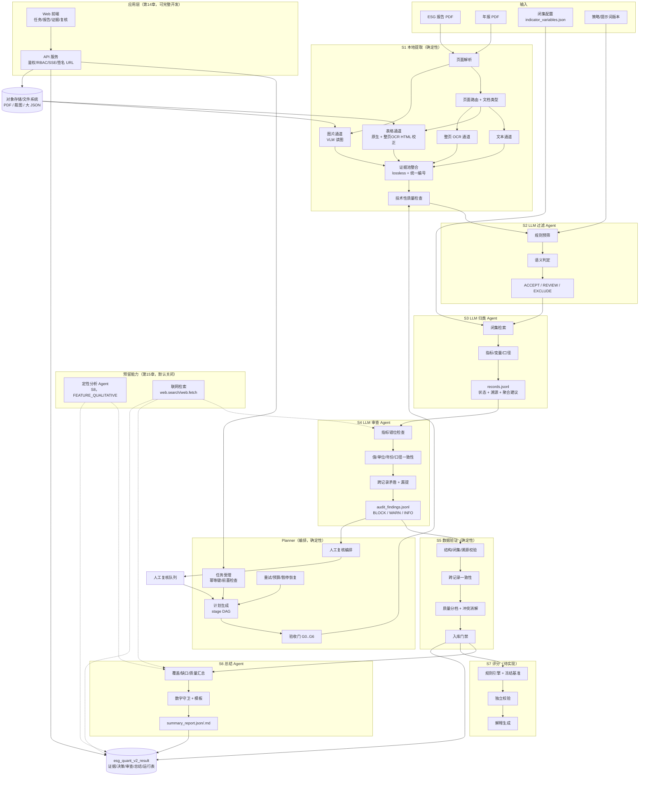

**层级职责**：

| 层 | 职责 | 不负责 |
| --- | --- | --- |
| Planner | 受理任务、生成计划、推进状态、执行验收门、重试/预算/暂停恢复、人工复核编排 | 不判断数据、不调用模型做决策、不改业务数据 |
| S1 提取 | 三通道解析与证据池 | 语义过滤、指标归类 |
| S2 过滤 | 判断证据是否进入归类 | 指标、算术 |
| S3 归类 | 指标/变量/值/单位/年份/口径 | 是否保留、算术 |
| S4 审查 | 语义自洽性审查、发现与建议 | 改数、放行入库、算分 |
| S5 验证 | 确定性校验、质量分、冲突消解、门禁 | 语义判断 |
| S6 总结 | 报告级结论表述 | 新增事实、改分 |
| S7 评分 | 确定性算分 | 使用模型输出 |
| 应用层 | Web 页面、API、鉴权、审计 | 不计算业务数值 |
| S8 定性（预留） | 无定量变量的定性判断 | 不改写定量记录 |
| 外部检索（预留） | 补充外部事实（带来源） | 不自动参与评分 |

### 3.2 数据流（产物级）

`【现有实现】` 的产物名保持不变；`【设计规定】` 新增审查与总结两类产物（虚线框）。

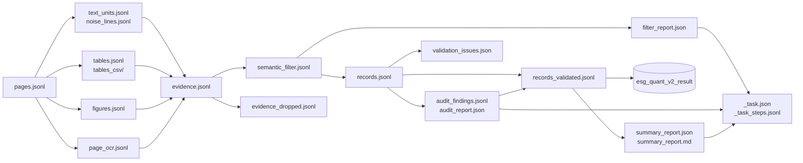

### 3.3 模块清单与形态

`【设计规定】` 仍不引入微服务、消息队列、向量库。理由：单报告数据量小（证据百级、记录数十级），阶段间是文件契约，串行即可；引入分布式只会增加一致性风险。

| 模块 | 形态 | 理由 |
| --- | --- | --- |
| S1 提取（8 个阶段） | 本地批处理 CLI（`scripts/esg_extract_pipeline.py`） | 已有；GPU/CPU 资源特征不同，按 stage 跑 |
| Planner | 库模块 + CLI/HTTP 入口 | 需要强状态一致性；单进程内用 DB/文件状态即可 |
| S2 过滤 Agent | 库模块（`SemanticFilter`）+ 可选 HTTP 包装 | 单次调用是"一批证据 → 一批决策"，无状态 |
| S3 归类 Agent | 库模块（`ClosedSetExtractor`）+ 可选 HTTP 包装 | 同上；闭集内存只读 |
| S4 审查 Agent | 库模块（新增 `src/esg_semantic/auditor.py`）+ 可选 HTTP 包装 | 按"指标组"审查，单报告内即可完成 |
| S5 验证/质量/入库 | 库模块（`validator/quality/store`） | 纯函数 + 幂等 upsert |
| S6 总结 Agent | 库模块（新增 `src/esg_semantic/summarizer.py`）+ 模板 | 只读结构化结果，模板优先、模型润色可选 |
| S7 评分 | 库模块（待实现） | 必须可离线复算 |

### 3.4 依赖方向（硬约束）

```
scripts/            →  src/esg_extract/  →  （无反向依赖）
scripts/            →  src/esg_semantic/ →  src/esg_extract/records.py, evidence.py（数据结构）
planner/            →  各 stage 的 service 入口（不 import 其内部实现）
src/esg_semantic/   →  ✗ 不得被 src/esg_extract/ import
src/esg_extract/quality|validator|store → records.py（契约）  ✗ 不 import semantic
src/esg_semantic/auditor.py  →  records.py / evidence.py / closed_set.py  ✗ 不 import quality/scorer
src/esg_semantic/summarizer.py → 只读聚合结果（summary input）  ✗ 不 import scorer
```

`【现有实现】` 第一条已成立（`records.py` 刻意做成"无 LLM 依赖的中立契约"）。`【设计规定】` 把整组写成 CI 检查项（`import-linter` 或 `grep` 断言），任何反向 import 视为构建失败。

### 3.5 架构取舍

| 取舍 | 选择 | 理由 | 代价 |
| --- | --- | --- | --- |
| 语义质量保障 | 在归类与验证之间加一层 LLM 审查 | 确定性校验查不出"指标错位"，人工全量复核又不现实 | 多一次模型调用，需控制误报 |
| 报告级输出 | 增加总结 Agent | 分析师需要结论而不只是记录 | 需数字守卫，避免幻觉 |
| 编排 | 代码状态机（Planner），不用 Agent 规划 | 状态必须可复现、可审计 | 新增状态机与步骤表 |
| 应用层 | 单体 API + SPA，不引入 BFF/微服务 | 数据量小、团队规模有限 | 前端需自己做缓存与分页 |
| 预留能力 | 只定契约与开关，不实现 | 业务规则未定，避免返工 | 后续实现时需回归表结构 |
| 队列 | 关系库步骤表，不引入 MQ | 千级任务/日足够 | 吞吐上限受限（见第20章） |

---

## 第四章 S1 本地提取层详细设计

### 4.0 统一描述模板

S1 由 6 个内部模块与 1 个整合步骤组成。每个模块按同一模板描述：

1. 职责与边界 2. 输入 3. 输出 4. 核心步骤 5. 依赖 6. 异常与重试 7. 日志/状态/质量标记 8. 测试与验收 9. 不负责的事

S1 的共同契约：

- **只处理"在哪里、长什么样、能不能读"，不处理"是不是 ESG 指标"。**
- 任何"删除"必须落在 `noise_lines.jsonl` 或 `evidence_dropped.jsonl`，且带 `reason`。
- 所有产物必须可由上一阶段产物**确定性重建**（同一 PDF + 同一版本 → 同一产物；OCR/VLM 部分允许非确定性，但必须记录模型版本与原始响应）。
- 每个 stage 结束时写/更新 `_run_manifest.json`（`run_id`、`pid`、`llm_mode`、`evidence_sha`、`records_written`）。

### 4.1 页面解析与路由

| 项 | 内容 |
| --- | --- |
| 职责 | 把 PDF 拆成页、块、行、词，标注文本/表格/图片区域与词级坐标；判定文档类型与每页标签 |
| 输入 | PDF 文件 |
| 输出 | `pages.jsonl`（`PageStructure`：`text_blocks`、`table_blocks`、`image_blocks`、`has_text_layer`、`n_numbers`、`drawings_bbox`）；`doc_type.json`（`vector/scanned/mixed`、逐页文本质量）；`pages_classified.jsonl`（`PageClass{label, score, signals, excluded}`） |
| 核心步骤 | ① PyMuPDF 取块/行/词与 bbox；② 检测表格区域（线段/网格/文本回退）；③ 判定文本层覆盖度与质量（词数、字符数、坏 token 比例、图像占比）；④ 页面标签：cover / toc / divider_or_blank / content（前三种 `excluded=true`）；⑤ 输出逐页证据（分数与信号） |
| 依赖 | 无（最先执行） |
| 异常 | 单页解析失败 → 该页记 `_parse_ok=false` 并跳过，不中断整册；加密/损坏 PDF → 整份失败（`ERR_PDF_UNREADABLE`） |
| 状态标记 | `page_label`、`needs_ocr`、`doc_type`；被排除页记入 `pages_classified.jsonl.excluded=true` |
| 测试 | ① 旋转页/横向页坐标正确；② 无文本层页 `has_text_layer=false`；③ 目录页被判 `toc` 且 `excluded=true`；④ 16 份样本报告逐页标签可复现 |
| 不负责 | 不判断页面内容是否 ESG 相关；不删除任何页 |

> `【设计规定】` 页面排除（cover/toc/divider_or_blank）**只影响"默认不进文本通道"**，不影响"该页上的表格/图表/OCR 是否进证据池"——lossless 模式下这些资产仍保留为低置信证据。这是现有实现的行为，本文将其固定为契约。

### 4.2 文本通道

| 项 | 内容 |
| --- | --- |
| 职责 | 把正文切成句级单元，保留数字、单位线索、词级坐标；把页眉/页脚/页码等版式行移出正文并留痕 |
| 输入 | `pages.jsonl` + `pages_classified.jsonl` |
| 输出 | `text_units.jsonl`、`noise_lines.jsonl`、`cleaning_report.json` |
| 核心步骤 | ① 按块/行合并断行，切句；② 数字抽取（原文字符串）；③ 跨页指纹判页眉页脚（文本归一后同模板、边带位置、页覆盖率 ≥30% 且 ≥3 页；命中即剔除，含数字也不例外，图内文字除外）；④ URL/邮箱/页码/点线目录识别；⑤ 表格内文本打 `in_table`（供证据池避重） |
| 依赖 | 4.1 |
| 异常 | 清洗失败 → 该报告该 stage 失败并保留上一轮产物（不半覆盖）；指纹统计不足（页数少）→ 不做页眉页脚删除，只标记 |
| 状态标记 | `page_suspect`、`page_label`、`in_table`、`approx_bbox`；噪声行 `reason` |
| 测试 | ① 页眉页脚跨页删除但不误删正文；② `3 tonnes of waste` 不被当标题删；③ 目录点线行正确识别；④ 单位线索正确绑定 |
| 不负责 | 不判断"这条句子有没有 ESG 价值"；不删除含数字但噪音的行（只标记 `noise_suspect`，交给 S2） |

> `【现有实现】` `_looks_like_no_data_line` 的第一条规则是"有单位 = 数据，直接保留"，且 lossless 模式下 `drop_noise_lines=False`——噪声行只降 tier、打 `source_ref.noise_suspect`。本文保留该策略。

### 4.3 表格通道

| 项 | 内容 |
| --- | --- |
| 职责 | 恢复表格的行列结构、表头、单位列与合并单元格；用整页 OCR 的 HTML 校正表头/补齐缺失；给出表级质量结论 |
| 输入 | `pages.jsonl` + `page_ocr.jsonl`（表格页 OCR） |
| 输出 | `tables.jsonl`、`tables_csv/*.csv`、`tables_index.csv`、`table_report.json` |
| 核心步骤 | ① 原生表格检测（线段/网格/文本回退）；② 单元格文本与坐标（`coord_kind ∈ cell/inherited/table/none`，`text_source ∈ native/page_ocr/crop_ocr`）；③ 表头行/列名/行头/单位列识别；④ 与整页 OCR HTML 对齐：补空表头（`ocr_header_repaired`）或整表替换（`ocr_page_used`，原栅格存 `native_cells`）；⑤ 表级 verdict：`ok/suspect/needs_ocr`；⑥ 结构/坐标问题清单 |
| 依赖 | 4.1、4.5 |
| 异常 | OCR 不可用 → 退回原生表并标 `source=native`、`verdict=suspect`；行列对齐失败 → `structure_issues` + `verdict=suspect`，**表仍进证据池**（low/medium） |
| 状态标记 | `verdict`、`structure_issues`、`coord_issues`、`gate_problems`、`review_flags` |
| 测试 | ① 多级表头行列对齐；② 合并单元格不产生空行错位；③ 单位列识别；④ OCR 替换后 `native_cells` 可对比；⑤ `ok` 表不出现 `needs_review` 标记 |
| 不负责 | 不判断表内数字属于哪个指标；不做单位换算；不因表"看起来不像表"而丢弃（只标 `suspect`） |

### 4.4 图片通道

| 项 | 内容 |
| --- | --- |
| 职责 | 识别图表区域，读图得到标题、图表类型、单位、纵轴、趋势与数据点；保留"为什么没读"的可审计信息 |
| 输入 | `pages.jsonl`（图片/矢量图形区域）+ 页面裁图 |
| 输出 | `figures.jsonl`、`figure_report.json`、`crops/` |
| 核心步骤 | ① 区域候选（矢量图元并集、大图、整页图）；② 过滤 logo/装饰（面积比、位置）；③ VLM 读图（`qwen-vl` 或等价），要求返回结构化 JSON；④ 数据点解析（`series/category/value/unit/value_type/confidence`）；⑤ `kept` 判定与 `skip_reason` |
| 依赖 | 4.1、模型服务 |
| 异常 | VLM 超时/失败 → `vlm_error` + `kept=false`，**不重试超过 2 次**；模型返回"无数据"（`[]`）→ `explicit_empty=true`（合法结论，非失败） |
| 状态标记 | `kept`、`skip_reason`、`value_type`（labeled/estimated）、`confidence`、`gate_problems` |
| 测试 | ① 折线/柱/饼三类图至少各 1 例；② `labeled` 与 `estimated` 区分；③ `FY2024/25` 取 2025；④ 读不出时不伪造数据 |
| 不负责 | 不做指标归类；不把 `estimated` 当 `labeled`；不重读整页文本 |

### 4.5 整页 OCR 通道

| 项 | 内容 |
| --- | --- |
| 职责 | 为无文本层页、以及"值得 OCR 的表格页"提供整页文本与 HTML 表结构 |
| 输入 | `pages.jsonl` + `doc_type.json` + 表格块（判断是否值得 OCR） |
| 输出 | `page_ocr.jsonl`、`page_ocr_report.json` |
| 核心步骤 | ① 选择目标页：`scanned` 全册、`needs_ocr` 页、`TableOcrFilter.worth_ocr` 通过的表格页（`min_rows=4, min_cols=2, min_words=8, min_data_rows=2`）；② OCR（Chandra 等）；③ 解析 HTML 表为 grid 存入 `meta.tables`；④ 记录 `purpose`（为什么 OCR 这一页） |
| 依赖 | 4.1 |
| 异常 | OCR 失败 → `ocr_error`，该页不产证据但不阻断其他页；OCR 文本为空 → 只计数不报错 |
| 状态标记 | `source`、`purpose`（`scanned_page`/`sparse_text_layer`/`garbled_text_layer`/`table_crosscheck`/`doc_scanned`/`all_pages`）、`ocr_error`、`n_chars`、`n_numbers` |
| 测试 | ① 无文本层页全部命中；② 1–3 行的假表不被 OCR（省算力且不误杀真表）；③ OCR 表与原生表的数字可对齐 |
| 不负责 | 不替代表格通道（OCR 是补充与校正）；不判断内容语义 |

### 4.6 证据池整合（S1 的核心）

| 项 | 内容 |
| --- | --- |
| 职责 | 把四个通道的产物合成**一个统一证据集合**，统一编号、标注来源与置信分层；做确定性避重与降级；输出丢弃台账 |
| 输入 | `text_units`、`noise_lines`、`tables`、`figures`、`page_ocr`、`pages`、`pages_classified` |
| 输出 | `evidence.jsonl`、`evidence_dropped.jsonl`、`evidence_report.json` |
| 核心步骤 | ① 建表级可信集合（`verdict ∈ {ok,suspect}` 且数字行 ≥ 2 才可"接管"其区域文本）；② 表格 → 证据（一表一条，HTML 优先，CSV 退路）；③ 文本 → 证据（有数字才进；短文本/噪声行**保留但降 tier**）；④ 整页 OCR → 证据（按含数字段落切分）；⑤ 图表 → 证据（每点一条）；⑥ 统一编号与排序；⑦ 写丢弃台账 |
| 依赖 | 4.1–4.5 |
| 异常 | 某通道产物缺失 → 该通道证据为空，其他通道照常；证据池为空 → 报告级 `evidence=0`，下游直接跳过（不报错） |
| 状态标记 | `tier`、`confidence`、`source_ref`（含 `noise_suspect`/`short_text`/`cross_check`/`format`/`fallback`）；`evidence_report.json` 的 `by_kind/by_tier/by_page/skipped/dropped` |
| 测试 | ① 表格区域文本不重复计数；② 噪声行在 lossless 下仍在证据池且 `tier=low`；③ 证据编号稳定（重跑同输入 → 同 ID）；④ 丢弃台账与统计一致 |
| 不负责 | **不做语义过滤**（相关性/指标判断）；不删除原始通道产物 |

**证据池的三个不变式**（`【设计规定】`写成契约，供 S2/S3 依赖）：

| 不变式 | 内容 | 违反后果 |
| --- | --- | --- |
| I1 内容自洽 | 每条证据的 `numbers` 必须能在 `content` 中找到（数字以原文或 HTML 形式出现） | S1 门禁失败，报告不出货 |
| I2 定位有效 | `kind != page_ocr` 的证据必须有合法 `bbox` 且 `page_no ≤ page_count` | 该证据降为 `low` 并标记 |
| I3 编号稳定 | `evidence_id` 由排序后的序号决定，同输入同版本必须一致 | 指纹不一致时 `store` 拒绝入库 |

### 4.7 技术性质量检查（S1 的门禁）

`【现有实现】` 已有表级/报告级门禁；`【设计规定】` 把检查项编号化，便于测试与审计。

| 编号 | 检查 | 触发 | 处置 |
| --- | --- | --- | --- |
| `C-TQ-01` | 表结构完整性（行列数、合并格、空行） | `structure_issues` 非空 | `verdict=suspect`，证据降 medium |
| `C-TQ-02` | 坐标完整性（`bbox` 缺失/越界/整表框冒充单元格） | `coord_kind=none/table` | 该表格证据 `tier=low` |
| `C-TQ-03` | 表格数字与 OCR 对账（`page_ocr_diff.reconcile`） | `needs_review`/`broken_decimal` | 证据 `tier=low` + `review_flags` |
| `C-TQ-04` | 证据 `numbers ⊆ content` | 抽查/全量 | 失败则修补 content（`native_supplement`）或剔除数字 |
| `C-TQ-05` | 页码/页码上限 | `page_no > page_count` | 丢弃并记入 dropped |
| `C-TQ-06` | 图表数据点有效性 | `value is None` | 不产该点证据 |
| `C-TQ-07` | 证据编号唯一性 | 重复 ID | 整份失败（不允许重复 ID 进下游） |
| `C-TQ-08` | 产物指纹一致性（`evidence_sha` 与 manifest） | 不一致 | `store` 拒绝入库 |

> 这些检查**只解决"数据是否完整、可定位、可读"**，不解决"这条数据有没有用、是什么指标"。后者是 S2/S3。

### 4.8 产物清单与目录结构（S1）

```text
intermediate/esg_extract/{pid}/
├── _parse_ok.json                 # 解析是否成功
├── _run_manifest.json             # 本轮 run_id / llm_mode / evidence_sha / records_written
├── pages.jsonl                    # 页/块/词坐标
├── doc_type.json                  # vector/scanned/mixed + 逐页质量
├── pages_classified.jsonl         # 页面标签与排除
├── text_units.jsonl               # 文本通道
├── noise_lines.jsonl              # 被移出正文的行（留痕）
├── cleaning_report.json
├── page_ocr.jsonl                 # 整页 OCR
├── page_ocr_report.json
├── tables.jsonl                   # 表格通道
├── tables_csv/{table_id}.csv
├── tables_index.csv
├── table_report.json
├── figures.jsonl                  # 图片通道
├── figure_report.json
├── crops/                         # 图表/表格裁图（调试与复核用）
├── evidence.jsonl                 # ★ S1 交付物
├── evidence_dropped.jsonl         # ★ 丢弃台账
├── evidence_report.json
├── semantic_filter.jsonl          # S2 输出（现有命名）
├── records.jsonl                  # S3 输出（现有命名）
├── semantic_report.json
├── records_validated.jsonl        # S5 输出
├── validation_issues.json
├── records.csv                    # 审计用平表
└── _stale/                        # 被隔离的旧产物（不删除）
```

旧复合入口 `--phases extract` 额外写 `extract_report.json`（证据统计 + LLM 统计 + 门禁问题），命名与新流程的 `evidence_report.json` 不同，排查时注意区分。

命名说明：`semantic_filter.jsonl` / `records.jsonl` 是现有名字，本文不改名（避免破坏兼容）；文档里把它们分别称为"S2 决策流"与"S3 记录流"。

### 4.9 两个入口（必须区分）

| 入口 | 命令 | 是否调 LLM | 产物 | 状态 |
| --- | --- | --- | --- | --- |
| 新流程（推荐） | `--stage extract` / `--phases evidence,semantic` | `extract` 不调；`semantic` 调 | evidence → semantic_filter → records | `【现有实现】` |
| 旧兼容 | `--phases extract` | **调**（LLM 直出 records） | evidence + records（跳过 filter 决策落盘） | `【现有实现】`，保留但标记 deprecated |
| 独立跑 | `scripts/esg_semantic_run.py --out ... --llm dashscope` | 调 | 只跑 S2/S3，复用已有 evidence | `【现有实现】` |

`【设计规定】` 规定：**正式批次必须走新流程**；旧兼容入口只允许在回归对照时使用，且产物必须写 `legacy=true` 标记，不得进入正式库。

### 4.10 S1 的测试与验收

| 用例 | 输入 | 期望 | 通过条件 |
| --- | --- | --- | --- |
| `S1-01` 无文本层页 | 扫描页 PDF | 该页走整页 OCR，证据 `kind=page_ocr`，`bbox=null` | 页码与文本可回查 |
| `S1-02` 表格页 | 含 5 行以上数据表 | 一表一条证据，`numbers` 覆盖全表，`content` 为 HTML | `numbers ⊆ content` |
| `S1-03` 图表页 | 折线/柱状图 | 每点一条证据，`series/category` 保留 | `value_type` 正确 |
| `S1-04` 封面/目录页 | 目录页含页数数字 | 该页文本不默认进证据池；页面资产仍保留 | 不出现"目录页码"被当数据的高置信证据 |
| `S1-05` 页眉页脚 | 每页重复页脚 | 进 `noise_lines.jsonl`，正文不受影响 | 正文数字一条不少 |
| `S1-06` 重跑稳定性 | 同一 PDF 跑两次 | `evidence.jsonl` 的 ID 序列一致 | `evidence_sha` 相同 |
| `S1-07` 产物缺失 | 删掉 `figures.jsonl` | 证据池跳过图表通道，其余正常 | 不报错，统计体现 |
| `S1-08` 坐标越界 | 人为改坏 bbox | 该证据降级并标记 | 不进入高置信集合 |

**S1 验收门槛**（硬性）：

1. 任一证据可定位到 PDF 页（`page_ocr` 除外，需有页码）。
2. `evidence_dropped.jsonl` 覆盖所有"候选但未进池"的表/文本/图，且每条有 `reason`。
3. `evidence.jsonl` 与 `_run_manifest.json` 的指纹一致。
4. 16 份现有样本报告全部可跑通（不要求结果正确，只要求产物完整、可回查）。

---

## 第五章 S2 数据过滤 Agent 详细设计

### 5.0 定位

`【设计规定】` 把"这条证据值不值得进入归类"从提取层彻底拿出来，成为一个**有独立输入输出、独立状态、独立版本、可重放**的 Agent。它对应现有 `src/esg_semantic/filter.py` 的 `SemanticFilter`，但契约从"keep 布尔值"扩展为三态决策 + 理由码 + 重复关联 + 策略版本。

一句话：**过滤 Agent 只回答"要不要"，不回答"是什么"。**

### 5.1 职责

1. 接收 S1 的 `evidence.jsonl`（一批证据）与报告上下文。
2. 识别并标注噪声：页码、目录编号/点线、页眉页脚、联系方式、版权/法条引用、奖项证书、股票代码、纯日期、章节编号、版式残片、空/乱码。
3. 识别跨通道重复：同一数值在表格、正文、图表中重复出现时，建立关联组，而不是简单丢弃。
4. 输出三态决策：`ACCEPT`（进入归类）/ `REVIEW`（不确定，转人工或带标记进入归类）/ `EXCLUDE`（确认无效）。
5. 给出**可审计的理由**：理由码、理由文本、命中规则、模型调用 ID、策略版本。
6. 保证"无法确定 → 保留"：任何失败、缺字段、低置信、解析不出的情况，都不允许 EXCLUDE。

### 5.2 不负责

- 不判断指标（`indicator_id` / `variable` 是 S3 的事）。
- 不修改、不删除 `evidence.jsonl` 与三通道原始产物。
- 不做单位换算、不合并数值、不做汇总。
- 不判断数值对错（那是 S5 的一致性校验）。
- 不重读整份 PDF，不调用表格/OCR 解析工具。
- 不因为"数字出现频率低""不含某关键词"这类单一条件 EXCLUDE（见 5.7）。

### 5.3 输入

```json
{
  "run": {"run_id": "fr_2025073101502_20261026T180000", "pid": "2025073101502",
          "mode": "STANDARD", "budget": {"max_model_calls": 20, "max_tokens": 120000}},
  "report_context": {
    "pid": "2025073101502",
    "company_name": "Imperium Financial Group Limited",
    "report_year": 2025,
    "period_start": "2024-04-01", "period_end": "2025-03-31",
    "doc_type": "vector", "page_count": 42,
    "excluded_pages": [1, 2]
  },
  "policy": {"policy_id": "filter-default", "policy_version": "FP-1.0.0",
             "min_exclude_confidence": 0.65, "keep_on_error": true,
             "allow_auto_exclude": false},
  "evidence": [
    {"evidence_id": "2025073101502_e00003", "page_no": 3, "kind": "text",
     "content": "Total floor area coverage ... was 958 m2 ...",
     "numbers": ["958"], "bbox": [70.9, 616.4, 524.4, 641.5],
     "tier": "medium", "confidence": 0.7, "unit_hint": "m2", "year_hint": null,
     "row_header": null, "col_header": null, "table_id": null,
     "region_id": null, "series": null, "value_type": null,
     "source_ref": {"unit_id": "p3_u6", "block_no": 4}}
  ]
}
```

输入约束：

1. `evidence` 单批 ≤ 40 条（现有 `batch_size=40`），超出的由调用方分批；批次划分必须可复现（按 `evidence_id` 排序后切分）。
2. `evidence` 必须带 `evidence_id`、`page_no`、`kind`、`content`、`numbers`；缺任一 → 该条直接判 `REVIEW`（理由 `R-MALFORMED`），不得 EXCLUDE。
3. `policy` 必须显式传入；缺省时用服务端登记的最新策略版本，并在输出中回写实际版本。

### 5.4 噪声分类法

`【设计规定】` 定义统一 `noise_class` 枚举。它与 S1 的既有先验一一对应，不另起一套：

| `noise_class` | 含义 | S1 既有线索 | 可 EXCLUDE | 说明 |
| --- | --- | --- | --- | --- |
| `NONE` | 不是噪声 | — | 否 | 默认 |
| `PAGE_NUMBER` | 页码/页脚计数 | `noise_lines.reason=page_number`、`NoisePattern.kind=page_number`、`digit_variants>1` | 是 | 需同时满足"无单位、无指标词" |
| `TOC` | 目录行/点线目录 | `_TOC_LEADER_RE`、页面标签 `toc` | 是 | 目录页本身已被路由排除，这里兜底 |
| `HEADER_FOOTER` | 跨页页眉页脚 | `noise_lines.reason=header_footer`、`band=top/bottom` | 是 | 页脚常带报告年份，注意别误删 |
| `CONTACT` | 电话/邮箱/网址/地址 | `_CONTACT_RE`、`url` 理由 | 是 | |
| `LEGAL_CITATION` | 法条/附录引用 | `_LEGAL_CITE_RE`、`_APPENDIX_RE`、`Cap. N` | 是 | 需"无动词"才可排除 |
| `AWARD_CERT` | 奖项/证书 | `_AWARD_RE` | 条件 | 去掉年份后无其它数字才可排除 |
| `STOCK_CODE` | 股票代码 | `_STOCK_CODE_RE` | 是 | |
| `DATE_ONLY` | 纯日期行 | `_DATE_ONLY_RE` | 是 | |
| `SECTION_HEADING` | 章节编号标题 | `_SECTION_HEAD_RE` + 首词大写 | 是 | `3 tonnes of waste` 不算 |
| `LAYOUT_ARTIFACT` | 版式残片/空串/单 token | 短文本 + 无单位 | 条件 | 只对 `len<12` 且无单位且无指标词生效 |
| `UNRELATED_FINANCIAL` | 与 ESG 无关的财务数字 | 无（需模型判断） | 条件 | 仅当明确是股价/市值/分红等 |
| `DUPLICATE` | 重复证据 | 5.8 的重复检测 | **否** | 只关联，不排除 |
| `EMPTY_OR_GARBLED` | 空/乱码/OCR 失败文本 | `n_chars=0`、坏 token | 是 | 必须记录原始文本片段 |

**`topic`**（粗粒度主题，供路由与统计，不参与指标归类）：`WATER`、`ENV_OTHER`、`SOCIAL`、`GOVERNANCE`、`OTHER`、`NOISE`。

> `【设计规定】` `topic` 只用于：① 让归类 Agent 优先处理水相关证据（可选优化）；② 统计报表。**不得**用 `topic != WATER` 作为 EXCLUDE 理由——那会把其他主题的定量数据提前丢掉，违反"过滤不做归类"。

#### 5.4.1 判定信号与数字噪声判别

过滤 Agent 的全部判断只能基于证据本身携带的信号。下表规定每个信号**怎么用**、**不能怎么用**：

| 信号 | 来源字段 | 用法 | 禁止用法 |
| --- | --- | --- | --- |
| 来源页面 | `page_no` + `source_ref.page_label/page_suspect` | 封面/目录页的证据降低置信；页码连续性异常时提示版式问题 | 不得仅凭"在目录页"就 EXCLUDE（目录页也可能有 KPI 表） |
| 原始文本 | `content` | 判断是否为句子、是否含单位/指标词/年份/口径 | 不得因文本短就删（`HK-08` 之外的短文本只降级） |
| 表格上下文 | `table_id`、`source_ref.col_names/row_headers/unit_col/verdict` | 表内证据优先保留；`verdict=suspect` 时降 REVIEW 而非排除 | 不得因 `verdict=suspect` 就删（表可能只是表头缺失） |
| 图片描述 | `region_id/series/value_type` + `content` 的"标题/系列/类别/值" | `labeled` 点直接保留；`estimated` 点保留但交 S3 判断 | 不得因"估算值"排除（估算值仍是披露数据） |
| 单位 | `unit_hint` | 有单位 → 硬保留（`HK-01`） | 不得因"单位不常见"排除 |
| 年份 | `year_hint`、`col_header` | 有年份 → 提示可能是多年数据，保留 | 不得因"年份看起来不对"排除（年份错误是 S5 的校验职责） |
| 相邻内容 | 同页/同表其它证据的 `content` 片段 | 帮助判断孤立的裸数字是否属于某张表 | 不得把相邻内容的数值"补"进当前证据（那会造数） |
| 重复关系 | `duplicate_group_id/role` | 只用于关联与选主，不用于删除 | 不得因"重复"排除（见 5.8） |

**数字噪声 vs 有价值定量数据**的判别顺序（必须按序，不得跳步）：

```text
1. 有单位？           → 有价值（保留）
2. 在表格里？         → 有价值（保留）
3. 命中闭集指标词？   → 有价值（保留）
4. 是页码/目录/URL/日期/股票代码/法条/联系方式？ → 噪声（可排除）
5. 是裸数字且无上下文？→ 不确定（REVIEW）
6. 其它               → 交模型，低置信一律 REVIEW
```

这个顺序保证：**"是不是数据"先于"是不是噪声"**，避免"因为短/因为没关键词"把有效数据删掉。

### 5.5 判定流程

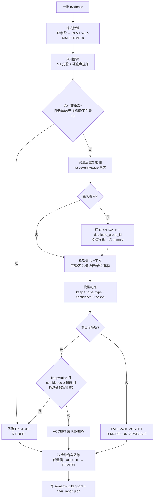

**必须"规则先行"**：能由确定性规则判定的（页码、URL、纯日期、股票代码），不调模型。模型只处理"规则判不了"的那部分。这与现有实现一致（现有 `SemanticFilter` 直接丢给 LLM，本文要求补规则预筛以省成本、提可解释性；规则预筛只做**候选**标记，最终仍受 5.7 硬约束约束）。

### 5.6 输出（`FilterDecision` v2）

| 字段 | 类型 | 必填 | 说明 |
| --- | --- | --- | --- |
| `evidence_id` | string | 是 | 必须与输入一一对应 |
| `status` | `ACCEPT`/`REVIEW`/`EXCLUDE` | 是 | 三态 |
| `noise_class` | 见 5.4 | 是 | `NONE` 表示非噪声 |
| `topic` | 见 5.4 | 是 | 仅统计/路由 |
| `confidence` | number 0–1 | 是 | 对该决策的把握；`EXCLUDE` 必须 ≥ `min_exclude_confidence` |
| `reason_code` | 枚举（见下） | 是 | 机器可读 |
| `reason_text` | string | 是 | 一句话人类可读理由（中文） |
| `rule_hits` | string[] | 否 | 命中的规则 ID，如 `R-TOC-LEADER` |
| `duplicate_group_id` | string \| null | 否 | 重复组 ID |
| `duplicate_role` | `PRIMARY`/`ALTERNATE` \| null | 否 | 组内角色 |
| `duplicate_of` | string[] | 否 | 其它成员 `evidence_id` |
| `model_call_id` | string \| null | 否 | 模型调用记录 ID |
| `decision_source` | `RULE`/`LLM`/`RULE_LLM`/`FALLBACK`/`HUMAN` | 是 | 决策来源 |
| `policy_version` | string | 是 | 策略版本 |
| `decided_at` | timestamp | 是 | |

`reason_code` 枚举（与 `noise_class` 解耦，便于统计）：

| 类别 | 代码 |
| --- | --- |
| 规则排除 | `R-PAGE-NUM`、`R-TOC`、`R-HDR-FTR`、`R-CONTACT`、`R-LEGAL`、`R-AWARD`、`R-STOCK-CODE`、`R-DATE`、`R-SECTION`、`R-LAYOUT`、`R-FIN-UNRELATED`、`R-EMPTY` |
| 保留 | `R-HAS-UNIT`、`R-METRIC-KW`、`R-IN-TABLE`、`R-LLM-KEEP`、`R-UNSURE-KEEP`、`R-NO-LLM-KEEP` |
| 重复 | `R-DUP-PRIMARY`、`R-DUP-ALT` |
| 降级/异常 | `R-LOWCONF-DOWNGRADE`、`R-MODEL-UNPARSEABLE`、`R-MODEL-ERROR`、`R-MALFORMED`、`R-BUDGET-EXCEEDED` |
| 人工 | `R-HUMAN-KEEP`、`R-HUMAN-EXCLUDE` |

**输出文件与下游视图**（一次过滤 run 的完整产物）：

| 产物 | 内容 | 下游 |
| --- | --- | --- |
| `semantic_filter.jsonl` | **全部**证据的决策（ACCEPT/REVIEW/EXCLUDE），与输入一一对应 | S5 验证、S4 审查、复核、统计 |
| `filter_report.json` | 策略/模型版本、批次统计、各状态计数、重复组数、降级与截断标记 | 监控、发版报告 |
| `semantic_filter_review.jsonl`（可选） | `REVIEW` 子集，便于复核系统批量导入 | 人工复核 |
| `filter_diff.json`（重放时） | 新旧策略的状态变化清单与计数 | 策略评审 |

下游（S3）拿到的"accepted 集合"**不另存一份文件**，而是按 `evidence_id` 连接 `semantic_filter.jsonl` 后取 `status ∈ {ACCEPT, REVIEW}`——避免"证据池一份、过滤后一份、归类再一份"的三份真相。

```json
{
  "evidence_id": "2025073101502_e00012",
  "status": "EXCLUDE",
  "noise_class": "TOC",
  "topic": "NOISE",
  "confidence": 0.93,
  "reason_code": "R-TOC",
  "reason_text": "目录点线行，末尾数字是页码而非数据",
  "rule_hits": ["R-TOC-LEADER"],
  "duplicate_group_id": null, "duplicate_role": null, "duplicate_of": [],
  "model_call_id": null,
  "decision_source": "RULE",
  "policy_version": "FP-1.0.0",
  "decided_at": "2026-10-26T18:00:03Z"
}
```

### 5.7 防误删硬约束（本 Agent 的核心安全设计）

`【设计规定】` 以下检查在**任何** EXCLUDE 生效前执行，任一命中即强制降级为 `REVIEW`（不是 ACCEPT，保留人工可见性）：

| 编号 | 硬保留条件 | 理由 |
| --- | --- | --- |
| `HK-01` | `unit_hint` 非空 | 有单位几乎一定是定量披露；S1 已用"有单位=数据"原则 |
| `HK-02` | `kind = table_cell` | 表格单元格本身是结构化数据，噪声应在 S1 表级处理 |
| `HK-03` | `content` 命中闭集任一指标关键词（中/英/繁） | 指标词是强信号 |
| `HK-04` | `numbers` 中任一数字与该证据所在页的表格数字重合 | 可能是表格转述 |
| `HK-05` | `year_hint` 或 `col_header` 含 4 位年份，且数值量级像业务量 | 年份列常是多年数据 |
| `HK-06` | 该证据是某个 `duplicate_group` 的唯一成员（组内没有其它通道） | 唯一来源不得因"重复"被删 |
| `HK-07` | `policy.allow_auto_exclude = false` | 策略关闭自动排除时，EXCLUDE 一律降 REVIEW |
| `HK-08` | 模型/规则置信度 < `min_exclude_confidence`（默认 0.65） | 与现有实现一致 |

另外三条**永不 EXCLUDE** 的情形：

1. `kind = figure` 且 `value_type = labeled`（图中直接标注的数值）。
2. 真实零值声明（`no ... generated`、`zero cases`、`0 tCO2e`）——零值是有效数据（对应归类阶段的 `REPORTED_ZERO`）。
3. 同一页同时存在"未披露/不适用"声明与数字时（可能是"本年 0，去年 X"）。

**统计口径**：`EXCLUDE` 数 / 总证据数 = 过滤率。过滤率异常升高（例如 > 40%）时，报告级告警——不是硬阻断，但要求人工抽检，因为"大量排除"往往意味着策略或提示词出了问题。

### 5.8 跨通道重复与冲突

同一数值可能在表格、正文、图表各出现一次；同一指标可能在不同页重复披露（KPI 摘要 + 明细表）。

**重复检测（确定性）**：

```text
归一化键 = (page_no 或 ±1 页, normalized_value, normalized_unit)
  normalized_value: 去掉千分位、统一小数、按 magnitude 换算到标准单位后比较
  normalized_unit : 用 units.canonical_unit 归一；无单位时用 "-"
聚类：键相同 → 同一 duplicate_group（group_id = "dg_{pid}_{序号}"）
组内排序（选 PRIMARY）：table_cell > text > page_ocr > figure；
                         tier high > medium > low；confidence 高优先；evidence_id 字典序兜底
```

**处理规则**：

| 情形 | 处理 |
| --- | --- |
| 同值同单位，跨通道 | 全部保留；标 `DUPLICATE`；`PRIMARY` 进归类，`ALTERNATE` **也进归类**（作为交叉证据），但在 S5 冲突消解时落败并记 `superseded_by` |
| 同值但单位不同（如 `1,234 千立方米` vs `1,234 立方米`） | **不判重复**；两者都进归类，由 S5 的 `unit_magnitude_mismatch` 校验暴露 |
| 同指标不同口径（集团/区域） | **不判重复**（口径不同是合法多条）；由 `breakdown` 区分 |
| 同指标不同年份 | **不判重复**；由 `year` 区分 |
| 数值不同但同页同指标 | 不判重复；交给 S3 归类后由 S5 冲突消解 |

`【设计规定】` 关键：**重复 ≠ 删除**。现有 `quality.resolve_conflicts` 已经在记录层做"留最好的一条 + 落败留痕"，过滤层不需要也不应该抢这个职责。过滤层只建立关联，供 S5 使用。

### 5.9 上下文不足、含义不明的处理

| 情形 | 决策 | 理由码 |
| --- | --- | --- |
| 只有裸数字（如 `0.11 0.13`），无单位无表头 | `REVIEW`（不是 EXCLUDE） | `R-UNSURE-KEEP` |
| 有单位但无指标词（如 `958 m2`） | `ACCEPT` | `R-HAS-UNIT` |
| 表格证据内容为 OCR HTML，模型看不清 | `ACCEPT`（表本身是结构化数据） | `R-IN-TABLE` |
| 图表点 `value_type=estimated` | `ACCEPT`（标 `topic` 即可，由 S3 决定是否采信） | `R-LLM-KEEP` |
| 模型返回"不确定" | `REVIEW`，`confidence≤0.5` | `R-UNSURE-KEEP` |
| 模型说"这是噪声"但无硬信号 | `REVIEW` | `R-LOWCONF-DOWNGRADE` |
| 证据跨页截断（句子不完整） | `REVIEW` | `R-UNSURE-KEEP` |

`REVIEW` 的下游处置（必须明确，避免"永远挂着"）：

1. 默认**仍进入 S3 归类**（带 `filter_status=REVIEW`），归类结果在 S5 被标 `needs_review`，不进入正式评分。
2. 若策略 `review_blocks_classification=true`（默认 false），则 REVIEW 不进 S3，进入人工队列。
3. 人工复核结论写 `decision_source=HUMAN` 的覆盖决策（追加，不修改原决策）。

### 5.10 策略版本、追溯与重放

| 机制 | 设计 |
| --- | --- |
| 策略版本 | `policy_version`（如 `FP-1.0.0`），来源：`filter_default.yaml` + 提示词模板版本 + 硬约束清单版本；三者任一变更即升版本 |
| 决策留痕 | 每轮写 `semantic_filter.jsonl` + `filter_report.json`（含策略版本、模型 ID、批次统计、降级计数） |
| 不覆盖 | 同一证据的多轮决策并存：文件名带 `run_id`，DB 表按 `(evidence_id, policy_version, run_id)` 追加 |
| 重放 | `--replay-filter --policy FP-1.0.0` 用原策略重算；`--replay-filter --policy FP-1.1.0` 用新策略重算，输出 diff 报告（新增 EXCLUDE/REVIEW 的清单） |
| 历史对照 | 策略升级后，必须能回答"哪些证据从 ACCEPT 变成 EXCLUDE"，并抽样人工确认 |

### 5.11 异常、重试与预算

| 情况 | 处理 |
| --- | --- |
| 模型超时/限流/5xx | 重试 2 次（指数退避）；仍失败 → 该批 `FALLBACK: ACCEPT`，`decision_source=FALLBACK`，`reason=R-MODEL-ERROR` |
| 模型返回非法 JSON | 用现有 `extract_json_array` 抢救；仍失败 → 该批 ACCEPT，`R-MODEL-UNPARSEABLE` |
| 模型漏返回某条 | 该条 ACCEPT，`R-UNSURE-KEEP` |
| 预算耗尽 | 停止调用，剩余全部 ACCEPT（`R-BUDGET-EXCEEDED`），报告标 `truncated=true` |
| 批次失败 | 不影响其它批；`filter_report.json` 记录 `batch_failures` |
| 无模型（离线） | 全部 ACCEPT（`R-NO-LLM-KEEP`），产物仍生成，保证流程可跑 |

**预算**：`max_model_calls` 默认按 `ceil(n_evidence / 40) + 2` 估算上限；`max_tokens` 由策略给出。超预算必须降级而不是静默截断。

### 5.12 接口

**库接口**（与现有签名兼容，新增字段不破坏旧调用）：

```python
class SemanticFilter:
    def filter(
        self,
        evidence: Sequence[Evidence],
        pid: str | None = None,
        *,
        policy: FilterPolicy | None = None,
        report_context: ReportContext | None = None,
        run: FilterRun | None = None,
    ) -> tuple[list[Evidence], list[FilterDecision], dict]: ...
```

- 返回值第一项是"进入归类的证据"（`status ∈ {ACCEPT, REVIEW}`），保持现有调用方兼容。
- 第二项是完整决策列表（含 EXCLUDE），第三项是统计。
- 不传 `policy` 时使用默认策略，输出回写实际版本。

**HTTP 接口**（`【设计规定】`，供独立 Agent 服务/编排层调用）：

```http
POST /v1/filter:run
Content-Type: application/json

{"pid": "...", "evidence_ref": "intermediate/esg_extract/{pid}/evidence.jsonl",
 "policy_version": "FP-1.0.0", "mode": "STANDARD", "idempotency_key": "..."}
```

响应 `202`：`{"filter_run_id": "...", "status": "RUNNING"}`；查询 `GET /v1/filter:runs/{id}` 返回统计与产物路径。
错误：`ERR_EVIDENCE_NOT_FOUND`、`ERR_POLICY_NOT_FOUND`、`ERR_MODEL_UNAVAILABLE`（降级为全 ACCEPT 时返回 200 + `degraded=true`）。

### 5.13 测试与验收

| 用例 | 输入 | 期望 | 通过条件 |
| --- | --- | --- | --- |
| `F-01` 目录行 | 点线目录证据 | `EXCLUDE` + `R-TOC` | 不误伤含单位正文 |
| `F-02` 页码页脚 | `Page 12` / `12` | `EXCLUDE` + `R-PAGE-NUM` | 报告年份不被删（`HK-05`） |
| `F-03` 有单位噪声 | `Tel: +852 ... 3 m3` | **不 EXCLUDE** | `HK-01` 生效 |
| `F-04` 表格证据 | 任意 `table_cell` | 永不 EXCLUDE | `HK-02` |
| `F-05` 指标词无单位 | `Total water withdrawal 1,234` | ACCEPT | `HK-03` |
| `F-06` 裸数字 | `0.11 0.13` | `REVIEW` | 不是 EXCLUDE |
| `F-07` 模型失败 | client 抛异常 | 全 ACCEPT + `R-MODEL-ERROR` | 不丢证据 |
| `F-08` 非法 JSON | 返回 `"sorry"` | 全 ACCEPT + `R-MODEL-UNPARSEABLE` | 不丢证据 |
| `F-09` 低置信排除 | keep=false, conf=0.3 | 降级 ACCEPT/REVIEW | 与 0.65 阈值一致 |
| `F-10` 跨通道重复 | 表+正文同值 | 同组，PRIMARY=表 | 两条都保留 |
| `F-11` 单位不同 | `1,234 千m3` vs `1,234 m3` | 不同组 | 交给 S5 校验 |
| `F-12` 零值声明 | `no hazardous waste generated` | ACCEPT | 不因"0"排除 |
| `F-13` 策略关闭自动排除 | `allow_auto_exclude=false` | EXCLUDE 全降 REVIEW | `HK-07` |
| `F-14` 幂等 | 同输入同策略跑两次 | 决策逐条一致 | `policy_version` 相同 |
| `F-15` 重放 | 新策略重跑 | 输出 diff 报告 | 可列出状态变化清单 |

**验收门槛**：

1. 金标准集中"带单位的有效记录"误删率 = **0**（硬门槛，未达标不得上线）。
2. 模型失败/超时/预算耗尽场景下，ACCEPT + REVIEW 比例 = 100%。
3. 每条决策都有 `reason_code`、`policy_version`、`decision_source`。
4. 同一输入重放的决策一致率 = 100%（规则部分）；模型部分允许差异，但必须可 diff。

### 5.14 与其他模块交互

- **上游**：只读 `evidence.jsonl`（S1）。
- **下游**：向 S3 交付"ACCEPT + REVIEW 的证据 + 决策"；向 S5 交付完整决策（供质量分与复核判断），S4 审查也读同一份决策。
- **不写** S1 的任何产物；`evidence.jsonl` 只读。
- **人工复核**：REVIEW 可通过 `POST /v1/reviews` 创建任务（第 10 章）；人工结论作为新决策追加。

---

### 5.15 日志、状态与质量标记

| 项 | 内容 |
| --- | --- |
| 结构化日志 | 每条决策一行 JSON：`filter_run_id / evidence_id / status / noise_class / reason_code / confidence / decision_source / policy_version / elapsed_ms` |
| 轮次级日志 | `esg_filter_run`：`n_evidence / n_accept / n_review / n_exclude / n_fallback / n_error / n_downgraded / degraded / truncated` |
| 状态 | `filter_status`（单条）+ `run.status`（`SUCCEEDED/PARTIAL/FAILED`） |
| 质量标记 | `degraded`（模型降级）、`truncated`（预算截断）、`duplicate_group_id`（重复关联）、`decision_source=FALLBACK`（兜底） |
| 告警 | 过滤率 > 40%、`degraded=true`、`n_error>0`、同一证据状态在两次重放中不一致（规则部分） |
| 不可写 | 不写 `evidence.jsonl`、不写 S3 记录、不改 S1 产物 |

### 5.16 与 v2 提取产物、Planner、S4 的衔接

**读取 v2 证据里的这些字段**（不是所有字段都参与判断，避免噪声信号互相打架）：

| 字段 | 用途 | 不能怎么用 |
| --- | --- | --- |
| `source_ref.verdict`（ok/suspect/needs_ocr） | `ok` → 证据可信度加分；`suspect` → 至少 REVIEW | 不得因 `suspect` 排除（`HK-02`） |
| `source_ref.review_flags` 非空 | 强制 `REVIEW`（表结构/OCR 对账有问题） | 不得据此 EXCLUDE |
| `source_ref.format`（html/csv） | `csv` 是退路，仍保留；提示"结构较弱" | 不得因 csv 排除 |
| `source_ref.native_supplement` 非空 | 说明 HTML 缺数字、已补入，保留 | 不得当作重复 |
| `source_ref.page_label` / `page_suspect` | 封面/目录页降置信 | 不得仅凭页面标签排除 |
| `kind=page_ocr` 且 `source_ref.cross_check` | 作为交叉证据，重复组里优先级最低 | 不得当主证据 |
| `tier` | 只影响重复组选主与复核排序 | **不是** `keep` 的依据 |

**与 Planner 的衔接**：

1. filter step 接收 `task_id`、`step_id`、`budget`、`deadline_at`，返回 `stats` 与 `degraded/truncated`。
2. 预算/超时由 Planner 注入，filter 不自行决定重试次数上限。
3. 过滤失败时 filter 返回"全 ACCEPT + `degraded=true`"，由 Planner 决定任务是否 `PARTIAL`。

**与 S4 审查的衔接**：

1. `REVIEW` 证据默认仍进 S3 归类，产出记录带 `filter_status=REVIEW`；
2. S4 审查时，`filter_status=REVIEW` 或 `tier=low` 的记录必须重点检查（可提高抽样权重）；
3. 若 S4 判定 `A-EVIDENCE-WEAK`，说明"过滤保留但证据不足"，与过滤决策并不矛盾：**过滤负责不误删，审查负责不误信**。

---

## 第六章 S3 数据归类 Agent 详细设计

### 6.0 定位

`【设计规定】` 归类 Agent 接收 S2 的候选证据，把它们映射到项目既有闭集（`config/indicator_variables.json`）中的 `indicator_id` + `variable`，并抽出值、单位、年份、统计口径。对应现有 `src/esg_semantic/classifier.py` 的 `ClosedSetExtractor`，契约扩展为：独立 `classification_status`、聚合建议、口径字段、逐条理由。

一句话：**归类 Agent 只回答"这是什么"，不回答"要不要"、不回答"算多少"。**

### 6.1 职责

1. 在闭集内完成指标映射（`indicator_id` + `variable`），不得创造闭集外的指标或变量。
2. 区分易混指标：取水量 / 耗水量 / 循环用水量 / 废水排放 / 高强度水压力地区取水；绝对量 / 强度 / 行业均值 / 改善率。
3. 抽取并保留：数值、单位、年份、统计口径（`breakdown`）、报告年度、公司主体、披露范围。
4. 对一表多记录（多年份/多口径/分项）逐条产出，不合并、不覆盖。
5. 给出聚合建议（是否需要按集团汇总、是否保留多口径），但**不做算术**。
6. 对无法可靠归类的证据输出明确状态（`AMBIGUOUS`/`UNMAPPED`/`OUT_OF_CLOSED_SET`/`INSUFFICIENT_CONTEXT`），不强制分类。
7. 保留三级溯源（`evidence_id` → `(page, value)` → `unresolved`），页码以证据为准。

### 6.2 不负责

- 不判断证据是否值得保留（S2 已判；S3 只处理 `ACCEPT/REVIEW`）。
- 不把闭集外的东西"凑"成闭集内的变量（只标记，交人工/闭集维护）。
- 不做单位换算、不做金额换算、不做汇总求和（S5/S7）。
- 不判断数值是否正确（S5 的跨记录一致性）。
- 不修改闭集配置（闭集是受控文件，变更需评审）。
- 不生成评分或质量分。

### 6.3 输入

```json
{
  "run": {"run_id": "cr_2025073101502_20261026T180500", "pid": "2025073101502",
          "mode": "STANDARD", "budget": {"max_model_calls": 12, "max_tokens": 90000}},
  "catalogue": {"catalogue_version": "MD-2026.10", "n_indicators": 86,
                "n_quantitative": 33, "n_variables": 179},
  "report_context": {"pid": "2025073101502", "report_year": 2025,
                     "period_start": "2024-04-01", "period_end": "2025-03-31",
                     "company_name": "Imperium Financial Group Limited",
                     "boundary_hint": "GROUP"},
  "candidates": [
    {"evidence_id": "2025073101502_e00003", "filter_status": "ACCEPT",
     "page_no": 3, "kind": "text", "tier": "medium",
     "content": "Total floor area coverage ... 958 m2 ...",
     "numbers": ["958"], "unit_hint": "m2", "year_hint": null,
     "row_header": null, "col_header": null, "table_id": null,
     "source_ref": {"unit_id": "p3_u6", "block_no": 4}}
  ]
}
```

输入约束：

1. `candidates` 只含 `filter_status ∈ {ACCEPT, REVIEW}` 的证据；`REVIEW` 必须在输出记录中保留该状态（供 S5 降级）。
2. 单批 ≤ 30 条（现有 `batch_size=30`），按 `evidence_id` 排序切分。
3. 闭集版本必须显式传入；不同批次不得混用闭集版本。
4. 表格证据的 `content` 是 OCR HTML，模型需要自行按行列对齐；**不得**把整表 HTML 原样写进记录字段。

### 6.4 闭集与指标口径（以现有配置为准）

`【现有实现】` 闭集：86 个指标，其中 33 个有可提取变量，共 179 个变量。每个指标有 `id / category / metric / keywords(en, zh_cn, zh_tw) / variables{all, extractable, computed}`。

**水相关指标（必须按此区分，不得凭名称臆测）**：

| 指标 | 名称 | 可提取变量（节选） | 易混点 |
| --- | --- | --- | --- |
| `E2.1.1` | 取水量/消耗量 | `Total Water Withdrawal (from all sources in m³)`、`Water Intensity this year`、`Water Intensity last year`、`Industry Average Water Intensity value` | 取水量 ≠ 耗水量；强度 ≠ 绝对量；行业均值 ≠ 本企业值 |
| `E2.1.2` | 水资源压力暴露 | `Water Withdrawal in High Water Stress Areas`、`Total Water Withdrawal`、`Exposure Ratio of Water Stress last/this year`、`Number of Facilities in Water Stressed Areas` | 高压力地区取水 ≠ 总取水 |
| `E2.1.3` | 废水排放/处理 | `Total Wastewater Discharge (in m3)`、`Amount of Key Pollutants (e.g COD or NH3-N in kg)`、`Pollutant Intensity last/this year` | 废水 ≠ 取水；COD/氨氮属于此指标（**不是** E2.2） |
| `E2.1.4` | 水循环利用率 | `Recycled Water Volume (...)`、`Total Water Withdrawal (Amount of fresh water taken from sources)`、`Water Recycled Ratio last/this year` | 循环水量 ≠ 取水量；`Total Water Consumption/Usage (Recycled + Withdrawal)` 是 **computed**，不可直接抄披露值 |
| `E2.2.1`–`E2.2.3` | 有害废弃物 / 非有害废弃物 / 回收率 | 各自变量 | **E2.2 在本项目指废弃物，不是水污染**（差异见 §2.4） |

**取水量 vs 耗水量判定表**（S3 必须执行的语义规则）：

| 报告原文特征 | 判定 | 说明 |
| --- | --- | --- |
| `water withdrawal` / `water intake` / `取水量` / `总取水量` / `取水总量` | `E2.1.1 / Total Water Withdrawal` | 默认口径：从外部水源取用 |
| `water consumption` / `耗水量` / `用水量`（语境为消耗） | **不映射**到 `Total Water Withdrawal`；若闭集无对应"耗水量"变量 → `UNMAPPED` + 待确认 | 不得混用 |
| `recycled / reused water` / `中水回用` / `循环用水` | `E2.1.4 / Recycled Water Volume` | 与取水量分开 |
| `wastewater discharge` / `废水排放` / `污水排放` | `E2.1.3 / Total Wastewater Discharge` | |
| `water intensity` / `单位产值取水量` / `取水强度` | `E2.1.1 / Water Intensity this year` 或 `last year`（按列头/年份判断） | 不得与绝对量混 |
| `industry average` / `行业平均` | `E2.1.1 / Industry Average Water Intensity value` | 不得当成本企业值 |
| `high water stress` / `高水压力地区` | `E2.1.2 / Water Withdrawal in High Water Stress Areas` | |
| 名称含 `and` / `及` / `合计` 且无法拆分 | `AMBIGUOUS` | 不猜测拆分 |

> `【待确认】` "耗水量"在闭集中没有独立可提取变量（只有 computed 的 `Total Water Consumption/Usage`），因此报告披露的"耗水量"目前只能标 `UNMAPPED` 并进入待确认清单（Q-03）。**不得**把它塞进取水量变量。

### 6.5 处理流程

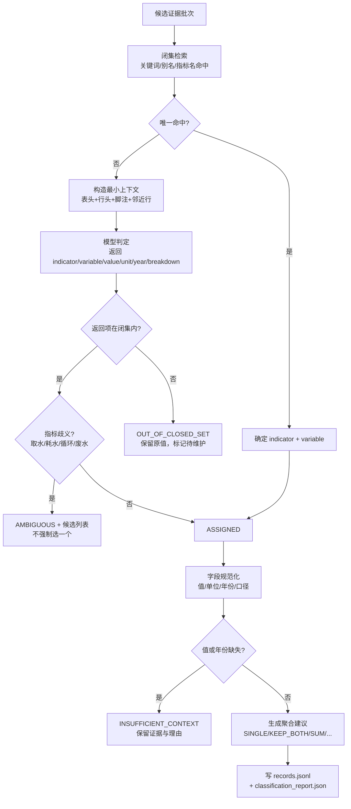

**与现有实现的差异**：现有 `ClosedSetExtractor` 直接让模型返回记录，解析时做闭集校验与溯源回退；本文增加 ① 闭集检索前置（能规则命中的不调模型）、② 显式状态机、③ 聚合建议字段。三者都是**增量**，不推翻现有解析逻辑。

### 6.6 输出（`ClassificationRecord` v2）

在现有 `MetricRecord` 字段基础上扩展，**保留原字段名**（`records.jsonl` 兼容）：

| 字段 | 类型 | 必填 | 说明 | 来源 |
| --- | --- | --- | --- | --- |
| `pid` | string | 是 | 报告 ID | 证据 |
| `evidence_id` | string | 是 | 溯源 | 证据 |
| `source_kind` | `text`/`table_cell`/`figure`/`page_ocr` | 是 | 来源通道 | 证据 |
| `source_page` | int | 是 | 页码，**以证据为准**；LLM 页码仅交叉校验 | 证据 |
| `bbox` | array \| null | 否 | 定位 | 证据 |
| `classification_status` | 见 6.7 | 是 | **新增**，归类状态 | 本文 |
| `indicator_id` | string | 条件 | 闭集指标码；`OUT_OF_CLOSED_SET` 时可为空 | 闭集 |
| `variable` | string | 条件 | 闭集变量全名（含括号说明） | 闭集 |
| `category` | string | 否 | 指标类别（闭集映射） | 闭集 |
| `value` | number \| string | 是 | 数值（原样解析） | 模型/证据 |
| `unit` | string \| null | 否 | 单位原文（**不换算**） | 模型/证据 |
| `year` | int \| null | 否 | 数据年份；缺失时用报告年度并标 `year_inferred=true` | 模型/上下文 |
| `year_inferred` | bool | 否 | **新增**，年份是否为推断 | 本文 |
| `report_year` | int | 是 | 报告年度（上下文） | 上下文 |
| `breakdown` | string \| null | 否 | 统计口径（`Group`/`Hong Kong`/`Male`/板块名） | 模型 |
| `aggregation_hint` | 见 6.9 | 否 | **新增**，聚合建议 | 本文 |
| `value_nature` | `REPORTED`/`REPORTED_ZERO`/`ESTIMATED`/`COMPUTED` | 是 | **新增**，数值性质 | 模型+规则 |
| `confidence` | number | 是 | 模型置信度（0–1） | 模型 |
| `confidence_tier` | `high`/`medium`/`low` | 是 | 证据分层（不是模型置信度） | 证据 |
| `provenance_source` | `evidence_id`/`page_value`/`unresolved` | 是 | 溯源级别 | 解析 |
| `validation_status` | `checked`/`needs_review`/`variable_not_in_closed_set` | 是 | 兼容现有字段 | 解析 |
| `validation_notes` | string[] | 是 | 逐条说明（闭集修正、页码不一致、无法回溯等） | 解析 |
| `classification_reason` | string | 否 | **新增**，一句话归类理由 | 模型 |
| `model_call_id` | string \| null | 否 | 模型调用记录 | 网关 |
| `catalogue_version` | string | 是 | 闭集版本 | 上下文 |

**输出示例**：

```json
{
  "pid": "2025073101502",
  "evidence_id": "2025073101502_e00005",
  "source_kind": "table_cell",
  "source_page": 7,
  "bbox": [156.1, 284.8, 524.7, 444.8],
  "classification_status": "ASSIGNED",
  "indicator_id": "E1.1.1",
  "variable": "greenhouse gas emission of Scope 2 (indirect emissions)",
  "category": "温室气体 (GHG) 排放管理",
  "value": 8125.11,
  "unit": "tCO2e",
  "year": 2025,
  "year_inferred": false,
  "report_year": 2025,
  "breakdown": "Group",
  "aggregation_hint": "SINGLE",
  "value_nature": "REPORTED",
  "confidence": 0.9,
  "confidence_tier": "high",
  "provenance_source": "evidence_id",
  "validation_status": "checked",
  "validation_notes": [],
  "classification_reason": "表内 Scope 2 行 + 列头 Emissions (in tCO2e)，与指标定义一致",
  "model_call_id": "mdl_...",
  "catalogue_version": "MD-2026.10"
}
```

> 上例是**结构示意**，数值来自既有产物，不代表评分结果。

### 6.7 归类状态与处置

| 状态 | 含义 | 典型触发 | S5 处置 | 能否进入评分 |
| --- | --- | --- | --- | --- |
| `ASSIGNED` | 唯一指标 + 变量 + 可解析值 | 正常 | 进入一致性校验 | 视校验与质量分而定 |
| `AMBIGUOUS` | 指标可缩小到 2–3 个候选但无法唯一 | 取水/耗水混用、合计 vs 分项、口径不明 | `needs_review`，保留候选列表 | 否（人工确认后重跑） |
| `UNMAPPED` | 明确是 ESG 数据，但闭集中无对应变量 | 披露"耗水量"但闭集无该变量 | `needs_review`，进闭集维护清单 | 否 |
| `OUT_OF_CLOSED_SET` | 模型返回了闭集外的指标/变量 | 幻觉、拼写错误 | 保留原值，标 `needs_review`，**修正为闭集映射（若唯一）或降级** | 否（除非修正成功） |
| `INSUFFICIENT_CONTEXT` | 缺值/缺年份/缺单位导致无法形成记录 | 裸数字、断句、表格读残 | 保留证据与理由 | 否 |

`【设计规定】` 现有实现只有 `validation_status`（三值），信息不足以区分"闭集外"与"歧义"与"上下文不足"。新增 `classification_status` 后，`validation_status` 保留用于兼容，两者映射：

| `classification_status` | 兼容 `validation_status` |
| --- | --- |
| `ASSIGNED` | `checked` |
| `AMBIGUOUS` / `UNMAPPED` / `INSUFFICIENT_CONTEXT` | `needs_review` |
| `OUT_OF_CLOSED_SET` | `variable_not_in_closed_set` |

### 6.8 一表多记录、多年份、多口径

这是表格证据（一表一条）带来的关键要求：

1. **多年份**：表格列头含 `2024/2025` 时，每个年份每个变量一条记录；`year` 取列头，不得只取最新年。
2. **多口径**：行按地区/板块拆分时，`breakdown` 必须填写（如 `Hong Kong`、`Ports`），集团合计填 `Group`；缺失 `breakdown` 视为 `AMBIGUOUS`。
3. **合计与分项**：报告有 `Total/合计` 行时，总量变量取合计行；分项变量各取各行。**不得**用分项值充当总量（现有提示词规则 #15 的要求，保留）。
4. **合并行与分项行**：`Scope 1+2` 与 `Scope 1`/`Scope 2` 分别成记录；不得用分项填合并变量。
5. **同一单元格多值**（如 `1,234 (2024: 1,100)`）：拆成两条，第二条 `year=2024`，并在 `validation_notes` 标注"括号内为对比年"。
6. **零值**：`no ... generated` / `zero cases` / `0` → `value_nature=REPORTED_ZERO`，`value=0`，不得留空。

### 6.9 聚合建议（`aggregation_hint`）

`【设计规定】` 现有语义层不做聚合；旧 skill 流程（Phase 2）用 LLM 做过 `keep_both/sum/sum_with_unit_conversion/weighted_avg`。本文把这部分职责归还给归类 Agent，但**只给建议、不做算术**：

| 值 | 含义 | 使用条件 |
| --- | --- | --- |
| `SINGLE` | 单条即可 | 默认 |
| `KEEP_BOTH` | 多口径/多定义并存，都保留 | 集团 vs 分板块、累计 vs 当年、不同定义 |
| `SUM_GROUP` | 分项可加总为集团值 | 分项属于同一指标子集、口径一致、单位相同、**且报告未给合计** |
| `SUM_WITH_UNIT_CONVERSION` | 需先换算再加总 | 同上但单位不同（换算由 S5 执行并记录因子） |
| `WEIGHTED_AVG` | 分项是比率且有权重 | 有明确权重（人数/营收）；无权重 → `SKIP` |
| `SKIP` | 无法聚合 | 比率无权重、口径冲突 |

约束：

1. `aggregation_hint` 必须带 `aggregation_reason`（一句话）与 `aggregation_members`（`evidence_id` 列表）。
2. 算术**只在 S5/Normalizer 执行**，且必须记录公式、输入、输出、因子版本。
3. 若 `aggregation_hint=SUM_GROUP` 但报告已有合计行 → 强制改 `KEEP_BOTH` 并告警（重复计算风险）。

### 6.10 溯源与页码规则

`【现有实现】` 三级回退，本文固定为契约：

```text
1) 模型返回 evidence_id 且能在本批找到 → provenance_source=evidence_id
2) 否则用 (source_page, value) 在批内匹配 → provenance_source=page_value
3) 都不行 → provenance_source=unresolved，validation_notes 追加"无法回溯"，状态降级
```

**页码规则**：`source_page` 一律取证据页码；模型返回的页码只在 `validation_notes` 里记"LLM=1，证据=p7（以证据为准）"。

**证据链完整性**：`unresolved` 的记录仍然保留（不丢），但 S5 必须把它排除在入库/评分之外（`quality_band=reject` 或 `needs_review`）。

### 6.11 异常、重试与预算

| 情况 | 处理 |
| --- | --- |
| 模型超时/5xx | 重试 2 次；仍失败 → 该批产 `INSUFFICIENT_CONTEXT` 占位记录（带 `evidence_id`），`classification_reason="模型失败"` |
| JSON 不可解析 | `extract_json_array` 抢救；仍失败 → 该批 `INSUFFICIENT_CONTEXT`，不写 done key（下次可续跑） |
| 返回指标不在闭集 | 标 `OUT_OF_CLOSED_SET`，记录原值；若闭集映射唯一且无歧义，按映射修正并在 `validation_notes` 记"已按闭集修正" |
| 一变量多指标 | 保留模型选择（现有 `indicators_for_variable` 支持），在 `validation_notes` 记候选 |
| 预算耗尽 | 停止调用，剩余证据标 `INSUFFICIENT_CONTEXT` + `R-BUDGET-EXCEEDED` 等价理由 |
| 整批失败 | 该报告 `records=0`，`semantic_report.json` 标 `fatal=true`，**不写主 records**（现有 `_stale` 隔离机制） |

### 6.12 接口

```python
class ClosedSetExtractor:
    def extract(
        self,
        evidence: Sequence[Evidence],
        reporting_year: int | None = None,
        pid: str | None = None,
        *,
        catalogue: VariableCatalogue | None = None,
        run: ClassificationRun | None = None,
    ) -> tuple[list[MetricRecord], dict]: ...
```

兼容说明：现有签名已包含 `reporting_year / pid / max_evidence / on_batch / done_keys`，本文新增参数为关键字参数，不破坏旧调用。

**HTTP 接口**（后续）：

```http
POST /v1/classify:run
{"pid": "...", "filter_run_id": "...", "catalogue_version": "MD-2026.10",
 "mode": "STANDARD", "idempotency_key": "..."}
```

响应 `202` + `classification_run_id`；查询返回状态、统计（`ASSIGNED/AMBIGUOUS/...` 计数）与产物路径。

### 6.13 测试与验收

| 用例 | 输入 | 期望 | 通过条件 |
| --- | --- | --- | --- |
| `C-01` 四类水指标同表 | 取水/耗水/循环/废水四行 | 分别归入 `E2.1.1/E2.1.4/E2.1.3`；耗水 → `UNMAPPED` | 无合并、无错位 |
| `C-02` 取水 vs 耗水 | "water consumption 1,000 m3" | 不映射到 `Total Water Withdrawal` | 见 6.4 判定表 |
| `C-03` 多年表格 | 2023/2024/2025 三列 | 三条记录，`year` 各不同 | 不只取最新年 |
| `C-04` 集团/区域 | Group / HK 两行 | 两条，`breakdown` 不同 | 不被冲突消解合并 |
| `C-05` 合计 vs 分项 | Total + 分项 | 总量取 Total | 不用分项冒充 |
| `C-06` Scope 1+2 | 分项 + 合并行 | 分别成记录 | 不混填 |
| `C-07` 零值 | "no hazardous waste generated" | `REPORTED_ZERO`，`value=0` | 不丢 |
| `C-08` 闭集外变量 | 模型返回 `"耗水量"` | `OUT_OF_CLOSED_SET` + 保留原值 | 不丢弃 |
| `C-09` 页码不一致 | LLM page=1，证据 p7 | `source_page=7` + 备注 | 以证据为准 |
| `C-10` 无法溯源 | 无 evidence_id 且 page/value 不匹配 | `unresolved` + 备注 | 记录保留 |
| `C-11` 裸数字 | `0.11` 无上下文 | `INSUFFICIENT_CONTEXT` | 不猜指标 |
| `C-12` 聚合建议 | 分板块 3 行、无合计 | `SUM_GROUP` + 成员列表 | 不执行算术 |
| `C-13` 有合计又建议 SUM | 报告有 Total | 改成 `KEEP_BOTH` + 告警 | 防重复计算 |
| `C-14` 批续跑 | 中途失败 | `done_keys` 跳过已完成批 | 不重复产记录 |
| `C-15` 全批失败 | client 全抛 | 不写主 records | 旧 records 隔离到 `_stale` |

**验收门槛**：

1. 闭集外变量 100% 被标记（不得静默通过）。
2. `unresolved` 记录 100% 有说明，且不进入正式入库。
3. 金标准集上"指标 + 变量 + 年份 + 口径"四项准确率按第 14 章测量（目标值待确认）。
4. 同一证据重复归类结果一致（同模型版本、同闭集、同温度）。

### 6.14 与其他模块交互

- **上游**：只读 S2 的候选证据与决策；不读 `noise_lines.jsonl`（那是 S1 的台账）。
- **下游**：S5 读 `records.jsonl` 做校验、质量分、冲突消解，S4 审查读同一份记录做语义审查；`AMBIGUOUS/UNMAPPED` 进入复核队列。
- **闭集维护**：`UNMAPPED` 汇总成"闭集缺口清单"，交由业务评审后更新 `indicator_variables.json`（需要版本升级）。
- **不写** S1/S2 产物。

---

### 6.15 日志、状态与质量标记

| 项 | 内容 |
| --- | --- |
| 结构化日志 | 每条记录一行：`classification_run_id / evidence_id / classification_status / indicator_id / variable / value / unit / year / breakdown / provenance_source / model_call_id` |
| 轮次级日志 | `esg_classification_run`：`n_candidates / n_assigned / n_ambiguous / n_unmapped / n_out_of_closed_set / n_insufficient / n_unresolved` |
| 状态 | `classification_status`（单条）+ `run.status` |
| 质量标记 | `provenance_source=unresolved`、`year_inferred=true`、`aggregation_hint != SINGLE`、`validation_status=variable_not_in_closed_set` |
| 告警 | `OUT_OF_CLOSED_SET` 比例 > 5%、`unresolved` > 0、同一证据两次归类指标不一致（同版本） |
| 不可写 | 不改证据、不改过滤决策、不做单位换算 |

## 第七章 S4 LLM 审查 Agent 详细设计

### 7.0 定位

`【设计规定】` 在"归类完成"与"确定性验证"之间加一层语义审查。它回答的问题是：

> **这条记录，按报告原文和指标定义看，讲得通吗？**

它**不是**第二个归类 Agent，也**不是**独立校验器：

| 对比项 | S3 归类 | S4 审查 | S5 验证 |
| --- | --- | --- | --- |
| 判断对象 | 单条证据属于哪个指标 | 已归类记录与证据/同组记录是否自洽 | 结构、单位量级、跨年、门禁 |
| 判断方式 | 闭集 + 语义 | 语义 + 跨记录对照 | 确定性规则 |
| 是否改数据 | 不改（只产记录） | **不改**（只产 finding） | 不改（只算质量分/消解） |
| 失败后果 | 归类错误进入下游 | 错误被拦下或降级 | 脏数据入库 |
| 模型依赖 | 是 | 是 | 否 |

**一句话边界**：S3 决定"是什么"，S4 质疑"这个判断站不站得住"，S5 决定"能不能入库"。

### 7.1 职责

1. 按**指标组**（`(pid, indicator_id)`）审查该组全部记录：指标/变量是否错位、值/单位/年份/口径是否与证据一致。
2. 检查跨记录关系：总量 vs 分项、绝对量 vs 强度、本企业 vs 行业均值、集团 vs 区域、多年份是否齐全。
3. 检查关键指标是否**漏提**（该报告明显披露了某指标，但归类结果没有）。
4. 检查重复是否未合并、聚合建议是否明显错误。
5. 输出结构化 finding（代码、严重度、证据、建议动作、置信度、理由），并给出每条记录的审查结论（`CONFIRMED/SUSPECT/REJECTED/INSUFFICIENT`）。
6. 把需要人工确认的项转成复核任务；把确定性可判的项交给 S5。

### 7.2 不负责

- **不修改** `records.jsonl`、`evidence.jsonl`、任何 S1–S3 产物。
- **不做算术**：不求和、不算比率、不做单位换算（发现疑似错误只描述并指向 S5 的检查项）。
- **不判断证据是否值得保留**（S2 已判）。
- **不判断能不能入库**（S5 门禁）。
- **不引入闭集外指标**：只能引用闭集内变量，或标 `A-CLOSED-SET-GAP`。
- 不调用 PDF 解析/表格工具，不重读整页；只看证据片段与记录。

### 7.3 输入

审查以"指标组"为单位，不逐条孤立审查（跨记录问题是审查的主要价值）：

```json
{
  "run": {"run_id": "ar_2025073101502_20261027T090000", "pid": "2025073101502",
          "mode": "STANDARD", "budget": {"max_model_calls": 12, "max_tokens": 90000}},
  "report_context": {"pid": "2025073101502", "report_year": 2025,
                     "period_start": "2024-04-01", "period_end": "2025-03-31",
                     "company_name": "Imperium Financial Group Limited", "doc_type": "vector"},
  "indicator_group": {
    "indicator_id": "E2.1.1",
    "definition": {"metric": "取水量/消耗量",
                   "extractable": ["Total Water Withdrawal (from all sources in m³)",
                                   "Water Intensity this year",
                                   "Water Intensity last year",
                                   "Industry Average Water Intensity value"],
                   "keywords": ["water withdrawal", "water intake", "取水量", "取水强度"]},
    "records": [
      {"record_uid": "...|E2.1.1|Total Water Withdrawal (from all sources in m³)|2025|Group",
       "variable": "Total Water Withdrawal (from all sources in m³)",
       "value": 12345, "unit": "m3", "year": 2025, "breakdown": "Group",
       "source_page": 12, "evidence_id": "2025073101502_e00201",
       "classification_status": "ASSIGNED", "provenance_source": "evidence_id",
       "classification_reason": "表内 Total water withdrawal 行，列头 2025",
       "sibling_hint": "同表另有 2024 列"}
    ],
    "evidence": [
      {"evidence_id": "2025073101502_e00201", "page_no": 12, "kind": "table_cell",
       "content": "<table>...Total water withdrawal 12,345...2024: 11,000...</table>",
       "unit_hint": "m3", "col_header": "2025", "row_header": "Total water withdrawal",
       "tier": "high", "source_ref": {"verdict": "ok", "review_flags": []}}
    ]
  },
  "review_policy": {"policy_version": "RP-1.0.0",
                    "check_missing_key": true, "water_rules_version": "WR-1.0.0"}
}
```

输入约束：

1. 一个审查单元只含一个 `indicator_id`；跨指标矛盾（如同一年取水量与耗水量关系）由总结 Agent 与人工发现，不在本 Agent 做（避免上下文膨胀与越权）。
2. 每条记录必须带 `evidence_id` 或明确 `provenance_source`；证据内容按需截断（≤1200 字符/条）。
3. 同组记录数 ≤ 20；超过则按 `(year, breakdown)` 分组分批。
4. `review_policy` 必须显式传入并回写版本。

### 7.4 审查维度与 finding 码

| 维度 | finding 码 | 典型场景 | 默认严重度 |
| --- | --- | --- | --- |
| 指标错位 | `A-IND-MISMATCH` | "耗水量"被归成取水量；高压力地区取水被归成总取水 | BLOCK |
| 变量错位 | `A-VAR-MISMATCH` | 强度值填进绝对量变量；去年值填进今年变量 | BLOCK |
| 口径混用 | `A-SCOPE-MIX` | 分项冒充总量；Scope 1/2 填进 1+2 | BLOCK |
| 单位不符 | `A-UNIT-MISMATCH` | 记录单位与证据单位不一致 | BLOCK |
| 年份不符 | `A-YEAR-MISMATCH` | 记录年份不等于列头/正文年份 | BLOCK |
| 口径缺失 | `A-BOUNDARY-MISSING` | 多条记录同指标同年却无 `breakdown` | WARN |
| 数值可疑 | `A-VALUE-IMPLAUSIBLE` | 数量级明显异常（如 10× 偏差）、负值 | WARN |
| 跨记录矛盾 | `A-CROSS-RECORD` | 同指标同年两条值差 >10% 且无口径差异 | BLOCK/WARN |
| 重复未合并 | `A-DUPLICATE-UNMERGED` | 同值同单位同页被归成两条 | WARN |
| 聚合错误 | `A-AGGREGATION-WRONG` | 分项可加总却标 `KEEP_BOTH`；有合计却标 `SUM_GROUP` | WARN |
| 关键指标漏提 | `A-MISSING-KEY` | E2.1.1 有披露但无取水量记录 | BLOCK |
| 证据不足 | `A-EVIDENCE-WEAK` | 记录指向的证据不含该数值；`unresolved` | BLOCK |
| 闭集缺口 | `A-CLOSED-SET-GAP` | 明显是 ESG 数据但闭集无变量 | INFO |

**判定规则**（写进提示词与后处理，不靠模型自由发挥）：

1. 每条 finding 必须引用至少一个 `evidence_id`（`A-MISSING-KEY` 可引用页级线索）。
2. 严重度为 `BLOCK` 的 finding，模型置信度必须 ≥ 0.7，否则自动降为 `WARN`（后处理执行）。
3. 禁止把"我建议改成 X"写成事实：修正值只能进 `proposed_value`，且必须附证据片段。
4. 同一记录同一码只报一条（去重）。
5. 无法判断时输出 `INSUFFICIENT`，不得输出 `REJECTED`。

### 7.5 处理流程

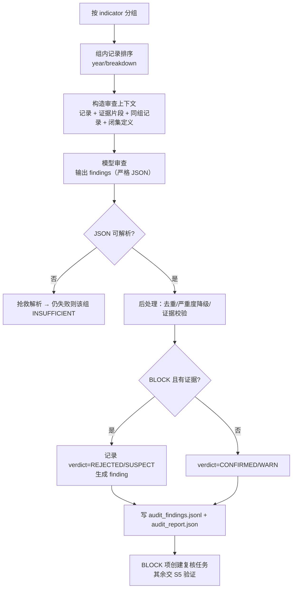

### 7.6 输出（`AuditFinding` / `AuditOutcome`）

**单条 finding**：

| 字段 | 类型 | 必填 | 说明 |
| --- | --- | --- | --- |
| `finding_id` | string | 是 | `af_{pid}_{seq}` |
| `audit_run_id` | string | 是 | |
| `pid` | string | 是 | |
| `indicator_id` | string | 是 | |
| `record_uid` | string \| null | 否 | 目标记录；`A-MISSING-KEY` 可为空 |
| `code` | enum（§7.4） | 是 | |
| `severity` | `BLOCK`/`WARN`/`INFO` | 是 | |
| `confidence` | number 0–1 | 是 | `BLOCK` 需 ≥0.7 |
| `evidence_ids` | string[] | 是 | 至少 1 个 |
| `evidence_span` | string | 否 | 证据原文片段（≤300 字） |
| `observed` | string | 否 | 记录里看到什么 |
| `expected` | string | 否 | 按定义应是什么 |
| `proposed_action` | enum | 是 | `KEEP`/`REMAP`/`CORRECT_VALUE`/`MARK_MISSING`/`MERGE_DUPLICATE`/`ESCALATE` |
| `proposed_value` | number \| null | 否 | **候选值，不写库** |
| `proposed_variable` | string \| null | 否 | 候选变量 |
| `reason` | string | 是 | 一句话中文理由 |
| `model_call_id` | string \| null | 否 | |
| `review_policy_version` | string | 是 | |

**组级结论**（`AuditOutcome`）：

```json
{
  "audit_run_id": "ar_2025073101502_20261027T090000",
  "pid": "2025073101502",
  "indicator_id": "E2.1.1",
  "policy_version": "RP-1.0.0",
  "record_verdicts": [
    {"record_uid": "...|E2.1.1|Total Water Withdrawal (from all sources in m³)|2025|Group",
     "verdict": "CONFIRMED", "finding_ids": []},
    {"record_uid": "...|E2.1.1|Water Intensity this year|2025|Group",
     "verdict": "SUSPECT", "finding_ids": ["af_2025073101502_0003"]}
  ],
  "findings": ["af_2025073101502_0003"],
  "stats": {"records": 4, "confirmed": 3, "suspect": 1, "rejected": 0,
            "insufficient": 0, "block": 0, "warn": 1, "info": 0},
  "status": "SUCCEEDED"
}
```

### 7.7 严重度与下游处置

| 严重度 | S5 验证 | 质量分 | 复核 | 能否入库 | 能否评分 |
| --- | --- | --- | --- | --- | --- |
| `BLOCK` | 该记录直接不通过（`V-17`） | — | 自动创建 P0 复核 | 否 | 否 |
| `WARN` | 通过但记 `validation_notes` | −0.10 | P1 复核（可批量） | 是 | 是，但解释必须披露 |
| `INFO` | 无影响 | 0 | 不创建 | 是 | 是 |
| `INSUFFICIENT`（组级） | 记录标 `needs_review` | −0.15 | P1 | 否（未确认） | 否 |

**新增校验项**（第8章 S5 验证表补一条）：

| 编号 | 校验 | 判定 | 级别 |
| --- | --- | --- | --- |
| `V-17` | 审查阻断 | 记录的 `audit verdict` 不得为 `REJECTED`，且不得有未处理的 `BLOCK` finding | error |

### 7.8 上下文构造（控制成本与提升判断质量）

审查上下文只放"判断所需"，不重贴整份报告：

| 内容 | 取法 | 上限 |
| --- | --- | --- |
| 记录字段 | `record_uid/variable/value/unit/year/breakdown/source_page/classification_reason` | 每记录 ≤ 300 字 |
| 证据片段 | 从 `evidence.jsonl` 取该 `evidence_id` 的 `content` | ≤ 1200 字/条，超出截断并标 `truncated` |
| 同组其它记录 | 只给 `variable/value/unit/year/breakdown` | ≤ 20 条 |
| 闭集定义 | 该指标的 `metric/keywords/variables` | 固定 |
| 水指标判别规则 | §6.4 的判定表摘要 | 固定 |
| S1 质量线索 | `tier/verdict/review_flags` | 每条 ≤ 100 字 |

**不放进上下文**：整份 PDF 文本、其它指标记录、其它报告、历史对话、上一轮自由文本回答。

### 7.9 采样与预算

| 指标类型 | 审查范围 | 理由 |
| --- | --- | --- |
| 评分关键指标（E2.1.1 所需变量） | **100%** 审查 | 错一条就影响分数 |
| 其他定量指标 | 默认 20% 抽样（按 `hash(record_uid)` 稳定抽样） | 成本控制（Q-21） |
| `quality_band=review` 或 `provenance=unresolved` | 100% | 高风险记录 |
| 已人工确认（`decision_source=HUMAN`） | 跳过 | 人工已判 |

预算：`max_model_calls = ceil(组数 / 2) + 2`；超预算时剩余组标 `INSUFFICIENT`（不是跳过）。

### 7.10 异常、重试与降级

| 情况 | 处理 |
| --- | --- |
| 模型超时/5xx | 重试 2 次；仍失败 → 该组 `INSUFFICIENT`，记录保留，创建 P1 复核 |
| JSON 不可解析 | `extract_json_array` 抢救；仍失败 → 该组 `INSUFFICIENT` |
| 返回 finding 码不在枚举 | 丢弃该条并记 `invalid_finding_code`，不静默当通过 |
| finding 引用不存在的证据 | 丢弃该条并记 `dangling_evidence` |
| `BLOCK` 置信度 < 0.7 | 自动降 `WARN`（后处理） |
| 预算耗尽 | 剩余组 `INSUFFICIENT`，报告标 `truncated=true` |
| 无模型（离线） | 全部组 `INSUFFICIENT`，不伪造通过 |

### 7.11 与人工复核的衔接

审查 Agent **不新建界面**，复用现有校对入口：

| 入口 | 用途 | 与 finding 的关系 |
| --- | --- | --- |
| `esg_extract_review.py` 的 CSV 包 | 批量导出 OCR 表/图表/记录/needs_review | 追加 `audit_findings.csv`（finding 清单） |
| `esg_extract_review_html.py` 的单文件 HTML | 左图右文人工校对 | 每页顶部增加"审查发现"区块 |
| `esg_review_task`（第11章） | 复核任务与结论 | `BLOCK`/`INSUFFICIENT` 自动建任务 |

复核结论回流：

- `KEEP` → finding 标 `resolved_by=HUMAN`，`verdict=CONFIRMED`，S5 放行；
- `REMAP` → 新归类记录（新 `classification_run`），重新审查；
- `CORRECT_VALUE` → 新记录版本（候选值经人工确认），重新审查；
- `EXCLUDE_FROM_SCORING` → 记录保留但不可评分。

### 7.12 接口

```python
class SemanticAuditor:
    def audit_group(self, ctx: AuditContext,
                    group: IndicatorGroup) -> AuditOutcome: ...
    def audit_report(self, ctx: AuditContext,
                     records: Sequence[MetricRecord],
                     evidence: Sequence[Evidence],
                     sample_rate: float = 0.2) -> AuditReport: ...
```

HTTP：`POST /v1/audit:run {pid, classification_run_id, policy_version, sample_rate}` → `202 {audit_run_id}`；`GET /v1/audit:runs/{id}` 返回统计与产物路径。

### 7.13 测试与验收

| 用例 | 场景 | 期望 | 通过条件 |
| --- | --- | --- | --- |
| `A-01` | 耗水量被归成取水量 | `A-IND-MISMATCH` + BLOCK | 阻断 |
| `A-02` | 强度值填进绝对量 | `A-VAR-MISMATCH` | 阻断 |
| `A-03` | 分项冒充总量 | `A-SCOPE-MIX` | 阻断 |
| `A-04` | 单位与证据不一致 | `A-UNIT-MISMATCH` | 阻断 |
| `A-05` | 年份取错列 | `A-YEAR-MISMATCH` | 阻断 |
| `A-06` | 集团/区域无 breakdown | `A-BOUNDARY-MISSING` | WARN |
| `A-07` | 同指标同年两值差 20% | `A-CROSS-RECORD` | BLOCK/WARN |
| `A-08` | 明显有取水披露但无记录 | `A-MISSING-KEY` | BLOCK |
| `A-09` | 证据不含该数值 | `A-EVIDENCE-WEAK` | BLOCK |
| `A-10` | 模型返回未知码 | 丢弃 + 计数 | 不误通过 |
| `A-11` | 模型失败 | 组 `INSUFFICIENT` | 不伪造通过 |
| `A-12` | 记录被人工确认过 | 跳过审查 | 不重复报 |
| `A-13` | 重复未合并 | `A-DUPLICATE-UNMERGED` | WARN |
| `A-14` | 有合计却标 SUM_GROUP | `A-AGGREGATION-WRONG` | WARN |

**验收门槛**：

1. 金标准集上"错映射"审查召回率见 §19.3（目标待确认）；`BLOCK` 误报率 ≤ 5%（Q-21）。
2. 每条 finding 100% 有证据引用与理由。
3. 审查不改变任何 S1–S3 文件（文件哈希不变）。
4. 模型失败/预算耗尽时，记录仍完整保留且状态明确。

### 7.14 日志、状态与质量标记

| 项 | 内容 |
| --- | --- |
| 结构化日志 | 每条 finding 一行：`audit_run_id/pid/indicator/record_uid/code/severity/confidence/evidence_ids` |
| 轮次级 | `esg_audit_run`：组数、记录数、各 verdict 计数、finding 计数、`truncated/degraded` |
| 状态 | 记录级 `audit_verdict` + 组级 `status` |
| 质量标记 | `A-*` 码 + `severity`；`WARN` 直接进质量分惩罚项 |
| 告警 | `INSUFFICIENT` 比例 > 20%、`BLOCK` 比例 > 10%、finding 码分布突变 |
| 不可写 | 不改 records/evidence；只写 `audit_findings`/`audit_result` |

### 7.15 与其他模块交互

- 上游：S3 `records.jsonl` + S1 `evidence.jsonl` + 闭集。
- 下游：S5 读 `audit_findings.jsonl`（`V-17` 门禁 + 质量分）；Planner 读审查状态决定是否转人工/继续；S6 总结读 findings 生成"问题与待办"。
- 复核：见 §7.11。

### 7.16 硬约束（评审必查）

1. 审查 Agent 的任何输出**不得**写 `records.jsonl` / `evidence.jsonl` / `esg_quant_v2_result`。
2. `proposed_value` 只是候选，必须经人工或 S5 规则确认后才可能成为新记录。
3. 审查不做算术；发现"合计不等于分项之和"时只报 `A-AGGREGATION-WRONG`，由 S5 的 `V-10` 复算。
4. 审查不得引用闭集外变量作为"应该是"；闭集缺口只能报 `A-CLOSED-SET-GAP`（INFO）。

---

## 第八章 S5 确定性数据验证详细设计

### 8.0 定位与边界

`【设计规定】` S5 是**唯一有权决定"能不能入库"的阶段**，全部为确定性代码，不调用模型。它由四步组成：校验 → 质量分 → 冲突消解 → 入库门禁。现有实现已具备这四步（`validator.py`、`quality.py`、`store.py`），本文补四件事：① 把 S2/S3/S4 的状态纳入校验；② 明确聚合执行边界；③ 把门禁条件编号化；④ 消费审查 finding（`V-17`）。

| 项 | 内容 |
| --- | --- |
| 输入 | `records.jsonl`（S3）+ `semantic_filter.jsonl`（S2）+ `audit_findings.jsonl`（S4）+ `evidence.jsonl`（S1）+ 闭集版本 + `_run_manifest.json` |
| 输出 | `records_validated.jsonl`、`validation_issues.json`、`records.csv`、`esg_quant_v2_result` 行、`validation_report.json`（新增） |
| 不做 | 不做指标判断、不做语义过滤、不做语义审查、不修改 S1–S4 的原始产物、不做算术之外的推断 |

### 8.1 校验项清单

| 编号 | 校验 | 判定 | 级别 | 来源 |
| --- | --- | --- | --- | --- |
| `V-01` | 必有字段完整 | `pid/indicator_id/variable/value/year` 非空 | error | 现有 + 新增 |
| `V-02` | 闭集合法性 | `variable` 在闭集内；`indicator_id` 与变量映射一致 | error | 现有 |
| `V-03` | 溯源可解析 | `provenance_source ∈ {evidence_id, page_value}` 且 `evidence_id` 存在；`unresolved` 必须带说明 | error | 现有 |
| `V-04` | 页码一致 | `source_page == evidence.page_no` | warn | 现有 |
| `V-05` | 单位量级一致 | 同一变量跨年单位/量级一致（`千吨` vs `吨`） | error | 现有 `unit_magnitude_mismatch` |
| `V-06` | 年份范围 | `year` 不晚于报告发布年、不早于 2000 | error | 现有 `year_out_of_range` |
| `V-07` | 负值检查 | 绝对量不得为负（变化率类变量除外） | error | 现有 `negative_absolute` |
| `V-08` | 量级上界 | 数值不超该单位合理上界（漏乘/多乘 1000） | warn | 现有 `magnitude_bound` |
| `V-09` | 同比跳变 | 相邻年变化 > 5× 且无解释 | warn | 现有 `yoy_jump` |
| `V-10` | 分项合计 | Scope 1+2 与合并总量相差 > 5% | warn | 现有 `scope_sum_mismatch` |
| `V-11` | 单位缺失 | 既无绑定单位也无文本线索 | warn | 现有 `missing_unit` |
| `V-12` | 归类状态 | `classification_status != ASSIGNED` 的记录不得入库 | error | **新增** |
| `V-13` | 过滤状态 | `filter_status = EXCLUDE` 的记录不得出现在输入（出现即 error）；`REVIEW` 必须降级 | error | **新增** |
| `V-14` | 口径完整 | 多口径记录（同指标同变量同年多值）必须有 `breakdown` | error | **新增** |
| `V-15` | 聚合一致 | `aggregation_hint=SUM_GROUP` 时成员必须齐全且不被同时入库 | warn | **新增** |
| `V-16` | 年份推断标记 | `year_inferred=true` 的记录必须带 `year` 且不能参与跨年对比 | warn | **新增** |
| `V-17` | 审查阻断 | `audit_verdict` 不得为 `REJECTED`；不得存在未处理的 `BLOCK` finding | error | **新增（消费 S4）** |

severity 语义：`error` 阻断该条入库；`warn` 允许入库但进 `validation_notes`、降质量分、在解释中披露。

### 8.2 质量分与分档（保留现有实现）

`【现有实现】` 质量分不是模型置信度，而是可解释的加权和，权重集中在 `QualityPolicy`：

| 因子 | 取值 | 说明 |
| --- | --- | --- |
| `tier_base` | high 0.75 / medium 0.55 / low 0.35 | 证据分层 |
| `provenance_bonus` | evidence_id +0.10 / page_value 0 / unresolved −0.25 | 溯源级别 |
| `source_bonus` | table_cell +0.05 / text +0.02 / figure 0 | 来源通道 |
| `unit_bonus` | +0.05 | 有单位 |
| `year_bonus` | +0.05 | 有年份 |
| `estimated_penalty` | −0.05 | 图表估算值 |
| `not_in_closed_set_penalty` | −0.15 | 闭集外变量 |
| `validation_error_penalty` | −0.10 | 有 error |
| `validation_warn_penalty` | −0.03 | 有 warn |

分档：`auto ≥ 0.70`、`review ≥ 0.45`、`reject < 0.45`。`reject` 记录**留档但不入库**。

`【设计规定】` 质量分增加三项（需评审后生效，先作为可选权重）：`classification_status` 非 `ASSIGNED` −0.20；`filter_status=REVIEW` −0.10；存在 `WARN` 级审查 finding −0.10（`BLOCK` 直接不入库，不参与打分）。**这只是工程参数，不是业务评分规则**（Q-09）。

### 8.3 冲突消解（保留现有实现）

- 分组键：`(pid, indicator_id, variable, year, breakdown)`。**必须含 `breakdown`**，否则集团/区域会被误判冲突。
- 组内排序：`(quality_score, tier_rank, source_rank, provenance_rank, confidence)` 降序。
- 结果：`winner` 保留，其余 `superseded` 并写 `superseded_by`（指纹）与说明；**落败记录仍写盘**，可审计。
- 门禁：同组不得出现两个 `winner`；`superseded` 必须写 `superseded_by`。

### 8.4 聚合执行（新增，边界明确）

`【设计规定】` S3 只给 `aggregation_hint`，算术在 S5 执行（或交给后续 Normalizer）：

| hint | S5 行为 |
| --- | --- |
| `SINGLE` / `KEEP_BOTH` | 不计算，按冲突消解处理 |
| `SUM_GROUP` | 校验成员单位一致 → 求和 → 生成一条 `breakdown=Group` 的记录，`value_nature=COMPUTED`、`derived_from=[成员 evidence_id]` |
| `SUM_WITH_UNIT_CONVERSION` | 先按 `rules/units/factors.yaml` 换算（记录因子版本），再求和 |
| `WEIGHTED_AVG` | 校验权重存在且 > 0 → 加权平均；缺权重 → 降级为 `KEEP_BOTH` + warn |
| `SKIP` | 不计算 |

**硬约束**：聚合结果不得覆盖原始成员记录；若报告本身已有合计行，聚合结果标 `duplicate_of_total=true` 且不参与评分（Q-06）。

### 8.5 入库门禁

```text
门禁条件（全部满足才写库）：
  G1  无 error 级校验问题
  G2  全部记录有 quality_score / quality_band，且分档与分数自洽
  G3  同一冲突组只有一个 winner
  G4  所有 classification_status = ASSIGNED
  G4b 无未处理的 BLOCK 审查 finding（V-17）
  G5  evidence.jsonl 指纹与 _run_manifest.json 一致
  G6  reject 记录已排除（但仍写 records_validated.jsonl 留档）
  G7  行级校验（check_rows）通过：必填列、可序列化、唯一键不冲突
```

任一不满足：**不写 SQLite/MySQL/legacy**，返回 `problems`，产物保留现场（`records_validated.jsonl`、`validation_issues.json`、`records.csv` 仍写，供排查）。

`【现有实现】` 这一行为已有（P6：门禁失败跳过写入）。本文把它固定为 S5 的验收条件。

### 8.6 输出与产物

| 产物 | 内容 |
| --- | --- |
| `records_validated.jsonl` | 含质量分/分档/消解状态/校验结论的全部记录（含 reject） |
| `validation_issues.json` | `[{code, severity, message, records[]}]` |
| `records.csv` | 审计用平表（不受门禁影响，始终写） |
| `validation_report.json`（新增） | 统计：按 code/severity 计数、按 band 计数、冲突组数、拒绝数、聚合数 |
| DB 行 | `esg_quant_v2_result`（仅 winner 且非 reject） |

### 8.7 幂等与重跑

- 入库唯一键：`(pid, indicator_id, variable, year, breakdown)`；重跑 `ON DUPLICATE KEY UPDATE`（MySQL）/`ON CONFLICT`（SQLite），不产生重复行。
- 重跑前若 `_run_manifest` 的 `evidence_sha` 与当前 `evidence.jsonl` 不一致 → 拒绝入库（防止张冠李戴）。
- `records.jsonl` 不是本轮产物时（`records_written=false`）→ 拒绝入库。

### 8.8 测试与验收

| 用例 | 场景 | 期望 |
| --- | --- | --- |
| `V-01` | 缺 `year` | error，不入库 |
| `V-05` | 同变量 2023 千吨 / 2024 吨 | `unit_magnitude_mismatch` |
| `V-06` | year=2030（报告 2025） | `year_out_of_range` |
| `V-07` | 取水量 = −5 | `negative_absolute` |
| `V-10` | Scope1+2 与合计差 8% | `scope_sum_mismatch` |
| `V-12` | `AMBIGUOUS` 记录 | 不入库 |
| `V-13` | 输入含 EXCLUDE | error，整份拒绝 |
| `V-14` | Group/HK 两条无 breakdown | error |
| `Q-01` | tier=low + unresolved | band=reject，不入库但留档 |
| `Q-02` | 同组两条 | 一条 winner、一条 superseded + `superseded_by` |
| `Q-03` | 手改质量分档 | `check_quality` 报错 |
| `S-01` | 指纹不一致 | 拒绝入库 |
| `S-02` | 门禁失败 | 不写库，产物保留 |
| `S-03` | 重跑同输入 | 行数不增加 |

### 8.9 与其他模块交互

- 读 S1/S2/S3 的产物与 manifest；**只写**自己的产物与 DB。
- 向 S5 交付 `records_validated.jsonl` + `validation_report.json`；S5 只能读 `quality_band != reject` 且 `classification_status=ASSIGNED` 的记录。
- 向人工复核交付 `reject`/`review` 清单（第 10 章）。

---

## 第九章 Planner：总调度与验收

### 9.0 定位

`【设计规定】` Planner 是**唯一的编排者**，也是**唯一有权推进任务状态**的角色。它是确定性代码状态机，不是 Agent：

| 是 | 不是 |
| --- | --- |
| 任务受理、计划生成、步骤派发、验收门、重试、预算、暂停恢复、人工复核编排 | 不判断数据对错、不调用模型做决策、不修改业务数据 |
| 读各 stage 的产物与统计，决定下一步 | 不解析 PDF、不做过滤/归类/审查/总结 |

它与四个 LLM Agent 的关系：Agent 只返回结构化结果与状态；**是否继续、是否重试、是否转人工、是否阻断，全部由 Planner 按规则决定**。

### 9.1 职责

1. 受理任务（单报告全流程、批量、单阶段重跑、策略重放、复核回流），做幂等与前置检查。
2. 生成执行计划：按 stage DAG 生成步骤，注入超时、预算、重试策略。
3. 逐步派发并收集结果；每步完成后执行验收门。
4. 管理失败：可重试的重试、可降级的降级、需要人的转人工、致命的阻断。
5. 管理预算：模型调用数、token、裁图数、总时长；超限即降级并标 `truncated`。
6. 管理人工复核：创建、等待、恢复、超时升级。
7. 输出任务状态、步骤日志、产物清单与问题列表。
8. 保证同一任务可断点续跑、可重放、不重复写。

### 9.2 不负责

- 不判断一条证据是否保留（S2）、属于哪个指标（S3）、是否自洽（S4）、能否入库（S5）。
- 不生成总结文本（S6）。
- 不直接调用模型；模型调用只发生在被它派发的 Agent step 内。
- 不修改任何 stage 的产物；只写任务/步骤表与状态。

### 9.3 任务类型

| 类型 | 用途 | 默认步骤 | 幂等键 |
| --- | --- | --- | --- |
| `REPORT_PIPELINE` | 单报告全流程 | extract → filter → classify → audit → validate → summarize | `hash(pid, pipeline_version, policy, catalogue, mode)` |
| `BATCH_PIPELINE` | 批量报告 | 对每个 pid 展开子任务（并行受 worker 限制） | `hash(pids[], 版本四元组)` |
| `STAGE_RERUN` | 只重跑某阶段（如只换策略重过滤） | 指定 stage 及其下游必需阶段 | `hash(pid, stage, 上游产物指纹, 版本)` |
| `REVIEW_RESOLVED` | 人工复核结论回流 | 受影响记录的 classify → audit → validate（最小重跑） | `hash(review_decision_id)` |
| `REPROCESS` | 策略/闭集升级后全量重放 | filter → classify → audit → validate（复用 evidence） | `hash(policy_version 或 catalogue_version)` |
| `SCORE_RUN` | 评分（后续） | 读 validated → 评分 → 校验 | `hash(pid, year, rule_version, benchmark_version)` |

### 9.4 输入（`TaskRequest`）

```json
{
  "task_type": "REPORT_PIPELINE",
  "pid": "2025073101502",
  "pids": null,
  "stages": null,
  "mode": "STANDARD",
  "policy_version": "FP-1.0.0",
  "catalogue_version": "MD-2026.10",
  "review_policy_version": "RP-1.0.0",
  "budget": {"max_model_calls": 40, "max_tokens": 400000, "max_crops": 60,
             "max_wall_seconds": 1800},
  "idempotency_key": "manual-2025073101502-run1",
  "requested_by": "ops:zhang",
  "options": {"skip_extract": false, "summarize": true, "allow_partial": true}
}
```

约束：

1. 必须显式给版本（或显式 `null` 表示取当前登记版本，并在输出回写实际版本）。
2. `stages` 只能指定"该任务类型允许的子集"；不允许跳过上游必需阶段（如只跑 validate 不跑 classify）。
3. `budget` 缺省时用策略默认值；不允许无限预算。

### 9.5 执行计划

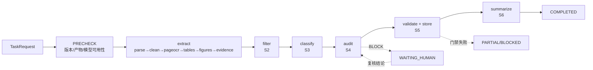

每个 step 记录：`stage`、`input_hash`、`attempt`、`started_at`、`finished_at`、`status`、`artifacts[]`、`problems[]`、`stats{}`。

### 9.6 状态机

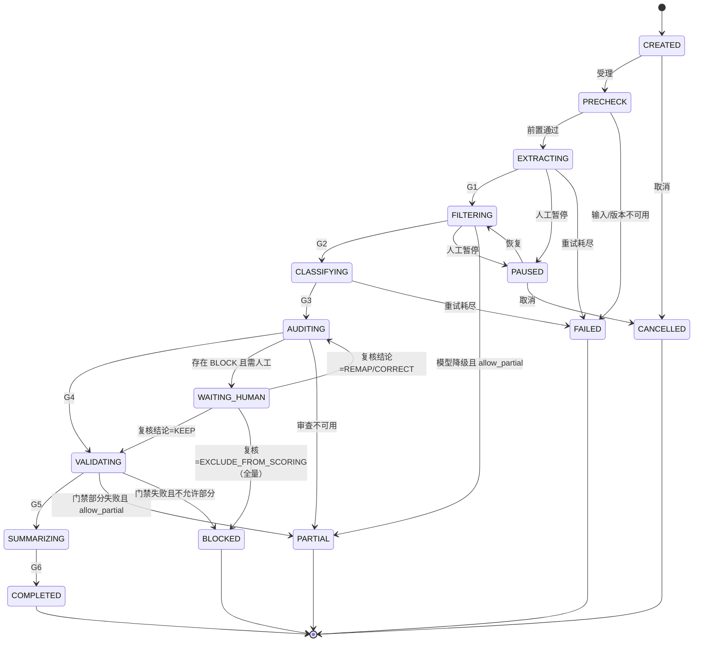

图中只画代表性迁移，实际实现按以下规则补充：

1. **暂停**可在 `EXTRACTING`～`SUMMARIZING` 任一阶段发生，恢复时回到被暂停的那个阶段（图中只画了 `FILTERING` 一条）。
2. **审查不可用**时，非关键指标 → `PARTIAL`；关键指标 → `BLOCKED`（由 `G4` 判定，图中只画了 `PARTIAL`）。
3. **复核结论**可能触发 classify/audit/validate 的最小重跑，图中合并画作回到 `AUDITING`。
4. **预算耗尽**沿用当前阶段的下游：`FILTERING`/`AUDITING` → `PARTIAL`；`VALIDATING` → `BLOCKED`。

状态语义：

| 状态 | 含义 | 是否终态 |
| --- | --- | --- |
| `CREATED` | 已受理 | 否 |
| `PRECHECK` | 版本/产物/模型检查 | 否 |
| `EXTRACTING` | S1 运行中 | 否 |
| `FILTERING` | S2 运行中 | 否 |
| `CLASSIFYING` | S3 运行中 | 否 |
| `AUDITING` | S4 运行中 | 否 |
| `VALIDATING` | S5 运行中 | 否 |
| `SUMMARIZING` | S6 运行中 | 否 |
| `WAITING_HUMAN` | 等待复核 | 否（可恢复） |
| `PAUSED` | 人工暂停 | 否 |
| `COMPLETED` | 全部完成且门禁通过 | 是 |
| `PARTIAL` | 完成但部分降级/未入库 | 是（可发起重跑） |
| `BLOCKED` | 关键门禁失败 | 是 |
| `FAILED` | 技术失败 | 是 |
| `CANCELLED` | 取消 | 是 |

### 9.7 验收门

| 门 | 位置 | 判定（全部满足） | 不通过动作 |
| --- | --- | --- | --- |
| `G0` 前置 | PRECHECK | PDF 存在且可读；版本可解析；模型可用性已知 | `FAILED`（版本问题）或降级（模型不可用） |
| `G1` 提取 | extract 后 | `evidence.jsonl` 存在；行数与统计一致；manifest 记录指纹 | 重试 extract；仍失败 `FAILED` |
| `G2` 过滤 | filter 后 | 决策覆盖 100% 证据；`filter_report.json` 存在；无未解释缺失 | 重试；仍失败降级全 ACCEPT 并标 `degraded` |
| `G3` 归类 | classify 后 | 每条 accepted 证据有记录或明确 `classification_status`；闭集版本一致 | 重试；仍失败 `FAILED` |
| `G4` 审查 | audit 后 | 组覆盖达标（关键 100%、其他抽样）；`BLOCK` 已转复核或已处理 | 降级 `PARTIAL`；关键指标不可降级 |
| `G5` 验证 | validate 后 | S5 门禁 G1–G7 通过（含 `V-17`） | `BLOCKED`（或 `PARTIAL`，若 `allow_partial`） |
| `G6` 总结 | summarize 后 | `summary_report.json` 存在；数字守卫通过 | 回退模板；仍失败 `PARTIAL` |
| `G7` 可交付 | 结束前 | 产物清单齐全；指纹一致；无 open 的阻断级复核 | 不置 `COMPLETED` |

### 9.8 重试、超时、预算与熔断

| 步骤 | 超时 | 重试 | 退避 | 可降级 |
| --- | --- | --- | --- | --- |
| extract（解析/OCR/表格/图表） | 单报告 30 min | 单页/单图 1–2 次 | 固定 2s | 局部降级（缺通道） |
| filter | 单批 60 s | 2 次 | 2^n × 2s | 全 ACCEPT |
| classify | 单批 90 s | 2 次 | 同上 | 占位 `INSUFFICIENT` |
| audit | 单组 60 s | 2 次 | 同上 | 组 `INSUFFICIENT` |
| validate | 单报告 60 s | 0 | — | 不允许 |
| summarize | 单报告 60 s | 1 次 | 固定 2s | 回退模板 |

**熔断**：同一模型在 5 分钟内连续 3 次失败 → 熔断 10 分钟，期间相关 step 直接降级并告警；熔断状态写入任务 `problems`。

**预算**：`max_model_calls`、`max_tokens`、`max_crops`、`max_wall_seconds` 任一耗尽 → 停止后续模型调用，已完成部分保留，任务标 `PARTIAL` + `truncated=true`。

### 9.9 暂停、恢复与取消

| 操作 | 语义 | 约束 |
| --- | --- | --- |
| 暂停 | 当前 step 允许跑完，不再派发下一步 | 仅 `EXTRACTING..SUMMARIZING` 可暂停 |
| 恢复 | 从第一个未完成 step 继续 | 已完成 step 按 `input_hash` 复用，不重跑 |
| 取消 | 停止派发；已写产物保留 | 终态；可用同幂等键重新发起新任务 |
| 崩溃恢复 | 进程重启后扫描 `RUNNING` 且租约过期的 step，重置为 `PENDING` | 依赖 `locked_at` 租约（默认 2× step 超时） |

### 9.10 幂等与并发

| 对象 | 幂等键 | 行为 |
| --- | --- | --- |
| 任务 | `task_key`（§9.3） | 同键且未终态 → 返回既有 `task_id`；已终态 → 新建 run（`retry_of`） |
| 步骤 | `(task_id, stage, input_hash)` | 已成功且输入未变 → 直接复用产物 |
| 入库 | `(pid, indicator, variable, year, breakdown)` | upsert |
| 复核 | `(target_type, target_id, reason_code, OPEN)` | 不重复建任务 |

并发规则：

1. 同一 `pid` 同一时刻只允许一个 `REPORT_PIPELINE`（后到者 `WAITING` 或拒绝，Q-22）。
2. 批量任务按 pid 并行，worker 数可配（默认 4）；同一 pid 的子步骤串行。
3. 模型调用全局限速；限速时排队而不是失败。
4. 任务状态更新用条件更新（`WHERE status = :expected`），冲突重读。

### 9.11 人工复核编排

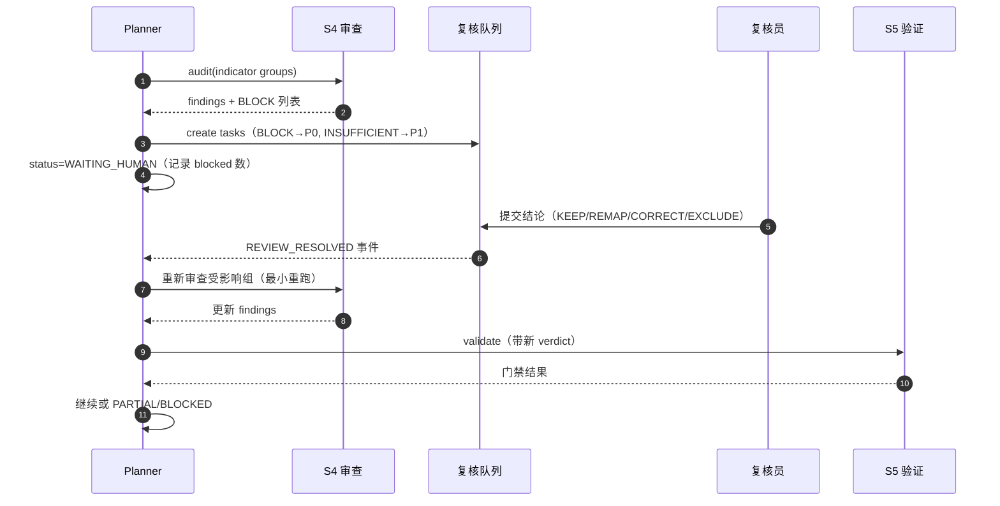

规则：

1. 只有 `blocking=true` 的 finding 会暂停任务；`WARN` 只记录。
2. 复核超 SLA（默认 P0 24h、P1 72h）→ 升级通知；**不自动放行**。
3. 复核结论按 §7.11 生效；旧记录保留，新记录 `supersedes`。
4. 部分复核完成时可继续处理未受影响的分组（`allow_partial`）。

### 9.12 失败与降级矩阵

| 失败点 | 降级 | 任务状态 | 是否影响已入库数据 |
| --- | --- | --- | --- |
| PDF 不可读 | 无 | `FAILED` | 否 |
| 某通道产物缺失 | 缺通道继续 | `PARTIAL` | 否（记录少但可追溯） |
| 过滤全失败 | 全 ACCEPT | `PARTIAL` | 否（记录多但可复核） |
| 归类部分失败 | 占位记录 | `PARTIAL` | 否（占位不入库） |
| 审查不可用 | 组 `INSUFFICIENT` | `PARTIAL` | 否（相关记录不入库） |
| 验证门禁失败 | 不写库 | `BLOCKED` | 否 |
| 总结失败 | 模板兜底 | `COMPLETED`（`summary_mode=template`） | 否 |
| 复核未完 | 等待 | `WAITING_HUMAN` | 否 |

### 9.13 输出（`TaskStatus`）

```json
{
  "task_id": "tsk_01JB...",
  "task_type": "REPORT_PIPELINE",
  "pid": "2025073101502",
  "status": "WAITING_HUMAN",
  "current_stage": "audit",
  "progress": {"steps_total": 6, "steps_done": 4, "percent": 67},
  "stages": [
    {"stage": "extract", "status": "SUCCEEDED", "elapsed_ms": 182000,
     "artifacts": ["evidence.jsonl"], "stats": {"evidence": 19}},
    {"stage": "filter", "status": "SUCCEEDED", "stats": {"accept": 15, "review": 2, "exclude": 2}},
    {"stage": "classify", "status": "SUCCEEDED", "stats": {"assigned": 23, "ambiguous": 1}},
    {"stage": "audit", "status": "RUNNING", "stats": {"block": 1}}
  ],
  "budget": {"model_calls_used": 7, "model_calls_limit": 40,
             "tokens_used": 52310, "tokens_limit": 400000, "truncated": false},
  "open_reviews": ["rvw_..."],
  "problems": [],
  "versions": {"pipeline_version": "a1b2c3d", "policy_version": "FP-1.0.0",
               "catalogue_version": "MD-2026.10", "review_policy_version": "RP-1.0.0"},
  "started_at": "2026-10-27T09:00:00Z",
  "updated_at": "2026-10-27T09:04:10Z"
}
```

### 9.14 接口

```python
class PipelinePlanner:
    def submit(self, req: TaskRequest) -> TaskHandle: ...
    def status(self, task_id: str) -> TaskStatus: ...
    def pause(self, task_id: str, reason: str) -> TaskStatus: ...
    def resume(self, task_id: str) -> TaskStatus: ...
    def cancel(self, task_id: str, reason: str) -> TaskStatus: ...
    def on_review_resolved(self, review_id: str) -> TaskHandle: ...
```

HTTP：

| 方法 | 路径 | 用途 |
| --- | --- | --- |
| `POST` | `/v1/pipeline:run` | 提交任务（单/批量/单阶段/重放） |
| `GET` | `/v1/pipeline/{task_id}` | 状态与阶段统计 |
| `POST` | `/v1/pipeline/{task_id}:pause` | 暂停 |
| `POST` | `/v1/pipeline/{task_id}:resume` | 恢复 |
| `POST` | `/v1/pipeline/{task_id}:cancel` | 取消 |
| `GET` | `/v1/pipeline/{task_id}/steps` | 步骤明细 |

CLI：`python scripts/esg_pipeline.py run --pid ... --mode STANDARD`、`... status --task-id`、`... resume`。

### 9.15 日志与监控

| 项 | 内容 |
| --- | --- |
| 任务日志 | 每次状态迁移一行：`task_id/from/to/reason/gate/elapsed_ms` |
| 步骤日志 | `stage/input_hash/attempt/status/problems` |
| 指标 | 任务成功率、各阶段耗时 P50/P95、重试率、降级率、复核等待时长、模型调用数 |
| 告警 | 熔断、连续失败、复核超 SLA、预算耗尽比例异常 |
| 不可写 | 不改任何业务产物；只写任务/步骤表 |

### 9.16 测试与验收

| 用例 | 场景 | 期望 |
| --- | --- | --- |
| `P-01` | 正常单报告 | 6 步全过，`COMPLETED` |
| `P-02` | 同幂等键重复提交 | 返回同一 `task_id`，不重复跑 |
| `P-03` | 过滤阶段进程被杀 | 恢复后从 filter 继续，不重复写 |
| `P-04` | 审查 BLOCK | `WAITING_HUMAN`，复核后恢复 |
| `P-05` | 模型熔断 | 相关阶段降级，任务 `PARTIAL`，`problems` 有记录 |
| `P-06` | 预算耗尽 | 停止模型调用，标 `truncated` |
| `P-07` | 验证门禁失败 | `BLOCKED`，不写库 |
| `P-08` | 取消后再提交 | 新任务可跑，旧产物保留 |
| `P-09` | 批量 20 份 | 并行受 worker 限制，全部有终态 |
| `P-10` | 策略重放 | 只跑 filter 及下游，复用 evidence |
| `P-11` | 复核超时 | 升级通知，任务仍 `WAITING_HUMAN`（不自动放行） |
| `P-12` | 同 pid 并发提交 | 第二个等待或拒绝（按配置） |

**验收门槛**：

1. 任意时刻杀掉进程，重启后任务可从断点继续，且不产生重复业务行。
2. 所有终态都有明确 `problems` 或 `stats`，不允许"静默失败"。
3. 任务状态迁移 100% 合法（非法迁移抛错并告警）。
4. 预算、超时、重试、熔断四类策略在测试中均可触发。

### 9.17 与其他模块交互

- 只通过 stage 的文件契约与 `task_step` 表交互；不持有 Agent 的内存对象。
- 向 S4 传递 `indicator groups`，向 S6 传递 `summary input bundle`。
- 人工复核通过 `esg_review_task` 与 `REVIEW_RESOLVED` 事件回流。
- 对外只暴露任务状态与产物路径，不暴露内部实现。

---

## 第十章 S6 总结 Agent（报告总结）

### 10.0 定位

`【设计规定】` 一份报告处理完后，分析师需要的第一句话不是"共 25 条记录"，而是：

> 这份报告有没有取水量？口径是什么？哪些数据不确定？下一步该看哪里？

总结 Agent 就是回答这个问题的**只读**模块。它与后续的"评分解释模块"不同：后者解释一个分数，本模块总结一次处理。

| 对比 | 总结 Agent（S6） | 评分解释模块（S7 内，后续） |
| --- | --- | --- |
| 输入 | 一份报告的全链路处理结果 | 一条评分结果 |
| 输出 | 报告级结论文本 | 得分构成与同行位置解释 |
| 是否涉及分数 | 不涉及（评分未接入时也能跑） | 涉及 |
| 是否允许模型改写 | 允许润色，数字受守卫 | 允许润色，数字受守卫 |

### 10.1 职责

1. 汇总报告概况：公司、年度、页数、文档类型、语言。
2. 汇总提取概况：证据数、通道分布、分层、丢弃与原因。
3. 汇总过滤结果：保留/待复核/排除数、主要原因、重复组。
4. 汇总归类覆盖：涉及指标数、`ASSIGNED/AMBIGUOUS/UNMAPPED`、关键指标是否到位。
5. 汇总审查发现：`BLOCK/WARN` 清单与影响。
6. 汇总数据质量：质量分档、追溯完整率、`unresolved`、`needs_review`。
7. 列出关键数据：E2.1.1 相关变量的值、单位、年份、口径、页码（**不含评分**）。
8. 给出待办与建议：需人工确认项、闭集缺口、建议下一步。
9. 声明局限：本文只基于该报告与本次处理结果，不外推、不评价公司表现。

### 10.2 不负责

- **不新增事实**：不写报告里没有的内容，不做行业对比（没有基准数据）。
- **不改分数**、不预测、不排名、不评价公司优劣。
- **不解释方法论**（除引用规则版本与闭集版本）。
- **不重算**任何数值；所有数字必须来自输入包。
- 不读 PDF、不读原始证据正文（只读结构化摘要与关键证据页引用）。

### 10.3 输入（`SummaryInput`）

```json
{
  "run": {"task_id": "tsk_...", "pid": "2025073101502", "pipeline_version": "a1b2c3d"},
  "report": {"company_name": "Imperium Financial Group Limited", "report_year": 2025,
             "period_start": "2024-04-01", "period_end": "2025-03-31",
             "page_count": 42, "doc_type": "vector", "language": "en"},
  "extract": {"evidence": 19, "by_kind": {"text": 6, "table_cell": 5, "figure": 6, "page_ocr": 2},
              "by_tier": {"high": 6, "medium": 7, "low": 6},
              "dropped": 3, "dropped_reasons": {"excluded_page": 1, "no_evidence_numbers": 2}},
  "filter": {"accept": 15, "review": 2, "exclude": 2,
             "top_reasons": {"R-TOC": 2}, "duplicate_groups": 1, "degraded": false},
  "classify": {"records": 25, "assigned": 23, "ambiguous": 1, "unmapped": 1,
               "indicators": ["E1.1.1", "E1.3.1", "E2.1.1"],
               "key_indicators_present": ["E2.1.1"], "key_indicators_missing": []},
  "audit": {"block": 0, "warn": 2, "info": 1,
            "top_findings": [{"code": "A-BOUNDARY-MISSING", "record_uid": "...", "reason": "..."}]},
  "validate": {"rows_written": 22, "quality_bands": {"auto": 18, "review": 4, "reject": 1},
               "trace_rate": 1.0, "unresolved": 0, "conflicts": 1, "superseded": 1},
  "key_data": [
    {"indicator_id": "E2.1.1", "variable": "Total Water Withdrawal (from all sources in m³)",
     "value": 12345, "unit": "m3", "year": 2025, "breakdown": "Group",
     "source_page": 12, "quality_band": "auto"}
  ],
  "open_reviews": [{"review_id": "rvw_...", "priority": "P1", "reason_code": "A-BOUNDARY-MISSING"}],
  "versions": {"policy_version": "FP-1.0.0", "catalogue_version": "MD-2026.10",
               "review_policy_version": "RP-1.0.0"}
}
```

约束：

1. 输入是**聚合结果**，不是原始记录全集；`key_data` 只放评分关键指标（当前 E2.1.1）与用户指定指标。
2. 所有统计必须来自各阶段 `*_report.json`，不得由总结 Agent 自行重算。
3. 缺失字段必须显式给 `null` 或空数组，不允许"没有就不写"（否则生成时会猜）。

### 10.4 输出结构（`SummaryReport`）

固定 9 段，顺序不变，便于下游渲染与对比：

| 段 | 键 | 内容 | 数据来源 |
| --- | --- | --- | --- |
| 1 | `OVERVIEW` | 公司、年度、报告期、页数、文档类型 | `report` |
| 2 | `EXTRACTION` | 证据数、通道分布、丢弃与原因 | `extract` |
| 3 | `FILTERING` | 保留/待复核/排除、主要原因、重复组 | `filter` |
| 4 | `CLASSIFICATION` | 记录数、状态分布、涉及指标、关键指标到位情况 | `classify` |
| 5 | `AUDIT` | BLOCK/WARN 清单与影响 | `audit` |
| 6 | `QUALITY` | 质量分档、追溯率、未解决项 | `validate` |
| 7 | `KEY_DATA` | E2.1.1 关键变量值/单位/年份/口径/页码 | `key_data` |
| 8 | `ACTIONS` | 待人工确认、闭集缺口、建议下一步 | 各段汇总 |
| 9 | `LIMITATIONS` | 只基于本报告与本次处理；不评价公司表现；未评分 | 固定模板 |

```json
{
  "summary_id": "sum_2025073101502_20261027T091000",
  "pid": "2025073101502",
  "language": "zh-HK",
  "sections": [
    {"key": "OVERVIEW", "text": "本报告为 Imperium Financial Group Limited 2025 财年 ESG 报告，报告期 2024-04-01 至 2025-03-31，共 42 页，文本层完整（vector）。"},
    {"key": "EXTRACTION", "text": "共形成 19 条证据（正文 6、表格 5、图表 6、整页 OCR 2），其中高置信 6 条；3 条候选因目录/无数字未进入证据池。"},
    {"key": "FILTERING", "text": "保留 17 条（含 2 条待复核），排除 2 条目录行；未发生模型降级。"},
    {"key": "CLASSIFICATION", "text": "归类出 25 条记录，23 条已确定指标，1 条歧义、1 条闭集缺口；E2.1.1 取水量已提取。"},
    {"key": "AUDIT", "text": "审查发现 2 条警告（1 条缺口径、1 条聚合建议待确认），无阻断项。"},
    {"key": "QUALITY", "text": "22 条入库，质量分档 auto 18 / review 4 / reject 1；入库记录 100% 可回溯到页码与坐标。"},
    {"key": "KEY_DATA", "text": "E2.1.1 总取水量 12,345 m³（2025，Group 口径，第 12 页，质量 auto）。"},
    {"key": "ACTIONS", "text": "需确认：1 条记录缺少统计口径；建议：补充闭集变量以覆盖“耗水量”。"},
    {"key": "LIMITATIONS", "text": "本总结仅基于该报告与本次处理结果，未进行评分、行业对比或公司表现评价。"}
  ],
  "numbers_used": [2025, 42, 19, 6, 5, 2, 3, 17, 25, 23, 1, 22, 18, 4, 12345, 12],
  "generated_by": "TEMPLATE",
  "template_version": "sum-zh-1.0.0",
  "model_call_id": null,
  "guard": {"checked": true, "violations": []},
  "created_at": "2026-10-27T09:10:00Z"
}
```

### 10.5 生成流程

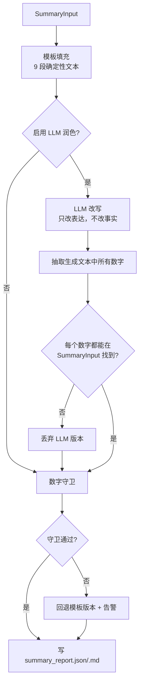

**模板优先**：默认 `generated_by=TEMPLATE`，不调用模型。只有配置 `summary.polish=true` 时才调用 LLM 润色，且必须通过数字守卫。

### 10.6 数字守卫与忠实度约束

| 约束 | 规则 |
| --- | --- |
| 数字来源 | 生成文本中的每个数字（含百分比、千分位、小数）必须能在 `SummaryInput` 的数值集合中找到（允许格式化差异：`12,345` ↔ `12345`） |
| 单位 | 数字旁的单位必须与输入一致；不允许换算 |
| 结论词 | 禁止"优于/落后/领先/排名/预计/将会"等评价或预测词（词表可配） |
| 缺失表达 | 必须写"未提取/未披露/待确认"，不得写"0" |
| 引用 | 每条关键数据必须带页码；无页码则不得写入 `KEY_DATA` |
| 版本 | 必须回写 `policy/catalogue/review_policy` 版本 |

守卫失败处理：

1. 记录 `guard.violations`（哪个数字、出现在哪段）；
2. 丢弃 LLM 版本，回退模板；
3. 告警并在任务 `problems` 中记录 `summary_guard_failed`；
4. **不阻断**入库（总结不是入库前置），但任务标 `COMPLETED` + `summary_mode=template`。

### 10.7 异常与降级

| 情况 | 处理 |
| --- | --- |
| 输入缺段（如无 audit 结果） | 该段写"本次未执行审查"，不猜 |
| 模型超时/失败 | 回退模板（不重试超过 1 次） |
| 守卫失败 | 回退模板 + 告警 |
| 无记录（证据为 0） | 输出"未提取到定量数据" + 原因（丢弃台账），不是空白 |
| 报告不可评分/未评分 | 在 `LIMITATIONS` 明确"本报告未进入评分" |

### 10.8 接口

```python
class ReportSummarizer:
    def summarize(self, ctx: SummaryContext, data: SummaryInput,
                  polish: bool = False) -> SummaryReport: ...
```

HTTP：`POST /v1/summary:run {pid, task_id, language, polish}` → `202 {summary_id}`；`GET /v1/summary/{summary_id}` 返回 JSON，`?format=md` 返回 Markdown。

### 10.9 测试与验收

| 用例 | 场景 | 期望 |
| --- | --- | --- |
| `S-01` | 正常报告 | 9 段齐全，数字全部可溯源 |
| `S-02` | LLM 生成含输入外数字 | 守卫拦截，回退模板 |
| `S-03` | 证据为 0 | 明确说明"未提取到定量数据"+原因 |
| `S-04` | 有 AMBIGUOUS/UNMAPPED | ACTIONS 段列出，不写成"未披露" |
| `S-05` | 无评分 | LIMITATIONS 明确未评分 |
| `S-06` | 输入缺 audit | 该段写"未执行审查" |
| `S-07` | 数字格式差异（12,345 vs 12345） | 守卫通过 |
| `S-08` | 含"优于/预计"等词 | 守卫拦截 |
| `S-09` | 同一输入重复生成 | 文本一致（模板模式） |
| `S-10` | 关键数据无页码 | 不得写入 KEY_DATA |

**验收门槛**：

1. 输出中每个数字都能在输入包中找到（100%）。
2. 九段齐全，缺段必须有显式说明。
3. 不出现评分、排名、预测、评价性结论（词表 + 人工抽查）。
4. 模板模式不依赖模型，可离线生成。

### 10.10 日志、状态与质量标记

| 项 | 内容 |
| --- | --- |
| 日志 | `summary_id/pid/generated_by/guard_violations/sections_count/model_call_id` |
| 状态 | `SUCCEEDED` / `TEMPLATE_FALLBACK` / `FAILED` |
| 质量标记 | `guard.violations`、`summary_mode`、`missing_sections` |
| 告警 | 守卫失败率、`TEMPLATE_FALLBACK` 比例、缺段比例 |

### 10.11 与其他模块交互

- 上游：只读 Planner 传入的 `SummaryInput`（由各阶段统计汇总而成）。
- 下游：`GET /v1/summary/{id}`、导出（Markdown），以及分析师的复核入口。
- **不写** 任何业务数据表，除自己的 `esg_summary_report`。
- 不参与评分；评分阶段的解释由 S7 的解释模块负责。

---

## 第十一章 数据模型与字段字典

### 11.1 建模原则

`【设计规定】` 不新建一整套与现有库并行的表，本章遵守三条约束：

1. **不臆造**：仓库中不存在 `raw_metric_record`/`normalized_metric`/`benchmark_snapshot` 等表，本文不再把它们写成"已有"；评分相关表放到第 13 章作为"待建"。
2. **兼容现有**：最终结构化数据继续写 `esg_quant_v2_result`（26 列、唯一键含 `breakdown`），只做**增量列**（全部可空、有默认值）。
3. **只为追溯加表**：新增表都是为了回答"这条数据从哪来、被谁判过、能不能重放"，不为"看起来完整"而建表。

### 11.2 表清单

| 表 | 类型 | 状态 | 用途 |
| --- | --- | --- | --- |
| `esg_quant_v2_result` | 结果表 | `【现有实现】` | 最终入库的结构化记录 |
| `esg_report` | 主数据 | `【设计规定】` | 报告注册表（pid、公司、年度、文件指纹、doc_type） |
| `esg_artifact_manifest` | 追溯 | `【设计规定】` | 每阶段产物清单与 sha256（替代/补充 `_run_manifest.json`） |
| `esg_evidence` | 追溯 | `【设计规定】` | 证据池（`evidence.jsonl` 的库内副本，只读） |
| `esg_evidence_dropped` | 追溯 | `【设计规定】` | 丢弃台账 |
| `esg_filter_run` | 运行 | `【设计规定】` | 过滤轮次（策略/模型/统计） |
| `esg_filter_decision` | 决策 | `【设计规定】` | 逐条过滤决策（追加） |
| `esg_classification_run` | 运行 | `【设计规定】` | 归类轮次（闭集/模型/统计） |
| `esg_classification_record` | 结果 | `【设计规定】` | 归类记录（含未入库状态） |
| `esg_audit_run` | 运行 | `【设计规定】` | 审查轮次（策略/模型/统计） |
| `esg_audit_result` | 结果 | `【设计规定】` | 每条记录的审查结论 |
| `esg_audit_finding` | 结果 | `【设计规定】` | 审查发现（BLOCK/WARN/INFO） |
| `esg_task` | 调度 | `【设计规定】` | Planner 任务 |
| `esg_task_step` | 调度 | `【设计规定】` | Planner 步骤（断点/重试/预算） |
| `esg_summary_report` | 结果 | `【设计规定】` | 报告级总结 |
| `esg_review_task` | 复核 | `【设计规定】` | 人工复核任务 |
| `esg_review_decision` | 复核 | `【设计规定】` | 复核结论（追加） |
| `esg_model_call` | 运行 | `【设计规定】` | 模型调用（prompt 哈希、模型版本、token） |
| `esg_agent_run` | 运行 | `【设计规定】` | Agent 任务/步骤（编排、幂等、重试） |
| `esg_access_log` | 审计 | `【设计规定】` | Web/API 访问审计（查看 PDF/裁图/导出） |
| `esg_qualitative_item` | 预留 | `【预留】` | 定性条目（S8，默认关闭） |
| `esg_search_query` | 预留 | `【预留】` | 联网检索查询日志（默认关闭） |
| `esg_external_fact` | 预留 | `【预留】` | 外部事实（URL/时间/摘要/授权） |

### 11.3 现有结果表：`esg_quant_v2_result`

`【现有实现】` 列与语义（源码 `store.COLUMNS`；`updated_at` 由 DDL 提供）：

| 列 | 类型 | 必填 | 含义 |
| --- | --- | --- | --- |
| `pid` | TEXT | 是 | 报告 ID（唯一键之一） |
| `indicator_id` | TEXT | 是 | 闭集指标码 |
| `variable` | TEXT | 是 | 闭集变量全名 |
| `year` | INTEGER | 是 | 数据年份 |
| `breakdown` | TEXT | 是（默认 `''`） | 统计口径 |
| `value` | REAL | 是 | 数值（原单位） |
| `unit` | TEXT | 否 | 单位 |
| `source_page` | INTEGER | 否 | 页码 |
| `confidence` | REAL | 否 | 模型置信度 |
| `evidence_id` | TEXT | 否 | 证据 ID |
| `source_kind` | TEXT | 否 | `text/table_cell/figure/page_ocr` |
| `provenance_source` | TEXT | 否 | `evidence_id/page_value/unresolved` |
| `confidence_tier` | TEXT | 否 | `high/medium/low` |
| `quality_score` | REAL | 否 | 质量分 |
| `quality_band` | TEXT | 否 | `auto/review/reject` |
| `resolution_status` | TEXT | 否 | `unique/winner/superseded` |
| `superseded_by` | TEXT | 否 | 被谁取代（指纹） |
| `validation_status` | TEXT | 否 | 兼容字段 |
| `validation_notes` | TEXT | 否 | 多条说明以竖线连接 |
| `bbox` | TEXT | 否 | JSON 数组 |
| `raw_content` | TEXT | 否 | 原文片段（≤500 字） |
| `value_type` | TEXT | 否 | 图表点类型 |
| `category` | TEXT | 否 | 指标类别 |
| `table_id` | TEXT | 否 | 表 ID |
| `region_id` | TEXT | 否 | 图表区域 ID |
| `updated_at` | TEXT | 是 | 更新时间 |

唯一键：`(pid, indicator_id, variable, year, breakdown)`。

`【设计规定】` 建议增量列（可空，不破坏现有 `INSERT`）：

| 新列 | 类型 | 说明 |
| --- | --- | --- |
| `classification_status` | TEXT | `ASSIGNED/AMBIGUOUS/...`（仅 `ASSIGNED` 会入库，故实际值恒为 `ASSIGNED`，保留以便审计） |
| `filter_run_id` / `classification_run_id` | TEXT | 关联运行记录 |
| `policy_version` / `catalogue_version` | TEXT | 决策版本 |
| `value_nature` | TEXT | `REPORTED/REPORTED_ZERO/ESTIMATED/COMPUTED` |
| `aggregation_hint` | TEXT | 聚合建议 |
| `derived_from` | TEXT | 聚合成员的 evidence_id 列表（JSON） |
| `record_uid` | TEXT | 全局记录 ID（`{pid}\|{indicator}\|{variable}\|{year}\|{breakdown}`） |

### 11.4 `esg_report`（报告注册表）

| 字段 | 类型 | 必填 | 说明 |
| --- | --- | --- | --- |
| `pid` | VARCHAR(64) | 是 | 主键（HKEX 文件号） |
| `company_name` | VARCHAR(512) | 是 | 报告封面公司名（原文） |
| `company_id` | VARCHAR(64) | 否 | 关联企业主数据（待建，Q-10） |
| `report_year` | SMALLINT | 是 | 报告年度 |
| `period_start` / `period_end` | DATE | 否 | 报告期 |
| `doc_type` | VARCHAR(16) | 是 | `vector/scanned/mixed` |
| `page_count` | INTEGER | 是 | 页数 |
| `file_name` | VARCHAR(512) | 是 | 文件名 |
| `file_sha256` | CHAR(64) | 是 | 文件指纹，防同一文件重复入库 |
| `language` | VARCHAR(8) | 否 | `en/zh-HK/zh-CN` |
| `ingested_at` | TIMESTAMPTZ | 是 | |

唯一：`UNIQUE(file_sha256)`。

### 11.5 `esg_artifact_manifest`（产物追溯）

| 字段 | 类型 | 必填 | 说明 |
| --- | --- | --- | --- |
| `id` | BIGSERIAL | 是 | 主键 |
| `pid` | VARCHAR(64) | 是 | |
| `stage` | VARCHAR(32) | 是 | `parse/clean/pageocr/tables/figures/evidence/filter/classify/validate` |
| `artifact` | VARCHAR(128) | 是 | 文件名 |
| `sha256` | CHAR(64) | 是 | 内容指纹 |
| `row_count` | INTEGER | 否 | 行数 |
| `pipeline_version` | VARCHAR(64) | 是 | 代码版本（git sha） |
| `run_id` | VARCHAR(64) | 是 | |
| `created_at` | TIMESTAMPTZ | 是 | |

唯一：`UNIQUE(pid, artifact, run_id)`；索引 `(pid, stage)`。

### 11.6 `esg_evidence`（证据池副本，只读）

| 字段 | 类型 | 必填 | 说明 |
| --- | --- | --- | --- |
| `evidence_id` | VARCHAR(64) | 是 | 主键（`{pid}_e00001`） |
| `pid` | VARCHAR(64) | 是 | |
| `page_no` | INTEGER | 是 | |
| `kind` | VARCHAR(16) | 是 | `text/table_cell/figure/page_ocr` |
| `content` | TEXT | 是 | 完整上下文（表=HTML/CSV） |
| `content_sha256` | CHAR(64) | 是 | 内容指纹（去重与变更检测） |
| `numbers` | JSONB | 是 | 数字原文字符串数组 |
| `bbox` | JSONB | 否 | `[x0,y0,x1,y1]` |
| `tier` | VARCHAR(8) | 是 | `high/medium/low` |
| `confidence` | NUMERIC(4,3) | 是 | 与 tier 对应 |
| `unit_hint` | VARCHAR(64) | 否 | |
| `year_hint` | SMALLINT | 否 | |
| `row_header` / `col_header` | VARCHAR(256) | 否 | |
| `table_id` | VARCHAR(64) | 否 | |
| `region_id` | VARCHAR(64) | 否 | |
| `series` / `value_type` | VARCHAR(64) | 否 | |
| `source_ref` | JSONB | 是 | 通道内定位 |
| `run_id` | VARCHAR(64) | 是 | 产生它的提取轮次 |
| `created_at` | TIMESTAMPTZ | 是 | |

索引：`(pid, page_no)`、`(pid, kind)`、`content_sha256`。**约束**：只插入，不更新（证据内容变更只能新 `run_id`）。

### 11.7 `esg_evidence_dropped`（丢弃台账）

| 字段 | 类型 | 必填 | 说明 |
| --- | --- | --- | --- |
| `id` | BIGSERIAL | 是 | |
| `pid` | VARCHAR(64) | 是 | |
| `kind` | VARCHAR(16) | 是 | `text/table/figure/page_ocr` |
| `reason` | VARCHAR(64) | 是 | `excluded_page/covered_by_trusted_table/untrusted_or_too_few_rows/no_evidence_numbers/...` |
| `detail` | TEXT | 否 | 补充说明 |
| `page_no` | INTEGER | 否 | |
| `table_id` | VARCHAR(64) | 否 | |
| `text_snippet` | TEXT | 否 | 原文片段（≤500） |
| `numbers` | JSONB | 否 | |
| `run_id` | VARCHAR(64) | 是 | |

### 11.8 `esg_filter_run` / `esg_filter_decision`

**run**：

| 字段 | 类型 | 必填 | 说明 |
| --- | --- | --- | --- |
| `filter_run_id` | VARCHAR(64) | 是 | 主键 |
| `pid` | VARCHAR(64) | 是 | |
| `policy_version` | VARCHAR(32) | 是 | `FP-1.0.0` |
| `prompt_template_id` | VARCHAR(64) | 否 | |
| `model_id` / `model_version` | VARCHAR(64) | 否 | |
| `mode` | VARCHAR(16) | 是 | `FAST/STANDARD/DEEP` |
| `n_evidence` | INTEGER | 是 | 输入条数 |
| `n_accept` / `n_review` / `n_exclude` | INTEGER | 是 | |
| `n_fallback` / `n_error` / `n_downgraded` | INTEGER | 是 | |
| `degraded` | BOOLEAN | 是 | 是否发生降级 |
| `status` | VARCHAR(16) | 是 | `SUCCEEDED/PARTIAL/FAILED` |
| `started_at` / `finished_at` | TIMESTAMPTZ | 是 | |

**decision**（追加，不更新）：

| 字段 | 类型 | 必填 | 说明 |
| --- | --- | --- | --- |
| `id` | BIGSERIAL | 是 | |
| `filter_run_id` | VARCHAR(64) | 是 | |
| `evidence_id` | VARCHAR(64) | 是 | |
| `status` | VARCHAR(8) | 是 | `ACCEPT/REVIEW/EXCLUDE` |
| `noise_class` | VARCHAR(24) | 是 | 见 §5.4 |
| `topic` | VARCHAR(16) | 是 | |
| `confidence` | NUMERIC(4,3) | 是 | |
| `reason_code` | VARCHAR(32) | 是 | |
| `reason_text` | VARCHAR(512) | 是 | |
| `rule_hits` | JSONB | 否 | |
| `duplicate_group_id` | VARCHAR(64) | 否 | |
| `duplicate_role` | VARCHAR(12) | 否 | `PRIMARY/ALTERNATE` |
| `duplicate_of` | JSONB | 否 | |
| `model_call_id` | VARCHAR(64) | 否 | |
| `decision_source` | VARCHAR(16) | 是 | `RULE/LLM/RULE_LLM/FALLBACK/HUMAN` |
| `policy_version` | VARCHAR(32) | 是 | |
| `decided_at` | TIMESTAMPTZ | 是 | |

唯一：`UNIQUE(filter_run_id, evidence_id)`；索引 `(evidence_id, policy_version)`。

### 11.9 `esg_classification_run` / `esg_classification_record`

**run**：`classification_run_id`、`pid`、`filter_run_id`、`catalogue_version`、`prompt_template_id`、`model_id/model_version`、`mode`、`n_candidates`、`n_assigned/n_ambiguous/n_unmapped/n_out_of_closed_set/n_insufficient`、`n_unresolved`、`status`、`started_at/finished_at`。

**record**：

| 字段 | 类型 | 必填 | 说明 |
| --- | --- | --- | --- |
| `record_uid` | VARCHAR(256) | 是 | 主键：`{pid}\|{indicator}\|{variable}\|{year}\|{breakdown}` |
| `classification_run_id` | VARCHAR(64) | 是 | |
| `pid` / `evidence_id` / `source_page` | — | 是 | 溯源 |
| `source_kind` | VARCHAR(16) | 是 | |
| `classification_status` | VARCHAR(24) | 是 | §6.7 |
| `indicator_id` / `variable` / `category` | VARCHAR(128) | 否 | 闭集 |
| `value` | NUMERIC(28,6) | 否 | |
| `unit` / `breakdown` | VARCHAR(64) | 否 | |
| `year` | SMALLINT | 否 | |
| `year_inferred` | BOOLEAN | 是 | |
| `report_year` | SMALLINT | 是 | |
| `aggregation_hint` | VARCHAR(32) | 否 | §6.9 |
| `value_nature` | VARCHAR(16) | 是 | |
| `confidence` / `confidence_tier` | — | 是 | |
| `provenance_source` | VARCHAR(16) | 是 | |
| `validation_notes` | JSONB | 是 | |
| `classification_reason` | VARCHAR(512) | 否 | |
| `model_call_id` | VARCHAR(64) | 否 | |
| `created_at` | TIMESTAMPTZ | 是 | |

唯一：`UNIQUE(classification_run_id, evidence_id, indicator_id, variable, year, breakdown)`。

### 11.10 `esg_audit_run` / `esg_audit_result` / `esg_audit_finding`

**`esg_audit_run`（审查轮次）**

| 字段 | 类型 | 必填 | 说明 |
| --- | --- | --- | --- |
| `audit_run_id` | VARCHAR(64) | 是 | 主键 |
| `pid` | VARCHAR(64) | 是 | |
| `classification_run_id` | VARCHAR(64) | 是 | 审查的是哪一轮归类 |
| `policy_version` | VARCHAR(32) | 是 | `RP-1.0.0` |
| `prompt_template_id` | VARCHAR(64) | 否 | |
| `model_id` / `model_version` | VARCHAR(64) | 否 | |
| `mode` | VARCHAR(16) | 是 | `STANDARD/DEEP` |
| `sample_rate` | NUMERIC(4,3) | 是 | 非关键指标抽样率 |
| `n_groups` | INTEGER | 是 | 审查的指标组数 |
| `n_records` | INTEGER | 是 | 覆盖记录数 |
| `n_confirmed` / `n_suspect` / `n_rejected` / `n_insufficient` | INTEGER | 是 | 记录级结论计数 |
| `n_block` / `n_warn` / `n_info` | INTEGER | 是 | finding 计数 |
| `degraded` / `truncated` | BOOLEAN | 是 | 降级/预算截断 |
| `status` | VARCHAR(16) | 是 | `SUCCEEDED/PARTIAL/FAILED` |
| `started_at` / `finished_at` | TIMESTAMPTZ | 是 | |

**`esg_audit_result`（记录级结论）**

| 字段 | 类型 | 必填 | 说明 |
| --- | --- | --- | --- |
| `audit_run_id` | VARCHAR(64) | 是 | 联合主键 |
| `record_uid` | VARCHAR(256) | 是 | 联合主键 |
| `verdict` | VARCHAR(16) | 是 | `CONFIRMED/SUSPECT/REJECTED/INSUFFICIENT` |
| `finding_count` | INTEGER | 是 | |
| `updated_at` | TIMESTAMPTZ | 是 | |

唯一：`UNIQUE(audit_run_id, record_uid)`；索引 `(record_uid)`。

**`esg_audit_finding`（发现，追加）**

| 字段 | 类型 | 必填 | 说明 |
| --- | --- | --- | --- |
| `finding_id` | VARCHAR(64) | 是 | 主键 |
| `audit_run_id` | VARCHAR(64) | 是 | |
| `pid` | VARCHAR(64) | 是 | |
| `indicator_id` | VARCHAR(16) | 是 | |
| `record_uid` | VARCHAR(256) | 否 | `A-MISSING-KEY` 可为空 |
| `code` | VARCHAR(32) | 是 | `A-IND-MISMATCH` 等 |
| `severity` | VARCHAR(8) | 是 | `BLOCK/WARN/INFO` |
| `confidence` | NUMERIC(4,3) | 是 | |
| `evidence_ids` | JSONB | 是 | 至少 1 个 |
| `evidence_span` | VARCHAR(300) | 否 | |
| `observed` / `expected` | VARCHAR(512) | 否 | |
| `proposed_action` | VARCHAR(24) | 是 | `KEEP/REMAP/CORRECT_VALUE/MARK_MISSING/MERGE_DUPLICATE/ESCALATE` |
| `proposed_value` | NUMERIC(28,6) | 否 | **候选值，不写库** |
| `proposed_variable` | VARCHAR(256) | 否 | |
| `reason` | VARCHAR(512) | 是 | |
| `model_call_id` | VARCHAR(64) | 否 | |
| `policy_version` | VARCHAR(32) | 是 | |
| `resolved_by` | VARCHAR(16) | 否 | `HUMAN` 或空 |
| `resolution_ref` | VARCHAR(64) | 否 | 复核结论 ID |
| `created_at` | TIMESTAMPTZ | 是 | |

索引：`(pid, indicator_id)`、`(severity, created_at)`、`(record_uid)`。

### 11.11 `esg_task` / `esg_task_step`（Planner）

**`esg_task`**

| 字段 | 类型 | 必填 | 说明 |
| --- | --- | --- | --- |
| `task_id` | VARCHAR(64) | 是 | 主键 |
| `task_type` | VARCHAR(24) | 是 | `REPORT_PIPELINE/BATCH_PIPELINE/STAGE_RERUN/REVIEW_RESOLVED/REPROCESS/SCORE_RUN` |
| `status` | VARCHAR(16) | 是 | 见 §9.6 |
| `pid` | VARCHAR(64) | 否 | 单报告任务 |
| `pids` | JSONB | 否 | 批量任务 |
| `stages` | JSONB | 否 | 指定阶段（`STAGE_RERUN`） |
| `mode` | VARCHAR(16) | 是 | `FAST/STANDARD/DEEP` |
| `task_key` | CHAR(64) | 是 | 幂等键，唯一 |
| `idempotency_key` | VARCHAR(128) | 否 | 外部传入 |
| `versions` | JSONB | 是 | 四类版本 |
| `budget` / `budget_used` | JSONB | 是 | 预算与已用 |
| `current_stage` | VARCHAR(24) | 否 | |
| `progress` | JSONB | 否 | `{steps_total, steps_done}` |
| `open_reviews` | JSONB | 否 | |
| `problems` | JSONB | 否 | 降级/失败原因 |
| `parent_task_id` / `retry_of` | VARCHAR(64) | 否 | |
| `requested_by` | VARCHAR(64) | 是 | |
| `started_at` / `updated_at` / `finished_at` | TIMESTAMPTZ | 否 | |

唯一：`UNIQUE(task_key)`；索引：`(status, updated_at)`、`(pid, status)`。

**`esg_task_step`**

| 字段 | 类型 | 必填 | 说明 |
| --- | --- | --- | --- |
| `step_id` | VARCHAR(64) | 是 | 主键 |
| `task_id` | VARCHAR(64) | 是 | |
| `stage` | VARCHAR(24) | 是 | `extract/filter/classify/audit/validate/summarize/score` |
| `seq` | SMALLINT | 是 | 顺序 |
| `status` | VARCHAR(16) | 是 | `PENDING/RUNNING/SUCCEEDED/FAILED/SKIPPED/CANCELLED` |
| `attempt` | SMALLINT | 是 | |
| `input_hash` | CHAR(64) | 是 | 幂等/复用 |
| `artifact_hashes` | JSONB | 否 | 产物 → sha256 |
| `stats` | JSONB | 否 | 该阶段统计 |
| `problems` | JSONB | 否 | |
| `locked_by` / `locked_at` | VARCHAR(64) / TIMESTAMPTZ | 否 | 租约 |
| `deadline_at` | TIMESTAMPTZ | 否 | |
| `started_at` / `finished_at` | TIMESTAMPTZ | 否 | |

唯一：`UNIQUE(task_id, stage, seq)`；索引：`(status, locked_at)`。

### 11.12 `esg_summary_report`

| 字段 | 类型 | 必填 | 说明 |
| --- | --- | --- | --- |
| `summary_id` | VARCHAR(64) | 是 | 主键 |
| `pid` | VARCHAR(64) | 是 | |
| `task_id` | VARCHAR(64) | 是 | |
| `language` | VARCHAR(8) | 是 | `zh-HK/en` |
| `sections` | JSONB | 是 | 9 段结构 |
| `numbers_used` | JSONB | 是 | 守卫用的数字集合 |
| `generated_by` | VARCHAR(16) | 是 | `TEMPLATE/TEMPLATE_LLM_POLISHED` |
| `template_version` | VARCHAR(32) | 是 | |
| `model_call_id` | VARCHAR(64) | 否 | |
| `guard` | JSONB | 是 | `{checked, violations[]}` |
| `status` | VARCHAR(24) | 是 | `SUCCEEDED/TEMPLATE_FALLBACK/FAILED` |
| `created_at` | TIMESTAMPTZ | 是 | |

索引：`(pid, created_at desc)`。

### 11.13 `esg_review_task` / `esg_review_decision`

**task**：`review_id`、`pid`、`target_type`（`EVIDENCE/FILTER_DECISION/CLASSIFICATION_RECORD/VALIDATED_RECORD`）、`target_id`、`reason_code`、`priority`（`P0/P1/P2`）、`status`（`OPEN/IN_PROGRESS/RESOLVED/REJECTED/EXPIRED`）、`blocking`、`context`（JSONB：原值/候选/证据/建议选项）、`sla_due_at`、`assignee`、`created_at`。

**decision**（追加）：`id`、`review_id`、`decision_type`（`KEEP/EXCLUDE/REMAP/APPLY_CORRECTION/MARK_NOT_DISCLOSED/EXCLUDE_FROM_SCORING`）、`decided_value`、`decided_unit`、`decided_indicator`、`decided_variable`、`justification`（≥10 字）、`evidence_refs`、`decided_by`、`decided_at`。

### 11.14 `esg_model_call` / `esg_agent_run`

**model_call**：`model_call_id`、`run_id`、`purpose`（`FILTER/CLASSIFY/FIGURE_READ/EXPLAIN`）、`provider`、`model_id`、`model_version`、`prompt_template_id`、`prompt_hash`、`input_refs`、`input_tokens`、`output_tokens`、`latency_ms`、`status`、`response_uri`、`parsed_output`、`temperature`、`created_at`。

**agent_run**：`run_id`、`agent`（`FILTER/CLASSIFY`）、`pid`、`status`、`attempt`、`max_attempts`、`input_sha256`、`output_sha256`、`error_code`、`error_detail`、`started_at`、`finished_at`。

### 11.15 `esg_access_log`（应用层审计）

| 字段 | 类型 | 必填 | 说明 |
| --- | --- | --- | --- |
| `id` | BIGSERIAL | 是 | 主键 |
| `actor` | VARCHAR(64) | 是 | 用户或服务账号 |
| `role` | VARCHAR(16) | 是 | 请求时的角色 |
| `action` | VARCHAR(32) | 是 | `VIEW_PDF/VIEW_CROP/EXPORT/RUN_TASK/REVIEW_DECISION/VIEW_CONFIG` |
| `target_type` | VARCHAR(24) | 否 | `REPORT/EVIDENCE/RECORD/REVIEW/TASK` |
| `target_id` | VARCHAR(128) | 否 | |
| `request_id` | VARCHAR(64) | 是 | 关联 API 日志 |
| `ip` / `user_agent` | VARCHAR(64) / VARCHAR(256) | 否 | |
| `occurred_at` | TIMESTAMPTZ | 是 | |

索引：`(actor, occurred_at)`、`(target_type, target_id)`。保留 ≥ 1 年；仅 admin 可查；只追加。

### 11.16 产物 → 表 映射

| 产物 | 表 | 写入者 |
| --- | --- | --- |
| `evidence.jsonl` | `esg_evidence` | S1 ingest |
| `evidence_dropped.jsonl` | `esg_evidence_dropped` | S1 ingest |
| `semantic_filter.jsonl` | `esg_filter_decision` | S2 |
| `filter_report.json` | `esg_filter_run` | S2 |
| `records.jsonl` | `esg_classification_record` | S3 |
| `semantic_report.json` | `esg_classification_run` | S3 |
| `records_validated.jsonl` | `esg_quant_v2_result` | S5 |
| `audit_findings.jsonl` | `esg_audit_finding` | S4 |
| `audit_report.json` | `esg_audit_run` + `esg_audit_result` | S4 |
| `_task.json` / `_task_steps.jsonl` | `esg_task` / `esg_task_step` | Planner |
| `summary_report.json` | `esg_summary_report` | S6 |
| `_run_manifest.json` | `esg_artifact_manifest` | 各 stage |
| 模型调用 | `esg_model_call` | 网关 |

### 11.17 索引、保留与迁移

| 项 | 要求 |
| --- | --- |
| 索引 | `esg_evidence(pid, page_no)`、`esg_filter_decision(evidence_id)`、`esg_classification_record(pid, indicator_id)`、`esg_quant_v2_result(indicator_id, year)` |
| 保留 | 所有追溯表永久保留；`esg_model_call.response_uri` 指向的对象存储保留 ≥ 2 年 |
| 迁移 | 新增表用 Alembic/幂等 DDL（`CREATE TABLE IF NOT EXISTS`）；`esg_quant_v2_result` 增量列必须可空 |
| 不迁移 | 不删除、不改名现有列；旧 `esg_quantitative_result_250609`（v1）保持只读 |

---

## 第十二章 数据契约与 JSON Schema

### 12.1 契约总则

`【设计规定】`

1. 跨阶段只认**文件产物 + 本章 Schema**；不得让下游解析上游的自由文本或日志。
2. 字段命名与现有产物一致（`snake_case`）；`kind`、`tier`、`provenance_source` 等取值保持现有小写字符串，不做大小写改写。
3. **缺失表达**：字段不存在 = 不适用；字段为 `null` = 已知为空。禁止用 `0`、`""`、"N/A" 代替缺失。
4. 数值：JSON number；库内 `NUMERIC(28,6)`；`numbers` 保留原文字符串数组。
5. 所有对象带版本：`policy_version`（S2）、`catalogue_version`（S3）、`pipeline_version`（各阶段）。
6. Schema 文件放在 `schemas/`，CI 校验；破坏性变更升主版本（§12.9）。

**共享定义**（`schemas/common.schema.json`）：

```json
{
  "$schema": "https://json-schema.org/draft/2020-12/schema",
  "$id": "https://schemas.esgwater.internal/common.schema.json",
  "$defs": {
    "pid":        { "type": "string", "pattern": "^[0-9]{8,20}$" },
    "evidence_id":{ "type": "string", "pattern": "^[0-9]{8,20}_e[0-9]{5}$" },
    "bbox":       { "type": "array", "minItems": 4, "maxItems": 4,
                    "items": { "type": "number" } },
    "channel":    { "type": "string",
                    "enum": ["text", "table_cell", "figure", "page_ocr"] },
    "tier":       { "type": "string", "enum": ["high", "medium", "low"] },
    "provenance": { "type": "string",
                    "enum": ["evidence_id", "page_value", "unresolved"] },
    "filter_status": { "type": "string", "enum": ["ACCEPT", "REVIEW", "EXCLUDE"] },
    "noise_class": { "type": "string",
                     "enum": ["NONE","PAGE_NUMBER","TOC","HEADER_FOOTER","CONTACT",
                              "LEGAL_CITATION","AWARD_CERT","STOCK_CODE","DATE_ONLY",
                              "SECTION_HEADING","LAYOUT_ARTIFACT","UNRELATED_FINANCIAL",
                              "DUPLICATE","EMPTY_OR_GARBLED"] },
    "classification_status": { "type": "string",
                               "enum": ["ASSIGNED","AMBIGUOUS","UNMAPPED",
                                        "OUT_OF_CLOSED_SET","INSUFFICIENT_CONTEXT"] },
    "value_nature": { "type": "string",
                      "enum": ["REPORTED","REPORTED_ZERO","ESTIMATED","COMPUTED"] },
    "aggregation_hint": { "type": "string",
                          "enum": ["SINGLE","KEEP_BOTH","SUM_GROUP",
                                   "SUM_WITH_UNIT_CONVERSION","WEIGHTED_AVG","SKIP"] },
    "timestamp":  { "type": "string", "format": "date-time" },
    "audit_verdict": { "type": "string",
                       "enum": ["CONFIRMED","SUSPECT","REJECTED","INSUFFICIENT"] },
    "audit_severity": { "type": "string", "enum": ["BLOCK","WARN","INFO"] },
    "finding_code": { "type": "string",
                      "enum": ["A-IND-MISMATCH","A-VAR-MISMATCH","A-SCOPE-MIX",
                               "A-UNIT-MISMATCH","A-YEAR-MISMATCH","A-BOUNDARY-MISSING",
                               "A-VALUE-IMPLAUSIBLE","A-CROSS-RECORD",
                               "A-DUPLICATE-UNMERGED","A-AGGREGATION-WRONG",
                               "A-MISSING-KEY","A-EVIDENCE-WEAK","A-CLOSED-SET-GAP"] },
    "stage":      { "type": "string",
                    "enum": ["extract","filter","classify","audit","validate","summarize","score"] },
    "task_type":  { "type": "string",
                    "enum": ["REPORT_PIPELINE","BATCH_PIPELINE","STAGE_RERUN",
                             "REVIEW_RESOLVED","REPROCESS","SCORE_RUN"] },
    "task_status":{ "type": "string",
                    "enum": ["CREATED","PRECHECK","EXTRACTING","FILTERING","CLASSIFYING",
                             "AUDITING","VALIDATING","SUMMARIZING","WAITING_HUMAN",
                             "PAUSED","COMPLETED","PARTIAL","BLOCKED","FAILED","CANCELLED"] }
  }
}
```

### 12.2 `ChannelArtifact`：三通道产物清单

用于 `esg_artifact_manifest` 与 `_run_manifest.json`。

| 字段 | 类型 | 必填 | 说明 |
| --- | --- | --- | --- |
| `pid` | pid | 是 | |
| `stage` | enum（`parse/clean/pageocr/tables/figures/evidence/filter/classify/validate`） | 是 | |
| `artifact` | string | 是 | 文件名（相对 `{pid}/`） |
| `sha256` | string(64) | 是 | 内容指纹 |
| `row_count` | integer \| null | 否 | JSONL 行数 |
| `pipeline_version` | string | 是 | git short sha |
| `run_id` | string | 是 | |
| `created_at` | timestamp | 是 | |

```json
{"pid": "2025073101502", "stage": "evidence", "artifact": "evidence.jsonl",
 "sha256": "f4fb211df562caa3e1c0b7d9a2f4c6e8b0d2f4a6c8e0b2d4f6a8c0e2b4d6f8a0",
 "row_count": 19, "pipeline_version": "a1b2c3d",
 "run_id": "20261021T133353", "created_at": "2026-10-21T13:35:33Z"}
```

### 12.3 `RawChannelRecord`：三通道原始记录（信封）

`【设计规定】` 不为四个通道各发明一套重复字段，而是统一信封 + `payload` 引用现有结构：

| 字段 | 类型 | 必填 | 说明 |
| --- | --- | --- | --- |
| `channel` | `text`/`table_cell`/`figure`/`page_ocr` | 是 | 通道 |
| `pid` / `page_no` | — | 是 | |
| `source_file` | string | 是 | 产物文件名（如 `tables.jsonl`） |
| `source_key` | string | 是 | 通道内主键（`unit_id`/`table_id`/`region_id`/`page_no`） |
| `payload` | object | 是 | 通道原始结构（见下） |

各通道 `payload` 直接对应现有 dataclass 的 `to_dict()`：`TextUnit`、`TableRecord`、`FigureRecord`、`PageOcrRecord`（字段见 §2.2）。**不在信封里重复这些字段**，避免两份真相。

### 12.4 `EvidenceRecord`：统一证据

```json
{
  "$schema": "https://json-schema.org/draft/2020-12/schema",
  "$id": "https://schemas.esgwater.internal/evidence_record.schema.json",
  "type": "object",
  "required": ["evidence_id","pid","page_no","kind","content","numbers","tier","confidence","source_ref"],
  "additionalProperties": false,
  "properties": {
    "evidence_id": { "$ref": "common.schema.json#/$defs/evidence_id" },
    "pid": { "$ref": "common.schema.json#/$defs/pid" },
    "page_no": { "type": "integer", "minimum": 1 },
    "kind": { "$ref": "common.schema.json#/$defs/channel" },
    "content": { "type": "string", "minLength": 1 },
    "content_sha256": { "type": "string", "pattern": "^[a-f0-9]{64}$" },
    "numbers": { "type": "array", "items": { "type": "string" } },
    "bbox": { "anyOf": [ { "$ref": "common.schema.json#/$defs/bbox" },
                         { "type": "null" } ] },
    "tier": { "$ref": "common.schema.json#/$defs/tier" },
    "confidence": { "type": "number", "minimum": 0, "maximum": 1 },
    "unit_hint": { "type": ["string","null"] },
    "year_hint": { "type": ["integer","null"] },
    "row_header": { "type": ["string","null"] },
    "col_header": { "type": ["string","null"] },
    "table_id": { "type": ["string","null"] },
    "table_csv": { "type": ["string","null"] },
    "region_id": { "type": ["string","null"] },
    "series": { "type": ["string","null"] },
    "value_type": { "type": ["string","null"] },
    "source_ref": { "type": "object" }
  },
  "allOf": [
    { "if": { "properties": { "kind": { "const": "page_ocr" } } },
      "then": { "properties": { "bbox": { "type": "null" } } } },
    { "if": { "properties": { "kind": { "not": { "const": "page_ocr" } } } },
      "then": { "required": ["bbox"] } }
  ]
}
```

示例（表格证据，节选）：

```json
{"evidence_id": "2025073101502_e00005", "pid": "2025073101502", "page_no": 7,
 "kind": "table_cell",
 "content": "<table border=\"1\"><thead><tr><th>Scope of GHG</th><th>Emissions (in tCO<sub>2</sub>e)</th></tr></thead><tbody><tr><td>Scope 1</td><td>61.25</td></tr></tbody></table>",
 "numbers": ["61.25", "8,125.11", "4.12"],
 "bbox": [156.1, 284.8, 524.7, 444.8], "tier": "high", "confidence": 0.9,
 "unit_hint": "tCO2e", "year_hint": 2025,
 "row_header": null, "col_header": "2025", "table_id": "p7_t1",
 "region_id": null, "series": null, "value_type": null,
 "source_ref": {"table_id": "p7_t1", "n_rows": 4, "n_cols": 3, "format": "html",
                "verdict": "ok", "review_flags": [], "col_names": ["Scope of GHG", "Emissions (in tCO2e)"],
                "unit_col": null, "years_in_header": [2025]}}
```

### 12.5 `FilterRequest` / `FilterDecision` / `FilterOutcome`

**FilterRequest** 字段见 §5.3。**FilterDecision**：

```json
{
  "$schema": "https://json-schema.org/draft/2020-12/schema",
  "$id": "https://schemas.esgwater.internal/filter_decision.schema.json",
  "type": "object",
  "required": ["evidence_id","status","noise_class","topic","confidence",
               "reason_code","reason_text","decision_source","policy_version"],
  "additionalProperties": false,
  "properties": {
    "evidence_id": { "$ref": "common.schema.json#/$defs/evidence_id" },
    "status": { "$ref": "common.schema.json#/$defs/filter_status" },
    "noise_class": { "$ref": "common.schema.json#/$defs/noise_class" },
    "topic": { "type": "string",
               "enum": ["WATER","ENV_OTHER","SOCIAL","GOVERNANCE","OTHER","NOISE"] },
    "confidence": { "type": "number", "minimum": 0, "maximum": 1 },
    "reason_code": { "type": "string",
                     "pattern": "^R-[A-Z0-9-]+$" },
    "reason_text": { "type": "string", "minLength": 1, "maxLength": 512 },
    "rule_hits": { "type": "array", "items": { "type": "string" } },
    "duplicate_group_id": { "type": ["string","null"] },
    "duplicate_role": { "type": ["string","null"],
                        "enum": ["PRIMARY","ALTERNATE",null] },
    "duplicate_of": { "type": "array", "items": { "type": "string" } },
    "model_call_id": { "type": ["string","null"] },
    "decision_source": { "type": "string",
                         "enum": ["RULE","LLM","RULE_LLM","FALLBACK","HUMAN"] },
    "policy_version": { "type": "string" },
    "decided_at": { "$ref": "common.schema.json#/$defs/timestamp" }
  },
  "allOf": [
    { "if": { "properties": { "status": { "const": "EXCLUDE" } } },
      "then": { "properties": { "confidence": { "minimum": 0.65 } } } },
    { "if": { "properties": { "noise_class": { "const": "DUPLICATE" } } },
      "then": { "properties": { "status": { "enum": ["ACCEPT","REVIEW"] } },
                "required": ["duplicate_group_id"] } },
    { "if": { "properties": { "decision_source": { "const": "RULE" } } },
      "then": { "required": ["rule_hits"] } }
  ]
}
```

**FilterOutcome**（汇总）：

| 字段 | 类型 | 必填 | 说明 |
| --- | --- | --- | --- |
| `filter_run_id` | string | 是 | |
| `pid` | pid | 是 | |
| `policy_version` | string | 是 | |
| `decisions` | FilterDecision[] | 是 | 与输入一一对应 |
| `stats` | object | 是 | `{input, accept, review, exclude, duplicate_groups, model_calls, batch_failures, downgraded, truncated}` |
| `degraded` | boolean | 是 | |
| `status` | `SUCCEEDED`/`PARTIAL`/`FAILED` | 是 | |

### 12.6 `ClassificationRequest` / `ClassificationRecord` / `ClassificationOutcome`

**ClassificationRecord**：

```json
{
  "$schema": "https://json-schema.org/draft/2020-12/schema",
  "$id": "https://schemas.esgwater.internal/classification_record.schema.json",
  "type": "object",
  "required": ["pid","evidence_id","source_page","classification_status","value",
               "report_year","provenance_source","confidence","confidence_tier",
               "catalogue_version"],
  "additionalProperties": false,
  "properties": {
    "pid": { "$ref": "common.schema.json#/$defs/pid" },
    "evidence_id": { "$ref": "common.schema.json#/$defs/evidence_id" },
    "source_kind": { "anyOf": [ { "$ref": "common.schema.json#/$defs/channel" },
                                { "type": "null" } ] },
    "source_page": { "type": "integer", "minimum": 1 },
    "bbox": { "anyOf": [ { "$ref": "common.schema.json#/$defs/bbox" },
                         { "type": "null" } ] },
    "classification_status": { "$ref": "common.schema.json#/$defs/classification_status" },
    "indicator_id": { "type": ["string","null"], "pattern": "^[EGS][0-9]\\.[0-9](\\.[0-9])?$" },
    "variable": { "type": ["string","null"] },
    "category": { "type": ["string","null"] },
    "value": { "type": ["number","string"] },
    "unit": { "type": ["string","null"] },
    "year": { "type": ["integer","null"] },
    "year_inferred": { "type": "boolean", "default": false },
    "report_year": { "type": "integer" },
    "breakdown": { "type": ["string","null"] },
    "aggregation_hint": { "anyOf": [ { "$ref": "common.schema.json#/$defs/aggregation_hint" },
                                     { "type": "null" } ] },
    "value_nature": { "$ref": "common.schema.json#/$defs/value_nature" },
    "confidence": { "type": "number", "minimum": 0, "maximum": 1 },
    "confidence_tier": { "$ref": "common.schema.json#/$defs/tier" },
    "provenance_source": { "$ref": "common.schema.json#/$defs/provenance" },
    "validation_status": { "type": "string",
                           "enum": ["checked","needs_review","variable_not_in_closed_set"] },
    "validation_notes": { "type": "array", "items": { "type": "string" } },
    "classification_reason": { "type": ["string","null"] },
    "model_call_id": { "type": ["string","null"] },
    "catalogue_version": { "type": "string" }
  },
  "allOf": [
    { "if": { "properties": { "classification_status": { "const": "ASSIGNED" } } },
      "then": { "required": ["indicator_id","variable","year"],
                "properties": { "indicator_id": { "type": "string" },
                                "variable": { "type": "string" } } } },
    { "if": { "properties": { "provenance_source": { "const": "unresolved" } } },
      "then": { "properties": { "classification_status": { "enum": ["INSUFFICIENT_CONTEXT"] } } } },
    { "if": { "properties": { "classification_status": { "const": "OUT_OF_CLOSED_SET" } } },
      "then": { "properties": { "validation_status": { "const": "variable_not_in_closed_set" } } } }
  ]
}
```

**ClassificationOutcome**：`classification_run_id`、`pid`、`catalogue_version`、`records[]`、`stats{assigned,ambiguous,unmapped,out_of_closed_set,insufficient,unresolved,model_calls}`、`status`。

### 12.7 `ValidatedRecord`：最终结构化数据

即 `esg_quant_v2_result` 的行契约（§11.3），额外要求：

| 字段 | 约束 |
| --- | --- |
| `classification_status` | 必须 `ASSIGNED` |
| `quality_band` | `auto` 或 `review`（`reject` 只留在 `records_validated.jsonl`） |
| `resolution_status` | `unique` 或 `winner` |
| `provenance_source` | 不得为 `unresolved` |
| `year` | 非空 |

```json
{
  "pid": "2025073101502", "indicator_id": "E1.1.1",
  "variable": "greenhouse gas emission of Scope 2 (indirect emissions)",
  "value": 8125.11, "unit": "tCO2e", "year": 2025, "breakdown": "Group",
  "source_page": 7, "confidence": 0.9, "evidence_id": "2025073101502_e00005",
  "source_kind": "table_cell", "provenance_source": "evidence_id",
  "confidence_tier": "high", "quality_score": 0.95, "quality_band": "auto",
  "resolution_status": "unique", "superseded_by": null,
  "validation_status": "checked", "validation_notes": [],
  "bbox": [156.1, 284.8, 524.7, 444.8],
  "raw_content": "<table ...>", "value_type": null,
  "category": "温室气体 (GHG) 排放管理", "table_id": "p7_t1", "region_id": null,
  "classification_status": "ASSIGNED", "value_nature": "REPORTED",
  "aggregation_hint": "SINGLE", "filter_run_id": "fr_...", "classification_run_id": "cr_...",
  "policy_version": "FP-1.0.0", "catalogue_version": "MD-2026.10"
}
```

### 12.8 `ReviewTask`

| 字段 | 类型 | 必填 | 说明 |
| --- | --- | --- | --- |
| `review_id` | string | 是 | |
| `pid` | pid | 是 | |
| `target_type` | enum | 是 | `EVIDENCE/FILTER_DECISION/CLASSIFICATION_RECORD/VALIDATED_RECORD` |
| `target_id` | string | 是 | 对应主键 |
| `reason_code` | string | 是 | `FILTER-REVIEW`/`CLASS-AMBIGUOUS`/`CLASS-UNMAPPED`/`VALIDATION-ERROR`/`QUALITY-REJECT` |
| `priority` | `P0/P1/P2` | 是 | |
| `blocking` | boolean | 是 | 是否阻断该报告入库/评分 |
| `status` | enum | 是 | `OPEN/IN_PROGRESS/RESOLVED/REJECTED/EXPIRED` |
| `context` | object | 是 | 自包含：原值、候选、证据（含 bbox 与裁图 URL）、建议选项 |
| `allowed_decisions` | string[] | 是 | |
| `sla_due_at` | timestamp \| null | 否 | |
| `assignee` | string \| null | 否 | |

```json
{
  "review_id": "rvw_2025073101502_0001",
  "pid": "2025073101502",
  "target_type": "CLASSIFICATION_RECORD",
  "target_id": "2025073101502|E2.1.1|Total Water Withdrawal (from all sources in m³)|2025|Group",
  "reason_code": "CLASS-AMBIGUOUS",
  "priority": "P0",
  "blocking": true,
  "status": "OPEN",
  "context": {
    "raw_value": {"value": 12345, "unit": "m3", "page_no": 12},
    "candidates": [
      {"indicator_id": "E2.1.1", "variable": "Total Water Withdrawal (from all sources in m³)"},
      {"indicator_id": "E2.1.2", "variable": "Total Water Withdrawal"}
    ],
    "evidence": {"evidence_id": "2025073101502_e00201", "page_no": 12,
                 "bbox": [80.0, 200.0, 500.0, 260.0]},
    "question": "这行是集团总取水量还是高水压力地区取水量？",
    "suggested_option": "E2.1.1"
  },
  "allowed_decisions": ["KEEP","REMAP","EXCLUDE","MARK_NOT_DISCLOSED"],
  "sla_due_at": "2026-10-27T18:00:00Z",
  "assignee": null
}
```

### 12.9 `AuditFinding` / `AuditOutcome`

```json
{
  "$schema": "https://json-schema.org/draft/2020-12/schema",
  "$id": "https://schemas.esgwater.internal/audit_finding.schema.json",
  "type": "object",
  "required": ["finding_id","audit_run_id","pid","indicator_id","code","severity",
               "confidence","evidence_ids","proposed_action","reason","policy_version"],
  "additionalProperties": false,
  "properties": {
    "finding_id": { "type": "string" },
    "audit_run_id": { "type": "string" },
    "pid": { "$ref": "common.schema.json#/$defs/pid" },
    "indicator_id": { "type": "string" },
    "record_uid": { "type": ["string","null"] },
    "code": { "$ref": "common.schema.json#/$defs/finding_code" },
    "severity": { "$ref": "common.schema.json#/$defs/audit_severity" },
    "confidence": { "type": "number", "minimum": 0, "maximum": 1 },
    "evidence_ids": { "type": "array", "minItems": 1, "items": { "type": "string" } },
    "evidence_span": { "type": ["string","null"], "maxLength": 300 },
    "observed": { "type": ["string","null"] },
    "expected": { "type": ["string","null"] },
    "proposed_action": { "type": "string",
      "enum": ["KEEP","REMAP","CORRECT_VALUE","MARK_MISSING","MERGE_DUPLICATE","ESCALATE"] },
    "proposed_value": { "type": ["number","null"] },
    "proposed_variable": { "type": ["string","null"] },
    "reason": { "type": "string", "minLength": 1, "maxLength": 512 },
    "model_call_id": { "type": ["string","null"] },
    "review_policy_version": { "type": "string" }
  },
  "allOf": [
    { "if": { "properties": { "severity": { "const": "BLOCK" } } },
      "then": { "properties": { "confidence": { "minimum": 0.7 } } } },
    { "if": { "properties": { "proposed_action": { "const": "CORRECT_VALUE" } } },
      "then": { "required": ["proposed_value","evidence_span"] } }
  ]
}
```

**`AuditOutcome`**（组级）：

| 字段 | 类型 | 必填 | 说明 |
| --- | --- | --- | --- |
| `audit_run_id` | string | 是 | |
| `pid` | pid | 是 | |
| `indicator_id` | string | 是 | |
| `policy_version` | string | 是 | |
| `record_verdicts` | object[] | 是 | `[{record_uid, verdict, finding_ids[]}]` |
| `findings` | string[] | 是 | finding_id 列表 |
| `stats` | object | 是 | 各 verdict / severity 计数 |
| `status` | `SUCCEEDED`/`PARTIAL`/`FAILED` | 是 | |

### 12.10 `TaskRequest` / `TaskStatus`（Planner）

**`TaskRequest`** 字段见 §9.4，Schema 关键约束：

```json
{
  "$schema": "https://json-schema.org/draft/2020-12/schema",
  "$id": "https://schemas.esgwater.internal/task_request.schema.json",
  "type": "object",
  "required": ["task_type","mode","requested_by"],
  "additionalProperties": false,
  "properties": {
    "task_type": { "$ref": "common.schema.json#/$defs/task_type" },
    "pid": { "$ref": "common.schema.json#/$defs/pid" },
    "pids": { "type": ["array","null"], "items": { "$ref": "common.schema.json#/$defs/pid" } },
    "stages": { "type": ["array","null"],
                "items": { "$ref": "common.schema.json#/$defs/stage" } },
    "mode": { "type": "string", "enum": ["FAST","STANDARD","DEEP"] },
    "policy_version": { "type": ["string","null"] },
    "catalogue_version": { "type": ["string","null"] },
    "review_policy_version": { "type": ["string","null"] },
    "budget": {
      "type": "object", "additionalProperties": false,
      "properties": {
        "max_model_calls": { "type": "integer", "minimum": 1 },
        "max_tokens": { "type": "integer", "minimum": 1000 },
        "max_crops": { "type": "integer", "minimum": 0 },
        "max_wall_seconds": { "type": "integer", "minimum": 60 }
      }
    },
    "idempotency_key": { "type": ["string","null"], "maxLength": 128 },
    "requested_by": { "type": "string", "minLength": 1 },
    "options": {
      "type": "object", "additionalProperties": false,
      "properties": {
        "skip_extract": { "type": "boolean" },
        "summarize": { "type": "boolean" },
        "allow_partial": { "type": "boolean" }
      }
    }
  },
  "allOf": [
    { "if": { "properties": { "task_type": { "const": "REPORT_PIPELINE" } } },
      "then": { "required": ["pid"] } },
    { "if": { "properties": { "task_type": { "const": "BATCH_PIPELINE" } } },
      "then": { "required": ["pids"] } },
    { "if": { "properties": { "task_type": { "const": "STAGE_RERUN" } } },
      "then": { "required": ["pid","stages"] } }
  ]
}
```

**`TaskStatus`** 字段见 §9.13；约束：

| 约束 | 规则 |
| --- | --- |
| `status` 终态 | `COMPLETED/PARTIAL/BLOCKED/FAILED/CANCELLED` |
| `progress.percent` | `steps_done / steps_total`，保留整数 |
| `budget.truncated=true` | 必须有 `problems` 项说明 |
| `open_reviews` 非空 | `status` 必须为 `WAITING_HUMAN` 或 `PARTIAL` |
| `stages[].status` | 与 `task_step.status` 一致 |

### 12.11 `SummaryReport`

| 字段 | 类型 | 必填 | 约束 |
| --- | --- | --- | --- |
| `summary_id` | string | 是 | |
| `pid` | pid | 是 | |
| `language` | string | 是 | `zh-HK`/`en` |
| `sections` | object[] | 是 | 9 项，`key` 固定且不重复 |
| `numbers_used` | number[] | 是 | 生成文本中出现的全部数字 |
| `generated_by` | `TEMPLATE`/`TEMPLATE_LLM_POLISHED` | 是 | |
| `template_version` | string | 是 | |
| `model_call_id` | string \| null | 否 | |
| `guard` | object | 是 | `{checked: bool, violations: [{section, token, reason}]}` |
| `status` | enum | 是 | `SUCCEEDED/TEMPLATE_FALLBACK/FAILED` |

```json
{
  "$schema": "https://json-schema.org/draft/2020-12/schema",
  "$id": "https://schemas.esgwater.internal/summary_report.schema.json",
  "type": "object",
  "required": ["summary_id","pid","language","sections","numbers_used",
               "generated_by","template_version","guard","status"],
  "additionalProperties": false,
  "properties": {
    "summary_id": { "type": "string" },
    "pid": { "$ref": "common.schema.json#/$defs/pid" },
    "language": { "type": "string", "enum": ["zh-HK","en"] },
    "sections": {
      "type": "array", "minItems": 9, "maxItems": 9,
      "items": {
        "type": "object", "additionalProperties": false,
        "required": ["key","text"],
        "properties": {
          "key": { "type": "string",
                   "enum": ["OVERVIEW","EXTRACTION","FILTERING","CLASSIFICATION",
                            "AUDIT","QUALITY","KEY_DATA","ACTIONS","LIMITATIONS"] },
          "text": { "type": "string", "minLength": 1 }
        }
      }
    },
    "numbers_used": { "type": "array", "items": { "type": "number" } },
    "generated_by": { "type": "string",
                      "enum": ["TEMPLATE","TEMPLATE_LLM_POLISHED"] },
    "template_version": { "type": "string" },
    "model_call_id": { "type": ["string","null"] },
    "guard": {
      "type": "object", "additionalProperties": false,
      "required": ["checked","violations"],
      "properties": {
        "checked": { "type": "boolean" },
        "violations": { "type": "array", "items": { "type": "object" } }
      }
    },
    "status": { "type": "string",
                "enum": ["SUCCEEDED","TEMPLATE_FALLBACK","FAILED"] }
  }
}
```

### 12.12 契约治理

> 预留能力（定性条目、外部事实）的字段定义见第15章 §15.3；当前不进入本契约集，启用时按同一套治理规则补 Schema。

| 规则 | 内容 |
| --- | --- |
| 存放 | `schemas/*.schema.json`，`$id` 稳定，`$ref` 指向 `common.schema.json` |
| 校验时机 | S2/S3 输出前、S4 读入时、写库前、CI |
| 兼容变更 | 新增可选字段 → 次版本 +1 |
| 破坏性变更 | 删字段/改类型/改枚举语义 → 主版本 +1，双写过渡一个发布周期 |
| 枚举扩展 | 新增值视为兼容；消费方必须容忍未知值并走默认分支（不得崩溃） |
| 契约测试 | 每个 schema 至少 1 合法样本、每个必填字段 1 缺失样本、枚举边界各 1 |
| 生成物 | 由 schema 生成 TS 类型与文档，禁止手写重复定义 |

---

## 第十三章 模块接口、调用协议与异常

### 13.1 调用链路

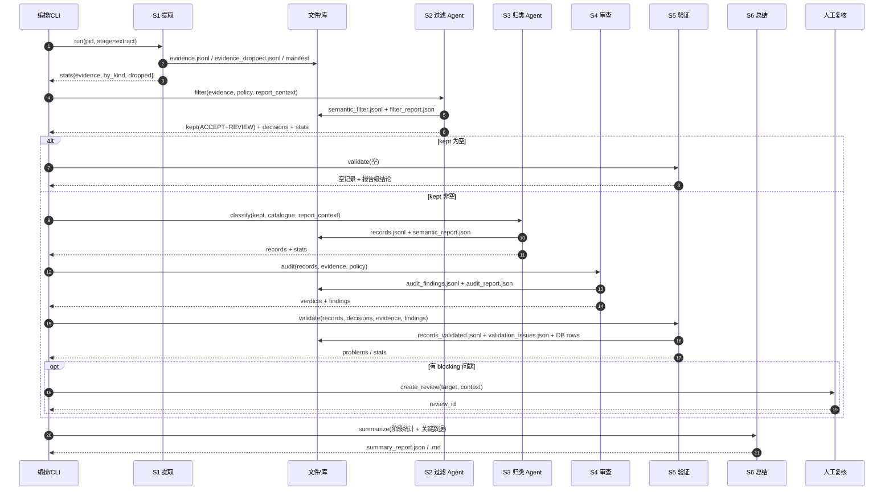

### 13.2 接口清单

| 编号 | 接口 | 形态 | 状态 | 说明 |
| --- | --- | --- | --- | --- |
| `I-01` | `esg_extract_pipeline.py --stage extract` | CLI | `【现有实现】` | S1，一次跑 parse→evidence |
| `I-02` | `esg_semantic_run.py --out ... --llm ...` | CLI | `【现有实现】` | S2+S3，复用已有 evidence |
| `I-03` | `SemanticFilter.filter(evidence, pid, policy, report_context, run)` | Python | `【现有实现】`+扩展 | S2 |
| `I-04` | `ClosedSetExtractor.extract(evidence, reporting_year, pid, catalogue, run)` | Python | `【现有实现】`+扩展 | S3 |
| `I-05` | `validate_records / score_records / resolve_conflicts / build_rows` | Python | `【现有实现】` | S5 |
| `I-05a` | `SemanticAuditor.audit_report(records, evidence, sample_rate)` | Python | `【设计规定】` | S4 审查 |
| `I-05b` | `ReportSummarizer.summarize(input, polish)` | Python | `【设计规定】` | S6 总结 |
| `I-06` | `POST /v1/filter:run` | HTTP | `【设计规定】` | S2 异步 |
| `I-07` | `POST /v1/classify:run` | HTTP | `【设计规定】` | S3 异步 |
| `I-08` | `POST /v1/reviews` / `GET /v1/reviews` | HTTP | `【设计规定】` | 复核 |
| `I-09` | `POST /v1/reviews/{id}/decision` | HTTP | `【设计规定】` | 复核结论 → 新 run |
| `I-10` | `GET /v1/records/{record_uid}` | HTTP | `【设计规定】` | 查记录 + 证据 + 决策 |
| `I-11` | `GET /v1/evidence/{evidence_id}/page` | HTTP | `【设计规定】` | 按页回查（返回签名 URL 或裁图） |
| `I-12` | `POST /v1/reprocess` | HTTP | `【设计规定】` | 策略升级后重跑（等价 `REPROCESS`） |
| `I-13` | `POST /v1/audit:run` / `GET /v1/audit:runs/{id}` | HTTP | `【设计规定】` | S4 审查 |
| `I-14` | `POST /v1/summary:run` / `GET /v1/summary/{id}` | HTTP | `【设计规定】` | S6 总结 |
| `I-15` | `POST /v1/pipeline:run` | HTTP | `【设计规定】` | Planner 提交任务 |
| `I-16` | `GET /v1/pipeline/{task_id}` / `/steps` | HTTP | `【设计规定】` | Planner 状态与步骤 |
| `I-17` | `POST /v1/pipeline/{task_id}:pause`、`:resume`、`:cancel` | HTTP | `【设计规定】` | Planner 暂停/恢复/取消 |
| `I-18` | 应用层读模型接口（报告/证据/记录/看板） | HTTP | `【设计规定】` | 见第14章 API 目录 |
| `I-19` | `/v1/qualitative/*`、`/v1/search/*` | HTTP | `【预留】` | 默认 501，见第15章 |

### 13.3 幂等与批次

| 对象 | 幂等键 | 行为 |
| --- | --- | --- |
| 过滤 run | `(pid, evidence_sha, policy_version, mode)` | 同键重复提交返回既有 `filter_run_id` |
| 归类 run | `(pid, filter_run_id, catalogue_version, mode)` | 同上 |
| 入库 | `(pid, indicator_id, variable, year, breakdown)` | upsert，不产生重复行 |
| 批次 | `hash(evidence_id 列表以竖线连接)[:12]` | 续跑跳过已完成批（现有 `done_keys`） |
| 复核 | `(target_type, target_id, reason_code, OPEN)` | 同目标同原因不重复建任务 |

`evidence_sha` 计算方式沿用现有实现：`sha1("|".join(evidence_ids))[:16]`；`【设计规定】` 建议同时记录全量 `sha256(evidence.jsonl)`，避免"ID 相同、内容被改"的盲区。

### 13.4 错误码

| 错误码 | HTTP/CLI | 可重试 | 阻断 | 处理 |
| --- | --- | --- | --- | --- |
| `ERR_PDF_UNREADABLE` | CLI 非零 | 否 | 是 | 换文件/人工 |
| `ERR_PARSE_PAGE_FAILED` | 内部 | 是（1） | 否 | 跳过该页，记 `_parse_ok` |
| `ERR_OCR_FAILED` | 内部 | 是（1） | 否 | `ocr_error`，该页无证据 |
| `ERR_VLM_TIMEOUT` | 内部 | 是（2） | 否 | `vlm_error`，`kept=false` |
| `ERR_EVIDENCE_NOT_FOUND` | 404 | 否 | 是 | 检查 pid/产物 |
| `ERR_EVIDENCE_MALFORMED` | 422 | 否 | 否 | 该条降 REVIEW |
| `ERR_POLICY_NOT_FOUND` | 404 | 否 | 是 | 补策略文件 |
| `ERR_MODEL_UNAVAILABLE` | 503 | 是（2） | 否 | 降级（过滤全 ACCEPT / 归类占位） |
| `ERR_MODEL_TIMEOUT` | 504 | 是（2） | 否 | 同上 |
| `ERR_MODEL_OUTPUT_INVALID` | 502 | 是（1 修复） | 否 | 抢救解析；仍失败降级 |
| `ERR_MODEL_BUDGET_EXCEEDED` | 429 | 否 | 否 | 截断并标 `truncated` |
| `ERR_CATALOGUE_NOT_FOUND` | 404 | 否 | 是 | 补闭集 |
| `ERR_CATALOGUE_VERSION_MISMATCH` | 409 | 否 | 是 | 统一版本后重跑 |
| `ERR_CLASSIFICATION_EMPTY` | 200 + `records=0` | 否 | 否 | 合法空结果，但需 `status` 说明 |
| `ERR_ARTIFACT_FINGERPRINT_MISMATCH` | 409 | 否 | 是 | 产物被改，重跑相应 stage |
| `ERR_MANIFEST_MISSING` | 409 | 否 | 是 | 缺 manifest，拒绝入库 |
| `ERR_GATE_FAILED` | 409 | 否 | 是 | 门禁未过，不写库（保留现场） |
| `ERR_AUDIT_INSUFFICIENT` | 200 + `INSUFFICIENT` | 否 | 否 | 审查不可用，记录标待复核 |
| `ERR_FINDING_DANGLING` | 内部 | 否 | 否 | finding 引用不存在证据，丢弃该条并计数 |
| `ERR_TASK_NOT_FOUND` | 404 | 否 | 是 | Planner 任务不存在 |
| `ERR_TASK_ILLEGAL_TRANSITION` | 500 | 否 | 是 | 非法状态迁移（缺陷） |
| `ERR_TASK_BUDGET_EXCEEDED` | 200 + `truncated` | 否 | 否 | 预算耗尽，任务 `PARTIAL` |
| `ERR_TASK_CONFLICT` | 409 | 否 | 是 | 同 pid 已有运行中任务 |
| `ERR_SUMMARY_GUARD_FAILED` | 200 + `TEMPLATE_FALLBACK` | 否 | 否 | 总结数字守卫失败，回退模板 |
| `ERR_SUMMARY_INPUT_INCOMPLETE` | 422 | 否 | 否 | 输入缺段，该段写"未执行" |
| `ERR_REVIEW_PENDING` | 409 | 否 | 是（评分） | 等复核 |
| `ERR_DUPLICATE_RUN` | 200 | — | 否 | 返回既有 run_id |
| `ERR_INVALID_REQUEST` | 400 | 否 | 是 | 修参数 |

### 13.5 超时、重试、预算（统一策略）

| 阶段 | 超时 | 重试 | 预算上限（默认，可配） |
| --- | --- | --- | --- |
| S1 解析 | 单 PDF 30 min | 单页 1 次 | — |
| S1 整页 OCR | 单页 120 s | 1 次 | 目标页数由 `TableOcrFilter` 控制 |
| S1 读图 | 单图 90 s | 2 次 | 单报告 ≤ 40 图 |
| S2 过滤 | 单批 60 s | 2 次 | `max_model_calls = ceil(n/40)+2` |
| S3 归类 | 单批 90 s | 2 次 | `max_model_calls = ceil(n/30)+2` |
| S4 审查 | 单组 60 s | 2 次 | 组 `INSUFFICIENT` |
| S5 验证 | 单报告 60 s | 0 | — |
| S6 总结 | 单报告 60 s | 1 次 | 回退模板 |
| Planner | 单任务 = 各 step 之和 | 按 step | 任务 `PARTIAL` |

预算耗尽一律**降级并标记**，不得静默截断；`truncated=true` 必须出现在报告中。

### 13.6 人工复核接口

| 动作 | 接口 | 说明 |
| --- | --- | --- |
| 列出待复核 | `GET /v1/reviews?status=OPEN&pid=...&priority=P0` | 游标分页 |
| 查看详情 | `GET /v1/reviews/{id}` | 含 `context`（原值/候选/证据/裁图 URL） |
| 提交结论 | `POST /v1/reviews/{id}/decision` | `decision_type` + 理由（≥10 字）+ 可选修正值 |
| 批量导入 | `POST /v1/reviews:import` | CSV，逐行对应 `review_id` |
| 结论生效 | 自动 | 追加 `esg_review_decision`，创建新 filter/classify run（`trigger=REVIEW_RESOLVED`），旧 run 保留 |

复核结论的四种生效方式：

| `decision_type` | 效果 |
| --- | --- |
| `KEEP` | 证据/记录保留，`filter_status` 或 `classification_status` 人工置为有效 |
| `EXCLUDE` | 记人工排除（`decision_source=HUMAN`），证据仍保留 |
| `REMAP` | 改 `indicator_id`/`variable`，生成新归类记录 |
| `MARK_NOT_DISCLOSED` | 标"报告未披露"，用于评分阶段的缺失处理（Q-08） |

### 13.7 与现有 CLI 的兼容

- 保留 `--stage extract|classify|store` 与 `--phases evidence,semantic`。
- `【设计规定】` 新增 `--stage filter|classify|review|validate|summarize|pipeline`（分别对应 S2/S3/S4/S5/S6 单跑与全流程），旧别名不变。
- 旧 `--phases extract`（LLM 直出）标 `deprecated`，产物写 `legacy=true`，禁止进入正式库。

### 13.8 上下文与成本控制

| 措施 | 规则 |
| --- | --- |
| 不重复贴全文 | 同表 HTML 只贴一次（现有 `render_evidence_batch` 已做） |
| 只贴必要元数据 | 证据标签只保留 `编号/页码/类型`，不带 `tier`（现有实现已优化） |
| 批次合并 | 过滤 40 条/批、归类 30 条/批、审查按指标组（≤20 条/组）（现有默认 + 新增） |
| 缓存 | 同 `(evidence_id, policy_version)` 的决策直接复用，不重调模型 |
| 预算 | 见 §13.5；超限降级（Planner 统一计账） |
| 总结成本 | 默认模板（0 次模型调用）；仅 `polish=true` 时 1 次 |
| 统计 | 每轮记录 `n_model_calls / input_tokens / output_tokens / elapsed_ms`；任务级汇总在 `esg_task.budget_used`；成本只报实测 |

---

## 第十四章 前后端应用设计（完整交付）

### 14.0 交付范围与完成定义

`【设计规定】` 本章是**正式交付物**，不是演示原型。完成定义：

| 编号 | 完成条件 |
| --- | --- |
| `APP-1` | 分析师可在浏览器完成：登录 → 选报告 → 提交任务 → 看实时进度 → 查看证据（PDF 定位）→ 复核 → 看总结 → 导出 |
| `APP-2` | 五类角色权限生效：越权请求 403，越权入口不可见或置灰并说明原因 |
| `APP-3` | 所有列表支持筛选、游标分页、空态/错误态；所有写操作有幂等与审计 |
| `APP-4` | 证据浏览器可从记录/审查 finding 一键跳转到 PDF 页码与 bbox 高亮 |
| `APP-5` | 复核提交后自动触发最小重跑，并能在任务详情看到新 run |
| `APP-6` | 关键页面 P95 ≤ 1.5s（1 万条记录以内），主要流程可全程键盘操作 |
| `APP-7` | 关闭预留能力时，相关接口 501、页面显示"未启用"、不产生任何副作用 |

### 14.1 技术选型与工程约束

`【设计规定】` 选型如下；如企业已有标准栈，可等价替换（Q-28）。

| 层 | 选型 | 说明 |
| --- | --- | --- |
| 前端框架 | React 18 + TypeScript + Vite | SPA，构建产物为静态文件 |
| 路由 | React Router | 路由级权限守卫 |
| 数据请求 | TanStack Query + 生成式 client | 缓存/重试/失效统一 |
| UI | Ant Design（或 MUI） | 中后台表格/表单/抽屉 |
| 状态 | Query 管服务器状态，Zustand 管少量 UI 状态 | 不建全局业务 store |
| PDF | PDF.js（自托管） | 按页加载 + bbox 高亮 |
| 后端 | FastAPI + Pydantic v2 | 复用 `schemas/`，自动 OpenAPI |
| 鉴权 | OIDC（企业 SSO）+ 后端 RBAC | 不自建密码体系 |
| 实时 | SSE | 单向进度推送，够用且简单 |
| 存储 | PostgreSQL/MySQL + S3 兼容对象存储 | 与数据层一致 |
| 部署 | 容器：`web`、`api`、`worker`、`db`、`minio` | 不引入 BFF/网关（企业网关可外挂） |

**工程约束**：

1. 前端**不直连数据库/对象存储**；只调 API，文件走短时签名 URL。
2. 前端**不做业务计算**：质量分、评分、统计、换算全部由后端给（Q-27）。
3. 类型单一来源：`schemas/*.json` → OpenAPI → 前端 `api/generated`。
4. 所有 API 变更必须先改 Schema，再生成前端类型；禁止手写重复类型。
5. 不在浏览器端做 OCR/解析/模型调用。

### 14.2 角色、权限与会话

| 角色 | 可见页面 | 可写操作 | 数据范围 |
| --- | --- | --- | --- |
| `viewer` | 报告列表/详情、记录、总结 | 无 | 仅已发布（`publishable=true` 或已入库） |
| `analyst` | viewer + 证据、审查、任务 | 提交单报告任务；提交复核结论；导出已发布数据 | 全部报告 |
| `reviewer` | analyst + 复核队列管理 | 领取/分配/升级复核；批量导入结论 | 全部报告 |
| `ops` | analyst + 批量任务、看板、监控 | 批量/重跑/暂停/恢复/取消；导出 | 全部 |
| `admin` | 全部 + 配置/版本/审计 | 用户与角色；查看审计；功能开关 | 全部 |
| `service` | 无 UI | 内部服务调用 | 按 scope |

**会话**：

1. 登录走 OIDC 授权码 + PKCE；后端只校验 JWT（issuer/audience/exp/signature），角色从 claims 映射。
2. Access Token 放内存（不写 localStorage）；刷新用 HttpOnly + Secure + SameSite=Lax 的 refresh cookie。
3. 会话过期：API 返回 401 + `WWW-Authenticate`，前端跳登录并保留 `returnTo`。
4. 敏感操作（批量、导出未发布、改配置）要求二次确认；admin 操作记审计。

### 14.3 信息架构与路由

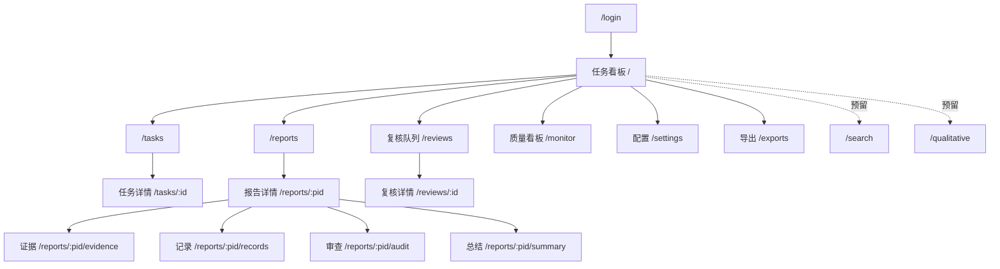

| 路由 | 页面 | 角色 | 关键 query 参数 |
| --- | --- | --- | --- |
| `/login` | 登录回调 | 公开 | `returnTo` |
| `/` | 任务看板 | viewer+ | `status`、`mine` |
| `/tasks` | 任务列表 | analyst+ | `status`、`pid`、分页 |
| `/tasks/:id` | 任务详情 | analyst+ | `tab=stages/problems/artifacts` |
| `/reports` | 报告列表 | viewer+ | `year`、`company`、`status` |
| `/reports/:pid` | 报告详情 | viewer+ | `tab=overview/audit/quality` |
| `/reports/:pid/evidence` | 证据浏览器 | analyst+ | `page`、`kind`、`filter`、`evidence` |
| `/reports/:pid/records` | 记录浏览 | viewer+ | `indicator`、`quality`、`showSuperseded` |
| `/reports/:pid/audit` | 审查发现 | analyst+ | `severity`、`code` |
| `/reports/:pid/summary` | 总结 | viewer+ | `lang` |
| `/reviews` | 复核队列 | reviewer+ | `status`、`priority`、`assignee` |
| `/reviews/:id` | 复核详情 | reviewer+ | — |
| `/monitor` | 质量看板 | ops+ | `period`、`year` |
| `/settings` | 配置与版本 | admin | `tab=policies/catalogue/users/flags` |
| `/exports` | 导出 | analyst+ | `status` |
| `/search`、`/qualitative` | 预留占位 | admin | — |

**深链要求**：证据浏览器必须支持 `?page=7&evidence=2025073101502_e00201` 直达并高亮；记录/审查/复核之间的跳转都带 ID，刷新不丢状态。

### 14.4 前端工程结构

```text
web/
├── src/
│   ├── app/
│   │   ├── main.tsx
│   │   ├── router.tsx          # 路由表 + 懒加载
│   │   ├── providers.tsx       # QueryClient / i18n / theme
│   │   └── guards.tsx          # RequireRole / RequireAuth
│   ├── api/
│   │   ├── generated/          # OpenAPI 生成（禁止手改）
│   │   ├── client.ts           # fetch 封装：401/403/错误码/重试
│   │   └── hooks/              # useReport / useEvidenceList / useReview ...
│   ├── features/
│   │   ├── tasks/              # 列表、详情、阶段时间线、SSE
│   │   ├── reports/            # 列表、详情、统计卡
│   │   ├── evidence/           # 列表 + PDF 预览 + bbox
│   │   ├── records/            # 表格 + 抽屉 + 历史
│   │   ├── audit/              # finding 列表 + 证据片段
│   │   ├── reviews/            # 队列 + 决策表单
│   │   ├── summary/            # 9 段渲染 + 导出
│   │   ├── monitor/            # 指标卡 + 图表（只展示后端聚合）
│   │   └── settings/           # 版本/开关/用户（只读为主）
│   ├── components/             # StatusBadge / EmptyState / ErrorState / DataTable / Drawer
│   ├── lib/                    # format / i18n / download / bbox
│   └── styles/
├── e2e/                        # Playwright
├── public/
└── vite.config.ts
```

**通用组件（必须复用，不允许各页面自造）**：

| 组件 | 职责 |
| --- | --- |
| `StatusBadge` | 统一渲染 `data_status/filter_status/classification_status/audit_verdict/quality_band/task_status` 的颜色与文案 |
| `DataTable` | 服务端分页/排序/筛选、列配置、空态、加载骨架 |
| `EmptyState` | 区分"未运行/无数据/无权限/筛选无结果"四种文案 |
| `ErrorState` | 展示 `error.code`、`message`、`request_id`、重试按钮 |
| `EvidenceDrawer` | 证据详情 + 裁图 + 关联记录 + finding |
| `PdfViewer` | 页码跳转、缩放、bbox 高亮、裁图切换 |
| `ConfirmDialog` | 高风险操作二次确认（批量、导出未发布、取消任务） |

### 14.5 前端通用规范

| 项 | 规范 |
| --- | --- |
| 数据获取 | 每页一个主 Query + 若干从属 Query；queryKey 形如 `["report", pid]`、`["evidence", pid, page]`；写操作成功后精确失效相关 key |
| 加载态 | 骨架屏；超过 300ms 才显示，避免闪烁 |
| 错误态 | 401 跳登录；403 显示无权限；409 显示冲突与最新状态；5xx 显示 `request_id` 与重试 |
| 空态 | 必说明原因与下一步（如"尚未运行，去提交任务"） |
| 分页 | 游标分页，URL 保留 cursor；返回顶部按钮 |
| 排序/筛选 | 服务端执行；前端只传参，不在本地重排全量 |
| 数字/单位 | 原样展示 `value + unit`；不换算；千分位由格式化函数统一 |
| 时间 | 后端返回 UTC，前端按浏览器时区展示，tooltip 显示 UTC |
| 状态 | 只用 `StatusBadge`；颜色语义固定（红=阻断，橙=待办，绿=通过，灰=不适用） |
| 权限 | 路由守卫 + 组件守卫；隐藏与置灰二选一，置灰必须给原因 |
| i18n | 默认 `zh-HK`，支持 `en`；文案集中在 `lib/i18n`，禁止硬编码中文到组件 |
| 可访问性 | 语义化标签、键盘可达、焦点可见、对比度 ≥ 4.5:1、表格有 caption |
| 安全 | 证据 HTML 只渲染服务端清洗后的内容；禁止 `dangerouslySetInnerHTML` 直接渲染原文 |

### 14.6 页面详细设计

#### 14.6.1 任务看板（`/`）

```text
┌──────────────────────────────────────────────────────────────┐
│ 任务看板                     [+ 新建任务]  [我的任务 ▾]      │
├──────────────────────────────────────────────────────────────┤
│ 运行中 3 | 待复核 12 | 失败 1 | 今日完成 45                    │
├──────────────────────────────────────────────────────────────┤
│ 任务            报告            阶段       进度      操作      │
│ tsk_a1…         示例水务 2025   auditing   67%      查看 暂停  │
│ tsk_a2…         某某控股 2024   filtering  33%      查看 取消  │
├──────────────────────────────────────────────────────────────┤
│ 最近失败：tsk_a0…  extract 失败（PDF 不可读）      查看详情 →  │
└──────────────────────────────────────────────────────────────┘
```

| 项 | 设计 |
| --- | --- |
| 数据 | `GET /v1/pipeline?status=&mine=`、`GET /v1/metrics/summary` |
| 交互 | 新建任务打开抽屉（选报告/年度/模式）；行内暂停/取消（按权限） |
| 实时 | 页面订阅全局 SSE，更新运行中任务的阶段与进度 |
| 空态 | "还没有任务，选择一份报告开始" |
| 验收 | 10 个运行中任务同时更新不卡顿；失败任务能一键跳详情 |

#### 14.6.2 任务详情（`/tasks/:id`）

```text
┌──────────────────────────────────────────────────────────────┐
│ tsk_a1…  示例水务 2025   [暂停] [取消]        状态：待复核     │
├──────────────────────────────────────────────────────────────┤
│ ① extract ✅ 2m10s   ② filter ✅ 35s   ③ classify ✅ 1m02s    │
│ ④ audit ⏳ 12s       ⑤ validate ⬜       ⑥ summarize ⬜        │
├──────────────────────────────────────────────────────────────┤
│ 预算：模型 7/40   token 52k/400k   裁图 12/60                 │
│ 门禁：G0 ✅ G1 ✅ G2 ✅ G3 ✅ G4 ⏳ G5 — G6 —                  │
│ 问题：无                                                      │
│ 待复核：rvw_…（P0，差口径）                       去处理 →    │
└──────────────────────────────────────────────────────────────┘
```

| 项 | 设计 |
| --- | --- |
| 数据 | `GET /v1/pipeline/{id}` + `?include=steps`；SSE 推送 |
| 交互 | 暂停/恢复/取消；失败阶段"从此处重跑"生成 `STAGE_RERUN` |
| 展示 | 阶段时间线、预算条、门禁列表、问题列表、产物下载 |
| 空态/错误 | 任务不存在 404；无权限 403 |
| 验收 | 阶段状态与后端 `esg_task_step` 一致；重跑后生成新 run 并保留旧产物 |

#### 14.6.3 报告列表与报告详情

列表：按年度/公司/状态筛选；列显示公司、年度、页数、证据数、入库记录数、待复核数、总结状态。

详情（`/reports/:pid`）：

```text
┌──────────────────────────────────────────────────────────────┐
│ 示例水务控股有限公司  2025 财年  42 页  vector   [重新运行]   │
├──────────────┬──────────────┬──────────────┬─────────────────┤
│ 证据 19      │ 过滤 17/2/2  │ 归类 23/1/1  │ 审查 0/2/1      │
│ (6/5/6/2)    │ 接受/复核/排除│ 确定/歧义/缺口│ BLOCK/WARN/INFO │
├──────────────┴──────────────┴──────────────┴─────────────────┤
│ 关键数据（E2.1.1）                                            │
│ 总取水量 12,345 m³ | 2025 | Group | p12 | 质量 auto           │
├──────────────────────────────────────────────────────────────┤
│ [证据浏览器] [记录] [审查发现] [总结]                          │
└──────────────────────────────────────────────────────────────┘
```

| 项 | 设计 |
| --- | --- |
| 数据 | `GET /v1/reports/{pid}`（含阶段统计与 key_data） |
| 交互 | 卡片点击进入对应页面并带筛选参数 |
| 空态 | 未运行：显示"尚未处理"+ 提交按钮 |
| 验收 | 六个入口均可深链；统计数字与 API 一致（前端不重算） |

#### 14.6.4 证据浏览器（`/reports/:pid/evidence`）

```text
┌───────────────┬──────────────────────────┬───────────────────┐
│ 筛选           │ PDF 页（p12）             │ 证据详情           │
│ 通道 ▾ 决策 ▾  │ ┌──────────────────────┐ │ e00201            │
│ 页码 ▾         │ │  [表格区域高亮]       │ │ 表格 / high       │
│ ─────────────  │ │  2025    2024        │ │ 单位 m3           │
│ e00198 正文 p3 │ │  Total  12,345 11,000│ │ 过滤 ACCEPT       │
│ e00201 表格 p12│ └──────────────────────┘ │ 审查 CONFIRMED    │
│ e00205 图表 p15│  [上一页] 12/42 [下一页]  │ 关联记录 2 条 →   │
└───────────────┴──────────────────────────┴───────────────────┘
```

| 项 | 设计 |
| --- | --- |
| 数据 | `GET /v1/reports/{pid}/evidence?page=&kind=&filter=`、`GET /v1/evidence/{id}`、`GET /v1/reports/{pid}/pdf` |
| 交互 | 列表↔PDF↔详情三向联动；点击 bbox 可放大；复制深链 |
| bbox | 后端给 PDF point，前端按 `scale = viewport.width / page.width` 换算；缩放时重算 |
| 空态 | 该页无证据："本页未提取到定量证据" + 查看丢弃台账入口 |
| 验收 | 任意证据 3 次点击内到达 PDF 位置；坐标偏差 ≤ 2px（100% 缩放下） |

#### 14.6.5 记录浏览（`/reports/:pid/records`）

表格列：指标、变量、值、单位、年份、口径、页码、来源通道、质量分/档、审查结论、状态（winner/superseded）。

| 项 | 设计 |
| --- | --- |
| 数据 | `GET /v1/reports/{pid}/records?indicator=&quality=&showSuperseded=` |
| 抽屉 | 溯源链、分类理由、finding、复核历史；跳证据 |
| 默认 | 只显示 `winner` 且 `quality_band != reject` |
| 验收 | 切换"显示全部"后 superseded 可见并标出取代者；导出与表格一致 |

#### 14.6.6 审查发现（`/reports/:pid/audit`）

| 项 | 设计 |
| --- | --- |
| 数据 | `GET /v1/reports/{pid}/audit`、`GET /v1/audit/findings?pid=&severity=` |
| 展示 | 严重度分组；每条给 code、observed/expected、证据片段、建议动作 |
| 交互 | BLOCK → "去复核"；WARN → "标记已知"（记审计，不改结论） |
| 验收 | finding 与证据可互跳；BLOCK 数与本报告待复核数一致 |

#### 14.6.7 复核工作台（`/reviews`、`/reviews/:id`）

```text
┌──────────────────────────────────────────────────────────────┐
│ 复核队列            [优先级 ▾] [原因 ▾] [领取]                │
├──────────────────────────────────────────────────────────────┤
│ P0 rvw_01  示例水务 E2.1.1  差口径       SLA 6h   打开 →      │
│ P1 rvw_02  某某控股 E1.3.1  年份不符     SLA 2d   打开 →      │
└──────────────────────────────────────────────────────────────┘
```

详情三栏：左证据裁图，中上下文（原值/候选/同组记录/finding），右决策表单。

| 项 | 设计 |
| --- | --- |
| 数据 | `GET /v1/reviews`、`GET /v1/reviews/{id}`、`GET /v1/evidence/{id}/crop` |
| 决策 | `KEEP/EXCLUDE/REMAP/CORRECT_VALUE/MARK_NOT_DISCLOSED/EXCLUDE_FROM_SCORING`；理由 ≥10 字；`REMAP/CORRECT` 必须给目标指标或值 |
| 提交 | `POST /v1/reviews/{id}/decision` + `Idempotency-Key`；返回 `new_run_id` |
| 限制 | 提交者不能复核自己触发的 BLOCK（默认，Q-29） |
| 验收 | 提交后原记录保留、新 run 可追踪；重复提交幂等 |

#### 14.6.8 总结与导出（`/reports/:pid/summary`、`/exports`）

| 项 | 设计 |
| --- | --- |
| 总结 | 渲染 9 段；显示 `generated_by` 与 `guard` 结果；支持复制/下载 Markdown |
| 导出 | `POST /v1/exports`（类型/筛选）→ `GET /v1/exports/{id}` 拿签名 URL |
| 限制 | 默认不导出未发布数据；admin 可显式允许 |
| 验收 | 导出列包含三版本（policy/catalogue/pipeline）；大文件不阻塞页面 |

#### 14.6.9 质量看板与配置（`/monitor`、`/settings`）

看板：覆盖率、状态分布、质量分档、审查命中、任务成功率、复核时长——全部来自 `/v1/metrics/*`。
配置：策略/闭集/审查策略版本只读展示；功能开关（`FEATURE_QUALITATIVE`、`FEATURE_WEB_SEARCH`）仅 admin 可见；发布审批入口预留（置灰 + 说明）。

### 14.7 后端工程结构

```text
api/
├── main.py                 # 应用装配、中间件、异常处理、OpenAPI
├── deps.py                 # DB session、当前用户、分页参数、幂等键
├── security.py             # JWT 校验、RBAC、scope
├── errors.py               # 错误码 → HTTP + 错误信封
├── sse.py                  # 事件总线、心跳、Last-Event-ID
├── routers/
│   ├── reports.py          # 列表/详情/pdf/evidence/records/audit/summary
│   ├── evidence.py         # 详情/裁图
│   ├── records.py          # 详情/历史
│   ├── reviews.py          # 队列/详情/决策/导入
│   ├── tasks.py            # 提交/状态/步骤/暂停恢复取消/SSE
│   ├── metrics.py          # 质量与运行指标
│   ├── meta.py             # 版本/闭集/开关
│   └── exports.py          # 导出
├── services/
│   ├── report_query.py     # 读模型组装（统计、key_data）
│   ├── evidence_query.py   # 证据/裁图/丢弃台账
│   ├── record_query.py     # 记录 + 溯源 + 历史
│   ├── review_cmd.py       # 决策校验、落库、触发重跑
│   ├── task_cmd.py         # 提交/暂停/恢复/取消（委托 Planner）
│   └── export_cmd.py       # 异步导出任务
└── repositories/
    ├── report_repo.py
    ├── evidence_repo.py
    ├── record_repo.py
    ├── review_repo.py
    └── metrics_repo.py
```

**依赖规则**：

1. `routers` 只做参数校验、鉴权、调用 service、映射错误；**禁止写 SQL、禁止业务判断**。
2. `services` 只编排领域逻辑；**禁止依赖 FastAPI Request/Response**。
3. `repositories` 只做查询与事务；**禁止业务规则**。
4. 写操作必须经 `services`（不得 router 直接写库），保证幂等与审计统一。

### 14.8 API 规格

#### 14.8.1 约定

| 项 | 约定 |
| --- | --- |
| 基址 | `/v1` |
| 鉴权 | `Authorization: Bearer <JWT>` |
| 幂等 | 写接口支持 `Idempotency-Key`；同键同 body 返回首次结果 |
| 分页 | `?limit=50&cursor=...`；响应 `{items,next_cursor}`；limit ≤ 200 |
| 排序 | `?sort=field:asc,field2:desc`（白名单字段） |
| 过滤 | 显式参数，不接受任意表达式 |
| 错误 | `{error:{code,message,retryable,blocking,details,request_id}}` |
| 时间 | ISO8601 UTC（`Z`） |
| 版本 | 响应头 `X-Schema-Version` |

#### 14.8.2 关键接口示例

**提交任务** `POST /v1/pipeline:run`

```json
{
  "task_type": "REPORT_PIPELINE",
  "pid": "2025073101502",
  "mode": "STANDARD",
  "policy_version": "FP-1.0.0",
  "catalogue_version": "MD-2026.10",
  "options": {"summarize": true, "allow_partial": true}
}
```

响应 `202`：

```json
{
  "task_id": "tsk_01JB7Y2Q8ZK3M4N5P6R7S8T9V0",
  "status": "CREATED",
  "links": {"self": "/v1/pipeline/tsk_01JB7Y2Q8ZK3M4N5P6R7S8T9V0",
            "events": "/v1/pipeline/tsk_01JB7Y2Q8ZK3M4N5P6R7S8T9V0/events"}
}
```

**任务状态** `GET /v1/pipeline/{task_id}`

```json
{
  "task_id": "tsk_01JB7Y2Q8ZK3M4N5P6R7S8T9V0",
  "status": "WAITING_HUMAN",
  "current_stage": "audit",
  "progress": {"steps_total": 6, "steps_done": 4},
  "stages": [
    {"stage": "extract", "status": "SUCCEEDED", "elapsed_ms": 130000},
    {"stage": "filter", "status": "SUCCEEDED", "elapsed_ms": 35000},
    {"stage": "classify", "status": "SUCCEEDED", "elapsed_ms": 62000},
    {"stage": "audit", "status": "RUNNING", "elapsed_ms": 12000}
  ],
  "budget": {"model_calls_used": 7, "model_calls_limit": 40,
             "tokens_used": 52310, "tokens_limit": 400000, "truncated": false},
  "open_reviews": ["rvw_01JB7Z7T5V6W7X8Y9Z0A1B2C3"],
  "problems": []
}
```

**报告详情** `GET /v1/reports/{pid}`

```json
{
  "pid": "2025073101502",
  "company": {"name": "Imperium Financial Group Limited", "stock_code": "00585"},
  "report_year": 2025,
  "page_count": 42,
  "doc_type": "vector",
  "stages": {
    "extract": {"evidence": 19, "by_kind": {"text": 6, "table_cell": 5, "figure": 6, "page_ocr": 2}},
    "filter": {"accept": 15, "review": 2, "exclude": 2},
    "classify": {"assigned": 23, "ambiguous": 1, "unmapped": 1},
    "audit": {"block": 0, "warn": 2, "info": 1},
    "validate": {"rows_written": 22, "quality_bands": {"auto": 18, "review": 4}}
  },
  "key_data": [
    {"indicator_id": "E2.1.1",
     "variable": "Total Water Withdrawal (from all sources in m³)",
     "value": 12345, "unit": "m3", "year": 2025, "breakdown": "Group",
     "source_page": 12, "quality_band": "auto"}
  ],
  "open_reviews": 1
}
```

**证据列表** `GET /v1/reports/{pid}/evidence?page=12&kind=table_cell`

```json
{
  "items": [
    {"evidence_id": "2025073101502_e00201", "page_no": 12, "kind": "table_cell",
     "tier": "high", "filter_status": "ACCEPT", "audit_verdict": "CONFIRMED",
     "preview": "Total water withdrawal 12,345 (2025) 11,000 (2024)",
     "bbox": [70.9, 200.2, 500.4, 380.6]}
  ],
  "next_cursor": "eyJwYWdlIjoxMn0"
}
```

**复核详情** `GET /v1/reviews/{review_id}`

```json
{
  "review_id": "rvw_01JB7Z7T5V6W7X8Y9Z0A1B2C3",
  "pid": "2025073101502",
  "target_type": "CLASSIFICATION_RECORD",
  "target_id": "2025073101502|E2.1.1|Total Water Withdrawal (from all sources in m³)|2025|Group",
  "reason_code": "CLASS-AMBIGUOUS",
  "priority": "P0",
  "blocking": true,
  "status": "OPEN",
  "context": {
    "raw_value": {"value": 12345, "unit": "m3", "page_no": 12},
    "candidates": [
      {"indicator_id": "E2.1.1", "variable": "Total Water Withdrawal (from all sources in m³)"},
      {"indicator_id": "E2.1.2", "variable": "Total Water Withdrawal"}
    ],
    "evidence": {"evidence_id": "2025073101502_e00201", "page_no": 12,
                 "bbox": [70.9, 200.2, 500.4, 380.6]},
    "question": "这行是集团总取水量还是高水压力地区取水量？",
    "suggested_option": "E2.1.1"
  },
  "allowed_decisions": ["KEEP", "REMAP", "EXCLUDE", "MARK_NOT_DISCLOSED"]
}
```

**提交复核** `POST /v1/reviews/{id}/decision`

```json
{
  "decision_type": "REMAP",
  "decided_indicator": "E2.1.3",
  "decided_variable": "Total Wastewater Discharge (in m3)",
  "justification": "表头为 Wastewater discharge，属于排水量而非取水量"
}
```

> 字段严格校验：未知字段、缺少 `justification`（<10 字）、`REMAP` 未给目标指标，都会返回 422 并拒绝提交。

响应 `202`：

```json
{"review_id": "rvw_01JB7Z7T5V6W7X8Y9Z0A1B2C3", "status": "RESOLVED",
 "new_run_id": "run_01JB80A1B2C3D4E5F6G7H8J9K0"}
```

#### 14.8.3 SSE 事件

| event | data | 触发 |
| --- | --- | --- |
| `stage` | `{stage,status,elapsed_ms}` | 阶段开始/结束 |
| `progress` | `{steps_done,steps_total,percent}` | 步骤完成 |
| `review_required` | `{review_id,priority,blocking}` | 审查产生 BLOCK |
| `done` | `{status}` | 任务终态 |
| `error` | `{code,message}` | 任务失败 |
| `heartbeat` | `{ts}` | 每 15s |

#### 14.8.4 交互时序

**提交任务并跟踪进度**

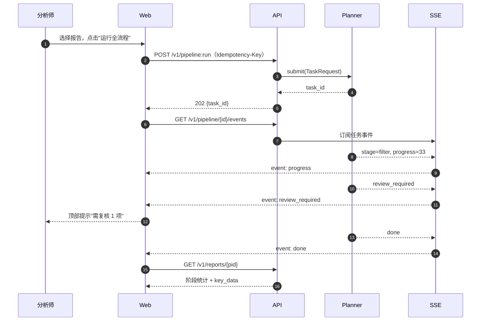

**复核工作台**

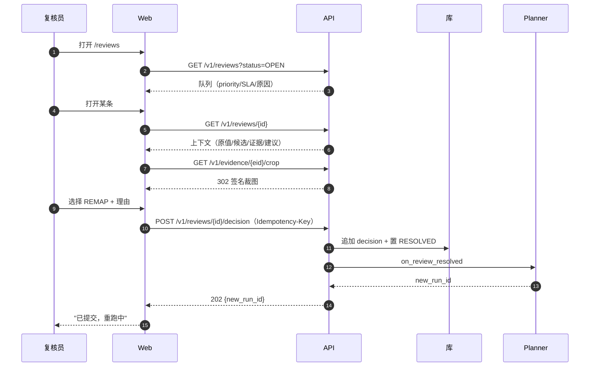

### 14.9 读模型与查询

| 读模型 | 主要表 | 关键点 |
| --- | --- | --- |
| 报告详情 | `esg_report` + 各 run 统计表 | 统计走预聚合字段或 `COUNT` 子查询；避免逐阶段 N+1 |
| 证据列表 | `esg_evidence` + `esg_filter_decision` + `esg_audit_result` | 按 `(pid,page_no)` 索引；列表只返回预览，详情再取 content |
| 记录列表 | `esg_quant_v2_result` + `esg_classification_record` | 默认过滤 `quality_band != reject`；`showSuperseded` 控制 |
| 复核详情 | `esg_review_task` + 证据/记录 | `context` 已自包含，避免前端拼接 |
| 质量看板 | 各表聚合 | 按批次/年度预聚合，页面只读结果 |

规则：

1. 列表接口不得返回大字段（`content`、`raw_content`、`bbox` 之外的 HTML）；
2. 单页 ≤ 200 行；超过必须分页；
3. 排序字段白名单；禁止 `ORDER BY` 用户输入；
4. 所有查询带 `pid` 或时间范围，禁止全表扫描导出。

### 14.10 文件与证据查看

| 项 | 设计 |
| --- | --- |
| PDF URL | `GET /v1/reports/{pid}/pdf` → 302 签名 URL，TTL ≤ 10 分钟 |
| 裁图 | `GET /v1/evidence/{id}/crop` → 302；内容寻址缓存 |
| 坐标 | 后端返回 PDF point（原点左上）；前端按页宽缩放 |
| HTML 证据 | 服务端清洗（去 script/style/on*），前端沙箱渲染 |
| 下载 | 导出走异步任务，完成后签名 URL；不直接流式打包大文件 |

### 14.11 安全、权限与审计

| 项 | 要求 |
| --- | --- |
| 鉴权 | JWT 校验签名/issuer/audience/exp；角色从 claims 映射 |
| 越权 | 统一 403 + `ERR_FORBIDDEN`；不泄露资源是否存在 |
| 数据范围 | viewer 仅已发布；analyst 全部报告；admin 全部 |
| 输入 | 全部走 Pydantic/JSON Schema；拒绝未知字段 |
| SQL | 只用 ORM/参数化；禁止字符串拼接 |
| 文件 | 只允许 PDF/PNG/CSV 导出；类型与大小校验 |
| 审计 | 见 §14.12；查看 PDF/裁图也记 |
| 敏感操作 | 批量、导出未发布、改开关 → 二次确认 + 审计 |
| 依赖 | 前端依赖锁定版本并做 SCA 扫描 |

### 14.12 审计与可观测

| 事件 | 记录 |
| --- | --- |
| 登录/登出 | `actor, ip, ua, result` |
| 提交/暂停/恢复/取消任务 | `actor, task_id, action` |
| 查看 PDF / 裁图 | `actor, pid, evidence_id, page` |
| 复核决策 | `actor, review_id, decision_type` |
| 导出 | `actor, export_type, filters, row_count` |
| 配置/开关 | `actor, key, old, new` |

指标：请求量/延迟/错误率、SSE 连接数、导出队列长度、401/403 比例。日志：`request_id` 贯穿前后端；前端错误上报带 `request_id`。

### 14.13 测试与页面验收

| 层 | 内容 | 通过条件 |
| --- | --- | --- |
| 契约 | OpenAPI 与生成类型一致 | CI diff 为空 |
| 组件 | 状态徽标、数据表、空/错态、决策表单 | 快照 + 交互测试 |
| E2E | 提交→进度→详情→证据→复核→重跑→总结→导出 | Playwright 全绿 |
| 权限 | 5 角色 × 关键路由/接口 | 越权全拒 |
| 可访问性 | axe 扫描主要页面 | 无 critical |
| 性能 | 报告详情 P95 ≤ 1.5s；证据列表 1000 行虚拟滚动 | 达标 |
| 安全 | HTML 清洗、签名 URL 过期、CORS、CSRF | 渗透用例通过 |

**页面验收清单（每页必须全过）**：

| 检查 | 标准 |
| --- | --- |
| 加载 | 有骨架屏；首屏 ≤ 1.5s（本地缓存命中 ≤ 300ms） |
| 空态 | 文案说明原因与下一步 |
| 错误态 | 显示 code + request_id；可重试 |
| 权限 | 无权限入口不可见或置灰 + 原因 |
| 深链 | 刷新/分享 URL 后状态保持 |
| 键盘 | 主要操作可纯键盘完成 |
| 数据一致 | 页面数字与 API 返回完全一致（前端不重算） |

### 14.14 开发任务拆分

**后端（BE）**

| 编号 | 任务 | 依赖 | 验收 |
| --- | --- | --- | --- |
| `BE-01` | 鉴权与 RBAC 中间件 | — | 5 角色越权全拒 |
| `BE-02` | 报告/证据/记录读模型接口 | BE-01 | 契约测试通过 |
| `BE-03` | PDF/裁图签名 URL 服务 | BE-02 | 过期与越权用例通过 |
| `BE-04` | 任务提交/状态/暂停恢复取消 | Planner | 幂等与状态一致 |
| `BE-05` | SSE 事件总线 | BE-04 | 断线重连不丢事件 |
| `BE-06` | 复核队列/详情/决策/导入 | BE-02 | 决策触发新 run |
| `BE-07` | 审查/过滤/归类 run 查询 | BE-02 | 与产物统计一致 |
| `BE-08` | 总结接口（JSON/Markdown） | S6 | 9 段齐全 |
| `BE-09` | 导出异步任务 | BE-02 | 三版本列齐全 |
| `BE-10` | 指标与看板接口 | 各表 | 与库内统计一致 |
| `BE-11` | 访问审计 | BE-01 | 关键事件可查 |
| `BE-12` | 配置/版本/开关接口 | BE-01 | 只读 + admin 可改开关 |

**前端（FE）**

| 编号 | 任务 | 依赖 | 验收 |
| --- | --- | --- | --- |
| `FE-01` | 工程骨架、路由、权限守卫 | BE-01 | 未登录跳转正确 |
| `FE-02` | API client 生成与错误处理 | BE-02 | 401/403/409 处理正确 |
| `FE-03` | 任务看板与详情（含 SSE） | BE-04/05 | 进度实时更新 |
| `FE-04` | 报告列表与详情 | BE-02 | 统计与 API 一致 |
| `FE-05` | 证据浏览器（PDF + bbox） | BE-02/03 | 坐标对齐 ≤2px |
| `FE-06` | 记录浏览与抽屉 | BE-02 | 溯源可跳转 |
| `FE-07` | 审查发现页 | BE-07 | 与 finding 一致 |
| `FE-08` | 复核工作台 | BE-06 | 决策提交闭环 |
| `FE-09` | 总结与导出 | BE-08/09 | 下载可用 |
| `FE-10` | 质量看板 | BE-10 | 只展示后端聚合 |
| `FE-11` | 配置/开关页 | BE-12 | 非 admin 不可见 |
| `FE-12` | 可访问性与 i18n 收尾 | 全部 | axe 无 critical |

### 14.15 与总体计划的关系

应用层对应第二十章 `P11`，可在 `P1`（证据入库）之后与 `P5`（Planner）并行开发：

- 先做只读部分（`FE-04/05/06/07`、`BE-02/03/07`），不依赖任务系统；
- 再接任务与复核（`FE-03/08`、`BE-04/05/06`）；
- 最后做导出、看板、配置（`FE-09/10/11`、`BE-09/10/11/12`）。

## 第十五章 预留能力：定性分析与联网搜索补充

### 15.0 原则

`【设计规定】` 这两块能力**本期不实现**，但必须预留位置，理由是它们会影响数据模型、接口与 UI 的信息架构；等做完再改会拆表拆接口。预留遵守四条：

1. **默认关闭**：`FEATURE_QUALITATIVE=false`、`FEATURE_WEB_SEARCH=false`，关闭时接口返回 501、UI 显示"未启用"。
2. **契约先定**：表、字段、接口路径、事件类型先占位，字段可空，后续只增不改。
3. **不污染既有结论**：外部数据与定性结论单独存、单独标来源，**不得**自动写入 `records.jsonl` 或改变定量评分。
4. **可审计**：每条外部事实必须带 URL、抓取时间、快照哈希；每条定性判断必须带证据与 rubric 版本。

### 15.1 定性分析（预留）

#### 15.1.1 为什么需要

闭集里有**没有可提取变量的定性指标**，例如：

| 指标 | 名称 | 现状 |
| --- | --- | --- |
| `E2.1.5` | 水风险评估 | 闭集无 `extractable` 变量，当前无法产出记录 |
| `E2.1.6` | 用水效益目标设定与行动方案 | 同上 |

这些指标只能靠"读段落、判断有没有、判断质量"来处理，属于定性分析。

#### 15.1.2 设计（待确认后实现）

| 项 | 设计 |
| --- | --- |
| 输入 | 报告章节文本（S1 的 text units/证据）+ 指标定义 + rubric |
| 输出 | `QualitativeItem`：指标、方面（政策/目标/行动/治理/风险）、结论（`DISCLOSED/PARTIAL/NOT_DISCLOSED`）、证据、页码、rubric 版本、置信度 |
| 不输出 | 分数（rubric 未确认前不出分） |
| 与定量关系 | 独立存储；可被评分阶段引用（需业务确认，Q-26），但**不得**改写定量记录 |
| 开关 | `FEATURE_QUALITATIVE`，关闭时 `qualitative` stage 不执行 |

```json
{
  "item_id": "qi_2025073101502_0001",
  "pid": "2025073101502",
  "indicator_id": "E2.1.6",
  "aspect": "TARGET",
  "finding": "DISCLOSED",
  "claim": "集团设定 2025 年单位产值取水量较 2020 年下降 10% 的目标",
  "evidence_ids": ["2025073101502_e00301"],
  "page_no": 18,
  "rubric_version": "QR-0.1.0-draft",
  "confidence": 0.82,
  "review_status": "NEEDS_REVIEW"
}
```

#### 15.1.3 预留的接口与页面

| 类型 | 预留 |
| --- | --- |
| API | `POST /v1/qualitative:run`、`GET /v1/qualitative/{pid}`、`GET /v1/qualitative/items` → 当前 501 |
| 表 | `esg_qualitative_item`（§15.3） |
| 页面 | `/qualitative` 占位页，显示"未启用"与开关状态 |
| 阶段 | Planner 预留 `qualitative` step，默认 `SKIPPED` |

#### 15.1.4 待确认

- rubric 是否给分、给几分、如何与定量合并（Q-26）。
- 定性结论是否需要双人复核。
- 是否允许引用外部资料（见 15.2）。

### 15.2 联网搜索补充（预留）

#### 15.2.1 允许的用途（白名单式）

| 用途 | 例子 | 允许影响 |
| --- | --- | --- |
| 公司主数据补全 | 公司全称、上市代码、行业分类 | 只补 `esg_report`/主数据，需人工确认 |
| 财务分母补全 | 年报未入库时的营业收入 | 生成 `EXTERNAL` 财务事实，需人工确认后才可用于评分 |
| 水资源压力数据 | WRI Aqueduct 等公开数据（E2.1.2 用） | 生成外部参考，不自动改记录 |
| 定性上下文 | 监管要求、行业倡议、新闻 | 只作为定性分析的参考，标注来源 |
| 交叉核对 | 同一披露是否在官网/公告中一致 | 只产生"提示"，不改数 |

#### 15.2.2 硬约束

1. **不得**把搜索结果直接写成 `records.jsonl` 里的数值；只能写 `esg_external_fact`。
2. 每条外部事实必须有：URL、`retrieved_at`、`snippet`、`content_hash`、`source_domain`、`license_note`。
3. 只允许白名单域名（Q-31）；遵守 robots/ToS；不抓付费墙。
4. 外部数据参与评分前必须人工确认（默认不参与）。
5. 缓存优先：同 URL 同内容 7 天内不重复抓取；结果可复现。
6. 成本与频率上限：每报告 ≤ N 次查询（可配），超限停止。

#### 15.2.3 预留的接口与表

| 类型 | 预留 |
| --- | --- |
| 工具 | `web.search`、`web.fetch`（注册但不启用，Agent 不可调用） |
| API | `POST /v1/search:run`、`GET /v1/search/{query_id}` → 501 |
| 表 | `esg_search_query`、`esg_external_fact`（§15.3） |
| 配置 | `SEARCH_PROVIDER`、`SEARCH_DOMAIN_ALLOWLIST`、`SEARCH_MAX_QUERIES_PER_REPORT` |
| 页面 | `/search` 占位页；报告详情预留"外部参考"区块（关闭时不显示） |

```json
{
  "fact_id": "ef_2025073101502_0001",
  "pid": "2025073101502",
  "fact_type": "REVENUE",
  "value": 12500000000,
  "unit": "HKD",
  "period": "2025",
  "source_url": "https://example.com/annual-report-2025",
  "source_domain": "example.com",
  "retrieved_at": "2026-10-27T10:00:00Z",
  "snippet": "Revenue for the year ended 31 March 2025 was HK$12.5 billion",
  "content_hash": "sha256:...",
  "license_note": "public filing",
  "usage_status": "PENDING_HUMAN"
}
```

#### 15.2.4 与现有阶段的接入点（预留）

| 阶段 | 可接入 | 限制 |
| --- | --- | --- |
| Entity Resolver | 补公司名/代码/行业候选 | 只产候选，人工确认 |
| Normalizer | 补财务分母 | 标 `EXTERNAL`，评分前需确认 |
| Benchmark | 行业/水压力参考 | 只作展示与解释 |
| S4 审查 | 提供交叉核对提示 | 不改 finding 结论，只加"外部参考" |
| S6 总结 | 补充背景（带引用） | 不改变数据结论 |

### 15.3 预留表结构

**`esg_qualitative_item`**

| 字段 | 类型 | 说明 |
| --- | --- | --- |
| `item_id` | VARCHAR(64) | 主键 |
| `pid` | VARCHAR(64) | |
| `indicator_id` | VARCHAR(16) | 如 `E2.1.5` |
| `aspect` | VARCHAR(24) | `POLICY/TARGET/ACTION/GOVERNANCE/RISK` |
| `finding` | VARCHAR(16) | `DISCLOSED/PARTIAL/NOT_DISCLOSED` |
| `claim` | TEXT | 结论摘要 |
| `evidence_ids` | JSONB | 证据 |
| `page_no` | INTEGER | |
| `rubric_version` | VARCHAR(32) | |
| `confidence` | NUMERIC(4,3) | |
| `review_status` | VARCHAR(16) | `DRAFT/NEEDS_REVIEW/CONFIRMED/REJECTED` |
| `created_at` | TIMESTAMPTZ | |

**`esg_search_query`**

| 字段 | 类型 | 说明 |
| --- | --- | --- |
| `query_id` | VARCHAR(64) | 主键 |
| `pid` | VARCHAR(64) | |
| `purpose` | VARCHAR(24) | `COMPANY/FINANCIAL/WATER_STRESS/QUALITATIVE/CROSS_CHECK` |
| `query_text` | TEXT | |
| `provider` | VARCHAR(32) | |
| `result_count` | INTEGER | |
| `status` | VARCHAR(16) | `OK/EMPTY/ERROR/BLOCKED` |
| `created_at` | TIMESTAMPTZ | |

**`esg_external_fact`**

| 字段 | 类型 | 说明 |
| --- | --- | --- |
| `fact_id` | VARCHAR(64) | 主键 |
| `pid` | VARCHAR(64) | |
| `fact_type` | VARCHAR(24) | `COMPANY/REVENUE/INDUSTRY/WATER_STRESS/NEWS/OTHER` |
| `value` / `unit` / `period` | — | 数值型事实 |
| `text_value` | TEXT | 文本型事实 |
| `source_url` / `source_domain` | TEXT/VARCHAR | |
| `retrieved_at` | TIMESTAMPTZ | |
| `snippet` | TEXT | |
| `content_hash` | CHAR(64) | |
| `license_note` | VARCHAR(128) | |
| `usage_status` | VARCHAR(24) | `PENDING_HUMAN/APPROVED/REJECTED` |
| `approved_by` | VARCHAR(64) | |

索引：`(pid, fact_type)`、`(usage_status)`。

### 15.4 风险与缓解

| 风险 | 影响 | 缓解 |
| --- | --- | --- |
| 搜索内容幻觉/错误 | 污染数据 | 只存外部表、必须引用 URL、人工确认才可用 |
| 时效性 | 用旧数据 | 记录 `retrieved_at` 与快照；过期标记 |
| 版权/ToS | 合规风险 | 白名单 + 只存摘要与链接，不分发原文（Q-31） |
| 成本失控 | 预算 | 每报告查询上限 + 缓存 |
| 定性 rubric 主观 | 结论不可比 | rubric 版本化 + 双人复核 |
| 与定量混淆 | 分数失真 | 定性单独存、单独展示、默认不参与评分 |

### 15.5 预留能力的测试方案（实现时执行）

| 用例 | 期望 |
| --- | --- |
| 开关关闭 | 接口 501、UI 显示未启用、Planner 跳过 step |
| 搜索命中但未确认 | 不进入 `records`；评分不使用 |
| 外部事实人工确认 | 仅生成 `APPROVED` 记录，仍不改原始记录 |
| 定性 item 无证据 | 拒绝写入（必须带 evidence） |
| 来源域名不在白名单 | 拒绝并记 `BLOCKED` |
| 同 URL 重复抓取 | 7 天内命中缓存，不重复请求 |

### 15.6 待确认（Q-26～Q-32）

| ID | 事项 | 建议 | 阻塞 |
| --- | --- | --- | --- |
| Q-26 | 定性指标范围与 rubric（E2.1.5/E2.1.6 是否评分） | 先只做"是否披露/披露质量"，不给分 | 定性开发 |
| Q-27 | 前端展示层允许的计算边界 | 只格式化，不换算、不重算 | 应用开发 |
| Q-28 | 前后端技术选型确认 | React+TS / FastAPI | 应用开发 |
| Q-29 | 复核职责分离（提交者不复核） | 默认开启 | 上线 |
| Q-30 | 证据 HTML 渲染与清洗策略 | 服务端清洗 + 沙箱渲染 | 应用开发 |
| Q-31 | 联网搜索数据源白名单与合规 | 只允许公开官方/监管/交易所 | 搜索开发 |
| Q-32 | 外部数据能否参与评分 | 默认否，需逐条人工批准 | 评分 |

---

## 第十六章 数据保留、追溯与重处理

### 16.1 不可变分层

| 层 | 内容 | 可变性 | 变更方式 |
| --- | --- | --- | --- |
| L0 原始文件 | PDF | 不可变 | 新文件（不同 sha256） |
| L1 通道产物 | `pages/text_units/tables/figures/page_ocr/noise_lines` | 不可变（按 run 目录） | 新 run 生成新目录，旧目录保留 |
| L2 证据池 | `evidence.jsonl` | 不可变 | 新 run 生成新证据池，`evidence_id` 可复用但 `evidence_sha` 必须变 |
| L3 决策 | `semantic_filter.jsonl`、`records.jsonl`、`audit_findings.jsonl`、`audit_report.json`、`summary_report.json` | **追加** | 新 run 写新文件；旧文件不覆盖 |
| L4 结果 | `esg_quant_v2_result` | 可 upsert | 仅在同一 `(pid, indicator, variable, year, breakdown)` 上更新，历史值进 `esg_classification_record` |
| L5 调度 | `_task.json`、`_task_steps.jsonl`、`esg_task`、`esg_task_step` | 追加/状态更新 | 状态可更新；步骤历史不删除 |

**禁止**：任何阶段覆盖 L0–L2；任何阶段删除 L3。

### 16.2 追加式决策模型

审查发现（`audit_finding`）与总结（`summary_report`）同样是**追加**：同一记录可被多轮审查（不同策略、复核后重审），finding 不覆盖，只按 `audit_run_id` 区分；"当前有效结论"取最新 `audit_run_id` 的 `verdict`。

同一证据可能有多次决策（不同策略、不同人工结论）。设计：

```text
esg_filter_decision: (filter_run_id, evidence_id) 唯一 → 一次决策一行
同一 evidence_id 多行 = 多轮/多策略/人工覆盖
"当前有效决策" = 按 (policy_version 优先级, decided_at) 取最新；人工决策永远优先
```

不允许 `UPDATE` 决策行；要改就追加，并在 `reason_text` 注明"覆盖 run X"。

### 16.3 排除可追溯

任何 `EXCLUDE` 必须同时满足：

1. 有 `esg_filter_decision` 行（含 `reason_code`、`reason_text`、`policy_version`）。
2. 能通过 `evidence_id` 找到 `esg_evidence` 行（含 `page_no`、`bbox`、`content`）。
3. 若因重复排除（`DUPLICATE`）——**实际上不允许排除**，只能 `ACCEPT/REVIEW` + 关联；因此 `DUPLICATE` 不在 `EXCLUDE` 的理由集合中（Schema 已约束）。

对"被排除后想找回"的场景：`GET /v1/records?include_excluded=true&pid=...` 返回排除清单 + 理由。

### 16.4 不确定数据独立状态

| 状态 | 存放 | 是否算"已确认无效" | 是否进入评分 |
| --- | --- | --- | --- |
| `REVIEW`（过滤） | `esg_filter_decision.status` | 否 | 否（除非人工 KEEP） |
| `AMBIGUOUS` / `UNMAPPED` / `INSUFFICIENT_CONTEXT` | `classification_status` | 否 | 否 |
| `EXCLUDE` | `filter_status` | 是（但可被人工推翻） | 否 |
| `quality_band=reject` | `esg_quant_v2_result` 之外 | 是（不入库） | 否 |

`【设计规定】` 明确：**`REVIEW`/`AMBIGUOUS` 不得被统计为"报告未披露"**。报告级统计必须分列：`未披露`（人工/规则确认）/`不确定`（待复核）/`已排除`（噪声）/`已归类`。

### 16.5 按页回查

```http
GET /v1/evidence/{evidence_id}/page?dpi=200
→ 302 Location: <签名 URL>（默认整页图）
GET /v1/evidence/{evidence_id}/crop?dpi=300
→ 302 Location: <裁图 URL>（按 bbox 裁剪，含留白）
```

约束：裁图惰性生成，内容寻址（同 `(pid, page, bbox, dpi)` 复用）；生成失败返回 503 并保留原图回退。

### 16.6 策略变更后的重处理

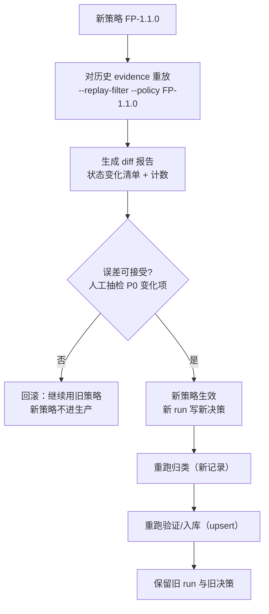

要求：

1. 重处理**不删除**旧决策；新旧并存，按时间与策略版本区分。
2. diff 报告必须列出：新增 EXCLUDE、撤销 EXCLUDE、EXCLUDE→REVIEW、REVIEW→ACCEPT 的数量与明细。
3. 重处理必须可分批（按 pid 列表），支持断点续跑。
4. 重处理后必须重跑 S3/S4（因为输入变了），不能只改过滤层。

### 16.7 多来源保留

| 场景 | 保留方式 |
| --- | --- |
| 同值跨通道 | 全部 `esg_evidence` 行保留；`duplicate_group_id` 关联；S5 冲突消解留 winner + superseded |
| 同指标多口径 | `breakdown` 区分；全部入库（唯一键含 `breakdown`） |
| 同指标多年 | `year` 区分；全部入库 |
| 报告重述（restatement） | 新 `pid` 或新文件（sha256 不同）；旧记录保留，加 `restatement_of` 字段（待建，Q-11） |
| 同一报告多次提取 | 不同 `run_id` 的产物并存；`esg_artifact_manifest` 区分 |

### 16.8 留存与合规

| 项 | 要求 |
| --- | --- |
| PDF | 原始文件保留，路径与 sha256 入库 |
| 证据内容 | `content` 全量保留（表 HTML 可能较大，允许放对象存储，库内只存 URI + sha256） |
| 模型原始响应 | 保留 ≥ 2 年（对象存储），库内只存 `response_uri` |
| 排除记录 | 永久保留（体积小） |
| 审查 finding | 永久保留（含 `resolved_by`） |
| 总结报告 | 永久保留（JSON + Markdown） |
| 任务/步骤 | 任务终态保留 ≥ 3 年；步骤明细保留 ≥ 1 年 |
| 复核结论 | 永久保留，含操作人与理由 |
| 访问审计 | `esg_access_log` 保留 ≥ 1 年，仅 admin 可查 |
| 外部事实（预留） | 保留 ≥ 2 年，含 URL/抓取时间/快照哈希 |
| 定性条目（预留） | 保留，含 rubric 版本与证据 |
| 对外展示 | 不直接分发 PDF/裁图；仅展示结构化摘要与页码（需法务确认，Q-12） |

---

### 16.9 版本集合与可复现

一次完整处理涉及六类版本，缺一不可追溯：

| 版本 | 字段 | 生成方 | 作用 |
| --- | --- | --- | --- |
| 代码 | `pipeline_version` | CI（git short sha） | 复现代码行为 |
| 契约 | `schema_version` | `schemas/` | 复现数据结构 |
| 过滤策略 | `policy_version` | `rules/filter/*.yaml` + 提示词模板 | 复现过滤决策 |
| 审查策略 | `review_policy_version` | `rules/review/*.yaml` + 提示词模板 | 复现审查结论 |
| 闭集 | `catalogue_version` | `config/indicator_variables.json` | 复现指标映射 |
| 模型 | `model_id` + `model_version` | `esg_model_call` | 解释"当时模型是谁"（**不参与算分**） |
| 数据 | `evidence_sha` / `records sha256` | 各 stage manifest | 确认输入未被替换 |

**复现清单**（每条入库记录应能导出）：

```json
{
  "record_uid": "2025073101502|E2.1.1|Total Water Withdrawal (from all sources in m³)|2025|Group",
  "evidence_id": "2025073101502_e00042",
  "pid": "2025073101502",
  "versions": {"pipeline_version": "a1b2c3d", "schema_version": "1.0.0",
               "policy_version": "FP-1.0.0", "review_policy_version": "RP-1.0.0",
               "catalogue_version": "MD-2026.10",
               "model_id": "qwen-max", "model_version": "2025-06-01"},
  "evidence_sha": "f4fb211df562caa3",
  "replay_command": "python scripts/esg_semantic_run.py --out intermediate/esg_extract --pid 2025073101502 --llm none --replay-policy FP-1.0.0"
}
```

**可复现边界（必须诚实声明）**：

1. 规则 / 闭集 / 代码 / 数据版本一致时，S2 的规则部分与 S3 的闭集校验必须逐条一致。
2. 模型输出本身非确定；重放时**用已落盘的决策与记录为准**（`--llm none` 只做回放，不重调模型）。
3. 若 `evidence.jsonl` 已变（重跑提取），则只能复现"新证据上的结果"，并必须标注 `evidence_sha` 变化。

## 第十七章 流程图与时序图

本章给出九张时序图：前六张覆盖基础场景，后三张覆盖审查阻断、Planner 失败/暂停恢复、总结生成。每张图后给出"数据交接表"，保证开发人员知道每一步传什么。

### 17.1 场景一：正常数据提取与处理

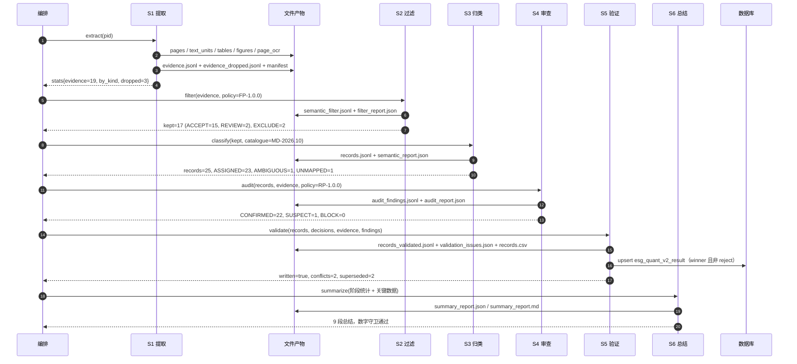

| 步骤 | 传递 | 验收 | 失败动作 |
| --- | --- | --- | --- |
| S1 | PDF → 产物目录 | 证据 ≥1、指纹一致 | 解析失败则整份失败 |
| S2 | `evidence.jsonl` + policy | 决策与输入一一对应 | 降级全 ACCEPT |
| S3 | kept + catalogue | 每条有 `classification_status` | 占位记录，不写主 records |
| S4 | records + evidence + policy | 每条有 `audit_verdict`；finding 有证据 | 组 `INSUFFICIENT`，转复核 |
| S5 | records + decisions + evidence + findings | 门禁 G1–G7 通过（含 V-17） | 不写库，保留现场 |
| S6 | 各阶段统计 + 关键数据 | 9 段齐全、数字守卫通过 | 回退模板，不阻断入库 |

### 17.2 场景二：过滤 Agent 发现不确定数据

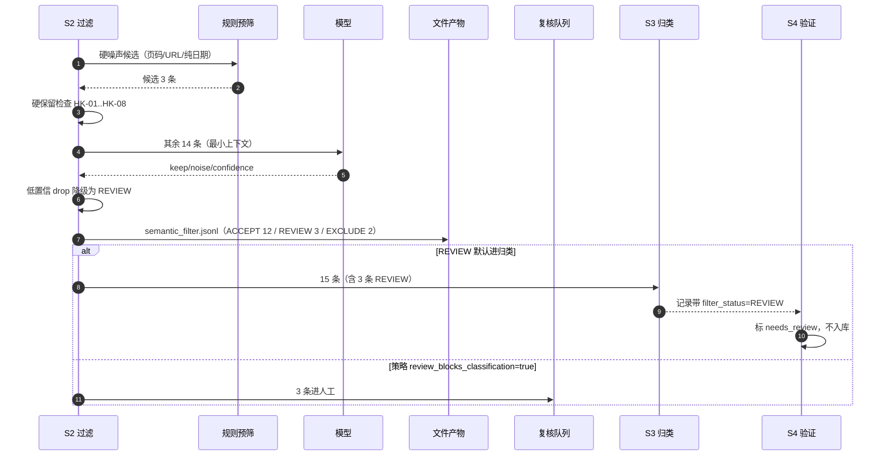

| 要点 | 说明 |
| --- | --- |
| 不确定不删除 | `REVIEW` 的证据仍然在证据池与决策流里 |
| 降级可见 | `decision_source=FALLBACK`、`reason_code=R-LOWCONF-DOWNGRADE` |
| 下游可感知 | 归类记录带 `filter_status`，S4 必须据此降级 |
| 复核可回填 | 人工结论追加，不改原决策 |

### 17.3 场景三：归类 Agent 无法确认指标

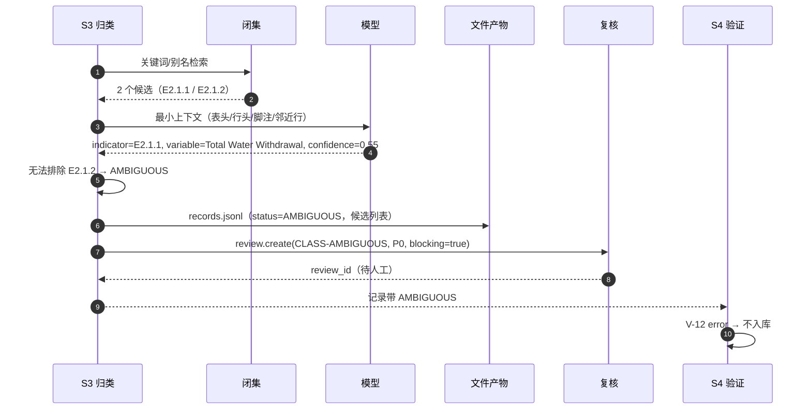

| 状态 | 入库 | 评分 | 人工动作 |
| --- | --- | --- | --- |
| `AMBIGUOUS` | 否 | 否 | 选择指标或标记未披露 |
| `UNMAPPED` | 否 | 否 | 决定是否扩闭集 |
| `OUT_OF_CLOSED_SET` | 否 | 否 | 修正映射或扩闭集 |
| `INSUFFICIENT_CONTEXT` | 否 | 否 | 补上下文或放弃 |

### 17.4 场景四：多通道重复或冲突

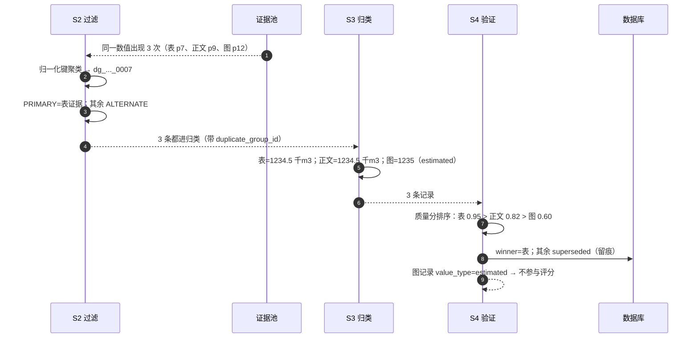

**冲突（数值不一致）**：

| 情形 | S4 处置 |
| --- | --- |
| 表 1234.5 vs 正文 12,345（差 10×） | 不静默选一个：`V-08` warn + 进复核（`VALIDATION-ERROR`） |
| 单位不同（千m3 vs m3） | `V-05` error，阻断该变量 |
| 年份不同 | 不是冲突，分别入库 |
| 口径不同 | 不是冲突，`breakdown` 区分 |

### 17.5 场景五：Agent 调用失败与重试

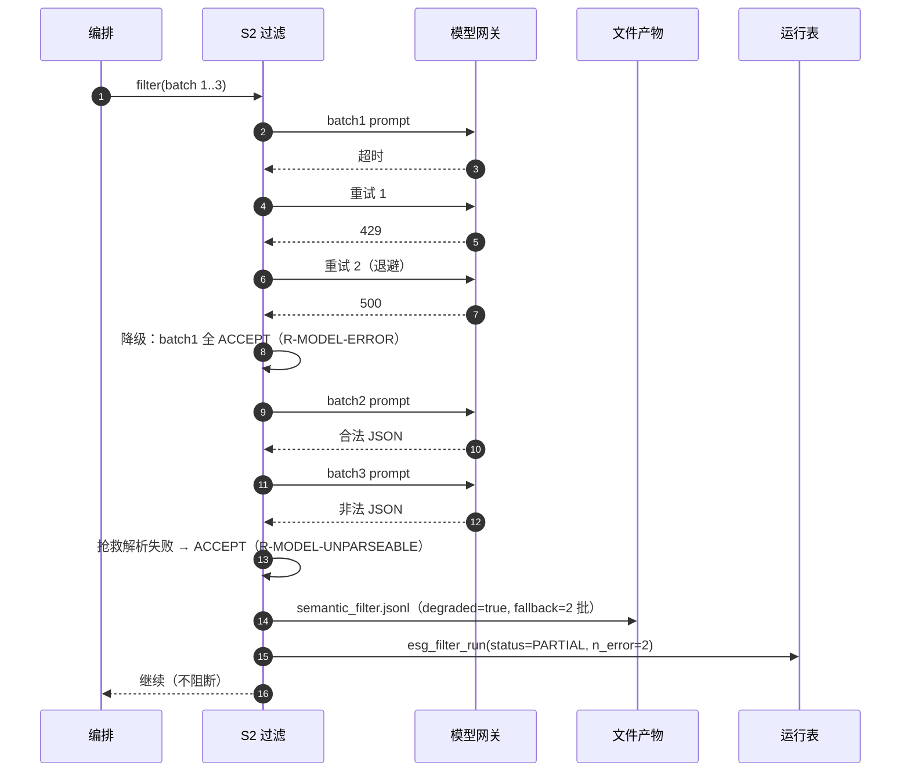

规则：

1. 单批失败不影响其它批；整轮失败也不阻断 S3（用 ACCEPT 兜底）。
2. `degraded=true` 必须让下游知道（S4 降低该报告质量评级，解释中披露）。
3. 重试上限 2 次，退避 `2^n × 2s`，总时长受 `deadline` 约束。
4. 失败原因写 `esg_agent_run.error_code` 与 `esg_filter_run.n_error`。

### 17.6 场景六：人工复核及结果回流

```mermaid
sequenceDiagram
    autonumber
    participant U as 复核员
    participant API as 复核接口
    participant DB as 数据库
    participant OR as 编排
    participant FL as S2 过滤
    participant CL as S3 归类
    participant VD as S4 验证

    U->>API: POST /v1/reviews/{id}/decision {REMAP, indicator=E2.1.1, 理由}
    API->>DB: insert esg_review_decision（追加）
    API->>DB: 更新 review.status=RESOLVED
    API->>OR: 触发新 run（trigger=REVIEW_RESOLVED）
    OR->>FL: 复用原过滤决策（人工结论优先）
    OR->>CL: 重新归类受影响证据（仅 target evidence）
    CL->>DB: 新 records（catalogue 同版本）
    OR->>VD: 重新验证 + 入库（upsert）
    VD->>DB: 新 winner；旧记录 superseded_by
    API-->>U: 202 {new_run_id}
```

| 规则 | 说明 |
| --- | --- |
| 追加不覆盖 | 复核结论是新行，旧决策/旧记录保留 |
| 最小重跑 | 只重跑受影响证据与记录，不整份重跑（除非策略变更） |
| 版本固定 | 复核回流默认沿用原 `policy_version`/`catalogue_version`，除非人工显式指定 |
| 可回滚 | 若复核判错，可再次提交新结论（追加），系统按时间取最新 |

### 17.7 场景七：审查 Agent 发现阻断项

```mermaid
sequenceDiagram
    autonumber
    participant PL as Planner
    participant AU as S4 审查
    participant FS as 文件产物
    participant RV as 复核
    participant VD as S5 验证
    participant SM as S6 总结

    PL->>AU: audit(indicator group E2.1.1)
    AU->>FS: records + evidence（组内 4 条记录）
    AU-->>PL: A-IND-MISMATCH（BLOCK, conf=0.86）
    PL->>RV: create_review(P0, blocking=true)
    PL->>PL: status=WAITING_HUMAN
    RV-->>PL: 复核结论=REMAP（改归 E2.1.3）
    PL->>AU: 重新审查受影响组
    AU-->>PL: CONFIRMED
    PL->>VD: validate（新记录）
    VD-->>PL: 门禁通过
    PL->>SM: summarize（含"1 条记录经人工改归"）
```

| 规则 | 说明 |
| --- | --- |
| 只有 BLOCK 暂停任务 | WARN/INFO 不暂停，只降质量分与披露 |
| 复核前不丢弃记录 | 记录留在 `records.jsonl`，只是不入库 |
| 复核后最小重跑 | 只重审受影响指标组，不整份重跑 |
| 总结必须体现 | ACTIONS 段写明"经人工改归/确认"的条数 |

### 17.8 场景八：Planner 失败、暂停与恢复

```mermaid
sequenceDiagram
    autonumber
    participant U as 操作员
    participant PL as Planner
    participant ST as 步骤表
    participant FL as S2 过滤
    participant GW as 模型网关

    U->>PL: POST /v1/pipeline:run
    PL->>ST: 建任务 + 6 个步骤
    PL->>FL: filter(batch 1..3)
    FL->>GW: 调用
    GW-->>FL: 超时（第 3 次）
    FL-->>PL: 降级全 ACCEPT（R-MODEL-ERROR）
    PL->>ST: filter=SUCCEEDED(degraded=true)，problems+1
    U->>PL: POST /v1/pipeline/{id}:pause
    PL->>ST: 当前 step 完成后不再派发
    PL-->>U: status=PAUSED
    U->>PL: POST /v1/pipeline/{id}:resume
    PL->>ST: 从未完成 step 继续
    PL->>FL: 跳过已完成（input_hash 相同）
    PL-->>U: status=PARTIAL（degraded=true）
```

| 情况 | 行为 |
| --- | --- |
| 步骤重试耗尽 | 按 §9.12 降级或 `FAILED`；已写产物保留 |
| 人工暂停 | 当前 step 跑完后停在 `PAUSED` |
| 恢复 | 已完成步骤按 `input_hash` 复用，不重跑 |
| 崩溃 | 租约过期后重置 `RUNNING` → `PENDING` |
| 预算耗尽 | 停止模型调用，任务 `PARTIAL` + `truncated` |

### 17.9 场景九：总结生成与数字守卫

```mermaid
sequenceDiagram
    autonumber
    participant PL as Planner
    participant SM as S6 总结
    participant TPL as 模板
    participant LLM as 模型
    participant GD as 数字守卫
    participant DB as 数据库

    PL->>SM: summarize(SummaryInput)
    SM->>TPL: 填充 9 段
    TPL-->>SM: 模板文本 + numbers_used
    alt polish=true
        SM->>LLM: 改写（只改表达）
        LLM-->>SM: 改写文本
        SM->>GD: 抽取数字并比对
        alt 有输入外数字
            GD-->>SM: violation
            SM->>SM: 丢弃 LLM 版本，回退模板
        else 全部可溯源
            GD-->>SM: ok
        end
    end
    SM->>DB: summary_report（含 guard 结果）
    SM-->>PL: SUCCEEDED 或 TEMPLATE_FALLBACK
```

| 规则 | 说明 |
| --- | --- |
| 模板优先 | 默认不调用模型；`polish` 才调用 |
| 数字必须可溯源 | 输入外的数字一律拦截 |
| 守卫失败不阻断入库 | 回退模板 + 告警 |
| 不评价公司 | 词表 + 人工抽查 |

### 17.10 状态机（过滤 + 归类 + 审查）


```mermaid
stateDiagram-v2
    [*] --> ACCEPT: 规则/模型保留
    [*] --> REVIEW: 不确定/低置信/失败
    [*] --> EXCLUDE: 硬噪声 + 通过 HK-01..08
    REVIEW --> ACCEPT: 人工 KEEP
    REVIEW --> EXCLUDE: 人工 EXCLUDE
    EXCLUDE --> REVIEW: 策略变更/人工推翻
    ACCEPT --> [*]
    EXCLUDE --> [*]

    state 归类 {
        [*] --> ASSIGNED: 闭集唯一命中
        [*] --> AMBIGUOUS: 多候选
        [*] --> UNMAPPED: 闭集缺口
        [*] --> OUT_OF_CLOSED_SET: 模型越界
        [*] --> INSUFFICIENT_CONTEXT: 缺值/缺年份
        AMBIGUOUS --> ASSIGNED: 人工 REMAP
        UNMAPPED --> ASSIGNED: 扩闭集后重跑
        OUT_OF_CLOSED_SET --> ASSIGNED: 修正映射
        INSUFFICIENT_CONTEXT --> ASSIGNED: 补上下文/重跑
    }

    state 审查 {
        [*] --> CONFIRMED: 无 finding 或仅 INFO
        [*] --> SUSPECT: WARN finding
        [*] --> REJECTED: BLOCK finding 且有证据
        [*] --> INSUFFICIENT: 模型失败/上下文不足
        SUSPECT --> CONFIRMED: 人工 KEEP
        REJECTED --> CONFIRMED: 人工 REMAP/CORRECT
        INSUFFICIENT --> CONFIRMED: 补上下文后重审
    }
```

---

## 第十八章 与评分流程的衔接

### 18.1 现状

`【现有实现】` 仓库中**没有**评分引擎、基准构建、独立校验器；`src/calculator.py` 是 v1 legacy 的 LLM 计算模块，不得用于正式评分。

`【设计规定】` 本章只定义 S7 的**输入契约、前置条件、阻断状态与扩展接口**，不定义评分公式（公式见第21章待确认项）。

### 18.2 输入契约

S7 只接受满足以下条件的记录：

```text
scoreable(record) =
      record.classification_status = ASSIGNED
  AND record.quality_band ∈ {auto, review}
  AND record.resolution_status ∈ {unique, winner}
  AND record.provenance_source ∈ {evidence_id, page_value}
  AND record.value_nature ∈ {REPORTED, REPORTED_ZERO, COMPUTED}
  AND record.year 非空
  AND record.audit_verdict != REJECTED
  AND 无未处理的 BLOCK 级审查 finding
  AND 该记录未被 open review 阻断
```

`【设计规定】` 明确：**`REVIEW`/`AMBIGUOUS`/`UNMAPPED`/`insufficient` 一律不可评分**，且必须区分"未披露"与"不确定"（§16.4）。

### 18.3 E2.1.1 的变量就绪度

`【现有实现】` 闭集中 E2.1.1 的可提取变量：`Total Water Withdrawal`、`Water Intensity this year`、`Water Intensity last year`、`Industry Average Water Intensity value`；computed 变量含 `Revenue`（需外部财务库）、`Water Intensity`（取水量/产值）、`Benchmark Ratio`、`Improvement Rate`。

`【待确认】` 评分到底用哪条路径（Q-01）：

| 路径 | 输入 | 问题 |
| --- | --- | --- |
| A：用报告披露的 `Water Intensity this year` | 披露强度 + 行业均值 | 口径不一致（各公司分母不同） |
| B：用 `Total Water Withdrawal ÷ Revenue` 自算 | 取水量 + 财务分母 | 需要营收来源与币种/年度对齐 |
| C：用 `Improvement Rate` 或 `Benchmark Ratio` | 披露的改善率/比值 | 依赖公司自算，可能不可复核 |

在 Q-01 关闭前，S7 只能实现"输入组装 + 阻断"，不得出分。

### 18.4 评分状态与阻断

| 状态 | 含义 | 触发 |
| --- | --- | --- |
| `FORMAL` | 正式分 | 全部前置满足 + 规则 ACTIVE + 基准 FROZEN |
| `BLOCKED_RULE_INCOMPLETE` | 规则未定参 | 规则文件含 `TODO-BIZ` |
| `BLOCKED_BENCHMARK_MISSING` | 无冻结基准 | |
| `BLOCKED_PENDING_REVIEW` | 有阻断级复核 | |
| `NOT_SCOREABLE_DATA_QUALITY` | 关键记录不可用 | |
| `NOT_SCOREABLE_AMBIGUOUS` | 归类不确定 | **新增**（对应 S3 状态） |

### 18.5 规则文件（草案，待业务确认）

```json
{
  "ruleset_id": "RS-E2.1.1",
  "ruleset_version": "0.1.0-draft",
  "status": "DRAFT_PENDING_RULE",
  "methodology_ref": "TODO-BIZ",
  "required_variables": ["Total Water Withdrawal (from all sources in m³)",
                         "Water Intensity this year",
                         "Industry Average Water Intensity value"],
  "intensity_path": "TODO-BIZ",
  "benchmark": {"statistic": "TODO-BIZ", "min_sample_size": "TODO-BIZ"},
  "score_mapping": {"type": "TODO-BIZ", "bands": []},
  "rounding": {"score_decimals": "TODO-BIZ"}
}
```

加载器规则：`status != ACTIVE` 或存在 `TODO-BIZ` → 抛 `ERR_RULE_INCOMPLETE`，S7 输出 `BLOCKED_RULE_INCOMPLETE`，**不得出分**。

### 18.6 后续指标的扩展接口

```python
class IndicatorScorer(Protocol):
    indicator_code: str
    required_variables: list[str]

    def check_preconditions(self, records: list[ValidatedRecord]) -> list[Unmet]: ...
    def compute(self, records: list[ValidatedRecord], rule: RuleSet,
                benchmark: FrozenBenchmark) -> ScoreResult: ...
```

新增指标（E2.1.2/E2.1.3/E2.1.4/E2.2.x）只需：① 闭集已含变量（多数已含）；② 新增规则文件；③ 新增 `IndicatorScorer`；④ 新增基准配置；⑤ 在审查策略中登记关键变量。**S1–S6 不改**。

---

## 第十九章 测试、度量与验收

### 19.1 测试分层与门禁

| 层 | 范围 | 时机 | 门禁 |
| --- | --- | --- | --- |
| L1 单元 | 规则、解析、状态机、质量分、冲突消解 | 每次提交 | 覆盖率 ≥ 85%（核心计算 100% 分支） |
| L2 契约 | 第12章 Schema、CLI 参数、产物格式 | 每次提交 | 合法样本全过、非法样本全拒 |
| L3 集成 | S1→S2→S3→S4→S5→S6 全链路（fake LLM） | 每日 | 16 份样本全部可跑通 |
| L4 金标准 | 人工标注集上的召回/误删/精确/归类/审查 | 每周/发版前 | 满足 §19.6 门槛 |
| L5 异常 | 模型失败、超时、预算、产物缺失、指纹不一致 | 每周 | 降级正确、无数据丢失 |
| L6 重放 | 同策略重放一致、换策略可 diff | 策略变更 | 一致率 100%（规则部分） |
| L7 性能 | 单报告耗时、模型调用次数、token | 里程碑 | 达目标（实测） |
| L8 应用层 | API 契约、权限、SSE、前端 E2E、可访问性 | 每日 | 越权全拒、E2E 全绿、无 critical a11y |
| L9 预留能力 | 开关关闭时的 501/UI 占位/Planner 跳过 | 每次提交 | 关闭态零副作用 |

### 19.2 金标准集

`【设计规定】` 没有金标准集就没有可计算的召回/误删率，因此必须建。

| 项 | 要求 |
| --- | --- |
| 抽样 | 按版式（vector/scanned/mixed）× 行业 × 语言（en/zh）× 报告长度分层；建议首批 ≥ 30 份，覆盖 16 份现有样本 |
| 标注单位 | **有效 ESG 数据条目**（指标 + 变量 + 值 + 单位 + 年份 + 口径 + 页码）与**噪声条目**（页码/目录/页脚等） |
| 标注人 | 2 名独立标注；不一致条目由第 3 人仲裁 |
| 一致性 | Cohen's Kappa ≥ 0.80 才纳入金标准；未达标条目单列"争议集"，不参与主指标 |
| 版本 | 金标准集打版本（`GS-2026.1`），每次扩充记录新增条目与来源 |
| 盲评 | 标注人不见模型输出；模型调参不使用测试集 |

**标注字段**（与 S3 输出对齐）：`pid, page_no, channel, indicator_id, variable, value, unit, year, breakdown, is_valid(bool), is_noise(bool), note`。

### 19.3 度量定义（可计算）

设：

- `G` = 金标准中"有效 ESG 数据条目"集合（按 `(pid, page, indicator, variable, year, breakdown)` 归一）
- `K` = 过滤后保留（`ACCEPT ∪ REVIEW`）的条目集合
- `X` = 被 `EXCLUDE` 的条目集合
- `N` = 金标准中"噪声条目"集合
- `A` = 归类为 `ASSIGNED` 的记录集合

| 指标 | 公式 | 含义 | 目标 |
| --- | --- | --- | --- |
| 有效数据召回率 `Recall` | `card(G ∩ K) / card(G)` | 有效数据被保留的比例 | 见 14.6 |
| 误删率 `FDR` | `card(G ∩ X) / card(G)` | 有效数据被排除的比例 | **硬门槛 0**（带单位条目） |
| 过滤精确率 `Precision` | `card(X ∩ N) / card(X)` | 排除的东西里真噪声的比例 | 见 14.6 |
| 过滤 F1 | `2PR/(P+R)`，其中 `R=card(G∩K)/card(G)`，`P=Precision` | 综合 | 见 14.6 |
| 归类准确率 `Acc` | `card(A 中 indicator+variable+year+breakdown 全对) / card(A)` | 归类正确率 | 见 14.6 |
| 归类覆盖率 `Cov` | `card(A) / card(K)` | 保留数据被成功归类的比例 | 见 14.6 |
| 来源追溯完整率 `Trace` | `card(provenance=evidence_id 且证据存在且 page/bbox 合法) / card(全部记录)` | 可回查率 | **100%**（入库记录） |
| 通道保留率 `Keep_ch` | `card(通道 ch 中被 ACCEPT/REVIEW 的证据) / card(通道 ch 的全部证据)` | 各通道是否被过度过滤 | 监控 |
| 重复关联完整率 `DupLink` | `card(全部成员都有 group_id 的重复组) / card(全部重复组)` | 重复是否漏关联 | 100% |
| 重放一致率 `Replay` | `card(重放后决策完全一致的 evidence) / card(全部 evidence)` | 可复现性 | 100%（规则部分） |
| 人工复核率 `ReviewRate` | `open review 数 / 入库记录数` | 运营负载 | 监控 |
| 审查阻断准确率 `AuditPrecision` | `card(被人工确认成立的 BLOCK) / card(全部 BLOCK)` | 审查误报 | 见 17.6 |
| 审查召回率 `AuditRecall` | `card(金标准错映射被 BLOCK/SUSPECT 命中) / card(金标准错映射)` | 审查漏报 | 见 17.6 |
| 任务成功率 `TaskSuccess` | `card(COMPLETED) / card(全部非取消任务)` | 编排稳定性 | 监控 |
| 断点恢复率 `ResumeOK` | `card(崩溃后成功续跑) / card(崩溃任务)` | 恢复能力 | **100%** |
| 总结守卫通过率 `GuardPass` | `card(numbers_used 全部可溯源) / card(全部总结)` | 总结忠实度 | **100%** |

**计算口径必须固定**：

1. "条目匹配"以 `(pid, page_no, indicator_id, variable, year, breakdown)` 为键；值比较用相对误差 `≤1e-6`（同单位）。
2. 一个金标准条目对应多条系统记录（重复来源）时，只要一条匹配即算召回；其余算"冗余"，单独统计。
3. 跨页/跨通道的同一数据，金标准按"最权威来源"记一条，其余作为 `alternate` 标注，不重复计入分母。

### 19.4 用例矩阵

#### 19.4.1 S1 提取（防丢失、防错位）

| 用例 | 场景 | 期望 | 通过条件 |
| --- | --- | --- | --- |
| `T-S1-01` | 表格 5 行数据、多级表头 | 行列对齐，`col_names/row_headers` 正确 | 与人工核对一致 |
| `T-S1-02` | 合并单元格 | 不产生空行错位 | 数据行数 = 实际行数 |
| `T-S1-03` | 单位列 | `unit_hint` 正确 | 与表内单位一致 |
| `T-S1-04` | 正文含单位数字 | 进证据池，`tier=medium` | 不被当噪声删 |
| `T-S1-05` | 目录页 | 页码不进高置信证据 | 无 `tier=high` 的目录行 |
| `T-S1-06` | 页眉页脚 | 进 `noise_lines`，正文完整 | 正文数字零丢失 |
| `T-S1-07` | 图表 labeled 点 | 进证据池 | `value_type=labeled` |
| `T-S1-08` | 扫描页 | 走 OCR，证据 `kind=page_ocr` | 页码正确 |
| `T-S1-09` | 表格 OCR 替换 | `native_cells` 保留 | 可对比替换前后 |
| `T-S1-10` | 同输入重跑 | ID 序列一致 | `evidence_sha` 相同 |

#### 19.4.2 S2 过滤（防误删、防漏放）

| 用例 | 场景 | 期望 | 通过条件 |
| --- | --- | --- | --- |
| `T-S2-01` | 带单位正文 | ACCEPT | `HK-01` |
| `T-S2-02` | 表格证据 | 永不 EXCLUDE | `HK-02` |
| `T-S2-03` | 页码/目录/URL | EXCLUDE + 理由 | 金标准噪声集 Precision |
| `T-S2-04` | 裸数字 | REVIEW | 不 EXCLUDE |
| `T-S2-05` | 模型失败 | 全 ACCEPT | 零丢失 |
| `T-S2-06` | 低置信排除 | 降级 | 与阈值一致 |
| `T-S2-07` | 跨通道重复 | 同组 + 全保留 | `DupLink=100%` |
| `T-S2-08` | 零值声明 | ACCEPT | 不因 0 排除 |
| `T-S2-09` | 策略关闭自动排除 | EXCLUDE 清零 | `HK-07` |
| `T-S2-10` | 重放 | 决策一致 | `Replay=100%` |

#### 19.4.3 S3 归类（防混淆、防编造）

| 用例 | 场景 | 期望 | 通过条件 |
| --- | --- | --- | --- |
| `T-S3-01` | 取水/耗水/循环/废水四行 | 分别归位 | 无交叉 |
| `T-S3-02` | 强度 vs 绝对量 | 不混填 | 变量名正确 |
| `T-S3-03` | 行业均值 vs 本企业值 | 不混填 | |
| `T-S3-04` | 多年列 | 每年一条 | 年份正确 |
| `T-S3-05` | 集团/区域 | `breakdown` 不同 | 不合并 |
| `T-S3-06` | 合计 vs 分项 | 总量取合计 | |
| `T-S3-07` | 闭集外 | `OUT_OF_CLOSED_SET` | 保留原值 |
| `T-S3-08` | 页码不一致 | 以证据为准 | 备注 |
| `T-S3-09` | 零值 | `REPORTED_ZERO` | |
| `T-S3-10` | 裸数字 | `INSUFFICIENT_CONTEXT` | 不猜 |
| `T-S3-11` | 聚合建议 | 只建议不算术 | 成员列表 |
| `T-S3-12` | 重放 | 同模型同闭集一致 | 差异可解释 |

#### 19.4.4 S4 审查

| 用例 | 场景 | 期望 | 通过条件 |
| --- | --- | --- | --- |
| `T-S4R-01` | 耗水量归成取水量 | `A-IND-MISMATCH` + BLOCK | 记录不入库 |
| `T-S4R-02` | 强度值填进绝对量 | `A-VAR-MISMATCH` | 不入库 |
| `T-S4R-03` | 分项冒充总量 | `A-SCOPE-MIX` | 不入库 |
| `T-S4R-04` | 单位/年份与证据不一致 | `A-UNIT-MISMATCH` / `A-YEAR-MISMATCH` | 不入库 |
| `T-S4R-05` | 同指标同年两值差 20% | `A-CROSS-RECORD` | 阻断或复核 |
| `T-S4R-06` | 有披露但无记录 | `A-MISSING-KEY` | 阻断 |
| `T-S4R-07` | 证据不含该值 | `A-EVIDENCE-WEAK` | 阻断 |
| `T-S4R-08` | 模型返回未知码 | 丢弃 + 计数 | 不误通过 |
| `T-S4R-09` | 模型失败 | 组 `INSUFFICIENT` | 不伪造通过 |
| `T-S4R-10` | 人工已确认记录 | 跳过审查 | 不重复报 |
| `T-S4R-11` | BLOCK 置信度 0.5 | 降级 WARN | 不误阻断 |
| `T-S4R-12` | 审查前后文件哈希 | 不变 | 只读 |

#### 19.4.5 S5 验证（防脏数据入库）

| 用例 | 场景 | 期望 |
| --- | --- | --- |
| `T-S4-01` | 单位量级不一致 | error |
| `T-S4-02` | 年份越界 | error |
| `T-S4-03` | 负绝对量 | error |
| `T-S4-04` | `AMBIGUOUS` 记录 | 不入库 |
| `T-S4-05` | `unresolved` 记录 | reject |
| `T-S4-06` | 同组两 winner | 门禁失败 |
| `T-S4-07` | 指纹不一致 | 拒绝入库 |
| `T-S4-08` | 重跑 | 不增行 |
| `T-S4-09` | 聚合 SUM | 生成 COMPUTED 记录 + 成员 |
| `T-S4-10` | 聚合与已有合计并存 | 标 `duplicate_of_total`，不评分 |

#### 19.4.6 Planner

| 用例 | 场景 | 期望 |
| --- | --- | --- |
| `T-PL-01` | 正常单报告 | 6 步全过 `COMPLETED` |
| `T-PL-02` | 同幂等键重复提交 | 同 `task_id` |
| `T-PL-03` | filter 阶段 kill | 恢复后从 filter 继续 |
| `T-PL-04` | BLOCK finding | `WAITING_HUMAN`，复核后恢复 |
| `T-PL-05` | 模型熔断 | 降级 `PARTIAL` |
| `T-PL-06` | 预算耗尽 | `truncated` + `PARTIAL` |
| `T-PL-07` | 门禁失败 | `BLOCKED`，不写库 |
| `T-PL-08` | 暂停/恢复 | 已完成步骤不重跑 |
| `T-PL-09` | 批量 20 份 | 全部有终态，无重复入库 |
| `T-PL-10` | 非法状态迁移 | 抛错并告警 |

#### 19.4.7 S6 总结

| 用例 | 场景 | 期望 |
| --- | --- | --- |
| `T-SM-01` | 正常报告 | 9 段齐全、数字可溯源 |
| `T-SM-02` | LLM 写出输入外数字 | 守卫拦截、回退模板 |
| `T-SM-03` | 证据为 0 | 明确说明原因 |
| `T-SM-04` | 有 AMBIGUOUS/UNMAPPED | ACTIONS 列出 |
| `T-SM-05` | 未评分 | LIMITATIONS 明确 |
| `T-SM-06` | 输入缺 audit 段 | 该段写"未执行审查" |
| `T-SM-07` | 含"优于/预计" | 守卫拦截 |
| `T-SM-08` | 格式化数字 12,345 vs 12345 | 通过 |

#### 19.4.8 应用层

| 用例 | 场景 | 期望 |
| --- | --- | --- |
| `T-UI-01` | 普通分析师提交单报告任务 | 202 + 任务详情可见 |
| `T-UI-02` | `viewer` 调用提交接口 | 403 |
| `T-UI-03` | SSE 断线重连 | 从 `Last-Event-ID` 继续，不丢状态 |
| `T-UI-04` | 证据页 bbox 高亮 | 与 PDF 页坐标一致 |
| `T-UI-05` | 复核提交 | 生成新 run，旧记录保留 |
| `T-UI-06` | 导出未发布数据 | 默认拒绝，admin 可显式允许 |
| `T-UI-07` | 证据 HTML 含 `<script>` | 服务端清洗后返回，前端不执行 |
| `T-UI-08` | 签名 URL 过期 | 重新获取，不缓存长期链接 |
| `T-UI-09` | 键盘操作主要流程 | 可完成提交/复核 |
| `T-UI-10` | 大列表 1000 行 | 虚拟滚动，无明显卡顿 |

#### 19.4.9 预留能力（关闭态）

| 用例 | 场景 | 期望 |
| --- | --- | --- |
| `T-RS-01` | `FEATURE_QUALITATIVE=false` | `/v1/qualitative/*` 返回 501；UI 显示未启用 |
| `T-RS-02` | `FEATURE_WEB_SEARCH=false` | `web.search` 未注册可调用；`/v1/search/*` 501 |
| `T-RS-03` | Planner 跑普通任务 | 不含 `qualitative`/`search` step |
| `T-RS-04` | 关闭态产物 | 不生成定性/外部事实文件 |

### 19.5 回归与重放测试

| 测试 | 内容 | 通过条件 |
| --- | --- | --- |
| `R-01` 规则回归 | 16 份样本跑全链路 | 产物结构不变、证据数不减少 |
| `R-02` 过滤重放 | 同策略跑两次 | 决策逐条一致 |
| `R-03` 策略 diff | FP-1.0.0 → FP-1.1.0 | 生成变化清单，无"静默变化" |
| `R-04` 归类重放 | 同闭集同模型 | `ASSIGNED` 集合一致；差异有 `model_call_id` 可查 |
| `R-05` 库内重算 | 从 `esg_quant_v2_result` 反查证据 | 100% 可定位 |
| `R-06` 端到端复算 | 同输入重跑 S2–S4 | 入库行集合一致（顺序无关） |

### 19.6 验收门槛

**硬不变量（必须满足，否则不发版）**：

| 编号 | 不变量 | 判定 |
| --- | --- | --- |
| `AC-01` | 带单位金标准条目误删率 = 0 | `FDR_unit = 0` |
| `AC-02` | 入库记录追溯完整率 = 100% | `Trace = 100%` |
| `AC-03` | 模型失败场景零丢失 | 失败批全部 ACCEPT/REVIEW |
| `AC-04` | 入库记录无 `AMBIGUOUS/unresolved/reject` | 门禁 G1–G7 |
| `AC-05` | 重放一致率（规则部分）= 100% | `Replay = 100%` |
| `AC-06` | 产物指纹可校验 | manifest 齐全 |
| `AC-07` | 证据池编号稳定 | 同输入同 ID 序列 |
| `AC-08` | 排除 100% 有理由与版本 | decision 表约束 |
| `AC-09` | 审查不改数据 | 审查前后 `records.jsonl`/`evidence.jsonl` 哈希不变 |
| `AC-10` | BLOCK 100% 有证据与理由 | finding 表约束 |
| `AC-11` | 任务可断点恢复 | `ResumeOK = 100%` |
| `AC-12` | 总结数字 100% 可溯源 | `GuardPass = 100%` |
| `AC-13` | 前后端闭环可演示 | 第14章 `APP-1`～`APP-7` 全过 |
| `AC-14` | 越权访问全拒 | 5 角色 × 关键路由/接口矩阵通过 |
| `AC-15` | 预留能力关闭态零副作用 | `T-RS-01..04` 通过 |

**质量目标（`【待确认】`，由业务给出风险偏好后填入）**：

| 指标 | 建议起点 | 说明 |
| --- | --- | --- |
| `Recall`（有效数据召回） | ≥ 0.95 | 首批金标准跑完后按实测校准 |
| `FDR`（总体误删） | ≤ 0.02 | 带单位条目必须为 0 |
| `Precision`（过滤精确） | ≥ 0.90 | 噪声排除的准确性 |
| `Acc`（归类准确） | ≥ 0.90 | `indicator+variable+year+breakdown` 全对 |
| `Cov`（归类覆盖） | ≥ 0.85 | 其余进 `AMBIGUOUS/UNMAPPED` |
| `ReviewRate` | ≤ 15% | 运营可承受 |

> 上述数字是**建议起点**，不是承诺，也不是已实现成绩。任何对外材料只能引用实测报告（含样本量、置信区间、金标准版本）。

### 19.7 测试报告格式

每次发版必须产出 `test_report.md`：

```text
1. 版本：pipeline_version / policy_version / catalogue_version / 模型版本
2. 样本：金标准 GS-2026.1（N 份报告，M 条有效条目，K 条噪声）
3. 指标：Recall / FDR / Precision / F1 / Acc / Cov / Trace / Replay（含分母与置信区间）
4. 失败用例：逐条列出（pid、条目、期望、实际、原因分类）
5. 与上一发布批次对比：指标变化、新增/撤销的排除项
6. 已知限制：未覆盖版式、语言、指标
```

---

## 第二十章 分阶段实施计划

### 20.1 原则

1. 以"证据可追溯 → 过滤可解释 → 归类可复核 → 入库可复算"为主线，不按周排期。
2. 每个阶段结束必须有**可演示、可验收**的产物；不依赖后续阶段。
3. 业务未定的部分（第 16 章）并行确认，代码以"阻断状态"交付，不写死数值。
4. 不推翻现有可运行代码：所有改动以"新增字段/新增表/新增 stage"为主。

### 20.2 阶段依赖

```mermaid
flowchart LR
    P0["P0 契约与基线"] --> P1["P1 证据入库与追溯"]
    P1 --> P2["P2 过滤 Agent 契约化"]
    P0 --> P3["P3 归类 Agent 契约化"]
    P2 --> P4["P4 校验增强与门禁"]
    P3 --> P4
    P3 --> P4R["P4R 审查 Agent"]
    P4 --> P5["P5 Planner 编排"]
    P4R --> P5
    P5 --> P6["P6 复核闭环"]
    P5 --> P7["P7 总结 Agent"]
    P5 --> P8["P8 金标准与度量"]
    P6 --> P9["P9 评分接入 E2.1.1"]
    P8 --> P9
    P9 --> P10["P10 扩展指标 E2.1.2/3/4, E2.2"]
    P1 --> P11["P11 应用层（前后端）"]
    P5 --> P11
    P7 --> P11
    P11 --> P12["P12 定性分析（预留转实现）"]
    P11 --> P13["P13 联网检索（预留转实现）"]
```

### 20.3 各阶段定义

#### P0 契约与基线固化

| 项 | 内容 |
| --- | --- |
| 目标 | Schema、产物清单、版本字段、CI 检查就位；不改业务逻辑 |
| 前置 | 无 |
| 接口 | `schemas/*.json`；`--stage` 参数扩展；`_run_manifest.json` 增 `evidence_sha256` |
| 数据表 | 建 `esg_report`、`esg_artifact_manifest`（空表） |
| 输入/输出 | 现有 16 份产物 → 校验通过；不改产物内容 |
| 可验证 | 每个 Schema 有合法/非法样本；`import-linter` 通过（`esg_extract` 不 import `esg_semantic`） |
| 测试 | 第 9 章契约测试；`R-01` 基线 |
| 阻塞 | 无（Q-14 存储选型在 P0 内决定） |

#### P1 证据入库与追溯

| 项 | 内容 |
| --- | --- |
| 目标 | `evidence.jsonl` / `evidence_dropped.jsonl` 可入库并 100% 回查 |
| 前置 | P0 |
| 接口 | `esg ingest-evidence --pid ...`；`GET /v1/evidence/{id}`、`/page`、`/crop` |
| 数据表 | `esg_evidence`、`esg_evidence_dropped`、`esg_report`（回填） |
| 输入/输出 | 现有产物 → 库内证据行；回查返回页码 + bbox + 裁图 |
| 可验证 | 任取 100 条入库记录，能打开对应 PDF 页并落在 bbox |
| 测试 | `S1-01..10`；`AC-07` |
| 阻塞 | PDF 授权（Q-12） |

#### P2 过滤 Agent 契约化

| 项 | 内容 |
| --- | --- |
| 目标 | 三态决策 + 理由码 + 重复关联 + 策略版本 + 重放 |
| 前置 | P1 |
| 接口 | `SemanticFilter.filter(...)` 扩展；`--stage filter`；`POST /v1/filter:run` |
| 数据表 | `esg_filter_run`、`esg_filter_decision`、`esg_model_call` |
| 输入/输出 | `evidence.jsonl` → `semantic_filter.jsonl` + `filter_report.json` |
| 可验证 | 硬保留 `HK-01..08` 全部生效；失败降级零丢失 |
| 测试 | `T-S2-01..10`；`R-02`；`AC-01/AC-03` |
| 阻塞 | Q-04 阈值（默认 0.65 可先跑） |

#### P3 归类 Agent 契约化

| 项 | 内容 |
| --- | --- |
| 目标 | 状态机 + 闭集校验 + 口径 + 聚合建议 + 页码规则 |
| 前置 | P0（可与 P2 并行开发，联调需 P2） |
| 接口 | `ClosedSetExtractor.extract(...)` 扩展；`--stage classify`；`POST /v1/classify:run` |
| 数据表 | `esg_classification_run`、`esg_classification_record` |
| 输入/输出 | kept 证据 → `records.jsonl` + `semantic_report.json` |
| 可验证 | 四类水指标不混；闭集外 100% 标记；页码以证据为准 |
| 测试 | `T-S3-01..12`；`AC-04` |
| 阻塞 | Q-02/Q-03（闭集缺口） |

#### P4 校验增强与门禁

| 项 | 内容 |
| --- | --- |
| 目标 | V-12..V-16 上线；聚合执行；`validation_report.json`；门禁编号化 |
| 前置 | P2、P3 |
| 接口 | `validate_records` 扩展；`--stage validate` |
| 数据表 | `esg_quant_v2_result` 增量列 |
| 输入/输出 | records + decisions → validated + 入库 |
| 可验证 | `AMBIGUOUS/unresolved/reject` 不入库；重跑不增行 |
| 测试 | `T-S4-01..10`；`R-06`；`AC-02/AC-04` |
| 阻塞 | Q-06 聚合规则 |

#### P4R 审查 Agent

| 项 | 内容 |
| --- | --- |
| 目标 | 指标组语义审查：finding 码、严重度、证据引用、建议动作；不改数据 |
| 前置 | P3 |
| 接口 | `SemanticAuditor.audit_report`；`--stage review`；`POST /v1/audit:run` |
| 数据表 | `esg_audit_run`、`esg_audit_result`、`esg_audit_finding` |
| 输入/输出 | records + evidence + review policy → `audit_findings.jsonl` + `audit_report.json` |
| 可验证 | BLOCK 有证据与理由；审查前后文件哈希不变；模型失败不伪造通过 |
| 测试 | `T-S4R-01..12`、`A-01..14`、`AC-09/AC-10` |
| 阻塞 | Q-21 审查策略/采样 |

#### P5 Planner 编排与验收

| 项 | 内容 |
| --- | --- |
| 目标 | 任务状态机、验收门、重试/预算/熔断、暂停恢复、复核编排；阶段可独立调用 |
| 前置 | P4、P4R |
| 接口 | `POST /v1/pipeline:run`、状态/暂停/恢复/取消、`esg_task`/`esg_task_step` |
| 数据表 | `esg_task`、`esg_task_step`、`esg_agent_run` |
| 输入/输出 | `TaskRequest` → `task_id` → `TaskStatus` + 步骤明细 |
| 可验证 | 断点续跑、幂等、预算与熔断生效、非法迁移被拒 |
| 测试 | `T-PL-01..10`、`FT-07/08`、`P-01..12` |
| 阻塞 | Q-22 并发策略 |

#### P6 复核闭环

| 项 | 内容 |
| --- | --- |
| 目标 | REVIEW/AMBIGUOUS/UNMAPPED/error 可人工处置并回流 |
| 前置 | P5 |
| 接口 | `POST /v1/reviews`、`/decision`、`/import` |
| 数据表 | `esg_review_task`、`esg_review_decision` |
| 输入/输出 | 复核结论 → 新 run → 新记录（旧记录 superseded） |
| 可验证 | 12.6 时序图全流程；旧记录保留 |
| 测试 | 复核回填、最小重跑、越权 |
| 阻塞 | Q-16 角色/SLA |

#### P7 总结 Agent

| 项 | 内容 |
| --- | --- |
| 目标 | 9 段报告级总结 + 数字守卫 + 模板回退 |
| 前置 | P5（需要各阶段统计） |
| 接口 | `ReportSummarizer.summarize`；`--stage summarize`；`POST /v1/summary:run` |
| 数据表 | `esg_summary_report` |
| 输入/输出 | `SummaryInput` → `summary_report.json` / `.md` |
| 可验证 | 9 段齐全；数字 100% 可溯源；不评价公司 |
| 测试 | `T-SM-01..08`、`S-01..10`、`AC-12` |
| 阻塞 | Q-23 总结受众/语言/润色策略 |

#### P8 金标准与度量

| 项 | 内容 |
| --- | --- |
| 目标 | 金标准集 + 指标计算脚本 + 测试报告 |
| 前置 | P4R、P5（最好 P6） |
| 接口 | `scripts/eval_gold.py --gold GS-2026.1` |
| 数据表 | 金标准可先落 CSV/JSON（后续建表） |
| 输入/输出 | 金标准 + 系统输出 → 指标 JSON + 报告 |
| 可验证 | 指标可复算；争议条目单列 |
| 测试 | 与人工核对 3 份；Kappa ≥ 0.80 |
| 阻塞 | Q-15 阈值 |

#### P9 评分接入 E2.1.1

| 项 | 内容 |
| --- | --- |
| 目标 | 规则加载 + 阻断 + 评分输入组装 + 独立校验 |
| 前置 | P4R、P5、P8；**Q-01 必须关闭** |
| 接口 | `IndicatorScorer`；`POST /v1/scores:run` |
| 数据表 | 评分相关表（待建，本阶段确定） |
| 输入/输出 | 可评分记录 + 冻结基准 + 规则 → 分数/阻断 + 明细 |
| 可验证 | 规则未定参时不出分；同输入可复算 |
| 测试 | `AC-05` 复算；阻断状态 |
| 阻塞 | Q-01、Q-02、Q-06、Q-07、Q-08、Q-15 |

#### P10 扩展指标

| 项 | 内容 |
| --- | --- |
| 目标 | E2.1.2 / E2.1.3 / E2.1.4 / E2.2.x 按同一框架接入 |
| 前置 | P8 |
| 接口 | 新 `IndicatorScorer` + 规则 + 基准配置 |
| 数据表 | 复用；必要时扩 `esg_quant_v2_result` 列 |
| 输入/输出 | 同 P8，`indicator_id` 不同 |
| 可验证 | 主干（S1–S4）零改动 |
| 测试 | 每指标 ≥ 10 条金标准 |
| 阻塞 | Q-02 |

#### P11 应用层（前后端）

| 项 | 内容 |
| --- | --- |
| 目标 | 可用的 Web 与 API：任务、报告、证据、记录、审查、复核、总结、看板、导出 |
| 前置 | P1（只读页面可先做）、P5、P7 |
| 接口 | 第14章 API 目录（BE-01～BE-12）；页面（FE-01～FE-12）；OIDC + RBAC；SSE；签名 URL |
| 数据表 | `esg_access_log`；其余只读 |
| 输入/输出 | 用户操作 → API → 任务/查询结果 → 页面 |
| 可验证 | `APP-1`～`APP-7` 全满足；五角色越权全拒；提交→进度→证据→复核→重跑→总结→导出闭环 |
| 测试 | `T-UI-01..10`、契约 diff、Playwright E2E、axe、性能门槛 |
| 阻塞 | Q-27/28/29/30 |

#### P12 定性分析（预留转实现）

| 项 | 内容 |
| --- | --- |
| 目标 | E2.1.5/E2.1.6 等无变量指标的"是否披露/披露质量"结构化 |
| 前置 | P11；Q-26 关闭 |
| 接口 | `POST /v1/qualitative:run`、`GET /v1/qualitative/{pid}` |
| 数据表 | `esg_qualitative_item` |
| 输入/输出 | 章节证据 + rubric → 定性条目（不给分） |
| 可验证 | 开关关闭零副作用；条目必须带证据；不改写定量记录 |
| 测试 | `T-RS-01/04`、定性 rubric 一致性（双人标注） |
| 阻塞 | Q-26 |

#### P13 联网检索（预留转实现）

| 项 | 内容 |
| --- | --- |
| 目标 | 公司/财务/水压力/定性上下文的外部补充，全部带来源 |
| 前置 | P11；Q-31/Q-32 关闭 |
| 接口 | `POST /v1/search:run`、`GET /v1/search/{id}`；`web.search`/`web.fetch` |
| 数据表 | `esg_search_query`、`esg_external_fact` |
| 输入/输出 | 查询 → 外部事实（URL/时间/摘要/授权）→ 人工确认 |
| 可验证 | 不写 `records`；未确认不参与评分；白名单外拒绝 |
| 测试 | `T-RS-02/04`、外部事实审查用例 |
| 阻塞 | Q-31/Q-32 |

### 20.4 里程碑

| 里程碑 | 阶段 | 通过条件 |
| --- | --- | --- |
| M1 可追溯 | P0–P1 | 100% 证据可回查 |
| M2 可过滤 | P2 | 误删率 0（带单位）、失败零丢失 |
| M3 可归类 | P3 | 四类水指标不混、闭集外全标记 |
| M4 可入库 | P4 | 门禁生效、重跑幂等 |
| M4R 可审查 | P4R | BLOCK 有证据、审查不改数 |
| M5 可编排 | P5 | 断点续跑、预算/熔断生效 |
| M6 可运营 | P6 | 复核闭环、可监控 |
| M7 可总结 | P7 | 9 段齐全、数字守卫通过 |
| M8 可度量 | P8 | 指标可复算、有基线报告 |
| M9 可评分 | P9 | 阻断正确、复算一致 |
| M10 可交付界面 | P11 | 五角色可用、E2E 全绿 |
| M11 可扩展 | P12/P13 | 预留能力可开关、关闭态零副作用 |

---

## 第二十一章 待确认事项

> 每项都给出"为什么必须确认 / 影响哪些模块 / 当前建议 / 是否阻塞"。**建议不等于已确认**；确认后必须更新对应章节、版本号与规则文件。

### 21.1 汇总表

| ID | 事项 | 阻塞 S1–S6 开发 | 阻塞评分 | 阻塞上线 | 决策方 |
| --- | --- | --- | --- | --- | --- |
| Q-01 | E2.1.1 评分口径（披露强度/自算/改善率） | 否 | **是** | 是 | 业务/方法论 |
| Q-02 | E2.2 定义（废弃物 vs 水污染）与 E2.1.3 归属 | 否（可先按闭集） | **是** | 是 | 业务 |
| Q-03 | "耗水量"无独立闭集变量的处置 | 否 | **是** | 是 | 业务 |
| Q-04 | 过滤自动排除阈值与硬信号清单 | 否（默认可用） | 否 | 是 | 业务/风控 |
| Q-05 | 重复证据首选通道优先级 | 否 | 否 | 否 | 技术+业务 |
| Q-06 | 聚合规则（SUM/KEEP_BOTH/加权）与已有合计的处理 | 否 | **是** | 是 | 业务 |
| Q-07 | `AMBIGUOUS` 是否阻断评分 | 否 | **是** | 是 | 业务 |
| Q-08 | 未披露/不适用/不确定/零值的评分处理 | 否 | **是** | 是 | 业务 |
| Q-09 | 质量分是否纳入 S2/S3 状态（权重变更） | 否 | 否 | 否 | 技术 |
| Q-10 | 公司主数据与名录来源 | 否 | 条件 | 是 | 数据运营 |
| Q-11 | 报告重述/更正的记录策略 | 否 | 否 | 否 | 业务 |
| Q-12 | 报告与裁图对外展示权限 | 否 | 否 | **是** | 法务 |
| Q-13 | 模型选型与数据出境 | 否 | 否 | 条件 | 技术/合规 |
| Q-14 | 存储选型（SQLite/MySQL/Postgres）与表复用 | 否（P0 决定） | 否 | 否 | 技术 |
| Q-15 | 金标准规模与质量阈值 | 否 | **是** | 是 | 业务 |
| Q-16 | 复核角色/SLA/是否双人 | 否 | 否 | 是 | 运营 |
| Q-17 | 旧兼容入口下线时间 | 否 | 否 | 否 | 技术 |
| Q-18 | 历史 16 份产物是否用新语义层重跑 | 否 | 条件 | 是 | 数据运营 |
| Q-19 | 闭集变更审批流程 | 否 | 否 | 条件 | 业务 |
| Q-20 | 繁体/英文报告是否需独立提示词版本 | 否 | 否 | 否 | 技术 |
| Q-21 | 审查策略：关键指标范围、非关键抽样率、BLOCK 误报上限 | 否（默认可用） | 条件 | 是 | 业务/风控 |
| Q-22 | Planner 并发策略（同 pid 串行、批量并行度、熔断阈值） | 否（有默认） | 否 | 是 | 技术 |
| Q-23 | 总结受众、语言、是否允许 LLM 润色、必须包含/禁止包含的内容 | 否 | 否 | 是 | 业务 |
| Q-24 | 审查建议是否允许自动采纳（`CORRECT_VALUE`/`REMAP` 免人工） | 否（默认禁止） | **是** | 是 | 业务/风控 |
| Q-25 | 任务与查询结果的保留期、审计留痕要求 | 否 | 否 | 条件 | 合规 |
| Q-26 | 定性指标范围与 rubric（E2.1.5/E2.1.6 是否评分） | 否 | 条件 | 是 | 业务 |
| Q-27 | 前端展示层计算边界（只格式化 vs 允许换算） | 否 | 否 | 是 | 技术+业务 |
| Q-28 | 前后端技术选型（React/FastAPI 等） | 否（P0/P11 决定） | 否 | 是 | 技术 |
| Q-29 | 复核职责分离（提交者不复核自己触发的 BLOCK） | 否 | 否 | 是 | 运营 |
| Q-30 | 证据 HTML 渲染与清洗策略 | 否 | 否 | 是 | 技术+安全 |
| Q-31 | 联网检索数据源白名单与合规（版权/ToS/robots） | 否 | 否 | 是 | 法务 |
| Q-32 | 外部数据能否参与评分 | 否 | **是** | 是 | 业务 |

### 21.2 关键决策卡

#### Q-01 E2.1.1 评分口径

- **问题**：闭集里同时有 `Total Water Withdrawal`、`Water Intensity this year/last year`、`Industry Average Water Intensity value`、`Improvement Rate`。评分用哪条路径？若自算，分母用营收还是产值、何种币种、期末还是平均？
- **为什么必须确认**：三条路径会给出不同分数；口径不一致会让同行比较失真。
- **影响**：S7 评分、S5 可评分判定、闭集变量选择、基准构建。
- **建议**：优先"自算取水强度"（取水量 ÷ 营收），因为可复核；披露强度只作交叉校验。营收从年报取，币种统一 HKD，期末值。
- **阻塞**：评分（**是**），S1–S4 开发（否）。

#### Q-02 E2.2 的定义

- **问题**：E2.2 存在两种口径——业务材料写「水污染（COD/氨氮）」，实现闭集里 E2.2 是废弃物、废水/COD 在 E2.1.3。以哪个为准？
- **为什么必须确认**：指标映射错位会导致整套归类与评分错。
- **影响**：S3 闭集、S5 指标范围、文档口径。
- **建议**：**以闭集为准**（`E2.1.3` 含废水/COD/氨氮；`E2.2.x` 为废弃物），不采用「E2.2=水污染」的口径。
- **阻塞**：评分与对外口径（**是**）。

#### Q-03 耗水量变量缺失

- **问题**：闭集中没有独立的"耗水量"可提取变量（只有 computed 的 `Total Water Consumption/Usage = Recycled + Withdrawal`），但报告常披露"耗水量"。
- **为什么必须确认**：若不处理，这类数据只能 `UNMAPPED`，水指标覆盖不全；若强行映射到取水量，会污染 E2.1.1。
- **影响**：S3（`UNMAPPED` 比例）、闭集维护、S5。
- **建议**：新增 `Water Consumption` 变量（需业务批准闭集变更），或在评分中明确不使用耗水量。
- **阻塞**：评分（**是**）。

#### Q-04 过滤自动排除边界

- **问题**：是否允许系统自动 `EXCLUDE`？阈值多少？哪些噪声类型可自动排除？
- **为什么必须确认**：误删是不可逆的信息损失（虽然证据仍保留，但不会进入归类）。
- **影响**：S2 策略、复核负载、Recall/FDR。
- **建议**：默认 `allow_auto_exclude=false`（全部 EXCLUDE 降 REVIEW）；仅"页码/目录/URL/股票代码"四类可自动排除；阈值 0.65 沿用现有。
- **阻塞**：上线策略（**是**），开发（否）。

#### Q-06 聚合规则

- **问题**：分板块数据是否加总为集团值？报告已有合计时是否还加总？加权平均的权重怎么取？
- **为什么必须确认**：重复计算会虚增/虚减总量，直接影响评分。
- **影响**：S3 `aggregation_hint`、S4 聚合执行、S5。
- **建议**：报告有合计 → 只用合计（`KEEP_BOTH`）；无合计 → 允许 `SUM_GROUP`；比率类无权重不聚合。
- **阻塞**：评分（**是**）。

#### Q-07 `AMBIGUOUS` 的处置

- **问题**：归类不确定的记录是"阻断该企业评分"还是"仅标记、按缺失处理"？
- **影响**：S4 入库、S5 可评分、复核负载。
- **建议**：关键指标（E2.1.1 所需变量）`AMBIGUOUS` 阻断评分；非关键指标仅标记。
- **阻塞**：评分（**是**）。

#### Q-08 缺失语义的评分处理

- **问题**：`未披露`、`不适用`、`不确定`、`真实零值` 在评分中如何区别对待？
- **影响**：S5 状态映射、S7 评分资格与解释。
- **建议**：零值参与计算；未披露/不适用记不可评分并说明；不确定进复核，不默认当缺失。
- **阻塞**：评分（**是**）。

#### Q-15 金标准与阈值

- **问题**：金标准抽多少份？Recall/Precision/Acc 的目标值？由谁验收？
- **影响**：P7 验收、发版门槛。
- **建议**：首批 ≥ 30 份分层抽样；目标见 §19.6（建议值）；由业务+数据运营共同验收。
- **阻塞**：上线验收（**是**）。

#### Q-21 审查策略与阈值

- **问题**：审查哪些指标 100%、哪些抽样？`BLOCK` 的置信度门槛与误报上限？finding 是否允许自动采纳？
- **为什么必须确认**：审查太严会造成大量误阻断与复核积压，太松则错映射流入评分。
- **影响**：S4 审查（采样/阈值）、Planner（复核量）、S5 门禁。
- **建议**：评分关键指标 100%，其余 20% 稳定抽样；`BLOCK` 置信度 ≥0.7；误报上限 5%；**默认不自动采纳**。
- **阻塞**：上线验收（是），S4 开发（否）。

#### Q-22 Planner 并发与熔断

- **问题**：同一 pid 是否允许并发任务？批量并行度多少？模型连续失败几次熔断？
- **为什么必须确认**：并发写同一 pid 会产生版本冲突；并行度过高会打爆模型配额。
- **影响**：Planner、数据库、成本。
- **建议**：同 pid 串行；批量并行 4；连续 3 次失败熔断 10 分钟；均可配置。
- **阻塞**：上线（是）。

#### Q-23 总结的边界

- **问题**：总结给谁看（分析师/管理层）？用中文还是中英？是否允许 LLM 润色？哪些内容必须出现/禁止出现？
- **为什么必须确认**：面向管理层的总结会省略技术细节，面向分析师的需要页码与口径。
- **影响**：S6 总结的模板、语言、长度、词表。
- **建议**：默认分析师视角、`zh-HK`、模板优先、`polish` 默认关闭；禁止评价/预测/排名。
- **阻塞**：上线（是），S6 开发（否）。

#### Q-24 审查建议能否自动采纳

- **问题**：`CORRECT_VALUE`/`REMAP` 这类建议，是否允许系统在置信度高时自动执行？
- **为什么必须确认**：自动改归会直接影响指标与评分，且模型可能误判。
- **影响**：S4/S5/Planner、复核量。
- **建议**：默认禁止自动采纳；只允许"进入复核时预填建议"，由人确认。
- **阻塞**：评分（是）。

### 21.3 其余事项（简表）

| ID | 问题 | 建议 | 阻塞 |
| --- | --- | --- | --- |
| Q-05 | 重复组首选通道 | 表 > 正文 > 整页 OCR > 图（结构化程度） | 否 |
| Q-09 | 质量分权重 | 先不加 S2/S3 惩罚，观察一版再定 | 否 |
| Q-10 | 公司主数据 | 先用报告封面公司名 + 港股代码表；后续接权威名录 | 条件 |
| Q-11 | 重述处理 | 新 `pid` + `restatement_of` 字段，旧记录保留 | 否 |
| Q-12 | 对外展示 | 仅结构化摘要 + 页码；PDF/裁图不对外 | 是（对外） |
| Q-13 | 模型 | 沿用现有 DashScope/OpenAI 兼容网关；敏感数据不出境需评估 | 条件 |
| Q-14 | 存储 | 沿用 MySQL（与现有 `esg_quant_v2_result` 一致）；本地用 SQLite | 否 |
| Q-16 | 复核 | 单人复核 + P0 双人；SLA 24h/72h | 是（运营） |
| Q-17 | 旧入口 | P5 完成后下线 `--phases extract` | 否 |
| Q-18 | 历史重跑 | 新语义层稳定后，对 16 份样本重跑并对比 | 条件 |
| Q-19 | 闭集变更 | 变更需业务批准 + 版本号 + 回归测试 | 条件 |
| Q-20 | 多语言 | 先共用提示词；繁体差异大时再分版本 | 否 |
| Q-21 | 审查采样/阈值 | 关键 100%、其余 20%、BLOCK≥0.7、误报≤5% | 是（上线） |
| Q-22 | Planner 并发 | 同 pid 串行、批量 4、熔断 3 次/10 分钟 | 是（上线） |
| Q-23 | 总结边界 | 分析师视角、zh-HK、模板优先、禁止评价 | 是（上线） |
| Q-24 | 自动采纳 | 默认禁止，只预填建议 | 是（评分） |
| Q-25 | 保留期 | 任务 3 年、步骤 1 年、结论永久 | 条件 |
| Q-26 | 定性 rubric | 先只判"是否披露/披露质量"，不给分 | 是（定性） |
| Q-27 | 前端计算边界 | 只格式化，不换算/不重算 | 是（应用） |
| Q-28 | 技术选型 | React+TS + FastAPI | 是（应用） |
| Q-29 | 职责分离 | 默认开启 | 是（上线） |
| Q-30 | HTML 渲染 | 服务端清洗 + 沙箱 | 是（应用） |
| Q-31 | 搜索白名单 | 官方/监管/交易所域名 | 是（搜索） |
| Q-32 | 外部数据评分 | 默认否，逐条人工批准 | 是（评分） |

---

## 第二十二章 实施顺序、风险与交付物

### 22.1 已验证有效的设计（不得重写）

| 设计 | 位置 | 保留理由 |
| --- | --- | --- |
| 三通道 + 整页 OCR + 证据池 | `src/esg_extract/` | 已验证，缺陷修复有据 |
| `EvidenceBuilder.lossless` | `evidence.py` | 防净丢失 |
| 表证据 OCR HTML + `native_cells` | `table_extractor.py` / `evidence.py` | 保留行列语义与原值 |
| 噪声行落盘 | `text_cleaner.py` | 可审计 |
| keep-on-uncertainty | `filter.py` | 防误删 |
| 三级溯源 | `classifier.py` | 防错挂来源 |
| `breakdown` 参与唯一键/冲突消解 | `quality.py`/`store.py` | 防多口径丢数 |
| 证据页码优先 | `classifier.py` | 防自相矛盾 |
| 质量分 `QualityPolicy` | `quality.py` | 可解释、可调 |
| 指纹校验与门禁 | `store.py`/pipeline | 防脏数据入库 |
| 幂等 upsert | `store.py` | 重跑安全 |
| 规则外置 + 阻断出分 | 本文 第18章 | 不编造评分 |

### 22.2 优先实施顺序

| 顺序 | 模块 | 为什么先做 | 依赖 | 完成标志 |
| --- | --- | --- | --- | --- |
| 1 | P0 契约 + Manifest | 没有契约，后面全是口头约定 | 无 | Schema 过 CI，manifest 有 sha256 |
| 2 | P1 证据入库/回查 | 追溯是所有审计的前提 | P0 | 任取 100 条可回查 |
| 3 | P2 过滤 Agent | 误删风险最高，越早验证越好 | P1 | 硬保留生效、失败零丢失 |
| 4 | P3 归类 Agent | 四类水指标混淆是核心业务风险 | P0（可与 P2 并行） | 四类不混、闭集外全标记 |
| 5 | P4 校验/门禁 | 决定能不能入库 | P2、P3 | 门禁生效、重跑幂等 |
| 6 | P4R 审查 Agent | 错映射必须在入库前拦截 | P3 | BLOCK 有证据、不改数 |
| 7 | P5 Planner | 让各阶段可恢复、可监控、可编排 | P4、P4R | 断点续跑、预算/熔断生效 |
| 8 | P6 复核闭环 | 不确定数据必须有出口 | P5 | §17.6 全流程 |
| 9 | P7 总结 Agent | 让处理结果可被人直接消费 | P5 | 9 段齐全、数字守卫通过 |
| 10 | P8 金标准与度量 | 没有基线就无法判断好坏 | P4R、P5 | 指标可复算 |
| 11 | P9 评分接入 | 依赖 Q-01/Q-02 等业务确认 | P8 | 阻断正确、可复算 |
| 12 | P10 扩展指标 | 主干稳定后再扩 | P9 | 新指标零改主干 |
| 13 | P11 应用层（前后端） | 分析师必须能在浏览器完成闭环 | P1（只读部分）、P5、P7 | `APP-1`～`APP-7` 全过 |
| 14 | P12 定性分析（预留转实现） | 无变量指标需要结构化 | P11、Q-26 | 关闭态零副作用；条目带证据 |
| 15 | P13 联网检索（预留转实现） | 外部补充需可控 | P11、Q-31/Q-32 | 不写 records；白名单生效 |

> 说明：P2 与 P3 可以并行开发，但**联调必须按 P2 → P3 顺序**（P3 的输入是 P2 的 accepted 集合）；P4R 必须在 P3 之后、P5 之前；P6/P7/P11 可并行，但 P11 的任务/复核部分依赖 P5/P6；P12/P13 只在 P11 与对应业务确认完成后启动。

### 22.3 风险与缓解

| 风险 | 影响 | 缓解 |
| --- | --- | --- |
| 过滤误删关键数据 | 指标缺失、评分偏差 | 硬保留 HK-01..08 + 默认不自动排除 + 金标准 FDR 门槛 |
| 归类混淆取水/耗水 | 指标错位 | 6.4 判定表 + AMBIGUOUS 不猜 + 复核 |
| 闭集缺口导致大量 UNMAPPED | 覆盖不足 | 统计 UNMAPPED → 闭集维护流程（Q-19） |
| 模型不稳定 | 结果波动 | 规则先行、温度 0、重放一致率检查、模型版本入库 |
| 多口径被判冲突 | 丢数 | 唯一键含 breakdown、冲突消解留痕 |
| 报告版式差异大 | 提取质量下降 | 版式分层金标准、scanned/mixed 单独路径、人工复核 |
| 历史产物与新语义层不一致 | 数据不可比 | 重跑（Q-18）+ 版本标记，不混用 |
| 评分规则长期未确认 | 无法上线评分 | 先交付"可追溯数据 + 阻断评分"，不阻塞前四阶段 |

### 22.4 交付物清单

| 交付物 | 位置 | 阶段 |
| --- | --- | --- |
| 本文档 | `ESG_Water_MultiAgent_Technical_Design.md`（最终版） | 现在 |
| Schema 集 | `schemas/*.json` | P0 |
| 产物清单与指纹 | `esg_artifact_manifest` + `_run_manifest.json` | P0/P1 |
| 证据入库与回查接口 | `esg_evidence` + API | P1 |
| 过滤 Agent（三态 + 策略版本） | `src/esg_semantic/filter.py` 扩展 | P2 |
| 归类 Agent（状态机 + 聚合建议） | `src/esg_semantic/classifier.py` 扩展 | P3 |
| 校验增强与门禁 | `validator.py`/`quality.py`/`store.py` | P4 |
| 复核闭环 | API + 表 | P6 |
| 金标准与评估脚本 | `scripts/eval_gold.py` + 报告 | P7 |
| 评分接入（阻断态） | `scorer/` + 规则文件 | P9 |
| Web 前端 | `web/`（FE-01～FE-12） | P11 |
| API 服务 | `api/`（BE-01～BE-12） | P11 |
| 部署配置 | `deploy/`（compose/k8s） | P11 |
| 定性分析（预留） | `esg_qualitative_item` + 占位页 | P12 |
| 联网检索（预留） | `esg_external_fact` + 占位页 | P13 |

## 附录 A 交付前一致性检查

| # | 检查项 | 结论 | 说明 |
| --- | --- | --- | --- |
| 1 | 六阶段与现有 8+2 stage 的映射完整 | 通过 | §1.2；S2/S3 对应 `semantic` 前后半段，新增 `filter/classify/review/summarize` |
| 2 | 模块职责无重叠 | 通过 | S1 不判语义、S2 不判指标、S3 不算术、S4 不改数、S5 不调模型、S6 不加事实、Planner 不判数据、S7 不用模型输出、应用层不计算数值 |
| 3 | 四个 Agent 输入输出首尾相接 | 通过 | S2→S3→S4 以证据/记录/决策为契约；S6 只读汇总（§5.6、§6.3、§7.6、§10.3） |
| 4 | 字段名与实现一致 | 通过 | `evidence.jsonl`/`records.jsonl`/`esg_quant_v2_result` 字段均来自源码；新增字段标 `【设计规定】` |
| 5 | Schema 与表字段一致 | 通过 | §12.4–12.11 与第11章表逐项对应；新增字段标注"增量" |
| 6 | 状态枚举全文一致 | 通过 | `filter_status`/`noise_class`/`classification_status`/`audit_verdict`/`quality_band`/`task_status` 各只定义一次 |
| 7 | 无不存在的模块/表/接口 | 通过 | §0.3、§2.6 列出现状；审查/Planner/总结/应用层/预留能力均标明状态 |
| 8 | 防误删机制可验证 | 通过 | HK-01..08 + AC-01/AC-03 + 金标准 FDR |
| 9 | 追溯链路闭合 | 通过 | `record → evidence_id → page/bbox → PDF`；finding 也带 `evidence_ids`；§16.5 回查 |
| 10 | 异常路径覆盖 | 通过 | §13.4 错误码 + §17.5/17.8 失败时序 + §9.12 降级矩阵 |
| 11 | 业务未定项均标 Q-xx | 通过 | 第21章 32 项；评分/审查/总结/定性章节不含未确认的硬编码数值 |
| 12 | 验收指标可计算 | 通过 | §19.3 公式 + §19.6 门槛（建议值标注待确认） |
| 13 | 审查不改数据 | 通过 | §7.16 硬约束 + `AC-09` 文件哈希校验 |
| 14 | Planner 状态机无非法路径 | 通过 | §9.6 状态表 + `T-PL-10` 非法迁移用例 |
| 15 | 总结数字可溯源 | 通过 | §10.6 数字守卫 + `AC-12` |
| 16 | 应用层不计算业务数值 | 通过 | §14.0 硬规则 + `T-UI-04/06` |
| 17 | 预留能力关闭态零副作用 | 通过 | §15.0 四条原则 + `T-RS-01..04` |

本表为发布前最终自检结果，全部通过。仍未关闭的业务与技术假设见第21章（Q-01～Q-32）；这些项在确认前，代码必须以阻断或默认关闭的方式交付。

## 附录 B 术语表

| 术语 | 定义 |
| --- | --- |
| 通道（channel） | `text` / `table_cell` / `figure` / `page_ocr` 四类证据来源 |
| 证据（evidence） | S1 产出的一条可定位、可送模型的上下文单元 |
| 过滤决策（FilterDecision） | S2 对一条证据的三态判断与理由 |
| 归类记录（ClassificationRecord） | S3 把证据映射到闭集指标/变量的结果 |
| 闭集（closed set） | `config/indicator_variables.json` 定义的 86 指标 / 179 变量 |
| 口径（breakdown） | 同一指标下的统计拆分维度（Group/HK/板块/性别…） |
| 质量分（quality_score） | S5 的加权分（0–1），非模型置信度 |
| 指纹（evidence_sha / file sha256） | 产物/文件内容哈希，用于防张冠李戴 |
| 策略版本（policy_version） | 过滤规则 + 提示词 + 硬约束的版本号 |
| 闭集版本（catalogue_version） | 指标字典版本号 |
| 审查策略版本（review_policy_version） | 审查规则 + 提示词 + 采样策略的版本号 |
| 审查发现（finding） | S4 产出的一条语义问题（码 + 严重度 + 证据 + 建议） |
| 记录结论（audit_verdict） | `CONFIRMED/SUSPECT/REJECTED/INSUFFICIENT` |
| 任务（task） | Planner 受理的一次执行请求，含多个 stage step |
| 总结报告（summary_report） | S6 产出的 9 段报告级结论 |
| 应用层（app） | 第14章的 Web 前端 + API 服务 + 访问审计 |
| 定性条目（qualitative item） | S8 预留：无定量变量指标的"是否披露/披露什么" |
| 外部事实（external fact） | 联网检索得到、带 URL 与抓取时间的事实，默认不参与评分 |
| 预留开关（feature flag） | `FEATURE_QUALITATIVE` / `FEATURE_WEB_SEARCH`，默认关闭 |

## 附录 C 代码与产物索引

| 能力 | 代码 | 产物 |
| --- | --- | --- |
| PDF 解析 | `src/esg_extract/parser.py` | `pages.jsonl` |
| 文档类型 | `src/esg_extract/doc_type.py` | `doc_type.json` |
| 页面路由 | `src/esg_extract/page_classifier.py` | `pages_classified.jsonl` |
| 文本通道 | `src/esg_extract/text_cleaner.py` | `text_units.jsonl`、`noise_lines.jsonl` |
| 表格通道 | `src/esg_extract/table_extractor.py`、`table_quality.py` | `tables.jsonl`、`tables_csv/` |
| 图片通道 | `src/esg_extract/figure_reader.py`、`vlm_client.py` | `figures.jsonl` |
| 整页 OCR | `src/esg_extract/page_ocr.py` | `page_ocr.jsonl` |
| 证据池 | `src/esg_extract/evidence.py` | `evidence.jsonl`、`evidence_dropped.jsonl` |
| 记录契约 | `src/esg_extract/records.py` | `records.jsonl` |
| 规则文本 | `src/esg_semantic/prompts.py` | — |
| 过滤 Agent | `src/esg_semantic/filter.py` | `semantic_filter.jsonl` |
| 归类 Agent | `src/esg_semantic/classifier.py`、`closed_set.py` | `records.jsonl` |
| 编排 | `src/esg_semantic/agent.py`、`scripts/esg_semantic_run.py` | `semantic_report.json`、`_run_manifest.json` |
| 验证 | `src/esg_extract/validator.py` | `validation_issues.json` |
| 质量/冲突 | `src/esg_extract/quality.py` | `records_validated.jsonl` |
| 入库 | `src/esg_extract/store.py` | `esg_quant_v2_result` |
| 审查 Agent | `src/esg_semantic/auditor.py`（**待实现**） | `audit_findings.jsonl`、`audit_report.json` |
| 总结 Agent | `src/esg_semantic/summarizer.py`（**待实现**） | `summary_report.json`、`summary_report.md` |
| Planner | `src/esg_planner/`（**待实现**）、`scripts/esg_pipeline.py` | `_task.json`、`_task_steps.jsonl` |
| 应用层 API | `api/`（**待实现**） | OpenAPI、SSE |
| Web 前端 | `web/`（**待实现**） | 页面与导出 |
| 定性分析（预留） | `src/esg_semantic/qualitative.py`（**预留**） | `qualitative_items.jsonl` |
| 联网检索（预留） | `src/esg_search/`（**预留**） | `external_facts.jsonl` |
| 闭集配置 | `config/indicator_variables.json` | — |

---

**文档结束。** 开发按 §22.2 的顺序推进：S1–S6 可在 Q-01/Q-02 关闭前完成并上线"可追溯但不评分"的版本；应用层（第14章）可与 P1 之后并行；定性分析与联网检索（第15章）只保留开关与契约。任何涉及评分公式、阈值、缺失处理的实现，必须等第21章对应阻塞项关闭，否则只能交付 `BLOCKED_*` 状态。